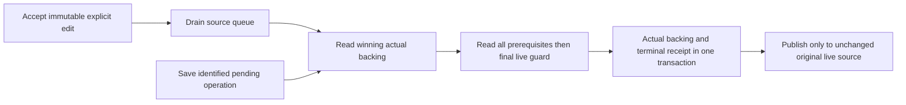

# Browser Annotation Draft Revisions Implementation Plan

> **For agentic workers:** REQUIRED SUB-SKILL: Use superpowers:subagent-driven-development to implement this plan task-by-task. Steps use checkbox (`- [ ]`) syntax for tracking.

**Goal:** Persist browser composition with one session revision, then append each annotation once to its original retained source's actual backing.

**Architecture:** Narrow the inactive repository in the existing version-4 `evener-mutation-outbox` database. Ordinary values remain separate from actual recovery rows; only the retained `ComposerSourceState` selects draft versus recovery backing. Accepted explicit edits serialize, while annotation preparation and every continuation are guarded against newer work.

**Tech Stack:** TypeScript, React, existing IndexedDB connection/transaction helpers, fake-indexeddb, Vitest, production hub/AppWire and Chrome browserguard.

**Spec:** `docs/superpowers/specs/2026-10-06-browser-annotation-draft-revisions-design.md`, approved input SHA256 `ba384b9590d3863a88fcf729fb87b147f7f42eaa0191bb81436c607e6c3e0afb`.

This amendment replaces original browser plan Task 2 and its Task 3 owner glue. Accepted original Task 1 mapping/shared contracts are reused unchanged; original UI Tasks 4–6 receive the substitutions here, and Tasks 7–8 remain.

**Status:** Written proposal only. No examples have been compiled or executed. Controller self-review, immutable dual independent written review and Jesse approval must precede implementation. Jesse authorized Sol only for this plan repair; product/probe authors remain Flash. The three paused dirty tests stay unchanged during planning.

**Notation:** `S` = `cmd/evener-hub/frontend/src`; `A` = `appwire-client/typescript`; `F` = `cmd/evener-hub/frontend`. Every new signature below is PLANNED, not an existing capability. Imports in owning tests use the named source modules and `IDBFactory` from `fake-indexeddb`, with `it`, `expect`, `vi` from `vitest`.

## Global Constraints

- “In the case of a race, latest wins is fine.” No durable owner, active pointer, claims, liveness, per-record counter, losing-draft archive or restoration UI. `MutationRecoveryRecord.version: 1` is schema only.
- Every supported ordinary/recovery change advances the same monotonic session revision in its actual transaction. Empty ordinary rows retain metadata. Namespace incarnation invalidates old tokens without resetting numeric revisions or deleting composition.
- Explicit competing edits can rebase their immutable full values. Hydration, acknowledgment, cleanup, settlement and stale destructive recovery callbacks cannot refresh an old token to authorize replacement or deletion.
- Accepted ordinary saves can finish after disposal. A closed/replaced source cannot accept a new annotation or publish into its replacement. Hidden editor unmount and Return retain the original source.
- Annotation Send requires a nonempty passage and nonblank note, preserves exact note/newlines, and causes zero send, queue, steer, session-start/resume or recovery-resend mutations. Return in the comment cannot Send.
- Preserve metadata, meaningful absent-versus-empty mentions, attachment/cursor/selection ownership and the accepted UTF-16 source mapping/reference contracts. No new durable ordinary attachment/cursor storage is promised.
- Transfer only supported localStorage drafts through `decodeSupportedComposerDraft`, before any existing durable revision. Record inspected outcomes before exact-byte cleanup. No localStorage writer after cutover, schema version bump, deleted store or second database.
- Preserve native's synchronous submission default, Reader storage and CommentSheet/ReviewSheet behavior. Marked stays 18.0.6. Native ref/evidence and exhausted three-fix cap remain deferred/untouched.
- Original browser plan Tasks 7–8 remain, subject to the later authorization: postmerge live-hub deployment is allowed only after all gates. Nothing is deployed now. Genuine-phone selection and OS keyboard still block qualification completion, merge and deployment; emulation is not proof.

## Review Focus

1. Identical/metadata-only saves and inactive recovery transitions must invalidate old guards (Tasks 1–2).
2. Typing before hydration, during insertion and before acknowledgment stays visible, while a changed current read suppresses old work before its fence commits (Tasks 2–3).
3. Same-session distinct ordinary/recovery values coexist, including attachments and absent/empty mentions, without activating literal slash prose on Return/reload (Tasks 2–4).
4. Close before guard, abort while abortable, and close after commit have different literal outcomes, with no replacement publication (Task 3).
5. Cross-file FIFO, stale expiry/reset, lost acknowledgment and recovered storage must not duplicate or resurrect operations (Task 3).



Ordinary edits drain in acceptance order even after disposal. Annotation handoff instead needs the captured original live source, reconciles it, and commits both backing and receipt together. Publication cannot undo a commit or overwrite later typing.

## Task 1: Narrow the inactive repository and session metadata

**Files:** Modify/test `A/state/mutation/pendingTurns.ts`, `pendingTurns.test.ts`, `index.ts`; `S/stores/browserDraftRepository.ts`, `browserDraftRepository.test.ts`, `localCompositionSchema.ts`, `localCompositionSchema.test.ts`. Create/test `S/stores/compositionRevision.ts`, `compositionRevision.test.ts`. Production writers remain inactive until Task 2 review.

**Interfaces:** Replace `DraftAuthorityToken` and owner/backing-counter DTOs with the following. Re-export the new types; remove `persistentRevisionAtStart`, ownership/claim/adopt/conflict APIs. Keep shared `PendingTurnsDraftPort`, `PendingTurnsStore.settleSubmittedDraft` and their synchronous native behavior unchanged.

```ts
export interface DraftSessionToken { readonly namespaceIncarnation: string; readonly sessionRevision: number }
export type DraftBackingIdentity = { readonly kind: "draft" } | { readonly kind: "recovery"; readonly recoveryId: string };
export interface DraftSettlementGuard { readonly token: DraftSessionToken; readonly backing: DraftBackingIdentity; readonly localGeneration: number }
export interface DraftSettlement { cleared: boolean; draftUnchanged: boolean; persistence: "committed" | "pending" }
// SubmittedDraft retains draftRevisionAtStart/text/skillNames/commandNames/stillOwnsEdit,
// replaces settlementGuard's type, and adds optional mentions for exact browser comparison.
export interface BrowserDraftKey { namespace: { kind: "browser"; origin: string }; sessionRef: string }
export interface StoredComposerDraft extends SkillEditorValue { key: BrowserDraftKey; token: DraftSessionToken }
export type DraftCommit = { state: "committed"; draft: StoredComposerDraft }
  | { state: "conflict"; current: StoredComposerDraft } | { state: "unavailable" };
export interface BrowserDraftRepository {
  load(key: BrowserDraftKey): Promise<StoredComposerDraft | null>;
  seedDraft(key: BrowserDraftKey, value: SkillEditorValue): Promise<DraftCommit>;
  commitEdit(key: BrowserDraftKey, expected: DraftSessionToken, value: SkillEditorValue,
    stillAuthorized: () => boolean): Promise<DraftCommit>;
  clearSubmitted(key: BrowserDraftKey, submitted: SubmittedDraft): Promise<DraftSettlement>;
  transferSupportedDrafts(namespace: BrowserDraftKey["namespace"]): Promise<{ state: "committed" | "pending" }>;
  subscribe(listener: (key: BrowserDraftKey) => void): () => void;
  close(): void;
}
export function browserDraftKey(sessionRef: string, origin = location.origin): BrowserDraftKey {
  return { namespace: { kind: "browser", origin }, sessionRef };
}
export function captureDraftSettlementGuard(row: StoredComposerDraft, backing: DraftBackingIdentity,
  localGeneration: number): DraftSettlementGuard {
  return Object.freeze({ token: Object.freeze({ ...row.token }), backing: Object.freeze({ ...backing }), localGeneration });
}
```

`createBrowserDraftRepository(options: BrowserDraftRepositoryOptions = {}): BrowserDraftRepository` keeps existing injected factory/database/storage, cleanup and diagnostic seams. Rename the `beforeCommit` operation union to the remaining writers. Preserve `cloneValue`'s explicit undefined checks and existing transaction/open/listener isolation, not owner/conflict logic.

**Transaction-local helpers (`compositionRevision.ts`):** `serializeSessionKey(key)` is the existing JSON `[kind,origin,sessionRef]`; `serializeNamespace(namespace)` is JSON `[kind,origin]`. `NamespaceRow = {namespaceKey:string, incarnation:string}`; `SessionRow = StoredComposerDraft & {serializedKey:string}`. `readSessionRow(tx,key):Promise<SessionRow|undefined>` and `readNamespaceRow(tx,namespace):Promise<NamespaceRow|undefined>` only read. `ensureSessionRow(tx,key):Promise<SessionRow>` initializes absent metadata after transfer, at revision 1. `nextSessionRow(row,value?:SkillEditorValue):SessionRow` is PURE and replaces ordinary value only when supplied; otherwise it preserves it, and increments revision by one. `putSessionRow(tx,row):IDBRequest<IDBValidKey>` only issues `put`, without reads or its own transaction. `sameSessionToken(a,b):boolean` compares incarnation and revision. These helpers are also consumed by outbox writers in Task 2 and append in Task 3.

```ts
export function nextSessionRow(row: SessionRow, value?: SkillEditorValue): SessionRow {
  const ordinary = value ?? row;
  return { serializedKey: row.serializedKey, key: row.key,
    text: ordinary.text, skillNames: [...ordinary.skillNames],
    ...(ordinary.commandNames === undefined ? {} : { commandNames: [...ordinary.commandNames] }),
    ...(ordinary.mentions === undefined ? {} : { mentions: ordinary.mentions.map(m => ({ ...m })) }),
    token: { namespaceIncarnation: row.token.namespaceIncarnation, sessionRevision: row.token.sessionRevision + 1 } };
}
```

- [ ] **Step 1: RED real two-adapter ordering, identical writes and metadata.** In `browserDraftRepository.test.ts`, adapt existing `committed` helper to the owner-free result; the following body supplies its complete definition. Both adapters share the same factory/database.

```ts
// browserDraftRepository.test.ts, alongside its existing afterEach mock cleanup:
const repositoryCleanups: (() => void)[] = [];
function closeAfterTest(close: () => void): void { repositoryCleanups.push(close); }
afterEach(() => { for (const close of repositoryCleanups.splice(0).reverse()) close(); });
function committed(result: DraftCommit): StoredComposerDraft {
  if (result.state !== "committed") throw new Error(`expected committed, got ${result.state}`);
  return result.draft;
}
it("orders overlapping CAS writes then a later explicit rebase, including identical metadata", async () => {
  const factory = new IDBFactory(), databaseName = "revision";
  const a = createBrowserDraftRepository({ indexedDB: factory, databaseName });
  closeAfterTest(() => a.close());
  const b = createBrowserDraftRepository({ indexedDB: factory, databaseName });
  closeAfterTest(() => b.close());
  const key = browserDraftKey("root", "https://hub.test");
  const base = committed(await a.seedDraft(key, { text: "/same", skillNames: ["same"], mentions: [] }));
  const results = await Promise.all([
    a.commitEdit(key, base.token, { text: "first", skillNames: [] }, () => true),
    b.commitEdit(key, base.token, { text: "second", skillNames: [] }, () => true),
  ]);
  expect(results.filter(r => r.state === "committed")).toHaveLength(1);
  expect(results.filter(r => r.state === "conflict")).toHaveLength(1);
  const current = await a.load(key); if (!current) throw new Error("missing row");
  const next = committed(await b.commitEdit(key, current.token, { text: "last", skillNames: [], mentions: [] }, () => true));
  const identical = committed(await a.commitEdit(key, next.token, next, () => true));
  const metadata = committed(await b.commitEdit(key, identical.token, { ...next, commandNames: ["plan"] }, () => true));
  expect(metadata.token.sessionRevision).toBe(next.token.sessionRevision + 2);
  expect(await a.load(key)).toMatchObject({ text: "last", commandNames: ["plan"], mentions: [] });
  const guard = captureDraftSettlementGuard(metadata, { kind: "draft" }, 7);
  metadata.token = { namespaceIncarnation: "changed", sessionRevision: 99 };
  expect(guard.token.sessionRevision).toBe(next.token.sessionRevision + 2);
  expect(Object.isFrozen(guard.token)).toBe(true);
});
```

- [ ] **Step 2: RED initialization-only transfer, exact-byte cleanup and observer safety.** Keep existing interrupted-transfer/decoder/open tests, remove losing-copy expectations. Import existing `MemoryStorage` from `S/storageTestUtils` and isolate each fixture; existing suite setup only restores mocks, not browser storage.

```ts
it("never imports over an explicit empty revision, or reimports changed legacy bytes", async () => {
  const factory = new IDBFactory(), key = browserDraftKey("root", "https://hub.test");
  const storage = new MemoryStorage();
  const repo = createBrowserDraftRepository({ indexedDB: factory, databaseName: "transfer", storage });
  closeAfterTest(() => repo.close());
  const legacy = composerDraftStorageKey("root");
  storage.setItem(legacy, JSON.stringify({ text: "imported", skillNames: [], mentions: [] }));
  expect(await repo.transferSupportedDrafts(key.namespace)).toEqual({ state: "committed" });
  const row = await repo.load(key); if (!row) throw new Error("missing import");
  committed(await repo.commitEdit(key, row.token, { text: "", skillNames: [] }, () => true));
  storage.setItem(legacy, JSON.stringify({ text: "later legacy", skillNames: [] }));
  await repo.transferSupportedDrafts(key.namespace);
  expect((await repo.load(key))?.text).toBe("");
});
it("cleanup keeps changed inspected bytes, and a listener cannot undo commit", async () => {
  const factory = new IDBFactory(), key = browserDraftKey("root", "https://hub.test");
  const storage = new MemoryStorage();
  const legacy = composerDraftStorageKey("root"), changed = '{"text":"changed","skillNames":[]}';
  storage.setItem(legacy, '{"text":"original","skillNames":[]}');
  const repo = createBrowserDraftRepository({ indexedDB: factory, databaseName: "cleanup", storage,
    beforeLegacyCleanup: () => storage.setItem(legacy, changed), onListenerDiagnostic: () => {} });
  closeAfterTest(() => repo.close());
  repo.subscribe(() => { throw new Error("observer"); });
  await repo.transferSupportedDrafts(key.namespace);
  expect(storage.getItem(legacy)).toBe(changed);
  expect((await repo.load(key))?.text).toBe("original");
});
```

- [ ] **Step 3: Run RED, then narrow existing implementation.** From `F`: `npm test -- src/stores/browserDraftRepository.test.ts src/stores/compositionRevision.test.ts src/stores/localCompositionSchema.test.ts`. From root: `make test-api-package` (shared DTO/native-default regression). Record behavioral failures separately from compile/setup failures.

`commitEdit` reads namespace and row, validates BOTH incarnations and revision, then calls `stillAuthorized` before any write. Explicit identical values still advance. `load` lazily re-tokens only incarnation in a readwrite transaction, preserving revision/value; it cannot authorize a captured old cleanup. `seedDraft` creates only absent rows. Transfer skips any durable row and previously inspected outcome, commits markers before cleanup, re-inspects changed bytes, never archives losing drafts. Keep unused stores registered at version 4.

```ts
// commitEdit's transaction body, after both reads, with key/expected/value/stillAuthorized in scope:
if (!row || !namespace) return { state: "unavailable" };
if (expected.namespaceIncarnation !== namespace.incarnation || row.token.namespaceIncarnation !== namespace.incarnation ||
    expected.sessionRevision !== row.token.sessionRevision) return { state: "conflict", current: row };
if (!stillAuthorized()) return { state: "unavailable" };
const next = nextSessionRow(row, value);
await requestResult(putSessionRow(transaction, next));
return { state: "committed", draft: next };
```

- [ ] **Step 4: GREEN and review alone.** Rerun Step 3 plus `npm test -- src/stores/mutationOutboxIndexedDB.conformance.test.ts src/stores/mutationOutboxIndexedDB.cancel.test.ts src/stores/mutationOutboxIndexedDB.stall.test.ts src/stores/mutationOutboxIndexedDB.openDiagnostic.test.ts` from `F`. Inspect staged exact owned Task 1 paths, commit `feat(composer): narrow inactive drafts to one session revision`, and get independent task review. Reject production activation here. Task 2 waits for acceptance.

## Task 2: One complete production writer cutover and guarded submission

**Files:** Modify/test `S/panes/session/composer/sourceState.ts`, `sourceState.test.ts`, `draft.ts`, `draft.test.ts`, `Composer.tsx`, `Composer.test.tsx`, `Composer.integration.test.tsx`, `queue/pendingTurnsStore.ts`, `pendingTurnsStore.test.ts`, `queue/QueueStrip.tsx`, `QueueStrip.test.tsx`; `S/stores/mutationOutboxIndexedDB.ts` and its conformance/cancel/stall/openDiagnostic suites; `S/stores/threads.ts`, `threads.retirement.test.tsx`; `S/shell/paneLifetime.ts`, `paneLifetime.test.ts`, `paneRestore.test.ts`; `S/panes/session/transcript/messages/UserMessageItem.tsx`, `UserMessageItem.test.tsx`; `S/panes/zoom/ActivityPeek.test.tsx`; `S/dev/surface-sections/composer.tsx`, `S/dev/retirementharness-entry.tsx`, `S/panes/session/testing/composerSource.ts`; `A/state/mutation/submission.ts`, `submission.test.ts`. Regression: skillDocument/SkillEditor, recoveryDraft and attachments suites. No native source changes.

**Writer census:** Cut over `sourceState` persist/edit/selection/write/clear/recovery persistence; all `draft.ts` writes and clears; pendingTurns settlement; Composer goal replacement, Send/steer/queue/drain/activation/exit; QueueStrip drain; attachment submitted cleanup; threads recovery update/discard/resend; fork seed; both dev seeds and testing source. In outbox, cover update/discard/resend/transfer, settleReceipt, settleApplied and superseded-note recovery deletion, including inactive rows. Remove localStorage writer exports and update every caller in this single reviewed integration. `draft.ts` retains decoder/legacy keys and runtime-only revision/read projection, never a durable writer.

**Interfaces:** Keep `createComposerSourceState(ref)` source-compatible by adding optional deps with production defaults. Tests inject a repository and outbox on the same factory/database. Extend the existing source, do not create another pane manager:

```ts
export interface ComposerSourceDeps { repository: BrowserDraftRepository; key: BrowserDraftKey; outbox: MutationOutboxIndexedDB }
export interface ComposerPreparation { key: BrowserDraftKey; token: DraftSessionToken; backing: DraftBackingIdentity; localGeneration: number }
// sourceState.ts additions to ComposerSourceState:
// readonly sourceId: string (runtime UUID, never an OpenPaneRecord field)
// ready(): Promise<void>; whenSettled(): Promise<void>; acceptEdit(value: SkillEditorValue): void;
// getDraftToken(): DraftSessionToken; getLocalGeneration(): number; getRuntimeBacking(): DraftBackingIdentity;
// prepareAnnotation(): Promise<ComposerPreparation | null>; ownsPreparation(p: ComposerPreparation): boolean;
// acknowledgeAnnotation(p: ComposerPreparation, token: DraftSessionToken, value: SkillEditorValue): void;
// submissionDraft(value?: SkillEditorValue): Promise<SubmittedDraft>; settleDraft(submitted: SubmittedDraft): Promise<DraftSettlement>;
export function createComposerSourceState(ref: string, deps?: ComposerSourceDeps): ComposerSourceState;
```

Production defaults share one browser repository and the EXISTING mutation runtime storage, not a second outbox instance. Export `getBrowserDraftRepository():BrowserDraftRepository` from browserDraftRepository.ts as a lazy module singleton using `createBrowserDraftRepository()`; both source defaults and Task 4 annotation ports use this SAME instance. Add `getComposerMutationStorage():Promise<MutationOutboxIndexedDB>` in `threads.ts`: obtain `requireMutationRuntime()`, await `runtime.start`, return `runtime.storage`. Default source initialization awaits this accessor; injected sources never call it. No annotation path calls enqueue or dispatch through it.

```ts
// browserDraftRepository.ts, module scope:
let browserDrafts: BrowserDraftRepository | undefined;
export function getBrowserDraftRepository(): BrowserDraftRepository {
  return browserDrafts ??= createBrowserDraftRepository();
}
```

`ready` first awaits transfer, then metadata/load. Clone every full accepted explicit value and generation at acceptance. Drain entries serially; do not drop accepted ordinary entries because disposed or newer typing exists. `whenSettled` resolves after the current drain attempt, even on storage failure; retain unsaved entries and honest pending status for a bounded later retry. Same-incarnation explicit CAS conflict rereads and rebases the full immutable entry, preserving acceptance order. A namespace fence refuses the captured stale write; it cannot silently refresh its token. A fresh deliberate edit after guarded reconciliation can supersede that pending stale value, allowing useful writing without authorizing old cleanup. Hydration/reconciliation publish only when alive and their captured local generation/backing still match. Typing before hydration queues a full explicit value and remains visible. Maintain meaningful undefined versus [] metadata; `patchSelectionText` remains for real text editing, not annotation prose.

`prepareAnnotation` drains accepted ordinary AND recovery writes, captures generation/backing, loads current session metadata and the selected existing recovery via injected outbox, reconciles the winning full value only if the capture is still current, and returns its token/backing/generation. If a queue remains unsaved, recovery is absent, source closes or capture changes, return null. `ownsPreparation` checks source alive, current generation, backing identity and token. `acknowledgeAnnotation` checks the ORIGINAL preparation (not a refreshed guard), then updates text/metadata/token; never replaces later typing, cursor or attachments. `submissionDraft(value?)` clones the supplied immutable payload value (default current source value) and captures generation/backing AT ENTRY, drains accepted saves, then captures the durable token before `perform`. If local work changed during the wait, its `stillOwnsEdit` stays false; never change the submitted text to later typing. Recovery settlement does no second durable clear; after a successful guarded resend its local publication uses captured generation/backing and the known accepted transition, not a refreshed deletion guard.

- [ ] **Step 1: RED accepted-after-dispose, late hydration and immutable metadata.** Add these to `sourceState.test.ts`. Existing paused owner assertions may now be deliberately adapted, not used as evidence.

```ts
// sourceState.test.ts, file-local cleanup, independent of Task 3's later fixture module:
const sourceCleanups: (() => void)[] = [];
afterEach(() => { for (const close of sourceCleanups.splice(0).reverse()) close(); });
it("finishes immutable accepted saves after disposal in acceptance order", async () => {
  const factory = new IDBFactory(), databaseName = "disposed", key = browserDraftKey("root", "https://hub.test");
  const repository = createBrowserDraftRepository({ indexedDB: factory, databaseName });
  sourceCleanups.push(() => repository.close());
  const outbox = new MutationOutboxIndexedDB({ indexedDB: factory, databaseName });
  sourceCleanups.push(() => outbox.close());
  const source = createComposerSourceState("root", { repository, key, outbox });
  sourceCleanups.push(() => source.dispose()); await source.ready();
  const first: SkillEditorValue = { text: "/same", skillNames: ["same"], mentions: [] };
  source.acceptEdit(first); first.skillNames.push("must-not-leak");
  await source.whenSettled();
  expect(await repository.load(key)).toMatchObject({ text: "/same", skillNames: ["same"], mentions: [] });
  source.acceptEdit({ text: "middle", skillNames: [], mentions: [] });
  source.acceptEdit({ text: "last", skillNames: [], mentions: [] }); source.dispose(); await source.whenSettled();
  expect(await repository.load(key)).toMatchObject({ text: "last", skillNames: [], mentions: [] });
  expect((await repository.load(key))?.token.sessionRevision).toBe(4);
});
it("typing before hydration and before settlement stays current", async () => {
  const factory = new IDBFactory(), databaseName = "early", key = browserDraftKey("root", "https://hub.test");
  const repository = createBrowserDraftRepository({ indexedDB: factory, databaseName });
  sourceCleanups.push(() => repository.close());
  await repository.seedDraft(key, { text: "old", skillNames: ["same"] });
  const outbox = new MutationOutboxIndexedDB({ indexedDB: factory, databaseName });
  sourceCleanups.push(() => outbox.close());
  const source = createComposerSourceState("root", { repository, key, outbox });
  sourceCleanups.push(() => source.dispose());
  source.acceptEdit({ text: "typed", skillNames: [], mentions: [] }); await source.ready(); await source.whenSettled();
  const submitted = await source.submissionDraft();
  source.acceptEdit({ text: "newer", skillNames: [], mentions: [] }); await source.whenSettled();
  expect(await source.settleDraft(submitted)).toMatchObject({ cleared: false, persistence: "committed" });
  expect(source.getSnapshot()).toMatchObject({ text: "newer", mentions: [] });
  expect(await repository.load(key)).toMatchObject({ text: "newer", mentions: [] });
});
```

- [ ] **Step 2: RED every real recovery writer in the same namespace/session.** Extract the existing mapping as a PURE function in `mutationOutboxIndexedDB.ts`; public `updateRecoveryInput` and Task 3 both use it inside their existing transaction, never call one transaction-opening method from another.

```ts
export function applyRecoveryInput(record: MutationRecoveryRecord, input: InputItem[], attachments?: MutationAttachment[],
  composerText?: string, composerMentions?: readonly ComposerMention[]): MutationRecoveryRecord {
  return { ...record, payload: { ...record.payload, input },
    optimisticDisplay: record.optimisticDisplay && typeof record.optimisticDisplay === "object"
      ? { ...record.optimisticDisplay, input } : { method: record.method, input },
    attachments: attachments ?? record.attachments, composerText: composerText ?? record.composerText,
    composerMentions: composerText === undefined ? (composerMentions ?? record.composerMentions) : composerMentions };
}
// Add optional final guard to update/resend, and optional token to discard's existing predicate.
export interface RecoveryWriteGuard { key: BrowserDraftKey; token: DraftSessionToken; stillAuthorized: () => boolean }
export interface RecoveryOrdinaryConsumption { token: DraftSessionToken; value: SkillEditorValue; stillOwnsValue: () => boolean }
// updateRecoveryInput(id,input,attachments?,composerText?,mentions?,guard?,consumeOrdinary?:RecoveryOrdinaryConsumption): Promise<MutationRecoveryRecord|undefined>
// discardRecovery(id,shouldDiscard?,guard?): Promise<boolean>
// resendRecovery(id,intent,guard?): Promise<MutationOutboxRecord|undefined>
```

Each actual recovery change includes `composerDrafts` and `annotationNamespaces` in its existing transaction. Initialize metadata after transfer before exposing a snapshot; read namespace/session/record and every allocation/uniqueness prerequisite before the final guard. Issue recovery and `nextSessionRow(row)` puts/deletes together, preserving ordinary work. Absent edit/discard/resend never upserts. Thread/queue/source update wrappers append `(guard?:RecoveryWriteGuard, consumeOrdinary?:RecoveryOrdinaryConsumption)` after mentions; discard appends guard after its existing predicate, resend appends guard after mentions. Destructive actions keep the captured guard across waits/retry. Automatic receipt settlement advances metadata only for actual deletions, with no source-liveness veto. Activation/merge consumes ordinary value only if token, full value and `stillOwnsValue()` match after all reads; use `nextSessionRow(row,{text:"",skillNames:[]})` for that conditional clear, otherwise `nextSessionRow(row)`. No subsequent `clearPersistedDraft` transaction remains.

```ts
// conformance.test.ts, alongside existing real store fixtures:
const recoveryCleanups: (() => void)[] = [];
afterEach(() => { for (const close of recoveryCleanups.splice(0).reverse()) close(); });
it.each(["update", "discard", "resend", "receipt", "applied"] as const)("%s advances one revision and preserves ordinary", async action => {
  const factory = new IDBFactory(), databaseName = `recovery-${action}`, key = browserDraftKey("root", location.origin);
  const drafts = createBrowserDraftRepository({ indexedDB: factory, databaseName });
  recoveryCleanups.push(() => drafts.close());
  await drafts.seedDraft(key, { text: "ordinary", skillNames: [], mentions: [] });
  let mutationNumber = 0;
  const outbox = new MutationOutboxIndexedDB({ indexedDB: factory, databaseName, createMutationId: () => `mutation-${++mutationNumber}`, now: () => 100 });
  recoveryCleanups.push(() => outbox.close());
  const intent: MutationIntent = { targetRef: "root", method: "turn/start", payload: { input: [{ type: "text", text: "recovery" }] },
    optimisticDisplay: { method: "turn/start", input: [{ type: "text", text: "recovery" }] }, attachments: [], composerText: "recovery" };
  const sent = await outbox.enqueueIntent(intent), beforeTransfer = await drafts.load(key);
  await outbox.transferToRecovery(sent.clientMutationId, "rejected");
  const before = await drafts.load(key); if (!before) throw new Error("missing metadata");
  expect(before.token.sessionRevision).toBe((beforeTransfer?.token.sessionRevision ?? 0) + 1);
  expect((await outbox.getRecovery(sent.clientMutationId))?.version).toBe(1); // schema, not an edit counter
  if (action === "update") await outbox.updateRecoveryInput(sent.clientMutationId, [{ type: "text", text: "edited" }], [], "edited", []);
  if (action === "discard") await outbox.discardRecovery(sent.clientMutationId);
  if (action === "resend") await outbox.resendRecovery(sent.clientMutationId, intent);
  if (action === "receipt") await outbox.settleReceipt(sent.clientMutationId, "applied");
  if (action === "applied") await outbox.settleApplied(sent.clientMutationId);
  expect(await drafts.load(key)).toMatchObject({ text: "ordinary", mentions: [], token: { sessionRevision: before.token.sessionRevision + 1 } });
  if (action !== "update") expect(await outbox.updateRecoveryInput(sent.clientMutationId, [], [], "resurrect")).toBeUndefined();
});
```

Also adapt existing Composer cases 632–711: ordinary `/goal` coexists with same-session recovery; merge goes INTO `currentRecoveryId ?? selectedId`, not the other direction; delayed redundant/empty discard after goal replacement cannot delete newer recovery. Add literal revision assertions to the existing superseded-note cleanup/transfer tests. Every existing source recovery generation/replacement guard remains runtime-only.

- [ ] **Step 3: RED/GREEN asynchronous settlement without changing native ports.** Add ONLY an optional shared `settleDraft?: (ref:string,submitted:SubmittedDraft)=>Promise<MutationSubmissionCommitted>` to `MutationSubmissionOptions`. Its result stays exactly `{cleared,draftUnchanged}`. At the shared existing settlement site, branch on the optional hook; no await or catch is added to native's default branch. For browser hook failures return conservative unchanged=false; observer/refresh failure after acceptance must not reject the accepted browser action. The only `onFailure` path remains `perform()` rejection.

```ts
// submission.ts, replacing only the accepted settlement block inside the existing try/finally:
if (epoch === fence.epoch()) {
  if (opts.settleDraft) {
    let committed: MutationSubmissionCommitted;
    try { committed = await opts.settleDraft(opts.ref, opts); }
    catch { committed = { cleared: false, draftUnchanged: false }; }
    if (epoch === fence.epoch()) { try { onCommitted?.(committed); } catch { /* accepted input remains accepted */ } }
  } else onCommitted?.(store.settleSubmittedDraft(opts.ref, opts));
}
// In finally keep epoch-guarded endSubmission. Browser-only refresh observer faults are isolated:
// if (opts.settleDraft) { try { refresh(opts.ref); } catch {} } else refresh(opts.ref);
```

Browser wrapper `SubmitWithPendingTrackingOptions` adds `source: ComposerSourceState` and `mentions?:readonly ComposerMention[]`; ALL Composer and QueueStrip send/steer/queue/drain callers pass the original source and submitted metadata. It awaits `source.submissionDraft(payloadValue)` before `runSubmission`; `perform` sends that SAME immutable payload, not current source text after the wait. Bind persistence in a PER-CALL closure. Preserve existing listener arguments and append optional sixth `{submitted:SubmittedDraft;settlement:DraftSettlement}`; source listeners check that captured guard before clearing text/exact submitted attachments. A pending cleanup retries only cleanup with its original guard. Keep the shared draft port intact. Browser never uses synchronous settlement: retain `draft.ts`'s runtime revision map and a structured in-memory read projection updated by source/committed loads, with no durable writes; bind its read methods, and bind `clearDraft` to throw `Error("Browser settlement requires settleDraft")`. This is an intentionally unsupported synchronous browser capability, not a fallback writer. Every browser wrapper installs the async hook; native's port is unchanged.

```ts
// pendingTurnsStore.ts, inside the wrapper with opts/perform/runSubmission/listeners in scope:
const submitted = await opts.source.submissionDraft({ text: opts.text, skillNames: [...(opts.skillNames ?? [])],
  ...(opts.commandNames === undefined ? {} : { commandNames: [...opts.commandNames] }),
  ...(opts.mentions === undefined ? {} : { mentions: opts.mentions.map(m => ({ ...m })) }) });
let settlement: DraftSettlement = { cleared: false, draftUnchanged: false, persistence: "pending" };
return runSubmission({ ...submitted, ref: opts.ref, onFailure: opts.onFailure,
  settleDraft: async (_ref, captured) => {
    try { settlement = await opts.source.settleDraft(captured); } catch { /* retain pending cleanup */ }
    return { cleared: settlement.cleared, draftUnchanged: settlement.draftUnchanged };
  } }, perform, ({ cleared, draftUnchanged }) => {
  if (!cleared && !opts.recoveryId && settlement.persistence !== "pending") return;
  for (const listener of submissionCommittedListeners) {
    try { listener(opts.ref, submitted.text, submitted.skillNames,
      opts.recoveryId ? { clientMutationId: opts.recoveryId, draftUnchanged, attachments: opts.attachments ?? [] } : undefined,
      submitted.commandNames, { submitted, settlement }); } catch { /* observer cannot relabel accepted input */ }
  }
});
```

`clearSubmitted` reads row/namespace, compares frozen incarnation/revision/backing, full text/skills/commands/mentions and `stillOwnsEdit` AFTER all reads, then writes empty ordinary value+increment. Recovery backing returns no durable clear. Storage fault returns pending, never successful clear. The source publishes cleanup only if its captured local generation/backing and exact attachment identities still match.

```ts
// submission.test.ts uses its existing testPendingTurnsStore import from ./testing.
test("browser settlement and observer faults never reject accepted input", async () => {
  const store = testPendingTurnsStore(), fence = createMutationProjectionFence();
  const { track } = trackingSpy();
  const failure = vi.fn(), perform = vi.fn(async () => {}), refresh = vi.fn();
  const notify = vi.fn(() => { throw new Error("observer"); });
  await expect(submitWithPendingTracking(store, fence, track, { ref: "root", text: "sent", skillNames: [],
    draftRevisionAtStart: 0, onFailure: failure, settleDraft: async () => { throw new Error("storage"); } },
    perform, refresh, notify)).resolves.toBeUndefined();
  expect(perform).toHaveBeenCalledTimes(1); expect(failure).not.toHaveBeenCalled();
  expect(notify).toHaveBeenCalledWith({ cleared: false, draftUnchanged: false });
});
```

- [ ] **Step 4: Run RED then GREEN for the complete cutover.** From `F`: `npm test -- src/panes/session/composer/sourceState.test.ts src/panes/session/composer/draft.test.ts src/panes/session/composer/queue/pendingTurnsStore.test.ts src/panes/session/composer/Composer.test.tsx src/panes/session/composer/Composer.integration.test.tsx src/panes/session/composer/queue/QueueStrip.test.tsx src/shell/paneLifetime.test.ts src/shell/paneRestore.test.ts src/panes/session/transcript/messages/UserMessageItem.test.tsx src/panes/zoom/ActivityPeek.test.tsx src/stores/threads.retirement.test.tsx src/stores/mutationOutboxIndexedDB.conformance.test.ts src/stores/mutationOutboxIndexedDB.cancel.test.ts src/stores/mutationOutboxIndexedDB.stall.test.ts src/stores/mutationOutboxIndexedDB.openDiagnostic.test.ts`. Then root `make test-api-package` and `make test-web`. Retain clean close/reopen structured hydration tests; zero-RPC proof belongs to Task 4's installed real journey, not an empty outbox alone.
- [ ] **Step 5: Commit and review.** Stage only the named Task 2 paths after inspecting the diff; commit `feat(composer): cut browser writers over to session revisions`. Reject any mixed backend, second cleanup, postaccept failure relabel, durable recovery counter/pointer or native change. Task 3 waits for acceptance.

## Task 3: Actual-backing atomic append, ordering, expiry and recovery

**Files:** Create/test `S/stores/documentAnnotationIndexedDB.ts`, `documentAnnotationIndexedDB.test.ts`, `documentAnnotationRuntime.ts`, `documentAnnotationRuntime.test.ts`, `S/panes/doc/testing/annotationRepositoryFixtures.ts`. Modify/test browserDraftRepository/localCompositionSchema/sourceState and their tests, plus `S/panes/session/composer/skillDocument.ts`/`skillDocument.test.ts` and `SkillEditor.test.tsx` for literal append/Return/reload. Preservation: `S/stores/threads.sessionCache.test.ts`, `S/panes/settings/sections/sessionCacheRow.test.tsx`.

**Interfaces:** Reuse shared `DocumentKey`, `PreparedAnnotation`, `DocumentAnnotationRepository`, `HandoffResult`, `ExpiryReceipt`, `AnnotationRetryReason` unchanged. `handoff(key:DocumentKey,operationId:string):Promise<HandoffResult>` is browser-only; every runtime/UI/test call supplies the document key WITH path. `BrowserDraftKey` is never substituted. Options inject `drafts:BrowserDraftRepository` on the SAME factory/database as annotations and expose `targetFor(destination:DestinationProvenance,key:DocumentKey):ComposerSourceState|null`, `beforeFinalGuard?:()=>void`, `beforeAbortableCompletion?:()=>void`, `afterCommit?:()=>void`, and existing-style `beforeCommit?:(operation:"acceptRead"|"save"|"expiry"|"deleteExpiry"|"reset")=>void`. The three handoff hooks never fire during save/fixture creation. Also expose `resetOwnedNamespace(namespace,expectedIncarnation):Promise<{committed:boolean;incarnation:string}>`, `subscribe(key,listener):()=>void`, `close():void`.

```ts
export type AnnotationReadBoundary = { phase: "begin-read-issued"; key: DocumentKey }
  | { phase: "ticket-remembered"; ticket: ReadTicket };
export interface DocumentAnnotationOptions {
  indexedDB?: IDBFactory; databaseName?: string; drafts: BrowserDraftRepository;
  targetFor(destination: DestinationProvenance, key: DocumentKey): ComposerSourceState | null;
  beforeFinalGuard?: () => void; beforeAbortableCompletion?: () => void; afterCommit?: () => void;
  onAppendReadsIssued?: () => void; // synchronous, after issuing IDB prerequisites, never awaited
  onReadBoundary?: (event: AnnotationReadBoundary) => void; // synchronous observation, no transaction holds
  beforeExpiryFence?: (ticket: ReadTicket) => Promise<void>; // ONLY after validation transaction completes
  onStorageSuccess?: () => void; // after completed authority operations, never inside a transaction
  beforeCommit?: (operation: "acceptRead" | "save" | "expiry" | "deleteExpiry" | "reset") => void;
}
export interface BrowserAnnotationRetryOutcome { pending: boolean }
export interface BrowserDocumentAnnotationRepository extends DocumentAnnotationRepository {
  handoff(key: DocumentKey, operationId: string): Promise<HandoffResult>;
  retryPendingWithOutcome(reason: AnnotationRetryReason): Promise<BrowserAnnotationRetryOutcome>;
  resetOwnedNamespace(namespace: BrowserDraftKey["namespace"], expectedIncarnation: string): Promise<{ committed: boolean; incarnation: string }>;
  subscribe(key: DocumentKey, listener: () => void): () => void; close(): void;
}
export function createDocumentAnnotationRepository(options: DocumentAnnotationOptions): BrowserDocumentAnnotationRepository;
```

**Persisted annotation rows:** Define these in `localCompositionSchema.ts`, without changing version 4/keyPaths. Reuse JSON namespace keys; native namespace encoding uses `["native",hubId]`. `documentKey` JSON is `[kind,origin-or-hubId,sessionRef,path]`; operation key JSON is `[kind,origin-or-hubId,operationId]`; expiry key JSON is `[serializedDocumentKey,epoch]`. Export `annotationOperationKey(namespace,id):string`, `annotationDocumentKey(key):string`, `annotationExpiryKey(documentKey,epoch):string` from the annotation adapter. No raw operationId lookups.

```ts
export interface AnnotationHeadRow { documentKey: string; namespaceIncarnation: string; epoch: string; headRevision: number;
  readGeneration: number; displayedSnapshotId: string; evidenceKey: string }
export interface AnnotationEvidenceRow { evidenceKey: string; documentKey: string; epoch: string; content: DocFileContent }
export interface AnnotationPayloadRow { payloadKey: string; documentKey: string; epoch: string; operation: PreparedAnnotation }
export interface AnnotationSequenceRow { documentKey: string; lastSequence: number }
// annotationSequences keyPath is historically "documentKey". For this store ONLY its value
// is serializeSessionKey(browserDraftKey), not a per-file key. No schema migration needed.
export type AnnotationOperationRow = {
  operationKey: string; namespaceKey: string; namespaceIncarnation: string; documentKey: string;
  sessionKey: string; sessionSequence: number; operationId: string; epoch: string;
} & ({ state: "pending"; destination: DestinationProvenance; payloadKey: string }
  | { state: "applied"; draftRevision: number } | { state: "cancelled" });
export interface AnnotationExpiryRow { expiryKey: string; receipt: ExpiryReceipt }
export interface AppendAnnotationInput { operationKey: string; document: DocumentKey; preparation: ComposerPreparation;
  sourceId: string; stillOwnsEdit: () => boolean; documentStillEligible: () => boolean;
  onAppendReadsIssued?: () => void; beforeFinalGuard?: () => void; beforeAbortableCompletion?: () => void }
export type AppendAnnotationResult = Exclude<HandoffResult, { state: "applied" }>
  | { state: "applied"; draftRevision: number; token: DraftSessionToken; value: SkillEditorValue };
// BrowserDraftRepository adds appendAnnotation(input:AppendAnnotationInput):Promise<AppendAnnotationResult>.
```

`saveAnnotation` validates genuine accepted lease/head/incarnation and source evidence, stores payload+full provenance+pending operation, and allocates session-wide sequence in one transaction. `payloadKey` equals serialized `operationKey`, so listing an applied operation can find its still-unexpired payload without retaining provenance on the minimal terminal receipt. Duplicate ID returns the original receipt without allocating or replacing payload; reject mismatched duplicate payload while its payload exists. Terminal duplicate callbacks cannot recreate expired/reset payload. Read all earlier pending operations for that SESSION, not a guessed per-file pending pointer. An expiry fence cancels all that epoch's pending operations in its own transaction, so applied/cancelled/fenced operations cannot block FIFO. Other namespaces and sessions never block.

- [ ] **Step 1: Author complete real fixtures, then RED same-session distinct backing tests.** Fixtures export the following bodies. Use real enqueue/transfer to construct a valid complete recovery record and revision; it is storage setup, not resend or transport. `MutationAttachment` contains Blob, not data; `buildInput` takes staged attachment data. All reads use the same injected outbox/factory/database.

```ts
const fixtureDisposers: (() => void)[] = [];
export function cleanupAfterTest(dispose: () => void): void { fixtureDisposers.push(dispose); }
afterEach(() => { for (const dispose of fixtureDisposers.splice(0).reverse()) dispose(); });
export function docContent(text: string, revision?: string, truncated = false): DocFileContent {
  return { text, revision, truncated, binary: false, mediaType: "text/markdown", sizeBytes: new TextEncoder().encode(text).byteLength };
}
export async function rowsForTests<T>(factory: IDBFactory, databaseName: string, store: string): Promise<T[]> {
  const database = await new Promise<IDBDatabase>((resolve, reject) => {
    const open = factory.open(databaseName, LOCAL_COMPOSITION_DATABASE_VERSION);
    open.onsuccess = () => resolve(open.result); open.onerror = () => reject(open.error);
  });
  try { const tx = database.transaction(store, "readonly"), completed = transactionCompletion(tx);
    const rows = await requestResult<T[]>(tx.objectStore(store).getAll()); await completed; return rows;
  } finally { database.close(); }
}
export async function acceptedOperation(repo: DocumentAnnotationRepository, key: DocumentKey, operationId: string,
  note: string, destination: DestinationProvenance, revision = "rev-A"): Promise<PreparedAnnotation> {
  const read = await repo.acceptRead(await repo.beginRead(key), docContent(SOURCE, revision));
  if (read.state !== "accepted") throw new Error("read not accepted");
  return { operationId, lease: read.lease, note, destination,
    capture: { evidence: { wholeRevision: revision, fingerprint: displayedFingerprint(SOURCE, false) }, sourceRange: FIRST,
      start: { line: 1, column: 19 }, endInclusive: { line: 1, column: 22 }, selectedRenderedText: "same",
      contextBefore: "First occurrence: ", contextAfter: "\n\nOther context for a second occurrence is nearby: same\n",
      mappingId: "map-A", displayedSnapshotId: read.lease.displayedSnapshotId } };
}
export async function fixture(databaseName: string, hooks: Partial<Pick<DocumentAnnotationOptions,
  "beforeFinalGuard" | "beforeAbortableCompletion" | "afterCommit" | "beforeCommit" | "onAppendReadsIssued" |
  "onReadBoundary" | "beforeExpiryFence" | "onStorageSuccess">> = {}) {
  const factory = new IDBFactory(), key = browserDraftKey("root", location.origin);
  const document: DocumentKey = { ...key, path: "NOTES.md" };
  const drafts = createBrowserDraftRepository({ indexedDB: factory, databaseName });
  cleanupAfterTest(() => drafts.close());
  await drafts.seedDraft(key, { text: "ordinary /same", skillNames: ["same"], mentions: [{ kind: "skill", name: "same", offset: 9 }] });
  const outbox = new MutationOutboxIndexedDB({ indexedDB: factory, databaseName, createMutationId: () => "rec-1",
    createPresentationId: () => "image-1", now: () => 100 });
  cleanupAfterTest(() => outbox.close());
  const staged = [{ marker: 1, name: "one.png", mediaType: "image/png", data: "AQ==" }];
  const input = buildInput("recovery /plan [image 1]", staged, [], ["plan"], [{ kind: "command", name: "plan", offset: 9 }]);
  const sent = await outbox.enqueueIntent({ targetRef: "root", method: "turn/start", payload: { input },
    optimisticDisplay: { method: "turn/start", input }, composerText: "recovery /plan [image 1]",
    composerMentions: [{ kind: "command", name: "plan", offset: 9 }],
    attachments: [{ presentationId: "image-1", marker: 1, name: "one.png", mediaType: "image/png", blob: new Blob([new Uint8Array([1])]) }] });
  await outbox.transferToRecovery(sent.clientMutationId, "rejected", "fixture rejection");
  const source = createComposerSourceState("root", { repository: drafts, key, outbox });
  cleanupAfterTest(() => source.dispose()); await source.ready();
  const destination: DestinationProvenance = { kind: "browser-origin", paneId: "pane-A", compositionOwnerId: source.sourceId };
  const repo = createDocumentAnnotationRepository({ indexedDB: factory, databaseName, drafts, ...hooks,
    targetFor: (origin, doc) => origin.kind === "browser-origin" && origin.compositionOwnerId === source.sourceId &&
      origin.paneId === "pane-A" && doc.sessionRef === key.sessionRef && doc.namespace.kind === "browser" &&
      doc.namespace.origin === key.namespace.origin && source.alive ? source : null });
  cleanupAfterTest(() => repo.close());
  const operation = await acceptedOperation(repo, document, "op-1", "Keep this scope.", destination);
  await repo.saveAnnotation(operation);
  return { factory, databaseName, key, document, drafts, outbox, source, destination, repo, operation,
    operationKey: annotationOperationKey(document.namespace, "op-1") };
}
```

Imports: SOURCE/FIRST/REFERENCE/APPENDED from existing `annotationFixtures.ts`; actual types/buildInput/displayedFingerprint from `@evener/appwire-client`; mutation types from `S/stores/mutationOutbox`; requestResult/transactionCompletion/tryAbortTransaction from `S/stores/idbConnection`; store constants/version from `localCompositionSchema`; afterEach from vitest; other producers from their named Task 1–3 modules. `fixture` has no implicit default factory in any read. Cleanup registration closes connections and disposes sources even after a failed assertion.

```ts
it.each(["draft", "recovery"] as const)("appends only to %s backing in the SAME session", async backing => {
  const f = await fixture(`append-${backing}`);
  if (backing === "recovery") f.source.setActiveRecoveryId("rec-1"); // select only, do not merge/consume ordinary
  const beforeOrdinary = await f.drafts.load(f.key), beforeRecovery = await f.outbox.getRecovery("rec-1");
  expect((await f.repo.handoff(f.document, "op-1")).state).toBe("applied");
  const ordinary = await f.drafts.load(f.key), recovery = await f.outbox.getRecovery("rec-1");
  if (backing === "draft") {
    expect(ordinary?.text).toBe("ordinary /same\n\n" + REFERENCE);
    expect(recovery).toEqual(beforeRecovery);
  } else {
    expect(ordinary).toMatchObject({ text: "ordinary /same", skillNames: ["same"], mentions: [{ kind: "skill", name: "same", offset: 9 }] });
    expect(recovery?.composerText).toBe("recovery /plan [image 1]\n\n" + REFERENCE);
    expect(recovery?.composerMentions).toEqual([{ kind: "command", name: "plan", offset: 9 }]);
    expect(recovery?.attachments).toEqual(beforeRecovery?.attachments);
    expect(recovery?.payload.input).toEqual([
      { type: "text", text: "recovery /plan [image 1]\n\n" + REFERENCE, mentions: [{ kind: "command", name: "plan", offset: 9 }] },
      { type: "image", mediaType: "image/png", data: "AQ==", name: "one.png" }, { type: "command", name: "plan" }]);
    expect(recovery?.optimisticDisplay).toEqual({ method: "turn/start", input: recovery?.payload.input });
  }
  expect(ordinary?.token.sessionRevision).toBe((beforeOrdinary?.token.sessionRevision ?? 0) + 1);
  expect((await f.repo.handoff(f.document, "op-1")).state).toBe("already-applied");
});
it("does not recreate missing recovery", async () => {
  const f = await fixture("absent"); f.source.setActiveRecoveryId("rec-1"); await f.outbox.discardRecovery("rec-1");
  expect((await f.repo.handoff(f.document, "op-1")).state).toBe("pending");
  expect(await f.outbox.getRecovery("rec-1")).toBeUndefined();
  expect((await f.drafts.load(f.key))?.text).toBe("ordinary /same");
});
it.each([undefined, []] as (ComposerMention[] | undefined)[])("preserves meaningful mention absence/emptiness", async mentions => {
  const f = await fixture(`mentions-${mentions === undefined ? "absent" : "empty"}`);
  await f.outbox.updateRecoveryInput("rec-1", buildInput("recovery", [], [], [], mentions), [], "recovery", mentions);
  f.source.setActiveRecoveryId("rec-1"); await f.repo.handoff(f.document, "op-1");
  expect((await f.outbox.getRecovery("rec-1"))?.composerMentions).toEqual(mentions);
});
```

- [ ] **Step 2: Run RED, implement the atomic seam and handoff.** From `F`: `npm test -- src/stores/documentAnnotationIndexedDB.test.ts src/stores/documentAnnotationRuntime.test.ts src/stores/browserDraftRepository.test.ts src/panes/session/composer/sourceState.test.ts`.

`handoff` first reads the serialized receipt: applied/cancelled precede ANY new-work eligibility. Missing/reset operation returns cancelled; storage fault returns pending/owner-unavailable. For a pending operation, capture its ORIGINAL document/incarnation/epoch and `documentStillEligible` below, check it before source lookup and after prepareAnnotation, then pass it beside `stillOwnsEdit:()=>source.ownsPreparation(preparation)` to appendAnnotation. Never refresh either capture. Resolve only full provenance against the original live source; no durable-row/focus discovery. Map unavailable backing to existing owner-unavailable. An uncertain outcome rereads receipt before append; afterCommit/ack faults cannot relabel a known commit.

**Immediate suppression (`documentAnnotationIndexedDB.ts`):** Reuse the adapter's runtime accepted-source/current-ticket memory needed by beginRead/acceptRead. The entry is `{ticket:ReadTicket, accepted?:{lease:AcceptedSourceLease,content:DocFileContent}}`, keyed by annotationDocumentKey; beginRead remembers its completed current ticket and acceptRead remembers a completed acceptance. Keep suppression in the SAME repository instance, never in ComposerSourceState or a new durable counter. This block runs at acceptRead ENTRY, BEFORE its first await, for a locally current ticket; the durable path still validates the ticket before advancing any head/fence. A provisional suppression from a subsequently stale ticket is removed only if it is still that ticket's entry. Confirm a current changed read before attempting its durable fence, so failed fences and later reversion cannot unsuppress it. Reset suppresses affected old leases before its first await as well.

**Bounded transition argument:** Entry transitions apply only to a locally current changed read of the original accepted lease. Validation results come from actual durable ticket checks, never a caller-supplied flag. “Own” below means both the captured epoch identity and requestId still match.

| Boundary and existing entry | Required transition |
|---|---|
| Changed-read entry, no suppression | Install `{requestId:ticket.requestId, confirmed:false}` and retain this invocation's provisional epoch identity. |
| Changed-read entry, unconfirmed older ticket | Transfer provisional ownership to the locally current ticket, replacing requestId and retaining its provisional identity. |
| Changed-read entry, confirmed suppression | Keep the confirmed entry unchanged, do not acquire provisional ownership. No later read or source reversion makes this old epoch eligible again. |
| Current durable validation, still owns provisional entry | Confirm the entry BEFORE scheduling its expiry fence. A pending/failed fence cannot release suppression. |
| Stale durable validation, still owns unconfirmed entry | Delete only that invocation's entry, so stale-only reads do not permanently suppress valid work. |
| Either validation, newer requestId owns entry or no provisional identity | No change. An older stale/current callback cannot delete or confirm a newer ticket's suppression. |
| Stale validation, confirmed entry | No deletion, including a matching requestId. Confirmation is irreversible for this old lease. |

Thus T2 takes an unconfirmed T1 entry at synchronous entry; stale T1 then fails the requestId comparison, and current T2 confirms its own entry even if its fence fails. An actually stale-only T1 still removes its own unconfirmed entry. Terminal applied receipts remain authoritative before all new-work eligibility checks.

```ts
// Adapter-local declarations, not persisted rows:
const readStates = new Map<string, { ticket: ReadTicket;
  accepted?: { lease: AcceptedSourceLease; content: DocFileContent } }>();
const suppressedEpochs = new Map<string, { requestId: string; confirmed: boolean }>();
function epochIdentity(lease: AcceptedSourceLease): string {
  return JSON.stringify([annotationDocumentKey(lease.key), lease.namespaceIncarnation, lease.epoch]);
}
// acceptRead entry, with readStates/ticket/content in scope as declared above:
const remembered = readStates.get(annotationDocumentKey(ticket.key));
const previous = remembered?.accepted;
let provisional: string | undefined;
if (remembered?.ticket.requestId === ticket.requestId && previous && compareDisplayedSources(
  { source: previous.content.text, evidence: { wholeRevision: previous.content.revision,
    fingerprint: displayedFingerprint(previous.content.text, previous.content.truncated) } },
  { source: content.text, evidence: { wholeRevision: content.revision,
    fingerprint: displayedFingerprint(content.text, content.truncated) } },
).changed) {
  const identity = epochIdentity(previous.lease);
  const entry = suppressedEpochs.get(identity);
  if (!entry?.confirmed) { // absent OR unconfirmed older ticket, never transfer a confirmed entry
    suppressedEpochs.set(identity, { requestId: ticket.requestId, confirmed: false }); provisional = identity;
  }
}
// After actual durable ticket validation, BEFORE attempting the fence:
function finishTicketValidation(current: boolean): void {
  if (!provisional) return;
  const entry = suppressedEpochs.get(provisional);
  if (entry?.requestId !== ticket.requestId) return;
  if (current) entry.confirmed = true;
  else if (!entry.confirmed) suppressedEpochs.delete(provisional);
}
// handoff, after receipt terminal checks, with the loaded pending payload in scope:
const originalLease = structuredClone(payload.operation.lease);
const documentStillEligible = () => !suppressedEpochs.has(epochIdentity(originalLease));
```

Call finishTicketValidation with the real validation result, not a test boolean. A failed fence leaves confirmed suppression and pending expiry for retry. `onAppendReadsIssued?:()=>void` is a synchronous test observation after the append's IDB requests are issued. It may START a real acceptRead but must never await it, start a timer hold or wait for a fence inside that transaction. The new fence queues behind the append; immediate suppression reaches its final guard without deadlock. Durable head/expiry validation still protects other adapters and process restarts. Receipt checks still run before either predicate.

**Expiry regression observation sites, owned by `documentAnnotationIndexedDB.ts`:** `onReadBoundary` orders two genuine tickets without supplying validation outcomes. `beforeExpiryFence` observes a current changed read only after its validation transaction has COMPLETED and its suppression is confirmed; no IDB transaction is open while this hook is awaited. It delays scheduling the NEW fence, not completion of an active transaction. The test awaits real handoff/storage reads there, never a timer, transport, editor or queued fence. Production omits both hooks.

```ts
// beginRead(key), within its actual durable transaction body, immediately after queuing
// the existing namespace/head request prerequisites, BEFORE awaiting their results:
options.onReadBoundary?.({ phase: "begin-read-issued", key }); // START operations only, never await callback
// beginRead, AFTER the runner has awaited transactionCompletion and returned the genuine ticket,
// in the SAME synchronous continuation that remembers it, BEFORE resolving beginRead to its caller:
const documentKey = annotationDocumentKey(ticket.key);
readStates.set(documentKey, { ticket, accepted: readStates.get(documentKey)?.accepted });
options.onReadBoundary?.({ phase: "ticket-remembered", ticket });
// acceptRead's current-changed branch, AFTER real validation/transactionCompletion and
// finishTicketValidation(true), with pending expiry retained, BEFORE opening the fence transaction:
await options.beforeExpiryFence?.(ticket);
```

Keep `finishTicketValidation(false)` on the actual stale-result branch and return `stale-ticket` without opening a fence. At the second hook, T1's validation is queued behind T2's begin transaction and cannot have finished before synchronous T2 entry. Its later stale result cannot clear T2's transferred entry. The outside-transaction fence observation then lets the owning regression check an old handoff while persistence is genuinely pending. The unchanged append body below still checks the immutable document predicate after every prerequisite/construction and before any writes.

Append transaction scope is `composerDrafts`, `recovery`, `annotationOperations`, `annotationHeads`, `annotationEvidence`, `annotationPayloads`, `annotationSequences`, `annotationExpiry`, `annotationNamespaces`. No editor/transport/timer await inside. Below is the complete load-bearing transaction BODY; `transaction`, `input` and its stores are supplied by the existing repository transaction runner, which waits for completion and aborts the WHOLE transaction on body failure.

```ts
const operations = transaction.objectStore(ANNOTATION_OPERATIONS_STORE);
const operation = await requestResult<AnnotationOperationRow | undefined>(operations.get(input.operationKey));
if (!operation) return { state: "cancelled" };
if (operation.state === "applied") return { state: "already-applied", draftRevision: operation.draftRevision };
if (operation.state === "cancelled") return { state: "cancelled" };
const p = input.preparation, documentKey = annotationDocumentKey(input.document);
const reads = Promise.all([
  readNamespaceRow(transaction, p.key.namespace), readSessionRow(transaction, p.key),
  requestResult<AnnotationHeadRow | undefined>(transaction.objectStore(ANNOTATION_HEADS_STORE).get(documentKey)),
  requestResult<AnnotationPayloadRow | undefined>(transaction.objectStore(ANNOTATION_PAYLOADS_STORE).get(operation.payloadKey)),
  requestResult<AnnotationExpiryRow | undefined>(transaction.objectStore(ANNOTATION_EXPIRY_STORE).get(annotationExpiryKey(documentKey, operation.epoch))),
  requestResult<AnnotationOperationRow[]>(operations.getAll()),
  p.backing.kind === "recovery" ? requestResult<MutationRecoveryRecord | undefined>(transaction.objectStore(MUTATION_RECOVERY_STORE).get(p.backing.recoveryId)) : Promise.resolve(undefined),
]);
input.onAppendReadsIssued?.(); // no wait, requests are outstanding and the transaction stays unchanged
const [namespace, row, head, payload, expiry, allOperations, recovery] = await reads;
if (!namespace || !head || !payload || expiry || operation.documentKey !== documentKey ||
    operation.sessionKey !== serializeSessionKey(p.key) || operation.namespaceIncarnation !== namespace.incarnation ||
    head.namespaceIncarnation !== namespace.incarnation || head.epoch !== operation.epoch || payload.epoch !== operation.epoch ||
    input.document.namespace.kind !== "browser" || input.document.namespace.origin !== p.key.namespace.origin ||
    input.document.sessionRef !== p.key.sessionRef || operation.destination.kind !== "browser-origin" ||
    operation.destination.compositionOwnerId !== input.sourceId) return { state: "cancelled" };
if (allOperations.some(o => o.sessionKey === operation.sessionKey && o.namespaceIncarnation === namespace.incarnation &&
    o.state === "pending" && o.sessionSequence < operation.sessionSequence)) return { state: "pending", reason: "dirty-draft" };
if (!row || row.token.namespaceIncarnation !== namespace.incarnation || !sameSessionToken(row.token, p.token))
  return { state: "pending", reason: "revision-conflict" };
if (p.backing.kind === "recovery" && (!recovery || recovery.targetRef !== p.key.sessionRef))
  return { state: "pending", reason: "owner-unavailable" };
const reference = formatAnnotationReference(payload.operation.capture, input.document.path, payload.operation.note);
let value: SkillEditorValue, nextRecovery: MutationRecoveryRecord | undefined;
if (recovery && p.backing.kind === "recovery") {
  const current = recoveryComposerDraft(recovery);
  const next = appendLiteralReference(current, reference);
  // Spread retains REQUIRED PendingAttachment[] and metadata, not a narrowed SkillEditorValue reconstruction.
  nextRecovery = applyRecoveryInput(recovery, buildInput(next.text, next.attachments, next.skillNames, next.commandNames, next.mentions),
    recovery.attachments, next.text, next.mentions);
  value = next;
} else { value = appendLiteralReference(row, reference); }
const nextRow = nextSessionRow(row, p.backing.kind === "draft" ? value : undefined);
// ALL asynchronous prerequisites and construction precede this FINAL guard. No helper below reads again.
input.beforeFinalGuard?.();
if (!input.documentStillEligible()) return { state: "cancelled" }; // no writes, durable fence may still be pending
if (!input.stillOwnsEdit()) return { state: "pending", reason: "owner-unavailable" };
const writes: Promise<unknown>[] = [requestResult(putSessionRow(transaction, nextRow))];
if (nextRecovery) writes.push(requestResult(transaction.objectStore(MUTATION_RECOVERY_STORE).put(nextRecovery)));
const { destination: _destination, payloadKey: _payloadKey, ...terminal } = operation;
writes.push(requestResult(operations.put({ ...terminal, state: "applied", draftRevision: nextRow.token.sessionRevision })));
const written = Promise.all(writes);
try { input.beforeAbortableCompletion?.(); } // synchronous after issuing ALL writes
catch (error) { tryAbortTransaction(transaction); await written.catch(() => undefined); throw error; }
await written;
return { state: "applied", draftRevision: nextRow.token.sessionRevision, token: nextRow.token, value };
```

Define this synchronous helper in the EXISTING `composer/skillDocument.ts` and import it into browserDraftRepository's append seam. Reuse parseSkillDocument/skillAtomMentions, do not serialize the whole value or call patchSelectionText. Its generic return retains attachments and other backing fields. Explicit mention arrays remain untouched; absence remains absent unless the literal suffix would infer additional atoms.

```ts
export function appendLiteralReference<T extends SkillEditorValue>(current: T, reference: string): T {
  const next = { ...current, text: current.text.length ? current.text + "\n\n" + reference : reference };
  if (current.mentions !== undefined) return next;
  const original = skillAtomMentions(parseSkillDocument(current));
  const inferred = skillAtomMentions(parseSkillDocument(next));
  return JSON.stringify(original) === JSON.stringify(inferred) ? next : { ...next, mentions: original };
}
```

Recovery construction calls `recoveryComposerDraft` once, retains staged attachments, and uses the pure Task 2 mapping in the SAME transaction. It never calls updateRecoveryInput/resend/ordinary seed. Preserve absent versus [] composerMentions when no new inferred atoms require locations. After transaction COMPLETE, handoff calls afterCommit, then source.acknowledgeAnnotation with the original preparation only for a newly applied result; observer exceptions cannot relabel commit. Storage-success notifications and broadcasts run only after completion.

- [ ] **Step 3: RED/GREEN all lifetime boundaries and typing.** Observe ORIGINAL source snapshots and a separately created replacement source on the same key. Hooks are synchronous and invoked ONLY during handoff.

```ts
it.each([
  ["draft", "before"], ["draft", "abort"], ["draft", "after"], ["draft", "close-without-abort"],
  ["recovery", "before"], ["recovery", "abort"], ["recovery", "after"], ["recovery", "close-without-abort"],
] as const)("resolves %s/%s without partial persistence or publication", async (backing, phase) => {
  let f: Awaited<ReturnType<typeof fixture>>;
  f = await fixture(`close-${backing}-${phase}`, {
    beforeFinalGuard: () => { if (phase === "before") f.source.dispose(); },
    beforeAbortableCompletion: () => { if (phase === "abort") { f.source.dispose(); throw new Error("abort boundary"); }
      if (phase === "close-without-abort") f.source.dispose(); },
    afterCommit: () => { if (phase === "after") f.source.dispose(); },
  });
  if (backing === "recovery") f.source.setActiveRecoveryId("rec-1");
  const replacement = createComposerSourceState("root", { repository: f.drafts, key: f.key, outbox: f.outbox });
  cleanupAfterTest(() => replacement.dispose()); await replacement.ready();
  const publication = vi.fn(); f.source.subscribe(publication);
  const replacementBefore = replacement.getSnapshot(), ordinaryBefore = await f.drafts.load(f.key), recoveryBefore = await f.outbox.getRecovery("rec-1");
  // Flush preparation before counting post-boundary publication.
  await f.source.prepareAnnotation(); publication.mockClear();
  const result = await f.repo.handoff(f.document, "op-1");
  const committed = phase === "after" || phase === "close-without-abort";
  expect(result.state).toBe(committed ? "applied" : "pending");
  expect(publication).not.toHaveBeenCalled();
  expect(replacement.getSnapshot()).toEqual(replacementBefore);
  if (!committed) {
    expect(await f.outbox.getRecovery("rec-1")).toEqual(recoveryBefore);
    expect(await f.drafts.load(f.key)).toEqual(ordinaryBefore);
    expect((await f.repo.listAnnotations(f.document))[0]?.handoff.state).toBe("pending");
  } else {
    if (backing === "recovery") {
      expect((await f.outbox.getRecovery("rec-1"))?.composerText).toBe("recovery /plan [image 1]\n\n" + REFERENCE);
      expect((await f.drafts.load(f.key))?.text).toBe("ordinary /same");
    } else {
      expect((await f.drafts.load(f.key))?.text).toBe("ordinary /same\n\n" + REFERENCE);
      expect(await f.outbox.getRecovery("rec-1")).toEqual(recoveryBefore);
    }
    expect((await f.repo.listAnnotations(f.document))[0]?.handoff.state).toBe("already-applied");
    expect((await f.repo.handoff(f.document, "op-1")).state).toBe("already-applied");
  }
  const receipt = (await rowsForTests<AnnotationOperationRow>(f.factory, f.databaseName, ANNOTATION_OPERATIONS_STORE))
    .find(o => o.operationKey === f.operationKey);
  expect(receipt?.state).toBe(committed ? "applied" : "pending");
  replacement.dispose();
});
it("typing at the final guard retries the SAME operation, and typing before ack wins", async () => {
  let f: Awaited<ReturnType<typeof fixture>>, editAtGuard = true, editAtAck = false;
  f = await fixture("typing", { beforeFinalGuard: () => { if (editAtGuard) { editAtGuard = false; f.source.acceptEdit({ text: "during", skillNames: [], mentions: [] }); } },
    afterCommit: () => { if (editAtAck) f.source.acceptEdit({ text: "after ack boundary", skillNames: [], mentions: [] }); } });
  expect((await f.repo.handoff(f.document, "op-1")).state).toBe("pending"); await f.source.whenSettled();
  editAtAck = true; expect((await f.repo.handoff(f.document, "op-1")).state).toBe("applied"); await f.source.whenSettled();
  expect(f.source.getSnapshot().text).toBe("after ack boundary");
  expect((await f.drafts.load(f.key))?.text).toBe("after ack boundary");
  expect((await f.repo.handoff(f.document, "op-1")).state).toBe("already-applied");
});
```

The table covers both actual backings at every boundary, including whole commit after close without abort. No test treats a completed transaction as abortable. Reconciliation must avoid redundant same-value publications so the observer measures acknowledgments, not incidental no-op hydration.

- [ ] **Step 3a: RED/GREEN immediate suppression with outstanding append reads.** Add to documentAnnotationIndexedDB.test.ts. The hook starts the REAL changed acceptRead while IDB prerequisites are outstanding; it does not await a fence or hold the transaction. In the ordered case the fence is delayed naturally behind the append. In the failed case the same fence then faults. Source generation/backing/token never change.

```ts
it.each([
  ["draft", false], ["draft", true], ["recovery", false], ["recovery", true],
] as const)("suppresses %s before a delayed/failed fence, failure=%s", async (backing, failFence) => {
  let f: Awaited<ReturnType<typeof fixture>>, ticket: ReadTicket;
  let changed: Promise<AcceptedReadResult> | undefined, startRead = false, fail = failFence;
  f = await fixture(`overlap-${backing}-${failFence}`, {
    onAppendReadsIssued: () => {
      if (startRead) { startRead = false; changed = f.repo.acceptRead(ticket, docContent(SOURCE, "rev-B")); }
    },
    beforeCommit: operation => { if (operation === "expiry" && fail) throw new Error("fence fault"); },
  });
  if (backing === "recovery") f.source.setActiveRecoveryId("rec-1");
  const preparation = await f.source.prepareAnnotation(); if (!preparation) throw new Error("missing preparation");
  ticket = await f.repo.beginRead(f.document);
  const ordinary = await f.drafts.load(f.key), recovery = await f.outbox.getRecovery("rec-1");
  const snapshot = f.source.getSnapshot(), publication = vi.fn(); f.source.subscribe(publication);
  startRead = true;
  expect((await f.repo.handoff(f.document, "op-1")).state).toBe("cancelled");
  expect(changed).toBeDefined(); const changedRead = await changed;
  expect(changedRead?.state).toBe("expiry-pending");
  expect(await f.drafts.load(f.key)).toEqual(ordinary); // includes unchanged session revision
  expect(await f.outbox.getRecovery("rec-1")).toEqual(recovery);
  expect(f.source.getSnapshot()).toEqual(snapshot); expect(f.source.ownsPreparation(preparation)).toBe(true);
  expect(publication).not.toHaveBeenCalled();
  const receipt = (await rowsForTests<AnnotationOperationRow>(f.factory, f.databaseName, ANNOTATION_OPERATIONS_STORE))
    .find(row => row.operationKey === f.operationKey);
  expect(receipt?.state).toBe(failFence ? "pending" : "cancelled");
  expect(await f.repo.listAnnotations(f.document)).toEqual([]);
  fail = false; await f.repo.retryPending("storage-recovered");
  const recovered = (await rowsForTests<AnnotationOperationRow>(f.factory, f.databaseName, ANNOTATION_OPERATIONS_STORE))
    .find(row => row.operationKey === f.operationKey);
  expect(recovered?.state).toBe("cancelled");
  expect((await f.repo.handoff(f.document, "op-1")).state).toBe("cancelled");
  expect(await f.drafts.load(f.key)).toEqual(ordinary); expect(await f.outbox.getRecovery("rec-1")).toEqual(recovery);
});
```

**Two-ticket ownership regression:** Keep the four outstanding-append cases above unchanged. Add this matrix to the SAME test file. The first synchronous boundary starts changed T1 while T2's real beginRead transaction is active; the second enters changed T2 immediately after its ticket is remembered, before T1's queued validation can finish. The awaited fence observation is outside every transaction. Its real handoff measures the pending window, independently of whether the subsequent fence succeeds or fails.

```ts
it.each([
  ["draft", false], ["draft", true], ["recovery", false], ["recovery", true],
] as const)("transfers unconfirmed suppression to current %s T2, fence failure=%s", async (backing, failFence) => {
  let f: Awaited<ReturnType<typeof fixture>>, t1: ReadTicket, t2: ReadTicket | undefined;
  let oldRead: Promise<AcceptedReadResult> | undefined, newRead: Promise<AcceptedReadResult> | undefined;
  let armed = false, fail = failFence;
  const trace: string[] = [];
  async function observePendingWindow() {
    const handoff = await f.repo.handoff(f.document, "op-1");
    return { handoff, ordinary: await f.drafts.load(f.key), recovery: await f.outbox.getRecovery("rec-1"),
      receipts: await rowsForTests<AnnotationOperationRow>(f.factory, f.databaseName, ANNOTATION_OPERATIONS_STORE),
      expiries: await rowsForTests<AnnotationExpiryRow>(f.factory, f.databaseName, ANNOTATION_EXPIRY_STORE),
      snapshot: f.source.getSnapshot(), ownsPreparation: f.source.ownsPreparation(preparation),
      generation: f.source.getLocalGeneration(), backing: f.source.getRuntimeBacking(), token: f.source.getDraftToken(),
      publications: publication.mock.calls.length };
  }
  let pendingWindow: Awaited<ReturnType<typeof observePendingWindow>> | undefined;
  f = await fixture(`tickets-${backing}-${failFence}`, {
    onReadBoundary: event => {
      if (event.phase === "begin-read-issued" && armed) {
        armed = false; trace.push("T2 issued");
        oldRead = f.repo.acceptRead(t1, docContent(SOURCE, "rev-B")).then(result => {
          trace.push(`T1 ${result.state}`); return result;
        });
      } else if (event.phase === "ticket-remembered" && oldRead && !newRead) {
        t2 = event.ticket; trace.push("T2 remembered");
        newRead = f.repo.acceptRead(t2, docContent(SOURCE, "rev-B")); trace.push("T2 entered");
      }
    },
    beforeExpiryFence: async ticket => {
      if (ticket.requestId !== t2?.requestId) return;
      trace.push("T2 validated"); pendingWindow = await observePendingWindow();
    },
    beforeCommit: operation => { if (operation === "expiry" && fail) throw new Error("fence fault"); },
  });
  if (backing === "recovery") f.source.setActiveRecoveryId("rec-1");
  const prepared = await f.source.prepareAnnotation(); if (!prepared) throw new Error("missing preparation");
  const preparation = prepared; // non-null immutable capture shared by both deferred observation functions
  t1 = await f.repo.beginRead(f.document);
  const ordinary = await f.drafts.load(f.key), recovery = await f.outbox.getRecovery("rec-1");
  const receipts = await rowsForTests<AnnotationOperationRow>(f.factory, f.databaseName, ANNOTATION_OPERATIONS_STORE);
  expect(receipts.find(row => row.operationKey === f.operationKey)?.state).toBe("pending");
  const snapshot = f.source.getSnapshot(), publication = vi.fn(); f.source.subscribe(publication);
  async function expectOriginalComposition() {
    expect(await f.drafts.load(f.key)).toEqual(ordinary); // full row includes unchanged session revision
    expect(await f.outbox.getRecovery("rec-1")).toEqual(recovery);
    expect(f.source.getSnapshot()).toEqual(snapshot); expect(f.source.ownsPreparation(preparation)).toBe(true);
    expect(f.source.getLocalGeneration()).toBe(preparation.localGeneration);
    expect(f.source.getRuntimeBacking()).toEqual(preparation.backing); expect(f.source.getDraftToken()).toEqual(preparation.token);
    expect(publication).not.toHaveBeenCalled();
  }
  armed = true; const issued = await f.repo.beginRead(f.document);
  expect(t2?.requestId).toBe(issued.requestId);
  if (!oldRead || !newRead) throw new Error("two-ticket observation did not start both real reads");
  expect((await oldRead).state).toBe("stale-ticket"); expect((await newRead).state).toBe("expiry-pending");
  expect(trace).toEqual(["T2 issued", "T2 remembered", "T2 entered", "T1 stale-ticket", "T2 validated"]);
  if (!pendingWindow) throw new Error("current validation never reached the outside-transaction fence boundary");
  expect(pendingWindow.handoff.state).toBe("cancelled"); // old body returns applied, the intended behavioral RED
  expect(pendingWindow.ordinary).toEqual(ordinary); expect(pendingWindow.recovery).toEqual(recovery);
  expect(pendingWindow.receipts).toEqual(receipts); expect(pendingWindow.expiries).toEqual([]);
  expect(pendingWindow.snapshot).toEqual(snapshot); expect(pendingWindow.ownsPreparation).toBe(true);
  expect(pendingWindow.generation).toBe(preparation.localGeneration); expect(pendingWindow.backing).toEqual(preparation.backing);
  expect(pendingWindow.token).toEqual(preparation.token); expect(pendingWindow.publications).toBe(0);
  await expectOriginalComposition();
  const fenced = (await rowsForTests<AnnotationOperationRow>(f.factory, f.databaseName, ANNOTATION_OPERATIONS_STORE))
    .find(row => row.operationKey === f.operationKey);
  expect(fenced?.state).toBe(failFence ? "pending" : "cancelled"); expect(await f.repo.listAnnotations(f.document)).toEqual([]);
  if (failFence) {
    // A confirmed entry is not transferred by a later changed ticket, nor erased by reversion to A.
    for (const revision of ["rev-C", "rev-A"]) {
      expect((await f.repo.acceptRead(await f.repo.beginRead(f.document), docContent(SOURCE, revision))).state).toBe("expiry-pending");
      expect((await f.repo.handoff(f.document, "op-1")).state).toBe("cancelled");
      expect(await rowsForTests<AnnotationOperationRow>(f.factory, f.databaseName, ANNOTATION_OPERATIONS_STORE)).toEqual(receipts);
      await expectOriginalComposition();
    }
  }
  fail = false; await f.repo.retryPending("storage-recovered");
  const recovered = (await rowsForTests<AnnotationOperationRow>(f.factory, f.databaseName, ANNOTATION_OPERATIONS_STORE))
    .find(row => row.operationKey === f.operationKey);
  expect(recovered?.state).toBe("cancelled"); expect((await f.repo.handoff(f.document, "op-1")).state).toBe("cancelled");
  expect(await f.repo.listAnnotations(f.document)).toEqual([]); await expectOriginalComposition();
});
it.each(["draft", "recovery"] as const)("removes only stale T1's own unconfirmed suppression on %s", async backing => {
  let f: Awaited<ReturnType<typeof fixture>>, t1: ReadTicket, armed = false;
  let oldRead: Promise<AcceptedReadResult> | undefined;
  f = await fixture(`stale-only-${backing}`, { onReadBoundary: event => {
    if (event.phase === "begin-read-issued" && armed) {
      armed = false; oldRead = f.repo.acceptRead(t1, docContent(SOURCE, "rev-B"));
    }
  } });
  if (backing === "recovery") f.source.setActiveRecoveryId("rec-1");
  const preparation = await f.source.prepareAnnotation(); if (!preparation) throw new Error("missing preparation");
  t1 = await f.repo.beginRead(f.document);
  const ordinary = await f.drafts.load(f.key), recovery = await f.outbox.getRecovery("rec-1");
  const receipts = await rowsForTests<AnnotationOperationRow>(f.factory, f.databaseName, ANNOTATION_OPERATIONS_STORE);
  armed = true; const t2 = await f.repo.beginRead(f.document); // no changed acceptRead(T2)
  expect(t2.requestId).not.toBe(t1.requestId);
  if (!oldRead) throw new Error("stale-only observation did not start the real read");
  expect((await oldRead).state).toBe("stale-ticket");
  expect(await rowsForTests<AnnotationOperationRow>(f.factory, f.databaseName, ANNOTATION_OPERATIONS_STORE)).toEqual(receipts);
  expect(await rowsForTests<AnnotationExpiryRow>(f.factory, f.databaseName, ANNOTATION_EXPIRY_STORE)).toEqual([]);
  expect(f.source.ownsPreparation(preparation)).toBe(true);
  expect((await f.repo.handoff(f.document, "op-1")).state).toBe("applied");
  const afterOrdinary = await f.drafts.load(f.key), afterRecovery = await f.outbox.getRecovery("rec-1");
  expect(afterOrdinary?.token.sessionRevision).toBe((ordinary?.token.sessionRevision ?? 0) + 1);
  if (backing === "draft") {
    expect(afterOrdinary?.text).toBe("ordinary /same\n\n" + REFERENCE); expect(afterRecovery).toEqual(recovery);
  } else {
    expect(afterOrdinary).toEqual({ ...ordinary, token: afterOrdinary?.token });
    expect(afterRecovery?.composerText).toBe("recovery /plan [image 1]\n\n" + REFERENCE);
    expect(afterRecovery?.composerMentions).toEqual(recovery?.composerMentions); expect(afterRecovery?.attachments).toEqual(recovery?.attachments);
  }
  expect((await rowsForTests<AnnotationOperationRow>(f.factory, f.databaseName, ANNOTATION_OPERATIONS_STORE))
    .find(row => row.operationKey === f.operationKey)?.state).toBe("applied");
  expect((await f.repo.handoff(f.document, "op-1")).state).toBe("already-applied");
  expect(await f.drafts.load(f.key)).toEqual(afterOrdinary); expect(await f.outbox.getRecovery("rec-1")).toEqual(afterRecovery);
});
```

Retain the committed-before-expiry test in Step 4: applied receipt/text survive B and reversion to A. Keep source-lifetime fault cases and stale-ticket tests unchanged. For this two-ticket regression, first run with the declared hooks wired but the old `if (!suppressedEpochs.has(identity))` body: pending-window handoff must incorrectly apply on both backings, not fail fixture setup or a spy. Then apply the ownership-transfer body and rerun for GREEN, including healthy stale-only handoff. From `F`: `npm test -- src/stores/documentAnnotationIndexedDB.test.ts`. Also run Step 2's unchanged full command before the existing commit/review gate. These are future implementation checks, not executed proof.

- [ ] **Step 3b: RED/GREEN literal slash prose through the real editor.** Modify/test skillDocument.ts/skillDocument.test.ts and add the following async integration body to SkillEditor.test.tsx, importing the real fixture/cleanup, source/repository APIs, SkillEditor, render and shared sourcePositions/contextForRange. Its existing editorGeometry import stays. This mounts the original editor, hides it, performs real atomic handoff, mounts Return from the retained source, then mounts a newly hydrated source. No fake editor or recovery row.

```tsx
it.each(["draft", "recovery"] as const)("keeps original absent-mention atoms on hidden %s Return/reload", async backing => {
  const f = await fixture(`atoms-${backing}`);
  const current = await f.drafts.load(f.key); if (!current) throw new Error("missing row");
  const saved = await f.drafts.commitEdit(f.key, current.token, { text: "/same", skillNames: ["same"] }, () => true);
  expect(saved.state).toBe("committed");
  const record = await f.outbox.getRecovery("rec-1"); if (!record) throw new Error("missing recovery");
  const staged = [{ marker: 1, name: "one.png", mediaType: "image/png", data: "AQ==" }];
  await f.outbox.updateRecoveryInput("rec-1", buildInput("/same [image 1]", staged, ["same"]), record.attachments, "/same [image 1]");
  if (backing === "recovery") f.source.setActiveRecoveryId("rec-1");
  await f.source.prepareAnnotation();
  if (backing === "draft") f.source.attachments.setState({ items: [{ ...staged[0], pending: false }] });
  const attachment = f.source.attachments.getState().items[0];
  const initial = f.source.getSnapshot(), expectedAtoms = [{ kind: "skill", name: "same", offset: 0 }];
  expect(initial.mentions).toBeUndefined(); expect(skillAtomMentions(parseSkillDocument(initial))).toEqual(expectedAtoms);
  const originalEditor = render(<SkillEditor value={initial} onChange={vi.fn()} aria-label="Message" />);
  cleanupAfterTest(() => originalEditor.unmount()); originalEditor.unmount(); // hidden editor, retained source
  const source = "Context /same, passage /same, context /same.\n";
  const changed = await f.repo.acceptRead(await f.repo.beginRead(f.document), docContent(source, "rev-slash"));
  if (changed.state !== "expiry-pending" || !changed.receipt) throw new Error("missing expiry");
  await f.repo.finishExpiry(changed.receipt);
  const accepted = await f.repo.acceptRead(await f.repo.beginRead(f.document), docContent(source, "rev-slash"));
  if (accepted.state !== "accepted") throw new Error("missing acceptance");
  const start = source.indexOf("/same", source.indexOf("/same") + 1);
  const range = { start, end: start + "/same".length };
  const context = contextForRange(source, range);
  const operation: PreparedAnnotation = { operationId: "atom-id", lease: accepted.lease, destination: f.destination,
    note: "Keep /same literal.", capture: { evidence: { wholeRevision: "rev-slash", fingerprint: displayedFingerprint(source, false) },
      sourceRange: range, ...sourcePositions(source, range), selectedRenderedText: "/same",
      contextBefore: context.before, contextAfter: context.after, mappingId: "slash-map", displayedSnapshotId: accepted.lease.displayedSnapshotId } };
  await f.repo.saveAnnotation(operation); expect((await f.repo.handoff(f.document, "atom-id")).state).toBe("applied");
  const expectedText = initial.text + "\n\n" + formatAnnotationReference(operation.capture, f.document.path, operation.note);
  const returned = f.source.getSnapshot();
  expect(returned.text).toBe(expectedText); expect(returned.mentions).toEqual(expectedAtoms);
  expect(skillAtomMentions(parseSkillDocument(returned))).toEqual(expectedAtoms);
  expect(f.source.attachments.getState().items[0]).toBe(attachment);
  const returnEditor = render(<SkillEditor value={returned} onChange={vi.fn()} aria-label="Message" />);
  cleanupAfterTest(() => returnEditor.unmount());
  expect(returnEditor.getByRole("textbox").querySelectorAll('[data-skill-name="same"]')).toHaveLength(1);
  expect(returnEditor.getByRole("textbox").querySelectorAll("[data-command-name]")).toHaveLength(0);
  returnEditor.unmount();
  const ordinary = await f.drafts.load(f.key), recovery = await f.outbox.getRecovery("rec-1");
  expect(recovery?.attachments).toEqual(record.attachments);
  expect(backing === "draft" ? ordinary?.text : recovery?.composerText).toBe(expectedText);
  const reloaded = createComposerSourceState("root", { repository: f.drafts, key: f.key, outbox: f.outbox });
  cleanupAfterTest(() => reloaded.dispose()); await reloaded.ready();
  if (backing === "recovery") reloaded.setActiveRecoveryId("rec-1"); await reloaded.prepareAnnotation();
  expect(skillAtomMentions(parseSkillDocument(reloaded.getSnapshot()))).toEqual(expectedAtoms);
  const reloadEditor = render(<SkillEditor value={reloaded.getSnapshot()} onChange={vi.fn()} aria-label="Message" />);
  cleanupAfterTest(() => reloadEditor.unmount());
  expect(reloadEditor.getByRole("textbox").querySelectorAll('[data-skill-name="same"]')).toHaveLength(1);
  expect(reloadEditor.getByRole("textbox").querySelectorAll("[data-command-name]")).toHaveLength(0);
  expect((await rowsForTests<AnnotationOperationRow>(f.factory, f.databaseName, ANNOTATION_OPERATIONS_STORE))
    .filter(row => row.operationId === "atom-id" && row.state === "applied")).toHaveLength(1);
  expect((await f.repo.handoff(f.document, "atom-id")).state).toBe("already-applied");
});
// skillDocument.test.ts: absence is not flattened when no suffix ambiguity exists.
it("retains unambiguous absence and explicit empty locations", () => {
  const absent: SkillEditorValue = { text: "/same", skillNames: ["same"] };
  expect(appendLiteralReference(absent, "plain note").mentions).toBeUndefined();
  const mentions: ComposerMention[] = [];
  expect(appendLiteralReference({ text: "/same", skillNames: ["same"], mentions }, "/same").mentions).toBe(mentions);
});
```

Keep the existing command/skill/prose cases at SkillEditor.test.tsx:47–85 and Step 1's recovery command mapping; do not broaden the parser's rules. From F run `npm test -- src/panes/session/composer/skillDocument.test.ts src/panes/session/composer/SkillEditor.test.tsx src/stores/documentAnnotationIndexedDB.test.ts` RED then GREEN, followed by Step 6's integration gate. Installed Task 4 Return/reload journeys repeat the atom and attachment assertions.

- [ ] **Step 4: RED/GREEN session-wide order, expiry/fault/reset/cache isolation.** Owning tests use fixture and actual APIs below, not requirement-only handoffs.

```ts
it("orders pending operations across files, duplicate save never allocates again", async () => {
  const f = await fixture("fifo"); const other: DocumentKey = { ...f.document, path: "OTHER.md" };
  const later = await acceptedOperation(f.repo, other, "op-2", "second", f.destination);
  const second = await f.repo.saveAnnotation(later); expect((await f.repo.saveAnnotation(later)).sessionSequence).toBe(second.sessionSequence);
  expect((await f.repo.handoff(other, "op-2")).state).toBe("pending");
  await f.repo.handoff(f.document, "op-1"); await f.repo.handoff(other, "op-2");
  expect((await f.drafts.load(f.key))?.text).toBe("ordinary /same\n\n" + REFERENCE + "\n\n" +
    REFERENCE.replace("NOTES.md", "OTHER.md").replace('"Keep this scope."', '"second"'));
});
it("fences source change before deleting, stale expiry cannot delete B, reversion cannot revive A", async () => {
  let failDeletion = true;
  const f = await fixture("expiry", { beforeCommit: op => { if (op === "deleteExpiry" && failDeletion) throw new Error("delete fault"); } });
  await f.repo.handoff(f.document, "op-1");
  const changed = await f.repo.acceptRead(await f.repo.beginRead(f.document), docContent(SOURCE, "rev-B", true));
  if (changed.state !== "expiry-pending" || !changed.receipt) throw new Error("missing fenced expiry");
  await expect(f.repo.finishExpiry(changed.receipt)).rejects.toThrow("delete fault");
  expect(await f.repo.listAnnotations(f.document)).toEqual([]);
  expect((await f.drafts.load(f.key))?.text).toBe("ordinary /same\n\n" + REFERENCE);
  failDeletion = false; await f.repo.finishExpiry(changed.receipt);
  const b = await acceptedOperation(f.repo, f.document, "B", "B note", f.destination, "rev-B");
  await f.repo.saveAnnotation(b); await f.repo.finishExpiry(changed.receipt);
  expect((await f.repo.listAnnotations(f.document)).map(v => v.operation.operationId)).toEqual(["B"]);
  const reverted = await f.repo.acceptRead(await f.repo.beginRead(f.document), docContent(SOURCE, "rev-A"));
  if (reverted.state !== "expiry-pending" || !reverted.receipt) throw new Error("missing revert fence");
  await f.repo.finishExpiry(reverted.receipt); expect(await f.repo.listAnnotations(f.document)).toEqual([]);
  expect((await f.repo.handoff(f.document, "op-1")).state).toBe("already-applied");
});
it("save/fence failure is honest and retry keeps the same operation id", async () => {
  let failSave = false, failFence = false;
  const f = await fixture("fault", { beforeCommit: op => { if ((op === "save" && failSave) || (op === "expiry" && failFence)) throw new Error("storage fault"); } });
  const pending = await acceptedOperation(f.repo, f.document, "same-id", "note", f.destination);
  failSave = true; await expect(f.repo.saveAnnotation(pending)).rejects.toThrow("storage fault");
  failSave = false; const receipt = await f.repo.saveAnnotation(pending);
  expect((await f.repo.saveAnnotation(pending)).sessionSequence).toBe(receipt.sessionSequence);
  failFence = true; const result = await f.repo.acceptRead(await f.repo.beginRead(f.document), docContent(SOURCE, "rev-C"));
  expect(result.state).toBe("expiry-pending");
  failFence = false; await f.repo.retryPending("reader-open");
  expect(await f.repo.listAnnotations(f.document)).toEqual([]);
});
it("history clear retains annotations in ALL 101 files", async () => {
  const f = await fixture("cache");
  const cache = new SessionCacheIndexedDB({ indexedDB: f.factory, databaseName: "history-cache" });
  setSessionCacheAdapterForTests(cache);
  cleanupAfterTest(() => { setSessionCacheAdapterForTests(undefined); cache.close(); });
  for (let n = 0; n < 101; n++) { const key = { ...f.document, path: `notes-${n}.md` };
    await f.repo.saveAnnotation(await acceptedOperation(f.repo, key, `note-${n}`, `note ${n}`, f.destination)); }
  expect((await clearCachedSessions()).committed).toBe(true); // production threads API, NOT an annotation mock
  for (let n = 0; n < 101; n++) expect(await f.repo.listAnnotations({ ...f.document, path: `notes-${n}.md` })).toHaveLength(1);
  setSessionCacheAdapterForTests(undefined); cache.close();
});
it.each(["live", "closed-draft", "closed-recovery"] as const)("reset preserves %s and useful writing returns", async lifetime => {
  const f = await fixture(`reset-${lifetime}`);
  if (lifetime === "closed-recovery") f.source.setActiveRecoveryId("rec-1");
  const submitted = await f.source.submissionDraft();
  const ordinary = await f.drafts.load(f.key), recovery = await f.outbox.getRecovery("rec-1"); if (!ordinary) throw new Error("missing row");
  if (!recovery) throw new Error("missing recovery");
  const guard: RecoveryWriteGuard = { key: f.key, token: ordinary.token, stillAuthorized: () => true };
  const rejectOldRecovery = async () => {
    expect(await f.outbox.updateRecoveryInput("rec-1", buildInput("stale"), recovery.attachments, "stale", [], guard)).toBeUndefined();
    expect(await f.outbox.discardRecovery("rec-1", () => true, guard)).toBe(false);
    expect(await f.outbox.resendRecovery("rec-1", recovery, guard)).toBeUndefined();
  };
  if (lifetime !== "live") f.source.dispose();
  expect((await f.repo.resetOwnedNamespace(f.key.namespace, ordinary.token.namespaceIncarnation)).committed).toBe(true);
  expect((await f.drafts.clearSubmitted(f.key, submitted)).cleared).toBe(false); // BEFORE lazy re-token load
  expect((await f.drafts.commitEdit(f.key, ordinary.token, { text: "stale", skillNames: [] }, () => true)).state).toBe("conflict");
  await rejectOldRecovery();
  const loaded = await f.drafts.load(f.key); expect(loaded).toMatchObject({ text: ordinary.text, skillNames: ordinary.skillNames,
    mentions: ordinary.mentions, token: { sessionRevision: ordinary.token.sessionRevision } });
  expect(loaded?.token.namespaceIncarnation).not.toBe(ordinary.token.namespaceIncarnation);
  expect(await f.outbox.getRecovery("rec-1")).toEqual(recovery);
  expect((await f.drafts.clearSubmitted(f.key, submitted)).cleared).toBe(false);
  expect((await f.drafts.commitEdit(f.key, ordinary.token, { text: "stale", skillNames: [] }, () => true)).state).toBe("conflict");
  await rejectOldRecovery(); expect(await f.outbox.getRecovery("rec-1")).toEqual(recovery);
  expect((await f.repo.handoff(f.document, "op-1")).state).toBe("cancelled");
  const source = lifetime === "live" ? f.source : createComposerSourceState("root", { repository: f.drafts, key: f.key, outbox: f.outbox });
  cleanupAfterTest(() => source.dispose());
  await source.ready(); if (lifetime === "closed-recovery") source.setActiveRecoveryId("rec-1");
  await source.prepareAnnotation(); // guarded refresh, not reauthorization of old cleanup
  if (lifetime === "closed-recovery") {
    await source.queueRecoveryPersistence("rec-1", "fresh recovery", [], [], [], []);
  } else { source.acceptEdit({ text: "fresh", skillNames: [], mentions: [] }); await source.whenSettled(); }
  const destination: DestinationProvenance = { kind: "browser-origin", paneId: "pane-fresh", compositionOwnerId: source.sourceId };
  const repo = createDocumentAnnotationRepository({ indexedDB: f.factory, databaseName: f.databaseName, drafts: f.drafts,
    targetFor: (origin, doc) => origin.kind === "browser-origin" && origin.paneId === "pane-fresh" &&
      origin.compositionOwnerId === source.sourceId && doc.sessionRef === f.key.sessionRef &&
      doc.namespace.kind === "browser" && doc.namespace.origin === f.key.namespace.origin && source.alive ? source : null });
  cleanupAfterTest(() => repo.close());
  await repo.saveAnnotation(await acceptedOperation(repo, f.document, "fresh-id", "Keep this scope.", destination));
  expect((await repo.handoff(f.document, "fresh-id")).state).toBe("applied");
  if (lifetime === "closed-recovery") {
    expect((await f.outbox.getRecovery("rec-1"))?.composerText).toBe("fresh recovery\n\n" + REFERENCE);
    expect((await f.drafts.load(f.key))?.text).toBe("ordinary /same");
  } else expect((await f.drafts.load(f.key))?.text).toBe("fresh\n\n" + REFERENCE);
  source.dispose(); repo.close();
});
it("owned reset leaves another namespace's payload/head/value/token untouched", async () => {
  const f = await fixture("isolated"), otherKey = browserDraftKey("other", "https://other.test");
  const otherDoc: DocumentKey = { ...otherKey, path: "OTHER.md" };
  await f.drafts.seedDraft(otherKey, { text: "other work", skillNames: [], mentions: [] });
  await f.repo.saveAnnotation(await acceptedOperation(f.repo, otherDoc, "other-id", "other note", { kind: "browser-restored-session" }));
  const value = await f.drafts.load(otherKey), notes = await f.repo.listAnnotations(otherDoc);
  const heads = await rowsForTests<AnnotationHeadRow>(f.factory, f.databaseName, ANNOTATION_HEADS_STORE);
  const payloads = await rowsForTests<AnnotationPayloadRow>(f.factory, f.databaseName, ANNOTATION_PAYLOADS_STORE);
  const row = await f.drafts.load(f.key); if (!row) throw new Error("missing reset row");
  await f.repo.resetOwnedNamespace(f.key.namespace, row.token.namespaceIncarnation);
  expect(await f.drafts.load(otherKey)).toEqual(value); expect(await f.repo.listAnnotations(otherDoc)).toEqual(notes);
  const other = annotationDocumentKey(otherDoc);
  expect((await rowsForTests<AnnotationHeadRow>(f.factory, f.databaseName, ANNOTATION_HEADS_STORE)).filter(h => h.documentKey === other))
    .toEqual(heads.filter(h => h.documentKey === other));
  expect((await rowsForTests<AnnotationPayloadRow>(f.factory, f.databaseName, ANNOTATION_PAYLOADS_STORE)).filter(p => p.documentKey === other))
    .toEqual(payloads.filter(p => p.documentKey === other));
});
```

The reset table preserves live/closed ordinary/closed recovery composition and rejects old cleanup both before/after lazy load. A session revision does not recover origin identity after restart. The production journey repeats accepted-Send pause/reset/cleanup with the installed mutation observer, proving no second input.

`acceptRead` uses original comparable source and `compareDisplayedSources`; head/read generations reject stale tickets. Missing revision/reduced coverage alone does not expire; failed fetch never becomes empty acceptance. Fence transaction changes epoch/incarnation as appropriate and cancels unapplied operations before deleting evidence/payloads in bounded old-epoch transactions. Retain only minimal terminal receipts; expiry never removes applied draft text. In-memory suppression is immediate while failed durable fence is labelled pending; preserve the spec's before-persistence process-death limit.

- [ ] **Step 5: Runtime retry code/tests and lost acknowledgment.** Define the following browser-only ports in `documentAnnotationRuntime.ts`. First Send and every retry use this SAME retained runtime. Failed saves are immutable, session-bound runtime work, not a second registry of readers or durable owners. `invalidate` drops old-source/reset attempts but not editable note text. Coalesce simultaneous triggers into one bounded pass; never self-reschedule failure. The repository calls `onStorageSuccess` only AFTER an authority operation completes, outside IDB; `storageSucceeded` ignores successes during its own pass, preventing recursion. Host unmount does not dispose this runtime.

**Bounded retry-health transitions:** A fulfilled shared `Promise<void>` does not establish recovery. Keep `retryNeeded` until completed repository work proves that no persisted handoff remains pending, no failed save remains, and no additional pending/failure result was observed during that pass. Only a subsequent external trigger starts another pass. A conservative additional pending observation may require one later bounded check; it never schedules itself.

| Boundary | Required transition and owning assertion |
|---|---|
| Failed save | Retain the immutable operation in `failed`, set retry-needed. Existing four-trigger failed-save test and eight actual first-Send cases retain their assertions. |
| Saved operation, handoff fulfills pending | Set retry-needed even though `failed` is empty. Both-backing pending test checks one successful save, a durable pending receipt and unchanged composition. |
| Unsuccessful retry with no failed saves | Completed row aggregation reports pending, so retry-needed remains true. Both-backing test checks one coalesced pass, unchanged rows/payload/revision/publication, and no automatic repeat. |
| Actual resolution | Clear retry-needed only after the real outcome is nonpending, failed saves are empty and no new pending/failure was observed in the pass. Both-backing test checks one applied receipt/reference/revision and that another real storage success starts no pass. |
| Successful storage operation during a pass | Ignore its scheduling trigger, not the pass's eventual outcome. The real duplicate save of unrelated applied op-1 queued from the abort hook and the successful recovery append must not create extra passes. |
| Real storage success after unsuccessful pass | Start one storage-recovered pass on the SAME runtime, without Send/open/foreground. Both-backing test enables the real repository callback and completes an unrelated beginRead. |
| Simultaneous triggers | Return the same pass promise and execute one repository pass. Both-backing test compares the promises and exact consumer count; existing four-trigger test remains. |
| Invalidation | Remove only failed attempts for the full document key, without optimistically clearing persisted-pending health. Both-backing test invalidates the empty failed map and still recovers persisted pending work; the separate invalidation test proves the removed failed operation is not saved on a later pass. Only actual outcomes settle health. |
| Disposal | Clear runtime work/health, refuse later retry triggers, and do not reinterpret any already committed receipt. Disposal test checks no later save/pass; existing lost-ack/recreation case remains. |

**Actual browser-only outcome producer (`documentAnnotationIndexedDB.ts`):** Keep shared/native `retryPending(reason):Promise<void>` unchanged. Its existing browser implementation completes retained pending expiry FIRST, then visits persisted operations in session sequence order with the original full key/ID and terminal receipt checks. If pending expiry cannot complete, reject that pass rather than report recovery. A handoff's fulfilled pending result remains valid and is detected by the completed row scan below. This is read-only aggregation of actual receipts, not a supplied health boolean or a new work registry.

Import `IDBConnection` as a type and requestResult/transactionCompletion from the existing `idbConnection.ts`; use the existing annotation store constant and row type. The factory's SAME returned repository object is named `repository` below; its EXISTING per-adapter cached IDBConnection, also used by its CRUD transaction runners, is named `connection`. No new connection, factory, database or schema is introduced. Define the complete helper and local method below, and include `retryPendingWithOutcome` on that returned repository object. All new runtime passes call this method. Shared/browser direct `retryPending` callers keep their old signature and behavior.

```ts
export async function retryBrowserAnnotationsWithOutcome(repository: DocumentAnnotationRepository,
  connection: IDBConnection, reason: AnnotationRetryReason): Promise<BrowserAnnotationRetryOutcome> {
  await repository.retryPending(reason); // actual pass, with real handoffs, never interpreted as recovery by itself
  const database = await connection.open();
  const transaction = database.transaction(ANNOTATION_OPERATIONS_STORE, "readonly");
  const completed = transactionCompletion(transaction);
  const [operations] = await Promise.all([
    requestResult<AnnotationOperationRow[]>(transaction.objectStore(ANNOTATION_OPERATIONS_STORE).getAll()), completed,
  ]);
  return { pending: operations.some(operation => operation.state === "pending") };
}
// Inside createDocumentAnnotationRepository, using that same repository/connection:
function retryPendingWithOutcome(reason: AnnotationRetryReason): Promise<BrowserAnnotationRetryOutcome> {
  return retryBrowserAnnotationsWithOutcome(repository, connection, reason);
}
```

Only IDB request/completion promises are awaited in the outcome transaction. The entire real retry pass finishes BEFORE it opens. Its completed row snapshot includes pending handoffs from any session/namespace already handled by the existing repository pass, without allowing them to block another session's FIFO. Applied/cancelled receipts are not pending. Open/read/completion failures reject and retain retry-needed. The read-only health observation does not emit `onStorageSuccess`; actual authority operations in the underlying pass still do, after completion. The helper invokes the repository's real `retryPending` property, so the reason observer below reaches the actual consumer even when storageSucceeded enters through a lexical closure.

```ts
export interface DocumentAnnotationRuntime {
  save(operation: PreparedAnnotation): Promise<SaveReceipt | null>;
  handoff(key: DocumentKey, operationId: string): Promise<HandoffResult>;
  retryPending(reason: AnnotationRetryReason): Promise<void>;
  whenIdle(): Promise<void>;
  storageSucceeded(): void;
  invalidate(key: DocumentKey): void;
  dispose(): void;
}
export interface DocumentAnnotationPorts {
  repository: BrowserDocumentAnnotationRepository;
  runtime: DocumentAnnotationRuntime;
}
export function createDocumentAnnotationRuntime(repo: BrowserDocumentAnnotationRepository): DocumentAnnotationRuntime {
  const failed = new Map<string, PreparedAnnotation>();
  let pass: Promise<void> | null = null, retryNeeded = false, pendingDuringPass = false, alive = true;
  const id = (op: PreparedAnnotation) => annotationOperationKey(op.lease.key.namespace, op.operationId);
  const needRetry = () => { if (alive) { retryNeeded = true; if (pass) pendingDuringPass = true; } };
  const save = async (input: PreparedAnnotation): Promise<SaveReceipt | null> => {
    if (!alive) return null;
    const operation = failed.get(id(input)) ?? structuredClone(input);
    failed.set(id(operation), operation); // BEFORE the fallible await
    try {
      const receipt = await repo.saveAnnotation(operation);
      if (failed.get(id(operation)) === operation) failed.delete(id(operation));
      return receipt;
    } catch { needRetry(); return null; }
  };
  const retryPending = (reason: AnnotationRetryReason): Promise<void> => {
    if (!alive) return Promise.resolve();
    if (pass) return pass;
    pendingDuringPass = false; // before assigning pass, never erase observations made while it runs
    pass = Promise.resolve().then(async () => {
      for (const operation of [...failed.values()]) {
        if (!alive) return;
        // invalidate may have removed this attempt while an earlier save waited.
        if (failed.get(id(operation)) === operation) await save(operation);
      }
      if (alive) try {
        const outcome = await repo.retryPendingWithOutcome(reason);
        if (alive) retryNeeded = failed.size > 0 || outcome.pending || pendingDuringPass;
      } catch { needRetry(); }
    }).finally(() => { pass = null; });
    return pass;
  };
  return { save, retryPending, whenIdle: () => pass ?? Promise.resolve(),
    handoff: async (key, operationId) => {
      const result = await repo.handoff(key, operationId);
      if (result.state === "pending") needRetry();
      return result;
    },
    storageSucceeded: () => { if (alive && retryNeeded && !pass) void retryPending("storage-recovered"); },
    invalidate: key => { for (const [operationKey, op] of failed)
      if (annotationDocumentKey(op.lease.key) === annotationDocumentKey(key)) failed.delete(operationKey); },
    dispose: () => { alive = false; failed.clear(); retryNeeded = false; pendingDuringPass = false; } };
}
```

Repository `retryPending` retains its expiry-first/session-FIFO/original-key-and-ID loop. The browser-only outcome method wraps that actual loop and derives pending from the completed persisted receipt scan. Runtime and UI retry signatures remain `Promise<void>`; only the browser repository/runtime boundary carries the outcome. A rejected save stays in `failed`; expiry/reset invalidation removes its old attempt without guessing that other persisted work resolved. `save` never mutates the captured payload or allocates an ID.

```ts
it("coalesces each accepted retry reason, failed save retains immutable work", async () => {
  let fail = false, attempts = 0;
  const f = await fixture("runtime", { beforeCommit: op => { if (op === "save") { attempts++; if (fail) throw new Error("fault"); } } });
  const runtime = createDocumentAnnotationRuntime(f.repo);
  cleanupAfterTest(() => runtime.dispose());
  const operation = await acceptedOperation(f.repo, f.document, "runtime-id", "note", f.destination);
  fail = true;
  expect(await runtime.save(operation)).toBeNull();
  for (const reason of ["reader-open", "composer-open", "foreground", "storage-recovered"] as const) {
    const before = attempts; await Promise.all([runtime.retryPending(reason), runtime.retryPending(reason)]);
    expect(attempts).toBe(before + 1);
  }
  fail = false; await runtime.retryPending("composer-open");
  expect((await f.repo.listAnnotations(f.document)).filter(v => v.operation.operationId === "runtime-id")).toHaveLength(1);
});
it("commit then lost ack and recreation reads terminal receipt before retry", async () => {
  const f = await fixture("lost-ack", { afterCommit: () => { throw new Error("lost ack"); } });
  expect((await f.repo.handoff(f.document, "op-1")).state).toBe("applied"); f.repo.close();
  const reopened = createDocumentAnnotationRepository({ indexedDB: f.factory, databaseName: f.databaseName, drafts: f.drafts, targetFor: () => null });
  cleanupAfterTest(() => reopened.close());
  expect((await reopened.handoff(f.document, "op-1")).state).toBe("already-applied");
  expect((await f.drafts.load(f.key))?.text).toBe("ordinary /same\n\n" + REFERENCE);
});
```

**Saved-but-handoff-pending regression:** Add these complete bodies to `documentAnnotationRuntime.test.ts`, importing the existing fixture/cleanup/constants/row readers and the named runtime/adapter APIs. Spies observe actual methods without replacing their bodies. The append fault throws after real writes are issued and aborts their whole transaction. The abort hook may START a real duplicate save of the unrelated applied fixture op-1, never await it inside that transaction. That save queues before the outcome read and shares annotationOperations, so its completed storage-success callback occurs while the pass is still active; it adds no pending operation or reference. Enable actual storage-success delivery only at the specified boundaries, so assertion reads cannot introduce another recovery trigger.

```ts
it.each(["draft", "recovery"] as const)("retries persisted pending %s after real storage recovery without another gesture", async backing => {
  let f: Awaited<ReturnType<typeof fixture>>, runtime: DocumentAnnotationRuntime | undefined;
  let failAppend = false, startSuccessDuringPass = false, observeSuccess = false, observedSuccesses = 0;
  let duringPassSave: Promise<SaveReceipt> | undefined;
  let appendAttempts = 0;
  f = await fixture(`persisted-pending-${backing}`, {
    beforeAbortableCompletion: () => {
      if (runtime) appendAttempts++; // actual append boundary, including internal lexical handoffs
      if (startSuccessDuringPass) {
        startSuccessDuringPass = false; observeSuccess = true;
        duringPassSave = f.repo.saveAnnotation(f.operation); // START real op-1 duplicate, never await here
      }
      if (failAppend) throw new Error("append storage fault");
    },
    onStorageSuccess: () => { if (observeSuccess) { observedSuccesses++; runtime?.storageSucceeded(); } },
  });
  expect((await f.repo.handoff(f.document, "op-1")).state).toBe("applied"); // settle setup before observation
  if (backing === "recovery") f.source.setActiveRecoveryId("rec-1");
  runtime = createDocumentAnnotationRuntime(f.repo); const retainedRuntime = runtime;
  cleanupAfterTest(() => retainedRuntime.dispose());
  const operation = await acceptedOperation(f.repo, f.document, "persisted-pending-id", "Recover this pending append.", f.destination);
  const original = structuredClone(operation);
  const prepared = await f.source.prepareAnnotation(); if (!prepared) throw new Error("missing preparation");
  const preparation = prepared;
  const ordinary = await f.drafts.load(f.key), recovery = await f.outbox.getRecovery("rec-1");
  if (!ordinary || !recovery) throw new Error("missing fixture backing");
  const snapshot = f.source.getSnapshot(), publication = vi.fn(); f.source.subscribe(publication);
  const saves = vi.spyOn(f.repo, "saveAnnotation"), retries = vi.spyOn(f.repo, "retryPending");
  const outcomes = vi.spyOn(f.repo, "retryPendingWithOutcome");
  const enqueues = vi.spyOn(f.outbox, "enqueueIntent"), resends = vi.spyOn(f.outbox, "resendRecovery");
  const recoveryEdits = vi.spyOn(f.outbox, "updateRecoveryInput");
  const saved = await retainedRuntime.save(operation); if (!saved) throw new Error("initial save failed");
  expect(saved.operationId).toBe(original.operationId); expect(saves).toHaveBeenCalledTimes(1);
  operation.note = "caller changed after successful save"; // persisted/runtime work must still use original
  const receipts = await rowsForTests<AnnotationOperationRow>(f.factory, f.databaseName, ANNOTATION_OPERATIONS_STORE);
  const payloads = await rowsForTests<AnnotationPayloadRow>(f.factory, f.databaseName, ANNOTATION_PAYLOADS_STORE);
  expect(receipts.filter(row => row.operationId === original.operationId)).toHaveLength(1);
  expect(receipts.find(row => row.operationId === original.operationId)?.state).toBe("pending");
  expect(payloads.filter(row => row.operation.operationId === original.operationId).map(row => row.operation)).toEqual([original]);
  async function expectStillPending() {
    expect(await f.drafts.load(f.key)).toEqual(ordinary); expect(await f.outbox.getRecovery("rec-1")).toEqual(recovery);
    expect(await rowsForTests<AnnotationOperationRow>(f.factory, f.databaseName, ANNOTATION_OPERATIONS_STORE)).toEqual(receipts);
    expect(await rowsForTests<AnnotationPayloadRow>(f.factory, f.databaseName, ANNOTATION_PAYLOADS_STORE)).toEqual(payloads);
    expect(f.source.getSnapshot()).toEqual(snapshot); expect(f.source.ownsPreparation(preparation)).toBe(true);
    expect(f.source.getLocalGeneration()).toBe(preparation.localGeneration); expect(f.source.getRuntimeBacking()).toEqual(preparation.backing);
    expect(f.source.getDraftToken()).toEqual(preparation.token); expect(publication).not.toHaveBeenCalled();
  }
  failAppend = true;
  expect((await retainedRuntime.handoff(original.lease.key, original.operationId)).state).toBe("pending");
  await expectStillPending();
  startSuccessDuringPass = true;
  const firstPass = retainedRuntime.retryPending("foreground"), coalesced = retainedRuntime.retryPending("foreground");
  expect(coalesced).toBe(firstPass); await firstPass;
  if (!duringPassSave) throw new Error("real during-pass storage operation not started");
  expect((await duringPassSave).operationId).toBe("op-1"); await retainedRuntime.whenIdle(); observeSuccess = false;
  expect(observedSuccesses).toBeGreaterThan(0); // actual authority success during the pass did not recurse
  expect(retries.mock.calls).toEqual([["foreground"]]);
  expect(saves.mock.calls.filter(([value]) => value.operationId === original.operationId)).toHaveLength(1); // NO failed saves left
  expect(appendAttempts).toBe(2); // initial handoff plus the unsuccessful real repository retry
  await expectStillPending(); await retainedRuntime.whenIdle();
  expect(retries).toHaveBeenCalledTimes(1); // a pending outcome does not self-reschedule
  retainedRuntime.invalidate(original.lease.key); // empty failed map must not clear persisted-pending health
  failAppend = false; observeSuccess = true;
  await f.repo.beginRead({ ...f.document, path: "STORAGE-RECOVERED.md" }); // unrelated real success, no Send/open/foreground
  await retainedRuntime.whenIdle(); observeSuccess = false;
  const afterOrdinary = await f.drafts.load(f.key), afterRecovery = await f.outbox.getRecovery("rec-1");
  const reference = REFERENCE.replace('"Keep this scope."', '"Recover this pending append."');
  const expectedText = (backing === "draft" ? ordinary.text : recovery.composerText) + "\n\n" + reference;
  expect(backing === "draft" ? afterOrdinary?.text : afterRecovery?.composerText).toBe(expectedText); // intended behavioral RED
  expect(expectedText.split(reference).length - 1).toBe(1);
  expect(afterOrdinary?.token).toEqual({ ...ordinary.token, sessionRevision: ordinary.token.sessionRevision + 1 });
  if (backing === "draft") {
    expect(afterOrdinary).toEqual({ ...ordinary, text: expectedText, token: afterOrdinary?.token });
    expect(afterRecovery).toEqual(recovery);
  } else {
    expect(afterOrdinary).toEqual({ ...ordinary, token: afterOrdinary?.token });
    const input = [
      { type: "text", text: expectedText, mentions: [{ kind: "command", name: "plan", offset: 9 }] },
      { type: "image", mediaType: "image/png", data: "AQ==", name: "one.png" }, { type: "command", name: "plan" },
    ];
    expect(afterRecovery).toEqual({ ...recovery, composerText: expectedText,
      payload: { ...recovery.payload, input }, optimisticDisplay: { method: "turn/start", input } });
    expect(afterRecovery?.attachments).toEqual(recovery.attachments); expect(afterRecovery?.composerMentions).toEqual(recovery.composerMentions);
  }
  expect(f.source.getSnapshot().text).toBe(expectedText);
  expect(f.source.getSnapshot().mentions).toEqual(backing === "draft" ? ordinary.mentions : recovery.composerMentions);
  expect(publication).toHaveBeenCalledTimes(1);
  const applied = (await rowsForTests<AnnotationOperationRow>(f.factory, f.databaseName, ANNOTATION_OPERATIONS_STORE))
    .filter(row => row.operationId === original.operationId);
  expect(applied).toHaveLength(1); expect(applied[0]).toMatchObject({ state: "applied", draftRevision: ordinary.token.sessionRevision + 1 });
  expect(await rowsForTests<AnnotationPayloadRow>(f.factory, f.databaseName, ANNOTATION_PAYLOADS_STORE)).toEqual(payloads);
  expect(saves.mock.calls.filter(([value]) => value.operationId === original.operationId).map(([value]) => value)).toEqual([original]);
  expect(saves.mock.calls.filter(([value]) => value.operationId === "op-1").map(([value]) => value)).toEqual([f.operation]);
  expect(retries.mock.calls).toEqual([["foreground"], ["storage-recovered"]]);
  expect(outcomes).toHaveBeenCalledTimes(2);
  expect(await outcomes.mock.results[0].value).toEqual({ pending: true });
  expect(await outcomes.mock.results[1].value).toEqual({ pending: false });
  expect(appendAttempts).toBe(3); // the third real attempt applied the unchanged original operation
  // Resolution cleared retry-needed. Successful own-pass callbacks and this later actual success cause no third pass.
  observeSuccess = true; await f.repo.beginRead({ ...f.document, path: "HEALTHY-AFTER-RESOLUTION.md" });
  await retainedRuntime.whenIdle(); observeSuccess = false; expect(retries).toHaveBeenCalledTimes(2);
  expect((await retainedRuntime.handoff(original.lease.key, original.operationId)).state).toBe("already-applied");
  expect(appendAttempts).toBe(3); // terminal receipt returns before any new append transaction
  expect(await f.drafts.load(f.key)).toEqual(afterOrdinary); expect(await f.outbox.getRecovery("rec-1")).toEqual(afterRecovery);
  expect(publication).toHaveBeenCalledTimes(1);
  expect(enqueues).not.toHaveBeenCalled(); expect(resends).not.toHaveBeenCalled(); expect(recoveryEdits).not.toHaveBeenCalled();
  expect(await f.outbox.listOutbox()).toEqual([]);
});
it("invalidates failed work and disposal stops later storage and explicit retry triggers", async () => {
  let failSave = false, runtime: DocumentAnnotationRuntime | undefined;
  const f = await fixture("retry-invalidate-dispose", {
    beforeCommit: operation => { if (operation === "save" && failSave) throw new Error("save fault"); },
    onStorageSuccess: () => runtime?.storageSucceeded(),
  });
  await f.repo.handoff(f.document, "op-1");
  runtime = createDocumentAnnotationRuntime(f.repo); const retainedRuntime = runtime;
  cleanupAfterTest(() => retainedRuntime.dispose());
  const saves = vi.spyOn(f.repo, "saveAnnotation"), retries = vi.spyOn(f.repo, "retryPending");
  const invalidated = await acceptedOperation(f.repo, f.document, "invalidated-id", "old capture", f.destination);
  failSave = true; expect(await retainedRuntime.save(invalidated)).toBeNull();
  retainedRuntime.invalidate(invalidated.lease.key); failSave = false;
  await retainedRuntime.retryPending("foreground");
  expect(saves.mock.calls.filter(([operation]) => operation.operationId === invalidated.operationId)).toHaveLength(1);
  expect((await rowsForTests<AnnotationPayloadRow>(f.factory, f.databaseName, ANNOTATION_PAYLOADS_STORE))
    .some(row => row.operation.operationId === invalidated.operationId)).toBe(false);
  await f.repo.beginRead({ ...f.document, path: "AFTER-INVALIDATION.md" }); await retainedRuntime.whenIdle();
  expect(retries.mock.calls).toEqual([["foreground"]]); // actual empty outcome cleared prior failed-save health
  const disposed = await acceptedOperation(f.repo, f.document, "disposed-id", "never retry after disposal", f.destination);
  failSave = true; expect(await retainedRuntime.save(disposed)).toBeNull();
  retainedRuntime.dispose(); failSave = false;
  await f.repo.beginRead({ ...f.document, path: "AFTER-DISPOSAL.md" });
  await retainedRuntime.retryPending("foreground"); await retainedRuntime.whenIdle();
  expect(await retainedRuntime.save(disposed)).toBeNull();
  expect(retries.mock.calls).toEqual([["foreground"]]);
  expect(saves.mock.calls.filter(([operation]) => operation.operationId === disposed.operationId)).toHaveLength(1);
  expect((await rowsForTests<AnnotationPayloadRow>(f.factory, f.databaseName, ANNOTATION_PAYLOADS_STORE))
    .some(row => row.operation.operationId === disposed.operationId)).toBe(false);
  expect((await f.repo.handoff(f.document, "op-1")).state).toBe("already-applied");
});
```

**Future RED/GREEN:** First keep the real outcome port, corrected repository reason spy and all assertions, but restore the old health mechanism: insert `retryNeeded = false` at pass entry and replace the outcome call/final assignment with `if (alive) try { await repo.retryPending(reason); } catch { needRetry(); }`. Do not change the real append fault, transaction hooks or expected state. Both persisted-pending cases must reach the final unrelated successful read and then fail the exact target-text assertion: their earlier fulfilled-void unsuccessful pass forgot the pending work. Outcome-spy assertions occur only AFTER that behavioral assertion, so missing port observation is not the intended RED. Then restore the outcome consumer for GREEN. Keep the existing four-trigger failed-save and lost-ack bodies above byte-identical. From `F`: `npm test -- src/stores/documentAnnotationRuntime.test.ts src/stores/documentAnnotationIndexedDB.test.ts`, then Step 2's unchanged full command and Step 6's existing commit/review gate. No tests are run while authoring this plan.

- [ ] **Step 6: GREEN and independent integration gate.** Rerun Step 2 plus `npm test -- src/panes/session/composer/queue/pendingTurnsStore.test.ts src/stores/threads.sessionCache.test.ts src/panes/settings/sections/sessionCacheRow.test.tsx src/stores/localCompositionSchema.test.ts` from `F`, then root `make test-api-package` and `make test-web`. Inspect staged named Task 3 paths, commit `feat(annotation): append actual backing and receipt atomically`; review atomicity/order/fault/reset before UI integration.

## Task 4: Substitute runtime provenance, retain UI and qualification

**Files and steps:** Execute original `docs/superpowers/plans/2026-10-05-markdown-document-annotations-browser.md` Tasks 4–6, including their exact file inventories, literal SOURCE/JOURNEY fixtures, early genuine-drag path, geometry/security/node assertions and phone procedure. This task replaces only their owner/interface assumptions; original Tasks 7–8 docs/PAR/simplification/current-head reviews remain binding. Include `Session.tsx` and `Transcript.tsx` producer contexts, Zoom EACH column, cards and prose links, restored docs and pane dedupe, not just DocPane.

**Explicit substitutions across ALL inherited consumers:** `ownerFor` → `targetFor` returning original live source; durable owner id → runtime `source.sourceId`; `handoff(operationId)` → `handoff(work.key,operationId)` in runtime/reader/fixtures and retry loops, or `handoff(operation.lease.key,operation.operationId)` when processing a persisted operation. No caller passes a `BrowserDraftKey`. `DestinationProvenance.browser-origin.compositionOwnerId` keeps its accepted shared field name but carries runtime identity, never an OpenPaneRecord owner field or restarted-source authorization. Owner-unavailable remains the shared reason label, not a durable ownership mechanism.

```ts
// shell/paneLifetime.ts, using its EXISTING WeakMap/workspaceStore, never creating a lifetime:
export function retainedComposerSourceFor(paneId: string, sourceId: string, sessionRef: string): ComposerSourceState | null {
  const pane = workspaceStore.getState().panes.find(p => p.id === paneId);
  const lifetime = pane ? lifetimes.get(pane) : undefined;
  if (!lifetime?.alive || lifetime.sourceType !== "session" || lifetime.sourceRef !== sessionRef) return null;
  const source = lifetime.composer;
  return source?.alive && source.sourceId === sourceId ? source : null;
}
// Production targetFor also checks DocumentKey's browser namespace equals location.origin.
export function docOpeningOriginFor(lifetime: PaneLifetime, displayedSessionRef: string): NonNullable<DocParams["origin"]> {
  if (lifetime.alive && lifetime.sourceType === "session" && lifetime.sourceRef === displayedSessionRef && lifetime.composer)
    return { kind: "browser-origin", paneId: lifetime.paneId, compositionOwnerId: lifetime.composer.sourceId };
  return { kind: "browser-readonly-session", sourcePaneId: lifetime.paneId };
}
```

**Reader/runtime interface and ownership:** Add optional `annotations?:DocumentAnnotationPorts` to `DocPane`'s existing props; production defaults to `getDocumentAnnotationPorts()`, tests inject real ports. Extend inherited `DocumentReaderWork` with `ports:DocumentAnnotationPorts` and `attemptedComment:AnnotationCommentWork|null`. Keep the ONE inherited viewer-id work map, here named `readers`; its entries retain work and repository subscriptions across host unmount. Only committed viewer removal/key replacement calls `disposeDocumentReaderWork`. Hosts subscribe/unsubscribe their render listeners, never dispose the work or runtime. `getDocumentAnnotationPorts` is one lazy browser singleton; no source lookup creates a pane lifetime. Add `Composer.tsx` to this task's modified files for its ready trigger.

```ts
// documentReadState.ts, imports from the named Task 2/3 modules and shell/paneLifetime:
let browserPorts: DocumentAnnotationPorts | undefined;
export function getDocumentAnnotationPorts(): DocumentAnnotationPorts {
  if (browserPorts) return browserPorts;
  let runtime: DocumentAnnotationRuntime | undefined;
  const repository = createDocumentAnnotationRepository({ drafts: getBrowserDraftRepository(),
    targetFor: (origin, key) => origin.kind === "browser-origin" && key.namespace.kind === "browser" &&
      key.namespace.origin === location.origin
      ? retainedComposerSourceFor(origin.paneId, origin.compositionOwnerId, key.sessionRef) : null,
    onStorageSuccess: () => runtime?.storageSucceeded() });
  runtime = createDocumentAnnotationRuntime(repository);
  return browserPorts = { repository, runtime };
}
type ReaderEntry = { work: DocumentReaderWork; listeners: Set<() => void>; unsubscribe: () => void };
const readers = new Map<string, ReaderEntry>(); // the inherited retained-work map, not a second registry
export function publishReader(work: DocumentReaderWork): void {
  for (const entry of readers.values()) if (entry.work === work)
    for (const listener of entry.listeners) listener();
}
function settleSavedAttempt(work: DocumentReaderWork, operation: PreparedAnnotation): void {
  if (work.attempted !== operation) return; // a late receipt cannot retire a later attempt
  const unchanged = work.comment === work.attemptedComment;
  work.attempted = null; work.attemptedComment = null;
  if (unchanged) work.comment = { note: "", captureFrozen: false };
  work.phase = unchanged ? "reading" : "unsaved";
  publishReader(work); // the note's saved/pending-draft label comes from actual AnnotationView.handoff
}
async function refreshSavedAttempt(work: DocumentReaderWork): Promise<void> {
  const operation = work.attempted;
  if (!operation) { publishReader(work); return; }
  let views: AnnotationView[];
  try { views = await work.ports.repository.listAnnotations(operation.lease.key); }
  catch { return; } // storage still failed, retain attempt/comment and existing honest status
  if (views.some(view => view.receipt.operationId === operation.operationId)) settleSavedAttempt(work, operation);
}
export function documentReaderWork(viewerId: string, key: DocumentKey,
  ports: DocumentAnnotationPorts = getDocumentAnnotationPorts()): DocumentReaderWork {
  const existing = readers.get(viewerId);
  if (existing && annotationDocumentKey(existing.work.key) === annotationDocumentKey(key)) return existing.work;
  if (existing) disposeDocumentReaderWork(viewerId);
  const work: DocumentReaderWork = { key: structuredClone(key), ports, scrollTop: 0,
    comment: { note: "", captureFrozen: false }, attempted: null, attemptedComment: null, lease: null, phase: "reading" };
  const entry: ReaderEntry = { work, listeners: new Set(), unsubscribe: () => {} };
  readers.set(viewerId, entry);
  entry.unsubscribe = ports.repository.subscribe(key, () => { void refreshSavedAttempt(work); });
  if (readers.size === 1) document.addEventListener("visibilitychange", onReaderForeground);
  return work;
}
export function subscribeDocumentReaderWork(viewerId: string, listener: () => void): () => void {
  const entry = readers.get(viewerId); if (!entry) throw new Error("reader work not created");
  entry.listeners.add(listener); return () => { entry.listeners.delete(listener); };
}
export function disposeDocumentReaderWork(viewerId: string): void {
  const entry = readers.get(viewerId); if (!entry) return;
  entry.unsubscribe(); readers.delete(viewerId);
  if (readers.size === 0) document.removeEventListener("visibilitychange", onReaderForeground);
}
export async function retryDocumentReaders(reason: AnnotationRetryReason): Promise<void> {
  const runtimes = new Set([...readers.values()].map(entry => entry.work.ports.runtime));
  await Promise.all([...runtimes].map(runtime => runtime.retryPending(reason)));
  await Promise.all([...readers.values()].map(entry => refreshSavedAttempt(entry.work)));
}
function onReaderForeground(): void {
  if (document.visibilityState === "visible") void retryDocumentReaders("foreground");
}
export async function saveReaderAnnotation(work: DocumentReaderWork, destination: DestinationProvenance): Promise<void> {
  if (!work.attempted) {
    if (!work.lease || !work.comment.capture || !work.comment.note.trim()) return;
    work.attemptedComment = work.comment;
    work.attempted = structuredClone({ operationId: crypto.randomUUID(), lease: work.lease,
      capture: work.comment.capture, note: work.comment.note, destination });
  }
  const operation = work.attempted, key = operation.lease.key; // both captured BEFORE any await
  work.phase = "saving"; publishReader(work);
  const receipt = await work.ports.runtime.save(operation);
  if (!receipt) {
    if (work.attempted === operation) { work.phase = "unsaved"; publishReader(work); }
    return; // retain exact attempt/comment, no handoff and no second Send required
  }
  settleSavedAttempt(work, operation);
  await work.ports.runtime.handoff(key, operation.operationId);
  publishReader(work);
}
// DocPane, within its existing component, with DocumentKey key built from params.session/path/location.origin:
const key: DocumentKey = { namespace: { kind: "browser", origin: location.origin },
  sessionRef: params.session, path: params.path };
const work = documentReaderWork(paneId, key, annotations ?? getDocumentAnnotationPorts());
const [, setReaderVersion] = useState(0);
useEffect(() => subscribeDocumentReaderWork(paneId, () => setReaderVersion(value => value + 1)), [paneId, work]);
const onSend = () => saveReaderAnnotation(work, params.origin ?? { kind: "browser-restored-session" });
// DocPane's DocumentCommentBox onNote handler, retaining its existing first-edit capture freeze:
const onNote = (note: string) => {
  work.comment = { ...work.comment, note, captureFrozen: true }; publishReader(work);
};
// After the inherited beginRead/readDocFile/acceptRead path has installed a CURRENT accepted map:
await retryDocumentReaders("reader-open");
// Composer.tsx, within Composer before its conditional return, using its actual source prop:
useEffect(() => {
  let mounted = true;
  void source.ready().then(() => { if (mounted) return retryDocumentReaders("composer-open"); });
  return () => { mounted = false; }; // host cleanup does not retire source/reader/runtime
}, [source]);
```

The render counter above is deliberate: do not use `useSyncExternalStore` with the same mutable work object as snapshot. Pass these `onSend`/`onNote` handlers to the inherited `DocumentCommentBox`; keep one pane-level `role="status"` element visible even after a saved comment box closes. Its status is `unsaved` for a retained attempt/newer comment, `expiry-pending` for that phase, `saved` only for an applied/already-applied `AnnotationView`, or `saved, pending draft` for a saved pending handoff. Reader-open fires after current accepted rendering; foreground also runs the inherited current-ticket reread, with no failed-fetch empty acceptance. Storage recovery is the repository callback above, not a custom DOM event. Reader source-change/reset paths call `work.ports.runtime.invalidate(work.key)`, clear `attempted`/`attemptedComment` and invalidate capture while retaining the exact editable note. App teardown, not host cleanup, disposes the production runtime/repository. Preserve selection/map/highlight contracts and exact coordinates. Missing legacy origin remains session-bound pending/copyable, never guessed by focus. Task 3 owns the inherited expiry/runtime obligations.

**Inherited comment-box fixture correction:** In original Task 5 Step 1, use `const f = await fixture("comment-box"); const capture = f.operation.capture; const onNote = vi.fn(), onSend = vi.fn(), onCancel = vi.fn();` inside the owning async test BEFORE its `DocumentCommentBox` render. Its markup/note/Return assertions remain unchanged; no unexplained fixture export is assumed.

- [ ] **Step 1a: RED actual first-Send producer, then implement the wiring above.** Add this body to `DocPane.test.tsx`, using its actual `mockRead` and cleanup, `act`/`waitFor` from Testing Library, real `Composer` from `../session/composer/Composer`, `ClientProvider` from `../../shell/clientContext`, `connectionStore` from `../../stores/connection`, `FakeClient` from the shared testing export, Task 3's fixture/cleanup exports and the declared documentReadState/runtime ports. Do not invoke runtime.save directly or pre-save the producer operation. Fixture `op-1` is settled BEFORE observation, so it cannot mask the failed producer save. Each trigger case enables only its successful-storage callback, making the four retry causes distinguishable; production installs all four. The DOM status element uses `role="status"` with literal `unsaved` or `saved` text reflecting real receipts, not optimistic success.

```tsx
for (const reason of ["reader-open", "composer-open", "foreground", "storage-recovered"] as const) {
  it.each([false, true])(`first Send survives failed save and ${reason}, newer comment=%s`, async newer => {
    let fail = false, observeSuccess = false;
    let runtime: DocumentAnnotationRuntime | undefined;
    const f = await fixture(`producer-${reason}-${newer}`, {
      beforeCommit: operation => { if (operation === "save" && fail) throw new Error("first-save fault"); },
      onStorageSuccess: () => { if (reason === "storage-recovered" && observeSuccess) runtime?.storageSucceeded(); }
    });
    await f.repo.handoff(f.document, "op-1");
    const baseline = await f.drafts.load(f.key); if (!baseline) throw new Error("missing baseline");
    runtime = createDocumentAnnotationRuntime(f.repo);
    const retainedRuntime = runtime, ports: DocumentAnnotationPorts = { repository: f.repo, runtime };
    cleanupAfterTest(() => retainedRuntime.dispose());
    cleanupAfterTest(() => disposeDocumentReaderWork("doc-first-send"));
    const client = new FakeClient("ready"), previousConnection = connectionStore.getState();
    cleanupAfterTest(() => { connectionStore.setState(previousConnection); client.close(); });
    client.on("evener/command/list", () => ({ commands: [] })); // script BEFORE connect's synchronous publish
    connectionStore.getState().connect(client);
    const saves = vi.spyOn(f.repo, "saveAnnotation"), retries = vi.spyOn(f.repo, "retryPending");
    const enqueues = vi.spyOn(f.outbox, "enqueueIntent"), resends = vi.spyOn(f.outbox, "resendRecovery");
    const callBaseline = client.calls.length;
    mockRead.mockResolvedValue(docContent(SOURCE, "rev-A"));
    const show = () => render(<ClientProvider client={client}><DocPane paneId="doc-first-send" focused={true}
      params={{ session: "root", path: "NOTES.md", kind: "file", origin: f.destination }} annotations={ports} /></ClientProvider>);
    let host = show(); cleanupAfterTest(() => host.unmount());
    const paragraph = await screen.findByText("First occurrence: same");
    fireEvent.pointerDown(paragraph);
    const node = paragraph.firstChild; if (!node || node.nodeType !== Node.TEXT_NODE) throw new Error("missing source text node");
    const range = document.createRange(); range.setStart(node, 18); range.setEnd(node, 22);
    const selection = document.getSelection(); if (!selection) throw new Error("missing selection");
    selection.removeAllRanges(); selection.addRange(range); fireEvent.pointerUp(paragraph);
    fireEvent.change(await screen.findByRole("textbox"), { target: { value: "Keep this scope." } });
    fail = true;
    fireEvent.click(screen.getByRole("button", { name: "Send", exact: true })); // ONE Send
    await waitFor(() => expect(screen.getByRole("status").textContent).toBe("unsaved"));
    const work = documentReaderWork("doc-first-send", f.document, ports), attempted = work.attempted;
    if (!attempted) throw new Error("first attempt not retained");
    const original = structuredClone(attempted);
    expect(original).toMatchObject({ note: "Keep this scope.", destination: f.destination,
      lease: { key: f.document }, capture: { sourceRange: FIRST, selectedRenderedText: "same", contextAfter: "" } });
    expect(saves.mock.calls[0][0]).toEqual(original);
    expect(await f.drafts.load(f.key)).toEqual(baseline);
    expect((await f.repo.listAnnotations(f.document)).map(v => v.receipt.operationId)).toEqual(["op-1"]);
    if (newer) fireEvent.change(screen.getByRole("textbox"), { target: { value: "Newer exact\ncomment" } });
    host.unmount();
    expect(documentReaderWork("doc-first-send", f.document, ports)).toBe(work);
    expect(work.attempted).toEqual(original);
    if (reason === "reader-open") fail = false;
    host = show(); await screen.findByText("First occurrence: same");
    if (reason !== "reader-open") {
      await retainedRuntime.whenIdle(); // reopen still failed, registered immutable work remains
      expect(work.attempted).toEqual(original); fail = false;
    }
    if (reason === "composer-open") {
      const composer = render(<ClientProvider client={client}><Composer ref="root" paneId="pane-A"
        focused={true} source={f.source} /></ClientProvider>);
      cleanupAfterTest(() => composer.unmount());
      await f.source.ready();
    } else if (reason === "foreground") {
      vi.spyOn(document, "visibilityState", "get").mockReturnValue("visible");
      fireEvent(document, new Event("visibilitychange"));
    } else if (reason === "storage-recovered") {
      observeSuccess = true; await f.repo.beginRead(f.document); // REAL completed storage operation, no fabricated event
    }
    await waitFor(() => expect(work.attempted).toBeNull());
    await act(async () => { await retainedRuntime.whenIdle(); });
    await waitFor(async () => expect((await f.repo.listAnnotations(f.document))
      .find(v => v.receipt.operationId === original.operationId)?.handoff.state).toBe("already-applied"));
    expect(retries).toHaveBeenCalledWith(reason);
    expect(saves.mock.calls.every(([operation]) => JSON.stringify(operation) === JSON.stringify(original))).toBe(true);
    const reference = 'A note on `NOTES.md:1:19-1:22` (captured source positions), selecting “same”: "Keep this scope."\n' +
      'Captured whole-file revision: "rev-A".\n' +
      'Context before: "First occurrence: "; after: "".\n' +
      'Verify the quotation and context against current content before relying on these captured coordinates.';
    expect((await f.drafts.load(f.key))?.text).toBe(baseline.text + "\n\n" + reference);
    expect((await f.drafts.load(f.key))?.token.sessionRevision).toBe(baseline.token.sessionRevision + 1);
    expect((await f.repo.handoff(original.lease.key, original.operationId)).state).toBe("already-applied");
    expect((await f.repo.listAnnotations(f.document)).filter(v => v.receipt.operationId === original.operationId)).toHaveLength(1);
    expect((await rowsForTests<AnnotationPayloadRow>(f.factory, f.databaseName, ANNOTATION_PAYLOADS_STORE))
      .filter(row => row.operation.operationId === original.operationId).map(row => row.operation)).toEqual([original]);
    expect(work.comment.note).toBe(newer ? "Newer exact\ncomment" : "");
    expect(screen.getByRole("status").textContent).toBe(newer ? "unsaved" : "saved");
    expect(enqueues).not.toHaveBeenCalled(); expect(resends).not.toHaveBeenCalled();
    const prohibited = new Set(["turn/start", "turn/steer", "turn/queue", "thread/start", "thread/resume"]);
    expect(client.calls.slice(callBaseline).filter(call => prohibited.has(call.method))).toEqual([]);
    expect((await f.outbox.listOutbox()).map(row => row.clientMutationId)).toEqual([]);
  });
}
```

Run from `F`: `npm test -- src/panes/doc/DocPane.test.tsx src/panes/doc/documentReadState.test.ts src/stores/documentAnnotationRuntime.test.ts`. RED is the actual Send path losing failed-save registration/attempt or falsely claiming success; GREEN must exercise all eight producer cases without a second Send. This deterministic DOM selection checks UI/state wiring, not genuine native selection geometry. Installed-stack observation in Steps 2–3 still proves the complete mutation boundary, including recovery-resend and provider input.

- [ ] **Step 1: RED/GREEN provenance and reader suites.** From `F`: `npm test -- src/panes/doc/openDoc.test.ts src/panes/doc/docOpeningContext.test.tsx src/panes/session/transcript/fileOpenBeside.test.tsx src/panes/session/transcript/messages/agentMarkdownDiagramWalk.test.tsx src/panes/zoom/Zoom.test.tsx src/shell/paneRestore.test.ts src/panes/doc/documentReadState.test.ts src/panes/doc/DocumentCommentBox.test.tsx src/panes/doc/DocPane.test.tsx`. Run remaining original Task 5 map/geometry/component suites too. Observe the actual opening boundary; retain original literal assertions rather than mock behavior.
- [ ] **Step 2: Early actual-stack path then qualification.** Keep original Task 5 Step 6 genuine desktop drag RED/GREEN before expanding qualification. Then root `make test-api-package`, `make test-web`, `make test-web-browser`, `go test -tags browserguard ./cmd/evener-hub -run '^TestDocumentAnnotationBrowserJourney$' -count=1 -v`; from `F`, `node --test scripts/documentannotationguard/assertions.test.mjs`. Inspect script/driver and raw required assertion inventory. No bare “tests passed” based on a printed summary.
- [ ] **Step 3: Qualify revised composition contracts through the installed mutation boundary.** Hidden composer/multiple notes/Return must show exact ordered references, skills/commands/mentions and attachment identity. Add clean close/reopen and crash/reload structured hydration with zero prohibited mutations; competing explicit overwrite/removal/clear/submit cannot reactivate applied receipts. Pin stale accepted-Send cleanup before/after reset with one input only. Actual browser fault/ack/source-change/reset evidence complements IDB tests, not substitutes for them.
- [ ] **Step 4: Preserve mandatory physical-phone gate.** No real-phone access exists. Record genuine selection/handle adjustment/Copy, multiline OS keyboard, reachable Send/Cancel, stable reading and original-session Return as BLOCKED until observed on physical hardware. Responsive CDP/emulation does not satisfy it. Do not resume native or deploy; later postmerge live-hub deployment requires all approvals and phone proof.
- [ ] **Step 5: Independent task/whole-branch review and delivery gates.** Commit only the original Task 4–6 named files after diff inspection as `test(annotation): qualify owner-free browser composition`. Then original Tasks 7–8 verified docs, implementation PAR, simplification, matching-head CI/RoboRev and authorized merge apply. Any missing phone evidence leaves work unmerged/undeployed.

## Written self-review and handoff

- Spec 14–22 → Tasks 1–2 revision/explicit queue/continuation/lifetime; 24–44 → Task 3 atomic actual backing, provenance, final guard, receipts; 46–52 → transfer, native-default settlement, expiry/cache/runtime; 54–70 → Task 4 and retained Tasks 7–8 evidence/reviews/phone/native gates.
- Task 1 produces owner-free token and readless row put; Task 2 consumes it and produces source preparation, pure recovery mapping, optional two-field hook; Task 3 consumes those with full DocumentKey/provenance and schema-exact keys; Task 4 substitutes every inherited handoff consumer. Recovery attachment data remains `PendingAttachment[]` into `buildInput`, durable `MutationAttachment[]` into mapping.
- All six task pairs checked: 1→2 uses the same token/row helpers and one writer cutover, 1→3 keeps version-4 keys and session sequence/atomic backing, 1→4 supplies the shared repository singleton without ownership, 2→3 combines original source preparation with synchronous original-document suppression and preserves literal atom locations, 2→4 retains runtime-only source provenance and ready-trigger integration, 3→4 sends the captured first attempt through the same retained runtime and supplies real receipts/fixture captures to UI. Inherited Tasks 4–6 keep every opening context, mapping/geometry/selection contract, literal production journey and phone gate.
- All transaction reads and recovery construction precede final live guard; puts have no hidden reads. All three handoff hooks route to real distinct boundaries. Session FIFO uses session key despite historical schema column name. Applied receipt handling precedes target lookup and stays terminal after reset/expiry/deletion of draft text.
- These are planned RED/GREEN checks, not observed behavior. Authoring is complete only as a written proposal. Controller self-review, frozen dual independent written-plan review and Jesse approval remain. No implementation, runtime proof, merge or deployment is claimed.
