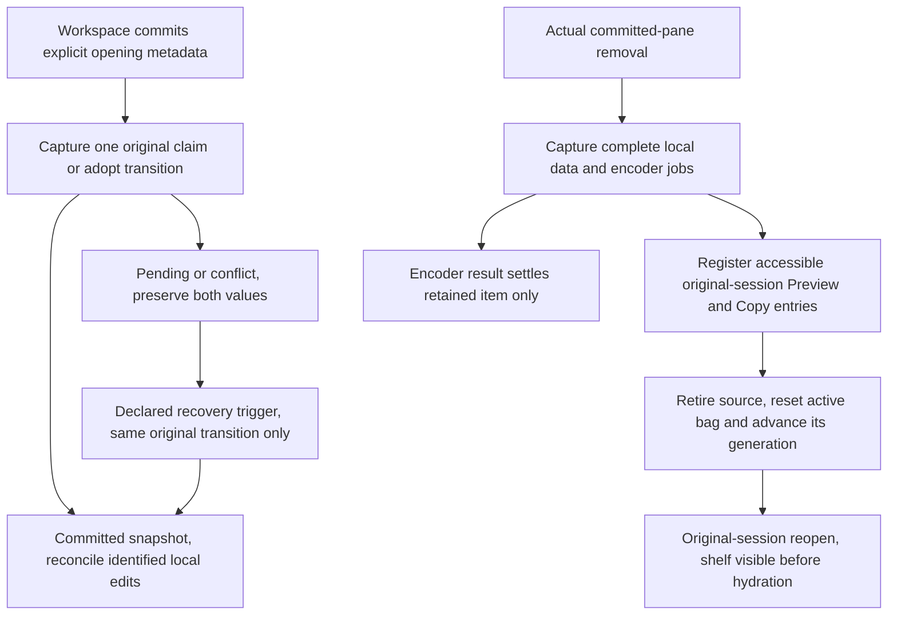

# Guarded browser draft recovery Implementation Plan

> **For agentic workers:** REQUIRED SUB-SKILL: Use superpowers:subagent-driven-development or superpowers:executing-plans to implement this plan task-by-task. Steps use checkbox (`- [ ]`) syntax for tracking. The already selected method is subagent-driven development. This amendment stays inside the existing Task2B, with the same stopped implementer and one complete supported-writer acceptance gate.

**Goal:** Recover persisted browser drafts on explicit pane openings while keeping displaced or closed composers' unsaved structured work and attachments accessible.

**Architecture:** Keep the accepted IndexedDB authority and its full-token claim/adopt operations. Establish opening provenance at the committed workspace boundary, retain one captured transition per opening, and preserve dirty predecessors in a process-local data shelf before retiring them. The shelf has no durable-write or ownership capability. Existing Session and Composer/QueueStrip reuse the same full Preview/Copy rows, including while Session has no model.

**Tech Stack:** Existing TypeScript, React, Zustand, IndexedDB/IDBConnection, Vitest, fake-indexeddb and jsdom. No added dependency or browser API.

**Spec:** `docs/superpowers/specs/2026-10-06-browser-draft-owner-recovery-design.md`, approved at `85966a343c621b1053064d9864b091d9c4351171`. The browser annotation spec and plan remain binding elsewhere.

## Global Constraints

- "Use the existing transactional draft authority. Do not add dead-tab detection, locks, heartbeats, leases, a service worker, hub endpoint, storage schema/version, compatibility format or HTTPS-only requirement."
- "Keep existing supported-browser and served-origin requirements. No new browser API is required by this design."
- "An opening belongs to a committed pane lifetime, not a mounted React component."
- "A source cannot infer permission from a pane ID, a row read, silence or a claim failure."
- "Do not reload a newer token and automatically counter-adopt, repeatedly transfer ownership or replay an old whole-value snapshot."
- "Ordinary edits, subscriptions, focus, annotation retries and submission cleanup never start adoption."
- "No timer or tight retry loop is introduced."
- "Keep existing attachment bag/generation and exact marker-cleanup guards. Ownership transfer creates no additional attachment durability or fabricated backing bytes."
- "Genuine-phone qualification still gates completion, merge and deployment."
- Preserve accepted shared contracts, mapper and inactive repository. Preserve the native lane at `7f2bacf33fad854c849a9db6aafd34dbb680ed4c`, its evidence, stopped writer and exhausted three-fix cap.
- The original Task2B brief and controller ruling still require all supported writers to cut over together, actual recovery backing and atomic recovery-resend settlement. No partial activation, redispatch of Task2A, or native-default change.
- **Execution is not authorized by this document or its approval.** Finish independent written-plan review, obtain Jesse's written-plan approval, then STOP. Resuming `dlg_034b15Un7bhvJa8M4QMsE1` requires Jesse's subsequent explicit instruction. The paused three tests and their exact 8,510-byte RED diff stay untouched during planning/review.

## Review Focus

These five conditions each receive an explicit test below.

1. Close during an unresolved write or encoder: reopening shows complete local work before storage recovers, and old callbacks touch only the retained data or nothing.
2. A commit whose acknowledgment is interrupted, including an initially absent row: recognize only the exact captured outcome in the original namespace, without a second transfer.
3. Duplicated saved owner IDs with identical text but changed mentions or selections: full tokens fence the loser, and both structured values remain accessible.
4. Restored layout or session zoom/Return: owner metadata survives serialization outside deduplication params, and same-lifetime retyping never becomes an opening.
5. A second dirty close or unavailable session model/clipboard: no earlier retained work is overwritten or hidden, and selectable full previews remain usable.

---

## Bounded task and authoritative inputs

This is an additive implementation amendment to **Task2B: Activate authority across supported draft writers**, not a new product milestone. Its red-green substeps share the original Task2B acceptance gate.

Read these preserved inputs before implementing:

- `.superpowers/sdd/2026-10-05-markdown-document-annotations-browser/task-2b-guarded-transfer-plan-inputs-85966a3/task-2b-brief.md`, including production integration obligations and Steps4–7.
- The adjacent `task-2b-context.md` and `task-2b-contract-controller-report.md`.
- The current approved recovery spec and `task-2b-guarded-transfer-written-spec-approval.md` in that SDD workspace.
- `AGENTS.md`, `docs/product/README.md`, subsystem rows for browser/composer and shared input, and `docs/developing-evener/testing.md`.

The accepted repository base is `7ea01cc9dc3c802e8ec3d3955c4d90626e03c550`. Later commits through the approved recovery spec are document-only. The original full cutover requirements, exact initial losing-claim/fork REDs, complete structured settlement guards and atomic transaction ruling remain requirements, not optional background.

### Files and responsibilities

All paths beginning `src/` below are relative to `cmd/evener-hub/frontend`.

| Files | Responsibility in this amendment |
| --- | --- |
| `src/shell/workspace.ts`, `workspace.test.ts`, `paneRestore.test.ts` | Assign fresh/restored/replacement provenance and owner metadata when committing records, serialize the ID outside session params, preserve existing deduplication/layout recovery. |
| `src/shell/paneLifetime.ts`, `paneLifetime.test.ts` | Supply genuine runtime owner/provenance, capture identified predecessor receipts, preserve before `alive=false`, retain the existing retype/focus lifetime. |
| `src/stores/browserDraftRepository.ts`, `browserDraftRepository.test.ts` | Reuse claim/adopt; add only namespace-aware opening observation/absent-claim fencing and shared equality needed for exact acknowledgment. No schema change. |
| `src/panes/session/composer/sourceState.ts`, `sourceState.test.ts` | One opening attempt, dirty projection/acknowledged snapshot, pending/conflict reconciliation, data-only retained shelf. |
| `src/panes/session/composer/attachments/useAttachments.ts`, `useAttachments.test.ts` | Shared raw encoder-job registry so retention can finish actual pending encodes after ordinary active-generation retirement. This bounded modification promotes the original preserve/regression path to modify/test; no attachment durability change. |
| `src/panes/session/composer/Composer.tsx`, `Composer.test.tsx`, `Composer.integration.test.tsx`, `queue/QueueStrip.tsx`, `queue/QueueStrip.test.tsx` | Subscribe to local retained work and render full selectable Preview/Copy, independently of transport-model availability. |
| `src/panes/session/Session.tsx`, `Session.test.tsx` | Narrow parent mounting seam: render the same local-only retained rows from the existing committed source while the model is absent, and prove actual committed close/reopen access. Keep the loading/deletion surfaces and all transport gates. |
| `src/panes/session/testing/composerSource.ts`, `src/dev/surface-sections/composer.tsx` | Supply explicit genuine standalone owner/opening metadata to the source factory. Keep the retirement harness on the actual committed-pane route. |
| Original Task2B draft, pending-turn, outbox, submission, fork and direct-consumer paths | Complete the original supported-writer and async-settlement cutover without adding a second authority. |
| `docs/web-ui/parity/contracts-composer-queue-pending.md`, `docs/product/subsystems.md` | Record only verified current owner/recovery/async-cleanup behavior after implementation. |

No extra production module, store, endpoint, serialized format or UI subsystem is planned. Minimal `src/stores/threads.ts` imports/types/resend forwarding in the existing browser resend path is still the controller's bounded exception; do not alter shared/native resend ports.

## Proposed interfaces

Everything in this section is **proposed**, not an API already present at the approved spec head. Existing repository `load`, `claim`, `adopt`, `commitEdit`, `restoreConflict` and submission guards remain available and keep their accepted semantics.

### Committed opening and runtime owner

In `workspace.ts`, add optional composition fields only to records that own a session composer, including session-origin zoom records. Use existing `parseZoomParams` to identify the latter. Non-composer records keep their present shape.

```ts
export type PaneComposerOpening =
  | { readonly kind: "fresh" }
  | { readonly kind: "restored" }
  | { readonly kind: "replacement"; readonly predecessor: OpenPaneRecord };

// Add to OpenPaneRecord, outside params.
compositionOwnerId?: string;
composerOpening?: PaneComposerOpening;
```

Use this proposed workspace record-construction helper for normal creation, primary replacement, restored records and explicit test fixtures. It receives the opening kind, rather than deriving it from a repository read. Use existing `createSecureUUID()` for a genuinely fresh identity. A restored, nonempty saved ID is retained. Restoration without that metadata gets a new ID and a fresh-opening descriptor, as the approved spec requires. Retyping copies the metadata and transfers the same lifetime. Known replacement means an explicitly identified predecessor for the **same namespace/session**; replacing main with another session is that new session's fresh opening, never an adoption of the old session.

```ts
export function createCommittedPaneRecord(
  input: Pick<OpenPaneRecord, "id" | "type" | "params" | "slot">,
  opening: PaneComposerOpening,
  savedOwnerId?: unknown,
): OpenPaneRecord {
  const zoom = input.type === "sessionZoom" ? parseZoomParams(input.params) : null;
  const ownsComposer = input.type === "session" || zoom?.source.type === "session";
  if (!ownsComposer) return { ...input };
  const retainedId = opening.kind === "restored" && typeof savedOwnerId === "string" && savedOwnerId.trim() !== ""
    ? savedOwnerId
    : null;
  return {
    ...input,
    compositionOwnerId: retainedId ?? createSecureUUID(),
    composerOpening: opening.kind === "restored" && retainedId === null ? { kind: "fresh" } : opening,
  };
}
```

Both `parseZoomParams` and `createSecureUUID` already exist. Import them by their current module paths. A declared replacement must also be checked against its predecessor's original source session in the lifetime before constructing source opening inputs; a mismatch cannot adopt that predecessor.

`layoutJSON()` enriches the returned panel `params` with `compositionOwnerId` beside `paneType`/`paneParams`, without modifying the live Dockview object or `paneParams`. `readPanelParams()` carries that saved field back into record construction. Serialize no token, runtime serial, predecessor object or retry state. For an explicit layout restoration, saved owner metadata determines the restored route; same-process removed records are still preserved before disposal. Do not reinterpret a restore as a fresh-ID replacement.

In `sourceState.ts`:

```ts
export type ComposerOpening =
  | { readonly kind: "fresh" | "restored" }
  | {
      readonly kind: "replacement";
      readonly predecessorOwnerId: string;
      readonly predecessorDraft: StoredComposerDraft | null;
      readonly predecessorInitialized: boolean;
    };

export interface BrowserComposerOwner extends BrowserDraftOwner {
  readonly opening: ComposerOpening;
  readonly isAlive: () => boolean;
}

export function createComposerSourceState(
  ref: string,
  owner: BrowserComposerOwner,
  repository?: BrowserDraftRepository,
): ComposerSourceState;
```

This refines the original second factory argument with the explicit opening/live guard required by the amendment. The optional third argument remains a **real** repository adapter, not a historical-caller fallback. All production, dev and test callers supply the new owner. No one-ref overload.

The source adds `compositionOwnerId`, `ready(): Promise<void>` and `retryOpening(): Promise<void>`, as well as these proposed synchronous snapshot fields. `ready()` awaits the current attempt and reports pending/conflict through the snapshot; it does not mean storage succeeded. `retryOpening()` is invoked only by the declared composer-open/foreground recovery trigger. Coalesce concurrent calls, retain at most one triggered follow-up, and never schedule self-retry from a fault.

```ts
// Add to ComposerSourceSnapshot, beside its existing structured projection.
hydration: "pending" | "ready" | "conflict";
dirty: boolean;
acknowledgedDraft: StoredComposerDraft | null;
```

`acknowledgedDraft` keeps the actual durable side of a conflict separate from the editable local projection. Pending backing stays explicitly unresolved. Only a matching live ownership receipt can mark hydration ready; a storage result or same owner ID alone cannot mark dirty edits saved.

### Namespace-aware opening observation

An existing `load(key)` returns only `null` for an absent row. That is insufficient to distinguish an absent claim's committed acknowledgment from a same-ID row in a later namespace incarnation. Do not manufacture an incarnation or assume an owner ID proves a commit.

Add this small observation method to the existing repository and implement both it and `load()` through the **same** current load transaction/helper:

```ts
export interface BrowserDraftOpeningSnapshot {
  readonly namespaceIncarnation: string;
  readonly draft: StoredComposerDraft | null;
}

// Add to BrowserDraftRepository.
loadOpening(key: BrowserDraftKey): Promise<BrowserDraftOpeningSnapshot>;

// Add a current capability to claim, preserving existing four-argument callers.
claim(
  key: BrowserDraftKey,
  owner: BrowserDraftOwner,
  expected: DraftToken | null,
  stillOwnsOwner: () => boolean,
  expectedNamespaceIncarnation?: string,
): Promise<DraftCommit>;
```

`loadOpening` exposes the namespace value already read by the current implementation, including its existing row-retokening behavior. `load()` returns that helper's `draft`, so there is no duplicate loading algorithm. This is current opening metadata, not a legacy-format adapter or a new ownership mechanism.

All source opening claims pass the captured incarnation. In the existing transaction, before an absent insert or owner acknowledgment:

```ts
if (expectedNamespaceIncarnation !== undefined && incarnation !== expectedNamespaceIncarnation) {
  return current ? conflict(current) : { state: "unavailable" } as const;
}
```

Keep the original complete-token checks for existing rows, the live guard and transaction-completion boundary. An absent claim with a stale incarnation creates nothing. Do not change adopt's accepted CAS or add an adoption operation.

A captured opening stores immutable copies of its namespace/key, owner, loaded or identified predecessor, expected token, selected operation and local edit revision. Replacement uses its identified predecessor's captured complete token and owner, not whichever owner a later load discovers. If that predecessor never initialized, record that fact: an absent/unclaimed row may be claimed, but an owned row without the identified token remains pending/conflicting rather than authorizing a fresh takeover.

For fresh/restored openings, capture once from the first successful `loadOpening`: absent/unclaimed or matching owner selects claim; a different owned row selects adopt. A competing claim result never becomes adopt.

For acknowledgment, compute the exact expected owned result from the captured predecessor:

- Absent: captured incarnation, persistent revision `0`, owner revision `1`, empty ordinary value with original field presence.
- Unclaimed: same value/backing/incarnation/persistent revision, new owner and owner revision `+1`.
- Different owner adoption: same value/backing/incarnation/persistent revision, new owner and owner revision `+1`.
- Matching-owner acknowledgment: same entire token and value/backing, no revision increment.

On an unavailable result, retain the captured transition. On the next declared trigger, retry that original operation/arguments. If the result conflicts after acknowledgment was interrupted, `loadOpening` may recognize only the exact expected namespace, owner, all token fields, full structured value and backing while the original live opening guard holds. Reuse/extract the actively needed repository equality helpers, preserving omitted versus explicit empty mentions; do not duplicate comparison logic. This acknowledges an already-established matching snapshot, not proof of a unique tab or permission to write with a refreshed takeover token. A different result stays a conflict. Never recapture a transition after it was first attempted.

### Retained data and unfinished encoder results

In `attachments/useAttachments.ts`, share pending-job bookkeeping in the existing attachment store because the source and hook each construct operations over that store:

```ts
export interface PendingEncode {
  readonly generation: number;
  readonly itemIdentity: PendingAttachment;
  readonly result: Promise<EncodedPng>;
}
// Add beside the existing refs in createAttachmentStore().
pendingEncodesRef: { current: new Map<PendingAttachment, PendingEncode>() }
```

Import the existing `EncodedPng` type. Register the actual raw `reencodeToPng(file)` promise and initially reserved item identity before publishing staged items or attaching active callbacks. Keep the current success/failure, generation and removed-marker guards. Delete completed registry entries by exact job identity; capture retains its own references before reset clears active bookkeeping. Do not capture the active `.then().catch()` chain, which could confuse an editor callback exception with an encode failure.

In `sourceState.ts`:

```ts
export interface RetainedAttachment {
  readonly itemIdentity: PendingAttachment;
  readonly capturedItem: Readonly<PendingAttachment>;
  readonly encode: PendingEncode | null;
  readonly state: "settled" | "encoding" | "failed";
  readonly error: string | null;
}

export interface RetainedLocalDraft {
  readonly retentionId: number;
  readonly key: BrowserDraftKey;
  readonly predecessor: BrowserDraftOwner;
  readonly value: SkillEditorValue;
  readonly editRevision: number;
  readonly acknowledgedEditRevision: number | null;
  readonly dirty: boolean;
  readonly acknowledgedDraft: StoredComposerDraft | null;
  readonly actualRecovery: MutationRecoveryRecord | null;
  readonly localRecovery: {
    readonly activeRecoveryId: string | null;
    readonly writeVersion: number;
    readonly replacementEpoch: number;
    readonly ownsLocalDraft: boolean;
  };
  readonly bag: {
    readonly identity: AttachmentStore;
    readonly generation: number;
    readonly nextMarker: number;
    readonly removedWhilePending: readonly number[];
    readonly items: readonly RetainedAttachment[];
  };
}

// Add to ComposerSourceState and ComposerSourceSnapshot respectively.
preserveBeforeDispose(): RetainedLocalDraft | null;
retainedDrafts: readonly RetainedLocalDraft[];
```

The shelf is a module-private map keyed by `[namespace.kind, namespace.origin, sessionRef]`, containing a **list**, not one slot. Source snapshots/subscriptions expose the original key's entries synchronously, including before hydration. Capture is idempotent per retired source instance, not per saved owner ID. Copy structured selections, mentions, complete tokens and backing; preserve omission, order and offsets. Retain original attachment identities plus copied field values, captured generation/high-water/removal values and each raw pending job. The active mutable bag is not the archived data container.

Cache the actual recovery record when Task2B hydrates/activates/acknowledges recovery backing. A known record includes its real bytes and metadata. If backing has not resolved, retain `null` explicitly with its pending local recovery identity and state; do not fabricate a record from the ID or treat an unacknowledged projection as saved. The existing actual backing remains authoritative until its separately guarded reconciliation. Source recovery schema `version` is not an edit counter.

Retain work when local edits are unacknowledged, hydration/write/conflict is unresolved with local work, or ordinary attachments contain volatile bytes/jobs. Same-text metadata edits advance the edit revision. A saved marker does not make its ordinary image bytes durable. No automatic eviction, discard control, one-click structured restore or copying-as-consumption is added. Entries last for the current process; process death retains only existing durable work.

## Lifecycle



Opening metadata authorizes exactly one transaction. Its acknowledged snapshot does not replace newer local work. Independently, removal registers retained work before retiring the predecessor; encoder results can finish the retained item while old active callbacks remain fenced.

`PaneLifetime.dispose()` must preserve **before** its current `alive=false` and before disposing read views/source. Do not instantiate a never-used composer just to retire it. Direct source disposal performs the same idempotent preservation before `disposed=true`, unsubscribe and `operations.reset()`.

```ts
// At the beginning of lifetime.dispose(), using its existing local composer.
if (!alive) return;
composer?.preserveBeforeDispose();
alive = false;

// At the beginning of source.dispose(), using its new local capture function.
if (disposed) return;
preserveBeforeDispose();
disposed = true;
```

The current committed-list removal observer covers actual close, primary replacement, successful restore and same-ID record replacement. It runs after the pane-list commit but before runtime retirement; no storage flush or extra close service is needed. Register the complete capsule and its independent handlers before returning. A required capture failure must not fall through to retirement/reset. Establish pending-job invariants during ingestion so ordinary retention needs no asynchronous wait. A throwing shelf observer cannot prevent registration, retirement of another healthy pane, or notification of later observers.

An independent encoder success updates only the retained item with actual returned bytes/dimensions and `pending:false`. Failure updates only that retained item to `failed`, with its actual error and `pending:false`; keep its captured marker/text/metadata visible. Neither branch writes an editor, persists a draft, invokes an old toast, cleans another bag or adopts. Verify retention entry, captured bag/generation and exact item/job identity. An item removed before capture stays absent. Ordinary predecessor reset still advances its live generation and empties its active bag.

For an active displaced source, editor reads/bindings use its own local projection, not `currentDraftText()`'s shared newer-draft fallback. A late subscription may update the acknowledged/durable side of a conflict, never the losing local value. Only identified edits based on the acknowledged value can reconcile through current ownership/full-token CAS. If pre-hydration work has no established base in the predecessor value, retain both values explicitly; do not replay the dirty whole snapshot over it. Hold handoffs and sends that require settled authoritative work, while preserving local editing, reading and other sessions.

## Red-green substeps within Task2B

### Step 1: Baseline and explicit opening provenance

- [ ] Read the binding inputs and testing guidance. Recheck the original RED diff and stopped state before authorized resumption. Keep the accepted original three RED cases, strengthening the source test to await required `ready()` and use two genuine adapters. Baseline the original targeted suites before product changes; archive raw commands/exits.
- [ ] Add red-first `workspace.test.ts`/`paneRestore.test.ts`/`paneLifetime.test.ts` cases for fresh open, saved-ID restore against both matching and different durable owners, restore without metadata, explicitly identified same-key replacement, and same-session focus/remount/zoom/Return. Assert owner identity separately from runtime serial and deduplication params.

```ts
const id = workspaceStore.getState().openPane("session", { ref: "root" });
const pane = workspaceStore.getState().panes.find((candidate) => candidate.id === id);
if (!pane) throw new Error("committed session pane missing");
expect(pane.params).toEqual({ ref: "root" });
expect(pane.composerOpening).toEqual({ kind: "fresh" });
expect(pane.compositionOwnerId).toEqual(expect.any(String));
const lifetime = conversationPaneLifetime(pane);
workspaceStore.getState().focusPane(id);
expect(conversationPaneLifetime(pane)).toBe(lifetime);
expect(workspaceStore.getState().openPane("session", { ref: "root" })).toBe(id);
expect(workspaceStore.getState().panes.find((candidate) => candidate.id === id)?.compositionOwnerId)
  .toBe(pane.compositionOwnerId);
```

- [ ] Run from `cmd/evener-hub/frontend`: `npm test -- src/shell/workspace.test.ts src/shell/paneRestore.test.ts src/shell/paneLifetime.test.ts`. Expect new opening/metadata assertions to fail before implementation; do not weaken existing retirement/layout assertions.
- [ ] Add committed record metadata/serialization and supply `BrowserComposerOwner` through the real lifetime, dev and test callers. A replacement snapshot is captured from the identified old source before it is retired. Do not create a composer merely to read a predecessor token. Add `ready`/pending/dirty source interfaces as part of the original full cutover, not a second writer path.
- [ ] Run the same tests plus the original source/fork cases to green for this behavior. Existing tests that construct records directly must use explicit current opening fixtures rather than a silent old-record fallback. Keep all original non-composer shape assertions.

### Step 2: Capture and reconcile one transaction per opening

- [ ] Add repository/source REDs for the four opening outcomes, exact structured preservation, two captured openings racing, initial load fault, abort after capture, lost acknowledgment, namespace change and an unrelated losing claim. Use two real adapters over one `IDBFactory` and database; spy only to observe calls or hold delivery of results from actual operations outside transactions. Never substitute fake claim/adopt outcomes.

The structured fixture is literal and independent of capture/clone helpers:

```ts
const savedValue = {
  text: "🙂 /same /same /same",
  skillNames: ["same"],
  commandNames: ["same"],
  mentions: [
    { kind: "command" as const, name: "same", offset: 3 },
    { kind: "skill" as const, name: "same", offset: 9 },
  ],
};
const key = { namespace: { kind: "browser" as const, origin: location.origin }, sessionRef: "root" };
const owner = { paneId: "original", compositionOwnerId: "saved-owner", lifetimeSerial: 1 };
const replacement = { paneId: "new", compositionOwnerId: "new-owner", lifetimeSerial: 2 };
const first = createBrowserDraftRepository({ databaseName: "guarded-opening" });
const second = createBrowserDraftRepository({ databaseName: "guarded-opening" });
await first.seedUnclaimed(key, savedValue);
const seeded = await first.load(key);
if (!seeded) throw new Error("seed missing");
const claimed = await first.claim(key, owner, seeded.token, () => true);
if (claimed.state !== "committed") throw new Error("original claim missing");
const adopted = await second.adopt(key, replacement, claimed.draft.token, "saved-owner", () => true);
expect(adopted.state).toBe("committed");
expect(await first.load(key)).toMatchObject({
  ...savedValue,
  compositionOwnerId: "new-owner",
  token: {
    namespaceIncarnation: claimed.draft.token.namespaceIncarnation,
    persistentRevision: claimed.draft.token.persistentRevision,
    ownerRevision: claimed.draft.token.ownerRevision + 1,
  },
  backing: claimed.draft.backing,
});
expect((await first.commitEdit(key, owner, claimed.draft.token, { text: "stale", skillNames: [] }, () => true)).state)
  .toBe("conflict");
```

This repository invariant is already accepted; the **new RED** must perform the corresponding opening through `createComposerSourceState` and the real workspace/lifetime. Supply explicit source owner/opening as defined above, await `ready()`, compare all fixture fields/backing, and assert zero enqueue/perform calls. Do not present an already-green repository assertion as new integration RED.

In a separate test, use the same literal fixture, two adapters and original claim through line `claimed` above. Replace the direct repository adoption with this actual source opening. Observe the real second adapter's calls without replacing their implementations:

```ts
const adopt = vi.spyOn(second, "adopt");
const claim = vi.spyOn(second, "claim");
const source = createComposerSourceState("root", {
  ...replacement,
  opening: { kind: "fresh" },
  isAlive: () => true,
}, second);
await source.ready();
expect(source.getSnapshot().hydration).toBe("ready");
const projection = source.getSnapshot();
expect({
  text: projection.text,
  skillNames: projection.skillNames,
  commandNames: projection.commandNames,
  mentions: projection.mentions,
}).toEqual(savedValue);
expect(source.getSnapshot().acknowledgedDraft).toMatchObject({
  ...savedValue,
  compositionOwnerId: "new-owner",
  backing: claimed.draft.backing,
  token: {
    namespaceIncarnation: claimed.draft.token.namespaceIncarnation,
    persistentRevision: claimed.draft.token.persistentRevision,
    ownerRevision: claimed.draft.token.ownerRevision + 1,
  },
});
expect(adopt).toHaveBeenCalledTimes(1);
expect(adopt).toHaveBeenCalledWith(key, expect.objectContaining(replacement), claimed.draft.token, "saved-owner", expect.any(Function));
expect(claim).not.toHaveBeenCalled();
source.dispose();
```

The integration variant uses the actual committed workspace/lifetime rather than this standalone owner. Observe the real mutation enqueue/perform boundaries in the existing source test setup and assert zero calls for both variants. The source fixture's `isAlive` is an explicit standalone lifetime guard, not a fabricated repository result.

- [ ] For the absent case, observe its actual namespace via the proposed `loadOpening`; advance the real namespace fixture, then call `claim` with the old captured incarnation. Assert no row was created. For interrupted acknowledgment, let the real transaction complete, hold/drop its delivery outside the transaction, then trigger foreground recovery. Assert the exact expected row is acknowledged, owner revision advances at most once, and no input is enqueued.
- [ ] Run `npm test -- src/stores/browserDraftRepository.test.ts src/panes/session/composer/sourceState.test.ts src/shell/paneLifetime.test.ts`; retain the behavioral failures.
- [ ] Implement the namespace observation through the shared load helper, the bounded absent-claim guard, frozen captured transition, original-argument retry and exact-result recognition. Bind retries to existing declared open/foreground lifecycle events and dispose their subscriptions with the source. Notifications, ordinary edits, claim failure and focus never route into adopt.
- [ ] Run the same tests. Also hold actual initial hydration/adoption results while typing or making same-text metadata edits. Assert local projection survives, the predecessor value/backing remains separately available, and only identified ownership-valid later edits can reconcile. Duplicate restored IDs must use complete-token CAS, not owner-ID uniqueness.

### Step 3: Accessible preservation before actual retirement

- [ ] Add real-source/pane REDs for delayed and faulted writes, same-text metadata-only work, settled ordinary images and controlled unfinished encodes. Use `installControlledImageEncoding()` from the existing test helper: it holds browser image/canvas boundaries while running the real encoder.

After opening/awaiting the real source, the removal/encoding body is concrete:

```ts
const encoding = installControlledImageEncoding();
const operations = createAttachmentOperations(source.editor, source.attachments);
operations.replaceWithSettled([
  { marker: 1, name: "kept.png", mediaType: "image/png", data: "AQID", width: 8, height: 4, pending: false },
]);
source.editor.write("same text [image 1]", 19);
source.editSkillNames(["same"]);
source.updateSelectionMeta({ text: "same text [image 1]", skillNames: ["same"], commandNames: ["same"], mentions: [] });
operations.ingestFiles([new File([new Uint8Array([1, 2, 3])], "pending.png", { type: "image/png" })], pushToast.bind(null, "error"));
const settledItem = source.attachments.getState().items[0];
const pendingItem = source.attachments.getState().items[1];
if (!settledItem || !pendingItem) throw new Error("staged attachment missing");
const generation = source.attachments.getState().generationRef.current;
workspaceStore.getState().closePane(pane.id);
expect(workspaceStore.getState().panes).not.toContain(pane);
expect(lifetime.alive).toBe(false);
expect(source.alive).toBe(false);
expect(source.attachments.getState().generationRef.current).toBeGreaterThan(generation);
expect(source.attachments.getState().items).toEqual([]);
const reopenedId = workspaceStore.getState().openPane("session", { ref: "root" });
const reopenedPane = workspaceStore.getState().panes.find((candidate) => candidate.id === reopenedId);
if (!reopenedPane) throw new Error("reopened pane missing");
const reopened = conversationPaneLifetime(reopenedPane).composer;
if (!reopened) throw new Error("reopened composer missing");
const retained = reopened.getSnapshot().retainedDrafts[0];
if (!retained) throw new Error("closed work not accessible before hydration");
expect(retained.value.skillNames).toEqual(["same"]);
expect(retained.value.commandNames).toEqual(["same"]);
expect(retained.value.mentions).toEqual([]);
expect(retained.bag.identity).toBe(source.attachments);
expect(retained.bag.generation).toBe(generation);
expect(retained.bag.items[0]?.itemIdentity).toBe(settledItem);
expect(retained.bag.items[0]?.capturedItem.data).toBe("AQID");
expect(retained.bag.items[1]?.itemIdentity).toBe(pendingItem);
await encoding.resolve();
await waitFor(() => expect(reopened.getSnapshot().retainedDrafts[0]?.bag.items[1]?.capturedItem.data).toBe("AQID"));
expect(source.attachments.getState().items).toEqual([]);
expect(reopened.attachments.getState().items).toEqual([]);
```

The complete test constructs `pane` with real `workspace.openPane`, `lifetime` with `conversationPaneLifetime`, and `source` with its actual composer before this body. Hold its actual write/result outside transactions so the dirty value cannot already be mistaken for saved work. Independently assert the complete literal text, every structured field, acknowledged token/backing and real recovery bytes, not only the illustrated fields.

The metadata-only variant first awaits the real acknowledged source with unchanged literal text. Change selections/mention presence without calling `editor.write`, ingesting files or relying on an earlier text edit:

```ts
const before = source.getSnapshot();
const editRevision = source.continuity.draftEditRevisionRef.current;
source.updateSelectionMeta({
  text: before.text,
  skillNames: ["same"],
  commandNames: ["same"],
  mentions: [],
});
expect(source.continuity.draftEditRevisionRef.current).toBeGreaterThan(editRevision);
expect(source.getSnapshot().dirty).toBe(true);
expect(source.getSnapshot().text).toBe(before.text);
workspaceStore.getState().closePane(pane.id);
expect(source.getSnapshot().retainedDrafts.at(-1)?.value).toEqual({
  text: before.text,
  skillNames: ["same"],
  commandNames: ["same"],
  mentions: [],
});
```

Hold the actual metadata write outside its transaction and seed the acknowledged fixture with `skillNames: ["same"]`, no command selection and omitted mentions, so this changes only command/mention metadata. `updateSelectionMeta` updates commands/mentions, while skill changes use the existing `editSkillNames` path; test that separate metadata-only path too. Reopen the original session and repeat the literal comparison through its new source snapshot; the disposed source alone is not the recovery route.

- [ ] Observe the **real** `preserveBeforeDispose`, `source.dispose` and attachment reset entry, delegating to their actual implementations. Capture entry sees both lifetime and source alive. At source-disposal entry the full registered capsule must already be accessible, the lifetime is retired and the source is not yet disposed. At reset entry it remains accessible while both are retired. Assert these boundaries separately, rather than requiring an already retired lifetime to be alive at reset. Drive real `closePane`, `replacePrimary` and committed same-ID record replacement; a hook unmount alone is insufficient.
- [ ] Run the source/lifetime/attachment suites to confirm the missing preserved data or wrong ordering fails before implementation. Keep the original old-generation/empty-bag/no-old-toast assertions strict.
- [ ] Add the shared raw-job registry, data shelf, copied lineage/metadata and pre-retirement ordering described above. A settled item retains existing bytes directly; a pending one retains its actual promise. Capture local refs/projection, not a shared draft-reader fallback. Keep dirty and acknowledged revisions distinct, including metadata-only updates.
- [ ] Run the same tests to green. Repeat the encoding case with `encoding.reject()`: retained state becomes failed/not pending with no invented bytes or old toast. Release old edit, subscription and accepted-input cleanup after removal. Check the winning durable row/backing and new local work stay unchanged. A commit completed before retirement is recognized as committed; a not-yet-committed stale write is rejected by the live/full-token guard.
- [ ] Add cases for two retained losing lifetimes, duplicated IDs, marker reuse/new bag, an item removed before capture and both operations instances sharing one attachment store. Assert distinct accessible entries and no retention-triggered durable mutation/adoption.

### Step 4: Full Preview/Copy with no transport dependency

- [ ] Add a red-first `Session.test.tsx` case through the real Session, workspace and lifetime. Close a genuine dirty committed pane, reopen/edit/close its next committed lifetime, then reopen that same original session while `thread/read` leaves its model absent and real recovery/draft storage remains held. Use the existing committed Session fixture and restore the suite's Composer spy if the real Composer path is mounted; never replace the retained rows, source or ownership operations. Assert full literal text, selectable ordered selections/mention presence and offsets, exact backing, attachment names/markers/dimensions and real bytes for both predecessors. Fail the actual clipboard boundary and keep both previews selectable. Copy consumes neither entry. Observe zero input mutations and no claim/adopt initiated by Preview/Copy, separately from the reopening's permitted captured transition. Keep model-present Composer/QueueStrip regressions too. No Send/resend/steer/queue/restore action belongs to these rows.
- [ ] Run `npm test -- src/panes/session/Session.test.tsx src/panes/session/composer/Composer.test.tsx src/panes/session/composer/Composer.integration.test.tsx src/panes/session/composer/queue/QueueStrip.test.tsx` and retain the actual missing-parent-preview failure, not only a standalone row failure.
- [ ] Add `retainedDrafts` to the source snapshot and the separate local QueueStrip rows. Export a data-only `RetainedDraftRows` component from existing `QueueStrip.tsx`, accepting a readonly retained-entry list and reusing the row below. In existing `Session.tsx`, a small source-backed wrapper uses React's `useSyncExternalStore` with the existing `source.subscribe/getSnapshot` pair, then renders those rows in the loading scaffold's footer when its already-created committed source exists. Do not await `ready()` or model/storage hydration to mount them. The missing-model branch mounts no full Composer, editor or transport controls. Keep its ordinary loading surface and the existing deleted-state branch unchanged. In the model-present branch, Composer passes its subscribed entries to QueueStrip, whose same local rows sit outside its transport model/visibility guard. Keep Composer's model guard and every transport/capability gate. Mount only one preview route per Session state, with no new store, source, owner or module.

The actual parent matters: at the approved source head, `Session.tsx:513–533` returns before mounting Composer, which has its own guard at `Composer.tsx:623`; QueueStrip's guard at `QueueStrip.tsx:235` is only the third boundary. A standalone Composer/QueueStrip missing-model test cannot prove original-session access. The Session test must drive the real removal/reopen and render the real reused rows while both model and storage remain unresolved. Existing `thread/read` activity belongs to Session hydration; count input mutations and Preview/Copy effects at their real boundaries rather than asserting that mounting Session causes no read RPC.

Use the existing clipboard helper from `src/shell/palette/commands.ts` and selectable fields as fallback:

```tsx
function RetainedDraftRow({ retained }: { retained: RetainedLocalDraft }) {
  const [copyError, setCopyError] = useState<string | null>(null);
  const copy = (text: string) => {
    void copyToClipboard(text).then(
      () => setCopyError(null),
      () => setCopyError("Copy failed. Select the values above to copy them."),
    );
  };
  return (
    <details>
      <summary>Unsaved work from a closed composer, kept in this tab</summary>
      <textarea aria-label="Retained draft text" readOnly value={retained.value.text} />
      <pre tabIndex={0}>{JSON.stringify({
        skillNames: retained.value.skillNames,
        commandNames: retained.value.commandNames,
        mentions: retained.value.mentions,
        mentionPresence: retained.value.mentions === undefined ? "omitted" : "present",
        acknowledgedDraft: retained.acknowledgedDraft,
        actualRecovery: retained.actualRecovery,
        localRecovery: retained.localRecovery,
      }, null, 2)}</pre>
      <button type="button" onClick={() => copy(retained.value.text)}>Copy text</button>
      {retained.bag.items.map(({ capturedItem: item, state, error }) => (
        <div key={item.marker}>
          <pre tabIndex={0}>{JSON.stringify({ ...item, state, error }, null, 2)}</pre>
          {item.data !== undefined && (
            <>
              
              <textarea aria-label={`Attachment ${item.marker} bytes`} readOnly value={item.data} />
              <button type="button" onClick={() => copy(item.data ?? "")}>Copy attachment bytes</button>
            </>
          )}
        </div>
      ))}
      {copyError && <p role="status">{copyError}</p>}
    </details>
  );
}
```

Place this local row and the reusable `RetainedDraftRows` list in `QueueStrip.tsx`, importing React's existing `useState`, the retained type and the current clipboard helper. The exported list receives only `readonly RetainedLocalDraft[]`; it neither reads a session model nor mounts the transport QueueStrip subtree. Use the surrounding row/button styling. Render one row per `retentionId`; attachment markers are unique within each captured bag. These are selectable views of existing values, not a new import/export or compatibility format. Do not show the preview's dirty value as the acknowledged saved snapshot.

- [ ] Run the same tests to green. Fail the actual clipboard boundary and verify the inline failure plus selectable text/bytes remain through the real Session route. Render two entries and another session: both original entries remain, the other session receives none. Release the real pending encoder while model/storage are still held and assert its actual bytes appear through the mounted source subscription. Then release model hydration and assert exactly one set of both rows remains through Composer/QueueStrip, with unchanged retained values/identities and no consumption or preview-triggered ownership operation. Preview/copy/subscription/encoder completion start no RPC or adoption. Keep all ordinary loading/deletion and transport regression assertions strict.

### Step 5: Finish the original full supported-writer cutover

- [ ] Execute the original brief's Steps4–7 in full. Replace every supported localStorage writer/clear, activate the accepted transfer runtime only with that complete change, preserve supported-byte conflicts and fork durable seed-before-open, and await async ordinary submission settlement at every browser call site. The source's late hydration/commit handling must use the new opening/preservation rules.
- [ ] Keep real recovery updates, activation, discard, replacement and resend in the existing readwrite transaction with the authority sidecar. In particular, recovery resend consumes/updates the **actual** recovery record and settles authoritative draft work in the **same existing outbox transaction**, rather than a later repository clear. Use only the bounded browser `threads.ts` forwarding changes for this integration.
- [ ] Preserve original immutable submission guard plus local edit revision, exact attachment identities and current recovery backing. After input acceptance, a cleanup fault means pending cleanup, never a retry of `perform`. Recheck epoch/live ownership after the await. Shared callers without the browser async capability keep their existing synchronous default.

```ts
if (epoch === fence.epoch()) {
  const committed = opts.settleDraft
    ? await opts.settleDraft(opts.ref, opts)
    : { ...store.settleSubmittedDraft(opts.ref, opts), persistence: "committed" as const };
  if (epoch === fence.epoch()) onCommitted?.(committed);
}
```

This is the original shared submission-site change, not a new alternate settlement runner. Follow the brief's complete token/namespace/owner/backing/structured/attachment/live checks inside the real transaction.

- [ ] Preserve the original exact owner-transition, metadata, detached-editor, remount, old-encoder, recovery, fork, direct-consumer and accepted-input tests. Run the full original required focused list, including shared pendingTurns/submission and source/pane/Session/Composer/SkillEditor/attachment/recovery/QueueStrip suites. Keep the no-BroadcastChannel case and healthy-other-session recovery case.
- [ ] Update only the two authorized evergreen product-contract documents with verified behavior. State automatic persisted-work recovery, permitted live-tab transfer, pending/conflict protection, current-process Preview/Copy limits, ordinary attachment durability and async cleanup's no-resend guarantee.
- [ ] Before normal-hook product commits, run the frontend's pinned Biome on exact touched frontend/shared paths, inspect the exact staged diff and stage only authorized paths. Commit meaningful red-green units frequently, but do not activate or accept a partial supported-writer cutover. No hook bypass, push, merge, deployment or service restart by this worker.

### Step 6: Verification, independent acceptance and later browser gate

- [ ] Re-read scripts and run the original canonical Task2B gates from repository root: `make test-api-package`, `make test-web`, `make lint-biome`, `git diff --check`. Inspect complete output and preserve raw logs; expected fault diagnostics must be captured/asserted. Existing unrelated package negative-fixture stderr is issue `2676`, not evidence of pristine output or permission to change that harness.
- [ ] Write the complete append-only `task-2b-report.md`, numbered raw logs and evidence manifest under the existing SDD workspace. Preserve all old report/log bytes. Include full source/head identities, original and new RED/GREEN commands/exits, actual test boundaries and a requirement-to-behavior table.
- [ ] Stop the same product writer after its complete report. Controller checks the actual diff, original paused RED provenance, all behavior evidence and the full original `7ea01cc..final-head` range; dispatch fresh independent spec/quality review before acceptance or Task3. Three unsuccessful fixes or twice-returned findings stop the work, without resetting either cap.
- [ ] Carry the new scenarios into the already approved Task6 browser journey rather than claiming unit tests prove tab behavior: actual close/reopen, reload/crash with and without saved IDs, differing saved/durable owners, fresh live-tab adoption, delayed loser write/cleanup, pending/fault retry and two real tabs sharing IndexedDB. Assert no input mutations and exact structured/backing preservation. Copy/preview must still work at the existing supported served origins.
- [ ] Keep genuine physical-phone browser/OS-keyboard qualification mandatory and currently unavailable. Desktop browser, IDB/jsdom and shared default tests do not satisfy it. No qualification completion, merge or deployment until that separate gate is actually met. Do not resume or qualify the deferred native implementation.

## Spec coverage and evidence ownership

| Approved requirement | Owning substep and proof |
| --- | --- |
| Explicit fresh/restored/replacement opening, saved ID outside params, same lifetime on focus/remount/Return | Step1 actual workspace/serialization/lifetime tests, Step2 source opening route and Step6 actual tab journey. |
| One full-token CAS preserving full value/backing, unrelated losing claim, stale token/namespace/predecessor | Step2 two real adapters plus real source/lifetime, with the original losing-claim assertion retained. |
| Initial load fault versus captured transition fault, interrupted acknowledgment without another transfer | Step2 initial-load/abort/result-delivery controls and absent-row incarnation case, Step6 foreground/two-tab journey. |
| Dirty active displaced source and new-source edits during hydration/commit acknowledgment | Step2 literal structured fixtures and identified-edit/conflict assertions, Step5 accepted-input/append regressions. |
| Actual close/replacement retention before alive/source/reset and reachability while storage or the model is pending | Step3 boundary ordering plus actual removed-record/reopen tests, Step4 real Session loading-branch Preview/Copy, subscribed encoder completion, failed clipboard and model-present transition with both retained entries. |
| Same-text metadata, omitted versus empty mentions, duplicated saved IDs, both values preserved | Steps2–3 full literal-value comparisons, complete-token races and two separate retained entries. |
| Existing attachment ownership/generation, settled bytes, unfinished success/failure, exact stale cleanup | Step3 real encoder boundary and old-generation assertions, Step4 full selectable byte/metadata access, Step5 complete submitted guards. |
| No disposed writes, counter-adoption, redirected handoff, fabricated backing or duplicate input | Steps2–5 source/IDB/RPC-boundary assertions, original Task2B transaction/fork/cleanup tests and Step6 browser journey. |
| Full supported-writer cutover, atomic recovery-resend, unchanged shared/native synchronous default | Step5 all original Steps4–7, Step6 package/frontend gates and fresh original-range independent review. |
| Evergreen documentation, no new architecture/schema/origin/dependency, native/phone boundaries | File boundary, global constraints, Steps5–6 and controller provenance checks. |

## Self-review and handoff

Before freezing this plan, the controller checks every spec paragraph against the table, scans for placeholders, and checks all proposed signatures/fields across steps. Independent plan review examines this complete amendment with the immutable original brief, approved spec, actual source and paused evidence. Review findings may change this document only; they do not authorize product fixes.

After both full independent reports are reconciled, link the exact reviewed plan and ask Jesse whether it captures what he wants. Obtain his written-plan approval, then STOP. No product execution or writer resume follows from document-only approval; Jesse's subsequent explicit instruction is required. The already selected execution method, strict phone gate, native deferral and full original cutover remain unchanged.
