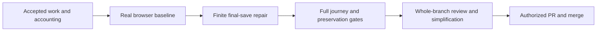

# Background Live Transcripts Delivery Implementation Plan

> **For agentic workers:** REQUIRED SUB-SKILL: Use superpowers:subagent-driven-development (recommended) or superpowers:executing-plans to implement this plan task-by-task. Steps use checkbox (`- [ ]`) syntax for tracking.

**Goal:** Open any caught-up Live session with its current transcript already available locally, including after background RAM eviction, without an activation `thread/read`.

**Architecture:** Reuse the accepted complete-Live owner, shared subscriptions/reducer, disk checkpoints and recovery. Integrate the accepted accounting repair and exercise the real browser journey first. Finish removal-time preservation with a finite records-plus-current save through the existing worker, rather than another representation-selection optimization.

**Tech Stack:** Existing TypeScript/AppWire/Zustand/React/IndexedDB, Vitest/fake-indexeddb, Go browserguard and Chrome. No new dependency, server API or database.

**Spec:** `docs/superpowers/specs/2026-10-05-background-live-transcripts-design.md`, approved at semantic Turn 442 of `local:034akJnCzYFDHgQZaATUPZ`. The original plan was approved at Turn 760. This replacement changes the remaining delivery sequence and proposes the explicit implementation-test amendment below. It does not replace the approved product requirements.

**Status:** Proposed, awaiting Jesse's review. Writing or approving the direction of this document does not itself claim any new test passes. No implementation was resumed to prepare it.

## What changes from the previous plan

1. Start from accepted work, not from the latest failed save-selection candidate.
2. Run the real producer-to-browser journey before another long final-save proof cycle.
3. Prefer a small, bounded amount of redundant persistence to incomplete comparisons intended only to save one transaction.
4. Keep proof repairs with the behavior they establish. Controller test-before-source checkpoints do not become repeated questions to Jesse.
5. Keep one progress ledger. A completed task means its stated evidence, not a growing list of mechanism-specific conditions.

### Explicit amendment requiring approval

Replace the **exact-two-transaction** requirement in the two final-release fixtures with a finite, content-preserving bound derived from the release phases. For the quiet resident fixture, the proposed maximum is **three save transactions**: known records before the read, final records, and final current state. This is a test-specific ceiling, not a universal product limit. A fixture with an already-running worker must account separately for that captured predecessor.

The affected assertions are in `threads.background.test.ts`, the receipt/saturating-update release test, and `threads.backgroundRecovery.test.ts`, the slow-final-read "does not add a third cache write" case. In the preserved release candidate they occur around lines 3736–3802 and 2533–2585 respectively. Locate them by their actual test bodies after integration, not by line numbers alone.

Keep their inputs, completion-triggered updates, useful saved-content assertions, finite release, unload/unsubscribe and no-late-write checks. Add the current-state content assertion. Do not weaken byte budgets, traffic, deadlines, Clear, recovery, ownership or actual browser assertions. If three final-save transactions cannot preserve the defined state under this workload, that disproves this proposed simple path; do not silently raise the ceiling.

Also correct invalid **browser observations**, without changing the browser scenario: use the app's own module instance, actual target content and native IDB records; await producer completion instead of sleeping or swallowing a timeout; distinguish the target's activation reads from unrelated background requests. These are corrections to measuring the approved behavior, not permission to omit a phase or make the workload easier.

Approval to execute this replacement must include this amendment and a new bounded final-save attempt. Historical exhausted loops remain stopped. The current release-cut unit has not received its SECOND independent review; this plan does not reset that allowance. No push, main merge or deployment is authorized by this document alone.

## Global Constraints

Copied from the approved scope and budget table:

- Web UI, including its narrow-screen layout.
- All session refs represented in the complete Live navigation resource, across projects and attached remote hosts, including idle sessions.
- Delegates and archived sessions are outside discovery scope, even if running.
- Native and CLI clients do not acquire background transcript demand.
- Resident background transcript payload: **16 MiB aggregate**.
- Pending background notification payload: **4 MiB aggregate**.
- Background load/reduce/commit workers: **1**.
- Concurrent background network hydrations: **2**.
- Cache records on disk, both classes combined: **Existing 32 MiB aggregate**.
- Cache TTL: **Existing 14 days**.
- These are retained encoded-payload bounds, with the spec's stated foreground, object-overhead, decoded-packet, serialization/IDB-copy and single-worker exceptions. They are not a total-browser-heap promise.
- No full-transcript serialization on every text chunk solely for accounting. Every retained payload has an owner and a charge.
- Healthy RAM eviction must preserve local reopening. Storage failure/oversize may use the approved stale-seed plus authoritative recovery path.
- Reconnect invalidates continuity, replaces history with an authoritative latest window, and retains the ability to page back to a previously visible later-page item.
- Clear suppression, delete fences, alias/client replacement, foreground/history/mutation holders and existing outbox behavior remain unchanged.
- Queued work can be cancelled. Issued reads retain capacity until response, rejection or the existing deadline; no physical server cancellation requirement.
- Existing cache lookup deadline **250 ms**, storage deadline **10,000 ms**, resident-write debounce **1,000 ms trailing / 5,000 ms maximum**. No deadline widening or fixed sleeps to hide awaited work.
- Browser pressure remains **64 KiB resident / 32 KiB pending**, with the retained deterministic workload and strict pre-release eviction gate.
- Default tests remain deterministic. Only the LLM provider is scripted in the real-stack journey; no mocked Evener internals.
- Use Flash implementation/probe subagents under Jesse's later author-model ruling, superseding the older spec's Luna preference. Verify current model availability before dispatch. Independent reviewers remain read-only.
- No unrelated refactor or replacement cache/coordination subsystem. No native background owner, wildcard subscription, event journal, service worker or outbox feature.

## Review Focus

1. **A held earlier write completes after newer accepted content:** finalization saves the requested final state, not merely the predecessor. Task 2, held-worker test.
2. **Final read fails or the first save fails:** preserve known useful content, settle release and keep healthy refs usable. Task 2, failed-read and failed-first-save tests.
3. **Clear, deletion or reappearance happens during an await:** obsolete work cannot write/publish into or retire the new lifetime. Task 2, lifecycle-boundary tests.
4. **A plausible-looking browser result comes from the wrong module or another ref:** same-instance content, target IDB row and target-specific wire requests establish the claim. Task 1, observation corrections.
5. **Pressure or reconnect loses an older visible page:** keep same-connection pages/cursor intact and prove paging back after reconnect replacement. Task 3, full browser and history matrix.

## Reuse map and preservation boundary

All repository-relative paths below are relative to the executor's checkout. Let `S` mean `cmd/evener-hub/frontend/src/stores` when reading the tables; commands use full paths.

| Input | Verified state when this plan was written | Use |
|---|---|---|
| `wip/background-live-transcripts`, product base `ed349df8b9d5dc0f6156b959dfd8bd0e02c157a5` | Clean before this planning document. Codec/cache, complete discovery, shared ownership, recovery and lifecycle work integrated. | Keep all accepted functionality. The plan commit adds no product code. |
| `wip/background-accounting-scalars`, `bdaf1cb6b4ec7b82eb6d36f33558f4b2975f994c` | Accepted, clean, not integrated. Its diff includes residency changes and `threads.backgroundAccounting.test.ts`. | Integrate in Task 1, then rerun affected tests. Acceptance is not proof that an overlapping merge is correct. |
| Browser lane `background-browser-journey-flash`, checkout `../../dlg_034bPZoEwfqDJAYlSGSNCS` from the planning checkout, HEAD `1f5523e2228d8b47b8d21a4c0b7dbea50a195407` | Eight uncommitted harness files. Its only commit beyond the product base is the prior integration merge. Journey unfinished. | Copy the named harness files into a fresh execution lane after backing them up. Do not alter the preserved original or call the harness accepted. |
| `wip/background-release-cut`, HEAD `e8e50ecc77c4faac3f35e7aecf44fd8cada9fb7b` plus four dirty files | Unaccepted source candidate and useful regression/proof work. | Read-only donor of named fixtures and previously checked lifetime behavior. Do not merge or blanket-copy its production diff. |

The two release candidate production files are `S/threads.ts` and `S/transcriptResidency.ts`; the two test files are `S/threads.background.test.ts` and `S/threads.backgroundRecovery.test.ts`. Preserve exact copies before any later port. Do not import the incomplete IDs/text equivalence key, overlay-hash/dirty-marker omission logic, direct uncharged `putCurrent` bypass, or return-after-any-worker shortcut.

The audit's corrected statuses remain authoritative: missing-cut claim WITHDRAWN; combined-state RED INVALID/INCONCLUSIVE; scalar accounting ACCEPTED; browser UNFINISHED; SECOND release-cut review NOT DONE. Source risks are not fresh runtime reproductions.

## Delivery sequence



The browser runs before the final-save repair and again on the integrated result. Its first run may expose a real failure; preserve the exact failing milestone and fix the responsible behavior. A valid failing browser baseline is useful evidence, not a delivery claim. Do not spend another series of proof-only rounds before observing this path.

### Task 1: Integrate accepted accounting and establish the browser baseline

**Deliverable:** A runnable, trustworthy real-stack journey against accepted code plus the accounting repair. Report the first actual failing milestone or the completed journey; do not turn a setup failure into a product verdict.

**Files:**
- Integrate accepted changes: `cmd/evener-hub/frontend/src/stores/transcriptResidency.ts` and `cmd/evener-hub/frontend/src/stores/threads.backgroundAccounting.test.ts`.
- Reuse/finish harness: `cmd/evener-dev/webbrowser.go`, `cmd/evener-dev/webbrowser_test.go`, `cmd/evener/skill_browser_helper_test.go`.
- Reuse/create in the execution lane: `cmd/evener-hub/background_transcripts_browser_test.go`, `cmd/evener-hub/frontend/scripts/backgroundtranscriptguard/{README.md,index.html,run.mjs}`, `cmd/evener-hub/frontend/src/dev/backgroundTranscriptGuard.tsx`.
- Do not change product code merely to manufacture an observation surface; the dev entry already imports the production store.

**Interfaces:** Existing `backgroundTranscriptSnapshotForTests(): TranscriptResidencySnapshot`, `settleBackgroundTranscriptsForTests(): Promise<void>`, `threadsStore`, `installBackgroundTranscriptOptionsForTests`, and the Go `TestBackgroundTranscriptsBrowser` harness. `BackgroundThreadLease` remains `{ readonly ready: Promise<void>; release(): Promise<void> }`.

- [ ] **Prepare one fresh native-managed execution worktree from the approved plan head.** Keep all historical lanes untouched. Recheck the accounting head, clean status and exact changed paths. Integrate using the repository's named-ref fetch and no-ff merge policy, rechecking both heads before merging. Do not install through a symlinked `node_modules`; use the documented same-lockfile preflight. Disk is 93% full, so avoid duplicate dependency/build trees.
- [ ] **Run the accounting/residency baseline before importing the harness.** From the frontend directory:

```bash
./node_modules/.bin/vitest run --maxWorkers=2 \
  src/stores/transcriptResidency.test.ts \
  src/stores/threads.backgroundAccounting.test.ts \
  src/stores/threads.backgroundRecovery.test.ts
npm run typecheck
```

- [ ] **Port exactly the eight named harness files.** Inspect their whole diff, including untracked files, and the existing README. Preserve producer phases, sentinels, six sustained turns, budgets and the absent-resident-plus-checkpoint gate before releasing `after-eviction`.
- [ ] **Correct the known observation errors, test-first.** The dev entry imports `../stores/threads` after `../main`; expose a read-only view from that same `threads` binding instead of the driver's second `import("/src/stores/threads")`. The addition to the existing frozen evidence object is:

```ts
model: (ref: string) => threads.threadsStore.getState().threads.get(ref),
```

The driver uses `window.backgroundTranscriptEvidence.model(ref)` only for observations. Assert literal target content and inspect its native IDB current record with the existing decoder. An `appliedSequence > 0`, a global committed-write increment or `current: true` alone cannot certify those observations. Decode wire frames and select the target ref before counting activation `thread/read` requests; preserve zero target reads while allowing unrelated background progress. Keep full trace evidence.

- [ ] **Replace wait guesses with existing completion observations.** In `run.mjs`, the six-turn loop's `setTimeout(..., 400)` becomes an awaited completion for that produced turn using the existing `driver.waitForTurnIdle` plus its provider-request/phase acknowledgment. Remove the `.catch(() => {})` on the target completion wait. Observe actual pane closure and model departure instead of assuming opening a second pane closes the first. Retain teardown on failure. The Go assertions must reject missing target content, missing target checkpoints, out-of-bound charged payload, and skipped journey phases rather than trusting milestone names alone.
- [ ] **Run the real journey immediately.** From the repository root:

```bash
make build-web
SKILLGUARD_KEEP_ARTIFACTS=1 go test -tags browserguard \
  ./cmd/evener-hub -run '^TestBackgroundTranscriptsBrowser$' -count=1
```

Read the Go owner, driver and complete output. The fixture starts real daemons, hub, browser and native IDB with only provider output scripted. A zero exit counts only when all named phases and independent producer/wire assertions ran. A failed run supplies the failing boundary for Task 2 or Task 3; it does not justify reducing pressure or bypassing the gate.

- [ ] **Review and commit only this task's paths.** Independent review checks the imported accounting and observation corrections, not a claim that final-save work is already finished. Stage the exact listed paths, read the staged diff, and commit with normal hooks. Record retained evidence paths and the actual failing/passing milestone in the sole ledger.

### Task 2: Preserve final accepted content with a finite save

**Deliverable:** Removing the final background owner preserves the final available accepted state, settles under continuous later traffic, and cannot damage a replacement owner or undo Clear.

**Files:** Modify only `cmd/evener-hub/frontend/src/stores/threads.ts`, `cmd/evener-hub/frontend/src/stores/transcriptResidency.ts`, and their existing `threads.background.test.ts`, `threads.backgroundRecovery.test.ts`, `transcriptResidency.test.ts`. Reuse the accepted accounting test as a regression; change it only if a new real retained-payload case needs pinning, without relaxing its assertions.

**Existing interfaces:** `acquireBackgroundThread(ref): BackgroundThreadLease`; `flushCacheWrite(ref): Promise<void>` in the accepted base; `TranscriptResidency.drain(ref): Promise<void>`; `SessionCacheIndexedDB.putCurrent(record, now): Promise<SessionCacheWriteOutcome>`. Neither existing `Promise<void>` is a successful-save certificate. Cache outcomes are `written`, `aborted` with `observedEpoch`, `oversize`, or `failed`.

**Proposed internal extension:** Reuse the release candidate's intended `flushFinalAcceptedState` responsibility, not its implementation. Give the caller an explicit terminal result:

```ts
type FinalTranscriptSaveResult =
  | { outcome: "written" }
  | { outcome: "retired" }
  | { outcome: "unavailable" };

// Internal residency interface only, not a server or cache-adapter API.
flushFinalAcceptedState(ref: string): Promise<FinalTranscriptSaveResult>;
```

`written` means this operation's accepted final state reached `putCurrent` successfully while its captured ownership, connection and Clear authority still matched. It certifies persistence, not freshness after a failed authoritative read. `retired` means its authority was superseded or deliberately suppressed. `unavailable` means bounded storage/admission failure, with the existing stale/recovery behavior already applied. Resolving a predecessor promise is none of these by itself.

- [ ] **Port and validate the existing useful regression fixtures before source changes.** Use the preserved release file's named tests for single-release overlay, pre-release unsaved overlay, successor overlay, failed-first-write, final-read failure, finite receipt-triggered traffic and held-record payloads. Port their real responders and failure-safe teardown too. Do not copy the invalid resolve-then-microtask schedule as proof. Record actual behavioral REDs on the new execution base, with passing sibling controls; compile/import/setup failures are not RED evidence.
- [ ] **Repair the combined-state test's observation boundary before counting its result.** Observe the actual response application/replay using the store publication or existing response-cut hold, then inject the intended accepted overlay while the release remains held. Assert the overlay was accepted before retirement. Keep independently chosen history, structured-field and cursor values; do not derive expected content from the implementation's latest snapshot.
- [ ] **Pin these outcomes in the existing fake-IDB/real-store fixtures:**

| Case | Required observable result |
|---|---|
| Single owner, overlay accepted before release/debounce | Literal overlay present in raw and decoded saved current state after model retirement. |
| Successor owner, later accepted overlay | Successor text survives in saved current state; predecessor cleanup cannot retire successor work. |
| New recorded tail plus overlay | At ample disk capacity, recorded-history read contains the new tail and cursor/structured values, and decoded current state contains the overlay exactly once. Shared-cap eviction is tested separately through useful reopening, not unconditional presence of both physical rows. |
| First history write fails, final snapshot unchanged or changed | Final history write still runs and preserves content when storage recovers; a resolved failed write is never taken as successful coverage. |
| Final records succeeds/current fails, or records fails/current succeeds | Preserve the successfully saved useful representation, distinguish each outcome, make no unsupported freshness or two-store-success claim, settle release and recover while demand remains. |
| Held predecessor worker, newer accepted state | The release waits for its own final save, after the predecessor, and durable content contains the newer values even when notification sequence alone cannot distinguish them. |
| Final read fails | Known accepted content is preserved as available stale state; no currentness claim, global drain or indefinitely retained model. |
| Completion-triggered updates continue | Release finishes with the approved finite transaction ceiling, saved accepted content, no writes after retirement and no quiet-loop restart. |
| Clear, deletion, client replacement or reappearance at each actual await | No durable resurrection, stale publication, stolen charge or removal of a successor. Aborted Clear still recovers. |

The durable-content assertion pattern already available in the preserved recovery fixture is:

```ts
expect(threadsStore.getState().threads.has(ref)).toBe(false);
const database = await openIndexedDatabase(factory, databaseName);
const currentRows = await readCurrentRows(database);
database.close();
expect(currentRows.flatMap(currentRowDomainTexts)
  .some((text) => text.includes(overlayText))).toBe(true);
expect(currentRows.flatMap(decodedCurrentDomainTexts)
  .some((text) => text.includes(overlayText))).toBe(true);
```

`openIndexedDatabase`, `readCurrentRows`, `currentRowDomainTexts` and `decodedCurrentDomainTexts` are existing helpers in the preserved `threads.backgroundRecovery.test.ts`; port their definitions if absent, never stub them. Join actual release/worker completion before closing their cache or restoring observers, and retain all body/cleanup errors.

- [ ] **Implement the simple path after the controller verifies those REDs.** Keep the known-state protection before the final read. Attempt one final canonical read, apply/replay its accepted result, and establish one finite acceptance cut. Keep final history saving unconditional under the existing validity/lifetime gates, so a failed first save cannot cause a skipped retry. Schedule one explicit final current save through the existing worker after any captured predecessor, with full codec state rather than ID/text equivalence. Do not let later notifications keep extending the cut.

The operation owns a completion distinct from `entry.work` and captures the authority it must match. Close this retiring owner's acceptance at the finite cut before the final writes; keep new or surviving owners on their own valid path. Both final representations must describe that same accepted state. Build its current record only when the serialized worker owns the operation; retain/charge every needed model, record and accepted update until that point. A newer accepted model must not be declared clean merely because an older write finished. Recheck authority at each asynchronous boundary. If admission or storage fails, return the stated unavailable result and use existing bounded recovery; do not create an unbounded retry loop or retain an extra uncharged snapshot.

This is a proposed construction to prove with the tests above. Source inspection established the existing writes and worker can express it; no run has established its correctness. Do not add representation fingerprints, a general save-provenance subsystem or an atomic multi-record cache API to save one transaction.

- [ ] **Run the whole focused files and inherited accounting tests.** From the frontend directory:

```bash
./node_modules/.bin/vitest run --maxWorkers=2 \
  src/stores/threads.background.test.ts \
  src/stores/threads.backgroundRecovery.test.ts \
  src/stores/threads.backgroundAccounting.test.ts \
  src/stores/transcriptResidency.test.ts \
  src/stores/transcriptPayloadBudget.test.ts \
  src/stores/sessionCacheCurrent.test.ts \
  src/stores/sessionCacheIndexedDB.test.ts \
  src/stores/threads.sessionCache.test.ts \
  src/stores/threads.history.test.ts
npm run typecheck
```

Keep the original literal assertions, held-payload sharing/coverage evidence and actual-cleanup completion observations. The finite-save amendment changes only the two named operation-count expectations with their replacement bounds and content proofs. Format touched paths with the frontend's pinned Biome before the gates.

- [ ] **Submit the remaining SECOND independent release-cut review.** Supply the new immutable diff, approved amendment, earlier findings and corrected evidence statuses. Controller checkpoints and this plan investigation did not consume or reset that review. A second rejection stops the loop; renaming the task or starting another author does not reset it. On acceptance, commit the exact changed files with normal hooks. Preserve the rejected candidate as evidence rather than overwriting it.

### Task 3: Prove the integrated journey and preserve existing behavior

**Deliverable:** The complete browser journey and affected regression gates pass on the same final product head, with evergreen docs that describe observed behavior.

**Files:** The Task 1 harness for necessary observation/failure-safe cleanup corrections; the Task 2 product files only for demonstrated integration failures. Documentation: create `docs/web-ui/session-cache.md` if absent; update `docs/web-ui/README.md`, `docs/product/session-activity.md`, `docs/product/subsystems.md`, `internal/appwiredoc/protocol.md.tmpl` and its generated `docs/appwire-protocol.md` where subscription prose is affected. Do not change protocol/schema declarations to repair prose.

- [ ] **Rerun the entire real browser command from Task 1 on the combined head.** Require literal before/after text and actual tool output, target absence from resident storage with a real committed checkpoint before more output, zero target activation reads, exactly-once retirement, same-connection history reopening and further paging, reconnect/latest-window replacement/paging back, narrow viewport and sustained workload. Missing later phases mean unfinished, even if opening itself works.
- [ ] **Check each approved acceptance family against an existing passing test or the journey.** Add only uncovered behavior cases in the owning existing files:

| Spec acceptance family | Existing evidence owner to retain/recheck |
|---|---|
| Unopened pane and disk handoff | Real `TestBackgroundTranscriptsBrowser`, residency and accounting suites. |
| Ownership, mutation isolation, two panes, teardown | `threads.background.test.ts`, `backgroundTranscripts.test.ts`, `cmd/evener-hub/frontend/src/shell/AppShell.test.tsx`. |
| Complete roster and hidden-page convergence | `appwire-client/typescript/state/navigation` tests and `backgroundTranscripts.test.ts`; keep the visible later-page row and rail boundary assertions. |
| Older history and reconnect | Browser paging phases and `threads.history.test.ts`. |
| Codec continuation and structured content | `appwire-client/typescript/currentTranscript.test.ts` and existing reducer tests. |
| Held-operation races and final state | Task 2 recovery/residency tests, including actual operation completion. |
| Storage pressure/failure and useful recovery | Accounting, current-cache and recovery suites; remove faults and verify local opening returns. |
| Clear and multiple tabs | Existing cache/recovery epoch and suppression tests; preserve the documented temporary cross-tab stale display allowance. |
| Producer-to-renderer flow | Real daemon/hub/provider-boundary/Chrome journey; no fabricated UI snapshots. |

- [ ] **Update the owning docs to match verified behavior.** Explain currentness through a local accepted cut, separate recorded/current records in one finite cache, unchanged native demand, bounded failure recovery, Clear suppression, final removal and authoritative reconnect. Check every claim against the passing tests. Run `go generate ./appwire` from the repository root to regenerate protocol documentation from its template. An unchanged protocol schema must leave `appwire-client/typescript/types.gen.ts` unchanged; investigate any unexpected generated diff rather than staging it blindly.
- [ ] **Run the canonical gates.** Read the target definitions/scripts before execution. From the repository root:

```bash
make test-web
make test-api-package
make test-web-browser
make test-native
```

The native gate qualifies shared-client codec/navigation/subscription changes already in this feature; it does not add native background demand. Use its documented dependency preflight, never a symlinked native install. Run targeted tests first, then these once per integrated candidate rather than repeating broad gates at every proof edit. CI owns the complete repository lint/vet/test/race lanes. Report skipped/unavailable gates explicitly; they are not passes.

- [ ] **Review and commit the docs/harness integration changes.** Provide literal outcome evidence and exact artifact paths, not only test totals or coordinator flags. Keep accepted fixes and their tests intact. Then run `make lint-generated`: this gate regenerates outputs and compares them to HEAD, so the intended generated documentation must be committed first. Any new diff or failed regeneration is a failed gate, not a reason to skip it.

### Task 4: Finish branch review and authorized delivery

**Deliverable:** A reviewed, simplified, integration-tested feature ready for the already defined publication boundary, followed by verified merge only when authorized.

- [ ] Run the required whole-implementation `/par` contract against an immutable base/head diff and the approved spec plus this amendment. Use two independent competing read-only reviewers; if native invocation is unavailable, disclose the documented adapted procedure. Include all new files and the real journey evidence. Distinguish a demonstrated defect, invalid test and missing proof. Resolve valid findings red-first; actual stopping rules still apply.
- [ ] Run `simplify-code:simplify-code` on the feature diff. Keep preservation and recovery behavior unchanged. Rerun affected tests and the journey if the simplification touches its path.
- [ ] Reconcile with the current main branch under repository merge policy before final approval and rerun impacted gates. Do not fold unrelated uncommitted work into this branch. Keep the browser/currentness assertions through conflict resolution.
- [ ] At the existing push/main-merge permission boundary, report readiness and obtain the required authorization. Then use `shepherd-pr:shepherd-pr`: one batch of changes, one push, one CI/review wait per round; read both current-head RoboRev findings and own per-commit reviews. Green review execution is not an empty findings report.
- [ ] When authorized and all required checks/reviews match the final head, use the repository's admin-squash policy. Verify GitHub reports MERGED and inspect the intended merged content. Deployment remains a separate request. Preserve required evidence and unmerged historical work; stop owned services and remove only known disposable scratch/worktrees after verification.

## How work stays bounded

- Three engineering milestones: early real-browser evidence, finite final-save acceptance, full integrated acceptance. Final review/publication is a fourth delivery milestone, not another product subsystem.
- One controller ledger at the existing session's `background-live-transcripts-sdd/progress.md`; this document's checkboxes express the approved steps. Record detailed running state in the ledger only.
- Fresh Flash authors for bounded task ownership, read-only independent reviews, no simultaneous writers to the same checkout. The three engineering milestones are deliberately sequential because they share the product state.
- Test-only RED and source-change checkpoints are controller decisions within approved execution. Ask Jesse only about a genuine product/contract change, unavailable required capability, actual stopping rule or the publication boundary.
- Keep existing passing proof cases. Add a new proof only to establish a named user outcome, preservation guarantee or demonstrated failure; do not require an unrelated mechanism to earn its own subsystem.
- No silent assertion weakening, budget increases, fixture reductions, fake completion or discarded failure output. A changed observation must be justified by the real boundary it measures.

## Planning verification and remaining uncertainty

The plan was grounded in the approved spec, the completed goal audit, current lane heads, actual cache/residency interfaces and retained Go/JS browser harness. An independent read-only source investigation supports separate finite records/current saves as the simpler direction, while identifying the held-predecessor, admission, partial-failure and epoch questions covered by Task 2. Its subsequent document review found no necessary corrections and recommended the explicit partial-failure cases now included above. It did not test feasibility or independently verify browser commands and publication policy; the controller checked those sources.

No product test, browser run, dependency installation or implementation change was performed to write this plan. The transaction-bound amendment, internal final-operation construction and corrected browser observations need execution and evidence after approval. The original spec and old plan remain preserved.
