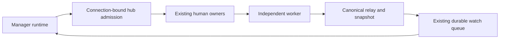

# Manager Sessions Implementation Plan

> **For agentic workers:** REQUIRED SUB-SKILL: Use superpowers:subagent-driven-development (recommended) or superpowers:executing-plans to implement this plan task-by-task. Steps use checkbox (`- [ ]`) syntax for tracking.

**Goal:** Let a human-designated Manager session operate other sessions through the hub using eight existing tools and one new control tool.

**Architecture:** Add a persisted Manager setting and a session-bound client of existing hub operations. Reuse human lifecycle/input handlers, canonical relay fan-out, and the runtime's durable watch queue. Carry authenticated actors and completion/provenance metadata through those existing paths; add no management scheduler, assignment system, or operation journal.

**Tech Stack:** Go, AppWire over existing WebSocket/SSH streams, existing SQLite `index.db`, React/TypeScript web and React Native clients, scripted-provider integration tests.

**Spec:** [Approved manager design](../specs/2026-10-20-session-manager-design.md), with its [command-surface audit](../specs/2026-10-20-session-manager-tool-audit.md).

**Status:** Replacement plan for Jesse's review. Product implementation remains paused. The earlier subagent-driven preference is retained, subject to review of this plan.

## Global Constraints

- “A designated manager has full delegated human authority for session management.”
- “It can manage everything reachable through its hub, including connected remote hosts and other managers. There are no project grants or exclusive controllers.”
- “A remotely running Manager acts for the hub where Jesse enables Manager.” That hub defines its reach; hosting and other connected hubs cannot silently replace it.
- “Manager mode stays on until Jesse turns it off. Resume, restart and Clear preserve it. New sessions and forks start with it off.”
- “One new tool: `session_control`.” Extend only `job_list`, `job_status`, `read_transcript`, `delegate_send`, `job_watch`, `model_list`, `delegate`, and `job_stop`.
- “Ordinary schemas and default calls retain their existing contracts.” Schema visibility is not authorization; every hub admission checks the current setting and authenticated binding.
- “A notification does not answer a pending question.” Human single-delegate stop leaves children running; ordinary owned-delegate stop remains recursive.
- “A capability-conditional skip is not completion of the required remote loop.” Qualify shared human and Manager remote input together.
- “No arbitrary RPC names, generic remote-tool executor or project/host administration is exposed.” No model-visible hub credentials or Manager-enable action.
- “No deletion or rewrite of the preserved implementation is authorized.” No wholesale reuse of the old framework.
- Follow `docs/developing-evener/testing.md`: scripted LLM boundary, real Evener layers, deterministic synchronization, structural assertions and whole-output prompt goldens. No copy-string assertions, external-provider dependency, or mocked internal E2E behavior.
- Read `docs/developing-evener/design-system.md` before UI changes. Use existing `Switch` and `SwitchRow`; no new widget or widget prop. Keep product docs current with each shipped slice.

## Review Focus

1. **Clear followed by restart:** preserve one workspace's setting while changing runtime instance; a fork of that workspace stays ordinary. Test in Task 1.
2. **Late or forged authority:** old schema, replaced connection, crossed host binding, or revocation cannot admit a new Manager operation; ordinary tools continue. Tests in Tasks 2 and 5.
3. **Partial creation and reply loss:** preserve a created reference, submit no task after watch failure, and never turn uncertain creation into an automatic duplicate. Tests in Tasks 3, 4b and 4d.
4. **Stale observation:** a question, waiting turn, duplicate snapshot, or previous generation cannot complete the current task; restart/rebind/disable handoff works after an earlier watch delivery. Tests in Tasks 4a and 4c.
5. **Identity across consumers and pages:** equal bare IDs on two hosts, alias subscriptions, and reconnect after several pages must not merge owners, consume another manager's reports, or displace a human watcher. Tests in Tasks 5 and 6.

---

## Execution lane and preservation

The inspected mainline is `fb5fc64bd4555fae67a4b4a6f5ec4eb02a8438bf`. The source audit also distinguishes pre-manager `34d4ea239ec6c192838b544d6c4dd4e7f70c04a1` from the paused framework. Mainline now includes `ModelListParams.Refresh` and newer input-recovery/client work; retain them.

After plan approval, fetch only `main` with `git fetch --no-tags origin main`, record the resolved commit, and create a fresh isolated worktree from it using the worktree skill/native tool. If relevant owners changed, recheck their interfaces before implementation. Copy only this plan and the two approved design documents into that lane. Leave `session-manager-design`, all its commits, and its 34 paused modified/untracked paths intact. Do not reset, restore, delete, merge, or cherry-pick that branch into the implementation lane.

No old product file is a dependency. The only inspected reuse candidate is bounded reverse-call correlation/cancellation from `internal/appserver/management_connection.go` and its client counterpart. If useful, extract those mechanics under the new interfaces with fresh tests. Do not copy `ManagementService`, grants, assignment state, reconciliation, reserved launch, parking, or the special managed Stop behavior.

Implement the tasks sequentially. Each task owns its listed changes, includes its tests and documentation, and finishes with a reviewed commit. Check current status before staging, stage only the task's exact paths, inspect the staged diff, and use the normal hooks. A filename listed as **Create** below means absent on inspected mainline, even if this preserved branch has an old file with a similar purpose.

Tasks 4a–4d replace the former combined local-loop task. Each is a separate test/review/commit unit; execute them in order before Task 5. Task 1 records Jesse's chosen saved-session initialization rule. Product implementation still requires approval of this replacement plan.

## Shared interfaces and tool layout

Names in this section are **new plan decisions**, not claims about existing APIs. Put wire types in `appwire/session_tools.go`; reuse the existing request/result types in the owner tables instead of reproducing their fields.

```go
// agent/session_hub.go: runtime-private, bound to an authenticated connection.
type SessionHubClient interface {
    State(context.Context) (appwire.ManagerView, error)
    Invoke(context.Context, appwire.SessionOperationRequest) (appwire.SessionOperationResponse, error)
    Watch(context.Context, appwire.SessionWatchRequest) (<-chan appwire.SessionWatchUpdate, error)
}

// appwire/session_tools.go: shared wire types.
type ManagerSetting struct { HubID string; Enabled bool; Revision uint64 }
type ManagerView struct { Ref, InstanceID string; Setting ManagerSetting }
type ThreadManagerSetParams struct { Ref string; Enabled bool }
type ThreadManagerSetResponse struct { View ManagerView }
type SessionActor struct { Kind, ManagerRef string } // Kind: human or manager
```

`SessionOperationRequest` is a closed union: exactly one typed request member, with no caller, credential or arbitrary method field. Members are `Discover`, `Read`, `Turns`, `Activity`, `Tasks`, `Job`, `JobOutput`, `Models`, `Create`, `Start`, `Queue`, `Steer`, `Stop`, and `Control`. `SessionOperationResponse` carries the matching typed result and authenticated actor, preserving existing receipts/errors, ownership and partial-result evidence. `State` and watch traffic have fixed private wire methods, not user-selected RPC names. Human clients cannot supply trusted actor metadata; internal forwarding accepts it only on the authenticated bound path.

`SessionWatchRequest` contains `Ref string`, `Events []string`, and `Completion bool`. Events are `question`, `approval`, `communicate`, and `status`; a completion watch also keeps question/approval observation until completion or explicit clear. `SessionWatchUpdate` carries the existing snapshot/notification plus typed `SessionObservationMetadata`: `Ref`, `InstanceID`, `GenerationID`, `TurnID`, `EntryID`, `EndTurn`, `EndReason`, `TerminalAccepted *bool`, `CausalKnown bool`, and the existing `provenance.Causal`. Use real read-generation/entry identities, not a new counter. Cancellation of the supplied context detaches this consumer; Task 4c owns the persisted watch's subsequent recovery or ended notice.

| Tool | Manager-only arguments and result contract |
| --- | --- |
| `job_list` | `hub` object selects `discovery` or `activity`. Discovery uses existing thread-list filters/cursors and returns sanitized source references, including empty hosts and the local source. Activity requires `ref`, `scope` (`session` or `subtree`), `kind` (`summary`, `delegates`, `jobs`, or `watches`), and existing page parameters. |
| `job_status` | `hub` object contains canonical `ref`, optional `job_id`, and optional `tasks` page selector. Return actual kind, ownership, capabilities, pending question/approval metadata, and structured follow-up arguments. |
| `read_transcript` | `hub` object selects `history` or `job_output`, with canonical `ref` and the source's typed cursor/limit or `job_id/max_bytes/before_bytes`. Reject local range, exact-JSONL, search or expansion arguments in this branch. |
| `delegate_send` | Preserve ordinary `to=dlg_…`. A canonical hub ref in `to` requires Manager admission. Add `input_mode` (`start`, `queue`, or `steer`), typed `input`, `client_mutation_id` and `expected_instance_id`; `message` becomes a text item only when typed input is absent. Reject simultaneous text and typed input. Return human input receipts, never owned `earlier_results`. |
| `job_watch` | Canonical hub ref in `source`, Manager-only `hub_events` and `completion`. Existing inspect/clear uses the resulting owned watch ID. Default hub observation requests question/approval and one-shot completion. No implicit all-session subscription. |
| `model_list` | `host` selects the source; `cwd` and `refresh` map to current `ModelListParams`. No host means the unchanged frozen startup catalog, including its ordinary availability rules. |
| `delegate` | `top_level` contains typed `ThreadStartParams` and optional watch options. Manager schema separates this branch from owned creation; `prompt` remains required only for owned creation. Top-level input is `ThreadStartParams.Input`, held until watch/read succeeds. Require interactive mode, reject owned-only arguments, return canonical ref and separate creation/watch/input outcomes. |
| `job_stop` | Canonical hub `target` requires explicit `action` (`interrupt`, `delegate_stop`, `shutdown`, or `force_stop`). Use the action's existing preconditions, including `expected_daemon` for force-stop. An owned job/delegate target with no human action follows the existing branch. |
| `session_control` | `action` and an action-specific typed `arguments` object. Task 3 introduces approval; Task 7 extends the same interface with its full table. Only implemented actions are exposed. No creation, input, stops or Manager toggle. |

Tool schemas expose only the fields legal in each mode. Generate schemas from typed arguments where the current tool machinery permits; validate disallowed combinations at execution too. Provider-profile schema overrides must preserve provider aliases, intent fields and tool policy. Do not restore denied unrelated tools or grant ordinary delegation allowance to enable independent creation.

An explicit tool-policy denial, including exclusion by a policy allowlist, excludes the whole named tool and its Manager branch; execution rejects a forged call. Ordinary absence is different: when registration, a provider's schema-definition omission or delegation allowance leaves an extended tool absent, Manager mode adds only its implemented Manager branch. For example, `model_list` then requires `host`, and `delegate` requires `top_level`; neither gains its unavailable ordinary behavior. After disable, remove these Manager-only registrations. Tools already present retain their ordinary schemas and behavior alongside the permitted extension.



The first useful slice admits a Manager read. Input then uses the real human handler. Creation and watch delivery complete the question/answer loop before extending it across remote sources and the remaining controls.

### Task 1: Persist Manager mode and expose the human toggle

**Files:**
- Create: `cmd/evener-hub/internal/hubcore/session_preferences.go`, `cmd/evener-hub/app_manager_mode.go`, and corresponding `_test.go` files.
- Modify: `agent/schema/snapshot.go`, `agent/session_config.go`, `agent/session_state.go`, `agent/session_init.go`, `agent/fork.go`, `cmd/evener/serve.go`, `cmd/evener-hub/internal/hubcore/config.go`, `cmd/evener-hub/main.go`, `cmd/evener-hub/web.go`, `cmd/evener-hub/app_rpc.go`, `cmd/evener-hub/app_threadlifecycle.go`, `appwire/types.go`, `appwire/protocol.go`.
- Create: `appwire/session_tools.go`, `cmd/evener/serve_workspace_identity_test.go`.
- Modify: `appwire-client/typescript/model.ts`, `appwire-client/typescript/reducer.ts`, generated `appwire-client/typescript/types.gen.ts`; web `cmd/evener-hub/frontend/src/stores/threads.ts`, `cmd/evener-hub/frontend/src/panes/session/chrome/DetailsPanel.tsx`; `mobile/src/services/conversation.ts`, `mobile-native/src/sessionControls.ts`, `mobile-native/src/session/SessionInfoSheet.tsx`.
- Test: `appwire-client/typescript/reducer.test.ts`, `cmd/evener-hub/frontend/src/stores/threads.sessionActions.test.ts`, `cmd/evener-hub/frontend/src/panes/session/chrome/DetailsPanel.test.tsx`, `mobile-native/src/session/SessionInfoSheet.test.tsx`, `mobile-native/src/sessionControls.test.ts`; document mode lifetime in `docs/automation.md`.

**Interfaces:**
- Produce `schema.SessionMeta.WorkspaceID string`, `Session.WorkspaceID() string`, and `SessionConfig.WorkspaceID string` as runtime bootstrap input, persisted only in metadata rather than inherited config snapshots. Initialize it from a new root's ID, carry it through Clear, restore it before preparing the runtime reference, and reset it on new roots/forks. Keep instance IDs separate. This is a session workspace identity, unrelated to the account-credential `WorkspaceID` in `appwire/types.go`; leave that account field unchanged.
- Use existing `EvenerThread.Ref` as the canonical workspace reference. `serve.go` already carries that reference through Clear, `ThreadClearResponse.Ref` returns it, and remote translation qualifies it. The new metadata preserves its thread component across process restart; add no duplicate wire workspace ID. Resolve aliases through the existing source and thread read before accessing preferences; an unavailable identity is unresolved, not a fabricated key.
- **Existing-session initialization:** when saved metadata lacks `WorkspaceID`, initialize it to that saved session's own ID and persist it through the existing metadata owner before publishing the runtime identity. This matches today's restart reference. Do not infer an earlier pre-Clear identity from history or rewrite transcripts. Pin an old-format fixture through load, save, Clear and restart; retain any existing nonempty workspace identity.
- Produce `hubcore.NewSessionPreferencesStore(dbPath string) *SessionPreferencesStore`, `HubID() (string,error)`, `Manager(ref string) (appwire.ManagerSetting,error)`, and `SetManager(ref string, enablingHubID string, enabled bool) (appwire.ManagerSetting,error)`, exposed as `WebConfig.SessionPreferences`. Construct the shared store in `cmd/evener-hub/main.go` alongside the existing index-backed stores. Persist a nonsecret hub ID once in existing `index.db`; it is an identity, never a credential.
- Store one Manager row beside the workspace in its hosting hub's existing `index.db`, keyed by the canonical hosting-source workspace ref. This storage choice keeps enable/disable and authority selection in one transaction. The enabling hub owns the setting and admission; the hosting hub stores and forwards it without acquiring that authority. Task 1 handles the local case; Task 5 forwards the same typed operation and read for remote workspaces, with no controller-side replica.
- On enable, atomically select the authenticated enabling hub when the setting is off; an already-enabled setting accepts only its current hub. Reject another hub's attempted toggle with the current structured view, leaving the setting unchanged. Turning it off through its selected hub permits a later explicit enable elsewhere. Advance `Revision` only when the setting changes, preserving it across Clear/restart and idempotent writes. This configuration revision detects missed off/on changes for watches; it is not a target execution epoch or assignment system. Missing means off at revision zero.
- Produce human-only `evener/thread/manager/set` with the typed params/response above and `EvenerThread.Manager bool`, plus the selected hub identity and editability in the existing human-control projection. Local human calls use this hub's stored ID; forwarded calls use Task 5's connection-bound peer identity, never human/tool JSON. Other hubs display the selected authority and a read-only switch while it is enabled. Persist no inherited mode or hub choice in new/forked sessions.

- [ ] **Write failing lifetime tests.** Exercise real save/load, Clear, restart from the replacement session, resume, fork, and two sources with equal IDs. Drive the human RPC, not direct test-only state.

```go
// TestManagerModeClearRestartAndFork
if cleared.WorkspaceID() != original.WorkspaceID() || restarted.WorkspaceID() != original.WorkspaceID() { t.Fatal("workspace identity changed") }
if !restartedView.Setting.Enabled || forkView.Setting.Enabled || newView.Setting.Enabled { t.Fatal("wrong mode lifetime") }
// TestManagerModeSourceQualified
if sourceA.Setting.Enabled == sourceB.Setting.Enabled { t.Fatal("source settings collided") }
// TestManagerModeAuthoritySelection
if competingEnableErr == nil || selected.Setting.HubID != enablingHubID || afterNoop.Setting.Revision != selected.Setting.Revision { t.Fatal("authority changed unexpectedly") }
if reenabled.Setting.Revision <= disabled.Setting.Revision { t.Fatal("off/on change lost") }
```

- [ ] **Run red:** `(cd agent && go test ./schema ./ -run 'TestManagerMode|TestWorkspaceIdentity' -count=1)` and `go test ./cmd/evener ./cmd/evener-hub ./cmd/evener-hub/internal/hubcore -run 'TestManagerMode|TestWorkspaceIdentity' -count=1`. First establish compilation, then require a behavioral failure before implementing persistence.
- [ ] **Implement identity, persistence and human projection.** Reuse existing metadata/config paths and SQLite setup. Extract no new authority subsystem. Human setting changes publish through the existing thread update owner. Keep the saved setting on when a host disconnects; reconnect restores its usable binding automatically.
- [ ] **Add failing UI tests, then wire existing switches.** Assert pending state, canonical response reconciliation, reconnect, and failure retaining the server's setting. New/forked sessions are unchecked; no extra Resume button, settings panel or widget API.
- [ ] **Run green:** repeat the Go checks. After existing preflights, run `(cd cmd/evener-hub/frontend && npx vitest run src/panes/session/chrome/DetailsPanel.test.tsx src/stores/threads.sessionActions.test.ts ../../../appwire-client/typescript/reducer.test.ts --configLoader runner --maxWorkers=2 && npm run typecheck)` and `(cd mobile-native && npm test -- src/session/SessionInfoSheet.test.tsx src/sessionControls.test.ts && npm run test:shared && npm run check)`. Run `go generate ./appwire/...` and inspect generated changes. Checks must exit zero with no failures and actually select the named tests.
- [ ] **Commit** only these paths: `feat: persist human-controlled manager mode`.

### Task 2: Admit a bound runtime and deliver the first Manager read

**Files:**
- Create: `appwire/client_session_tools.go`, `internal/appserver/session_tools_connection.go`, `server/appwire_session_tools.go`, `cmd/evener-hub/session_tools.go`, `agent/session_hub.go`, `agent/session_tools_hub.go`; corresponding focused `_test.go` files.
- Modify: `appwire/session_tools.go`, `appwire/client.go`, `appwire/types.go`, `appwire/protocol.go`, `internal/appserver/server.go`, `internal/appserver/websocket.go`, `server/server.go`, `cmd/evener/serve.go`, `cmd/evener-hub/internal/appsource/local_daemon.go`, `cmd/evener-hub/app_rpc.go`, `cmd/evener-hub/app_manager_mode.go`, `agent/session.go`, `agent/session_tool_registry.go`, `agent/session_tools.go`, `agent/internal/tool/definitions.go`, `agent/session_model_call.go`, `agent/session_prompts.go`, `agent/prompt_data.go`, `agent/prompts/system.md.tmpl`.
- Test: `agent/session_hub_test.go`, `cmd/evener-hub/session_tools_test.go`, connection/client tests; update actual-request prompt goldens beside `agent/delegate_messaging_guidance_test.go`. Update `docs/automation.md`.

**Interfaces:**
- Produce `Session.SetHubClient(SessionHubClient)` and the shared client interface. The binding is runtime-private and never copied into spawn/fork options.
- Produce `(*sessionOperations).Invoke(ctx context.Context, caller appwire.ManagerView, request appwire.SessionOperationRequest) (appwire.SessionOperationResponse,error)`. Its owner holds existing config, sources, relays, navigation and web server. The bound transport supplies `caller`; tool arguments cannot.
- Produce fixed methods `evener/runtime/session/bind`, `evener/runtime/session/state`, `evener/runtime/session/invoke`, `evener/runtime/session/watch`, `evener/runtime/session/unwatch`, and targeted `evener/runtime/session/observation` notifications. Binding identifies canonical workspace, instance, selected hub and a connection-local binding ID. Add a `SessionTools` feature to existing initialize capability/feature types; unsupported peers remain ordinary, with no compatibility shim.
- Bind the existing authenticated hub-to-daemon connection from discovered identity. Reverse requests use a separate ID namespace, a bounded pending map, existing frame writes and cancellation; responses bypass request-worker queues. Only explicitly installed handlers accept these fixed methods. State is readable while disabled; invoke/watch require current Manager mode. This is not a general reverse-RPC registration API.

- [ ] **Write failing real-connection admission and actual-model-request tests.** Capture scripted-provider requests before enable, after enable, after disable and after model/profile changes. Cover every extended tool with its ordinary registration present, absent and explicitly denied, including profile omissions/aliases and zero delegation allowance. Require only the Manager branch when absent, no tool when denied, and removal of synthetic registrations after disable.

```go
// TestManagerAdmissionRevocationAndOrdinaryTools
if forgedErr == nil || staleBindingErr == nil || disabledErr == nil { t.Fatal("unauthorized admission") }
if ordinarySendErr != nil { t.Fatal(ordinarySendErr) }
// TestManagerRequestComposition: structural schema assertions plus complete request-prompt golden.
if offHasHubArgs || offHasControl || !onHasHubArgs || disabledHasControl { t.Fatal("wrong exposed tools") }
if absentCatalogAllowsNoHost || zeroAllowanceAllowsOwnedDelegate || deniedToolExposed || deniedToolExecuted { t.Fatal("ordinary absence or policy bypassed") }
```

- [ ] **Run red:** `go test ./appwire ./internal/appserver ./server ./cmd/evener-hub -run 'TestSessionTools|TestManagerAdmission' -count=1`; `(cd agent && go test ./ -run 'TestManagerRequest|TestManagerAdmission' -count=1)`.
- [ ] **Implement the local binding and read path.** Start with discovery and status through existing thread/host/read owners. Extract the `thread/read` closure into the shared typed owner where needed, retaining its relay/fallback behavior. Reject unknown union members and simultaneous members before dispatch. A closed/replaced connection invalidates its bindings and closes its consumers.
- [ ] **Refresh tools and prompt atomically.** Obtain current state outside `s.mu`; publish schemas and approved guidance together before the model-request snapshot. Cover both profile and registry-only definitions and lock cache readers. Expose only implemented branches as each slice lands; later tasks extend this same composition. A temporarily unavailable binding cannot authorize calls or block healthy ordinary tools; preserve the saved setting and restore the surface on reconnection. In-flight stale-schema calls still face hub admission.
- [ ] **Run green and a race check** on the targeted new connection/admission tests. Confirm a real Manager tool read reaches the existing hub owner and returns source-qualified references; ordinary forged extension arguments fail at execution, not only schema validation.
- [ ] **Commit:** `feat: bind manager tools to authenticated hub sessions`.

### Task 3: Reuse human input and approval handling with honest actors

**Files:**
- Create: `cmd/evener-hub/session_input.go`, `cmd/evener-hub/session_controls.go`, `cmd/evener-hub/session_controls_test.go`, `agent/session_input_actor_test.go`, `server/appwire_session_actor_test.go`, `cmd/evener-hub/session_input_test.go`.
- Modify: `appwire/session_tools.go`, `appwire/types.go`, `agent/schema/turn.go`, `agent/session_client_mutation.go`, `agent/session_client_mutation_queue.go`, `agent/session_client_mutation_persist.go`, `agent/session_lifecycle.go`, `agent/session_escalation.go`, `server/server.go`, `server/appwire_runtime.go`, `cmd/evener/serve.go`, `cmd/evener-hub/app_rpc.go`, `cmd/evener-hub/session_tools.go`, `agent/session_tools_hub.go`, `internal/apptranscript/apptranscript.go`, `internal/apptranscript/notice.go`.
- Modify: shared `appwire-client/typescript/model.ts`, `appwire-client/typescript/reducer.ts`, generated types; web transcript `cmd/evener-hub/frontend/src/panes/session/transcript/messages/UserMessageItem.tsx`, `cmd/evener-hub/frontend/src/panes/session/transcript/messages/SteeringItem.tsx`; `mobile-native/src/projectedRows.ts` and their existing tests. Update `docs/daily-work.md`.

**Interfaces:**
- Produce `(*sessionOperations).Start(context.Context, appwire.TurnStartParams) (appwire.TurnStartResponse,error)`, `.Queue(context.Context, appwire.TurnQueueParams) (appwire.TurnQueueResponse,error)`, and `.Steer(context.Context, appwire.TurnSteerParams) (appwire.TurnSteerResponse,error)`, extracted from existing guarded human RPC closures. Both human and Manager admissions call them.
- Add authenticated actor context to internal dispatch. Define persisted `schema.SessionActor` with the same `Kind,ManagerRef` fields as the wire type, following the existing persisted-versus-wire separation. Produce `(*Session).AcceptClientMutationStartAs(appwire.TurnStartParams, schema.SessionActor) (appwire.TurnStartResponse,error)`, `AcceptClientMutationQueueAs(appwire.TurnQueueParams, schema.SessionActor) (appwire.TurnQueueResponse,error)`, and `AcceptClientMutationSteerAs(appwire.TurnSteerParams, schema.SessionActor) (appwire.TurnSteerResponse,error)`. Add matching `StartAs`, `QueueAs` and `SteerAs` callbacks to `server.RetrySafeTurnFunctions`. Existing direct-human entry points delegate to this shared logic with `human`; authenticated Manager dispatch supplies `manager` plus canonical manager reference and never falls back to a human callback.
- Add `ResolveSandboxEscalationAs(id string, approve bool, actor schema.SessionActor) error`; retain the direct-human wrapper. Persist the actor in existing mutation records, queued/steering input, input turns and approval notices. Retries retain the first accepted actor.
- Produce `SessionControlRequest`/`SessionControlResponse` in `appwire/session_tools.go` and `(*sessionOperations).Control(ctx context.Context, request appwire.SessionControlRequest) (appwire.SessionControlResponse,error)` in `session_controls.go`. The request is a closed union, initially only `Approval *appwire.SandboxEscalationResolveParams`; the matching response uses `EmptyResponse` and authenticated attribution. Wire the shared operation union's `Control` member to this real approval implementation now. Task 7 extends these exact types and method; no placeholder success or second approval dispatcher.

- [ ] **Write failing real-owner tests** for start/queue/steer, typed skill/command input, notification-versus-answer, human/Manager races, replay after response loss and approval without a browser. Attach the actual subscription before requesting approval. Add a typed actor-display test for both renderers.

```go
// TestManagerInputActorRetryAndPendingQuestion
if noticeClearedQuestion || !replyClearedQuestion { t.Fatal("notification/input gate changed") }
if acceptedInputs != 1 || replay.ClientMutationID != first.ClientMutationID { t.Fatal("duplicate accepted input") }
if persistedActor.Kind != "manager" || persistedActor.ManagerRef != managerRef { t.Fatal("actor lost") }
// TestManagerApprovalStaleDecision
if staleErr == nil || recordedDecisions != 1 { t.Fatal("stale approval changed the decision") }
```

- [ ] **Run red:** `(cd agent && go test ./ -run 'TestManagerInput|TestManagerApproval' -count=1)`; `go test ./server ./cmd/evener-hub -run 'TestManagerInput|TestManagerApproval|TestSessionActor' -count=1`.
- [ ] **Implement `delegate_send`'s hub branch and approval action.** Extend Task 2's actual-request schema test to require `session_control` only while Manager mode is enabled, initially with the implemented approval action. Use existing input normalization, receipts, instance checks and typed-input gates. Never call `ProcessInput` directly, resolve a question through a new ledger, or acknowledge owned delegate reports. Reject forged actor fields at the human and Manager-facing boundaries.
- [ ] **Verify persisted/reloaded actors and unchanged ordinary messaging.** Exercise running and idle owned delegates with Manager on/off. Keep response-loss evidence unknown when appropriate and reuse the same input ID. Render actor identity from typed metadata, with human input still labeled human.
- [ ] **Run green:** repeat targeted checks, actual `TestServeAsk_StatusAwaitingAtRest` and `TestAskUserLiveStatusFrameCarriesAskPending`, touched shared/web/native actor tests, typechecks and wire generation.
- [ ] **Commit:** `feat: route manager replies through human input owners`.

### Task 4a: Preserve observation evidence through recording and replay

**Files:**
- Modify: `agent/schema/turn.go`, `agent/session_execution.go`, `agent/session_events.go`, `agent/session_tools_communicate.go`, `internal/apptranscript/notice.go`, `internal/apptranscript/apptranscript.go`, `internal/appprojector/appwire_projection.go`, `appwire/session_tools.go`, `appwire/types.go`, `appwire/jsonrpc.go`, `cmd/evener-hub/app_relay.go`, generated wire types, and adjacent tests.
- Create: `agent/session_observation_test.go`, `internal/appprojector/session_observation_test.go`. Document evidence semantics in `docs/job-control.md`.

**Interfaces:**
- Produce the shared `SessionObservationMetadata` projection. Add persisted `schema.Turn.Causal *provenance.Causal` and `CausalKnown bool`. Capture active provenance once before recording and emit that same captured value. New relevant records set `CausalKnown=true`, including known-empty provenance. Carry it through history, snapshots and live envelopes with existing watch keys and bounded-chain evidence. Unstamped history stays readable with unknown causality; do not migrate it or invent ancestry.
- Derive `TerminalAccepted` from the existing typed terminal result/tool state for the matching communicate call and generation, retaining nil when unknown. `EndTurn` and `EndReason` come from recorded/runtime typed fields. Recording precedes terminal arbitration, so a recorded message alone cannot prove acceptance. Preserve current arbitration.

- [ ] **Write failing recording/projection tests.** Lose live delivery, reload the real transcript, and project a resync. Cover known-empty/unknown causality and competing terminal calls with opposite end reasons.

```go
// TestManagerObservationReplayCausal
if !replayed.CausalKnown || !reflect.DeepEqual(replayed.Causal, recordedCausal) { t.Fatal("replay lost causal evidence") }
// TestManagerObservationTerminalEvidence
if rejected.TerminalAccepted == nil || *rejected.TerminalAccepted || unknown.TerminalAccepted != nil { t.Fatal("terminal evidence fabricated") }
```

- [ ] **Run red:** `(cd agent && go test ./ ./schema -run '^TestManagerObservation' -count=1)`; `go test ./internal/apptranscript ./internal/appprojector ./cmd/evener-hub -run '^TestManagerObservation' -count=1`.
- [ ] **Implement the recording and projection changes** in the named owners, with no watch lifecycle or creation changes in this task.
- [ ] **Run green:** repeat the checks, regenerate wire types and inspect the diff. Compare live and replay metadata structurally.
- [ ] **Commit:** `feat: preserve manager observation evidence across replay`.

### Task 4b: Preserve a known created reference on partial failure

**Files:**
- Modify: `appwire/errors.go`, `cmd/evener-hub/app_threadlifecycle.go`, `cmd/evener-hub/internal/appsource/remote_hub_mutations.go`, `cmd/evener-hub/internal/appsource/remote_hub_source.go`, `cmd/evener-hub/internal/appsource/remote_hub_refs.go`, and adjacent tests.
- Create: `cmd/evener-hub/session_creation_test.go`, `cmd/evener-hub/internal/appsource/session_creation_test.go`. Update the creation outcome contract in `docs/automation.md`.

**Interfaces:**
- Produce `appwire.ThreadStartPartialErrorData` in `appwire/errors.go`, embedding `ErrorData` with `CreatedRef string` and `CreatedInstanceID string`. Once `hubThreadStart` knows the spawned identity, include it on subsequent failure paths while retaining the error classification and disabling automatic creation retry. The existing router discards results returned alongside an error, so the evidence must travel in the error. Remote forwarding preserves these fields and translates `CreatedRef`. Missing evidence remains an unknown launch.

- [ ] **Write failing owner and actual-wire tests.** Fail the owner's read after spawn, before `hubThreadStart` returns. Round-trip through the real `internal/appserver/router.go` locally and through remote forwarding; do not change its dispatch contract.

```go
// TestManagerCreatePostSpawnFailure
if partial.CreatedRef != spawnedRef || partial.CreatedInstanceID != spawnedInstance || submittedInputs != 0 || spawnCount != 1 { t.Fatal("known creation lost or repeated") }
```

- [ ] **Run red:** `go test ./cmd/evener-hub ./cmd/evener-hub/internal/appsource ./appwire -run '^TestManagerCreatePostSpawnFailure' -count=1`.
- [ ] **Implement partial-error propagation** through those existing owners, without adding retries or changing successful creation.
- [ ] **Run green:** repeat the checks and existing creation-owner regressions. Assert original error classification and qualified identity at the receiving client.
- [ ] **Commit:** `fix: retain created session identity in partial errors`.

### Task 4c: Connect hub observations to recoverable runtime watches

**Files:**
- Create: `cmd/evener-hub/session_observation.go`, `cmd/evener-hub/session_observation_test.go`, `agent/job_watch_hub.go`, `agent/job_watch_hub_test.go`.
- Modify: `appwire/session_tools.go`, `cmd/evener-hub/session_tools.go`, `cmd/evener-hub/app_manager_mode.go`, `agent/job_watch.go`, `agent/session_hub.go`, `agent/session_tools_hub.go`, `cmd/evener/serve.go`. Update `docs/job-control.md`.

**Interfaces:**
- Consume Task 4a's metadata and Task 2's binding. Produce `(*sessionOperations).Watch(ctx context.Context, caller appwire.ManagerView, request appwire.SessionWatchRequest) (<-chan appwire.SessionWatchUpdate,error)` using the existing canonical relay and subscription cut, with no second upstream source subscription.
- Produce `(*jobManager).onHubObservation(watchID string, update appwire.SessionWatchUpdate) error`, feeding existing watch evaluation, provenance, durable sends and notification wake. Extend `WatchConfigSnapshot` with hub target, target generation, selected hub and setting revision. Reuse its persisted delivered-entry/pending-delivery identities and existing restart end-notice machinery.
- Root completion requires the accepted terminal winner with `end_turn=true,end_reason=done` for the watched generation. A question, wait, rejected competing call, idle state or generic turn completion is insufficient. Delegate targets use their existing settled outcome evidence. Failures and interruption retain their actual outcome; unknown evidence remains unknown.
- For replay with `CausalKnown=false`, report the replay gap rather than treating the record as a fresh automatic trigger, and continue observing qualified current events. The unstamped record remains readable as history.

| Consumer transition | Required runtime behavior |
| --- | --- |
| Hub/SSH connection closes or is replaced, runtime survives | Keep the watch suspended under its existing ID and preserve pending deliveries. Queue one interruption notice for that loss episode. Existing transport recovery rebinds; when the authoritative setting is still enabled at the same hub/revision, automatically reissue Watch and consume initial/resync state before declaring observation restored. |
| Same-generation snapshot repeats or races live delivery | Deduplicate by target instance/generation and entry identity, reusing existing delivery IDs. Preserve causal suppression/depth through replay. Do not report completion twice. |
| Manager disabled while connected | The setting-change owner actively closes its consumers. The runtime removes each hub watch and durably queues its ended notice before waking. Already-pending delivery identities survive; ending observation is not worker completion. |
| Disable, or off/on, discovered after reconnect | A disabled setting or changed hub/revision ends the old watches through the same durable notice path. A later enable does not re-arm them. Ordinary tools remain usable. |
| Target replaced, unsupported observation, or unrecoverable subscription failure | End the affected watch with a reason and re-registration guidance. Preserve evidence already delivered; do not silently switch to a new target generation. |
| Manager runtime restarts | Cancel continuing hub watches and reliably deliver the existing restart/re-registration notice, including watches that fired earlier. Preserve pending deliveries. |

- [ ] **Write failing real-connection/runtime watch tests** for every table row, including loss after an earlier delivery, hub restart, disable with the connection intact, off/on entirely during an outage, and runtime restart. Synchronize teardown/rebind and callbacks rather than sleeping.

```go
// TestManagerWatchCompletionAndRestart
if questionCompleted || waitingCompleted || staleGenerationCompleted || completionDeliveries != 1 { t.Fatal("wrong completion evidence") }
if rejectedDoneCompleted || acceptedWaitingCompleted || replayFuseDepth != liveFuseDepth { t.Fatal("terminal or causal evidence lost") }
if watchPresentAtWake || !restartEndNotice || pendingIDAfter != pendingIDBefore { t.Fatal("watch lifetime lost") }
// TestManagerWatchRebindAndDisable
if reattachedWatchID != originalWatchID || resyncDeliveries != 1 || !interruptionNotice { t.Fatal("watch recovery lost") }
if disabledWatchPresent || offOnWatchRearmed || endedNotices != 1 || !ordinaryToolSucceeded { t.Fatal("disable handoff lost") }
// TestManagerWatchUnknownCausalityReplay
if !unstampedRecordReadable || unknownEventTriggers != 0 || !replayGapNotice || qualifiedDeliveries != 1 { t.Fatal("unknown replay or later delivery mishandled") }
```

- [ ] **Run red:** `go test ./cmd/evener-hub -run '^TestManagerWatch|^TestManagerObservation' -count=1`; `(cd agent && go test ./ -run '^TestManagerWatch|^TestManagerObservation' -count=1)`.
- [ ] **Implement the adapter and transition table.** Remove one-shot completion before wake, retaining question/approval observation until then or explicit clear. Mode changes use the existing state-update path; even while disabled, the runtime can read State and settle its local watch records. Rebind state must precede re-subscription. Use existing notice queues and causal budgets, never user input or a separate recovery service. A pending human question keeps its existing wake gate.
- [ ] **Run green and targeted races.** Verify actual durable notices, same-watch recovery, exact completion count, unchanged pending IDs and independent human/Manager relay consumers.
- [ ] **Commit:** `feat: recover manager watches across binding changes`.

### Task 4d: Complete the local creation, question and result loop

**Files:**
- Create: `cmd/evener-hub/e2e_manager_session_test.go`.
- Modify: `agent/session_tools_hub.go`, `cmd/evener-hub/session_tools.go`, `appwire/session_tools.go`. Update `docs/automation.md`.

**Interfaces:**
- Consume Task 3's Start/approval owners, Task 4b's partial errors and Task 4c's Watch. Produce the top-level `delegate` adapter: existing empty `hubThreadStart` → requested watch and initial read → existing Start input. Return creation, watch and input outcomes independently. No new create-with-observer API, launch reservation or automatic creation retry.

- [ ] **Write failing E2E tests** using the real hub/serve stacks from `e2e_turn_control_test.go`. Script only provider tool calls and questions; keep input, projection, subscriptions and delivery real.

```go
// TestE2E_ManagerLocalQuestionLoop
if worker.IsSubagent || worker.Manager || worker.ParentSessionID != "" { t.Fatal("worker is not independent") }
if !questionObserved || !answerInWorkerHistory || !resultInManagerHistory || ownedReportAcknowledged { t.Fatal("incomplete independent loop") }
// TestManagerCreateWatchFailure
if createdRef == "" || submittedInputs != 0 || watchErr == nil { t.Fatal("partial creation misreported") }
```

- [ ] **Run red:** `go test ./cmd/evener-hub -run '^TestE2E_ManagerLocalQuestionLoop$|^TestManagerCreateWatchFailure' -count=1`.
- [ ] **Implement creation composition.** Subscribe before input so approvals work without a browser. If creation, watch or initial read fails, return every known reference and leave the empty worker without task submission. Unknown launches remain unknown. Workers keep independent lifetimes when their manager ends.
- [ ] **Run green**, checking both transcripts and actors, no-browser approval, pending-human-question behavior, and ordinary delegate constraints/reporting.
- [ ] **Commit:** `feat: connect manager tools to independent session work`.

### Task 5: Qualify the remote loop and remotely hosted Managers

**Files:**
- Create: `cmd/evener-hub/internal/appsource/session_tools_remote.go`, `cmd/evener-hub/e2e_manager_remote_test.go`, corresponding binding tests.
- Modify: `cmd/evener-hub/internal/appsource/remote_hub_source.go`, `cmd/evener-hub/internal/appsource/remote_hub_refs.go`, `cmd/evener-hub/internal/appsource/remote_hub_mutations.go`, `cmd/evener-hub/internal/appsource/remote_hub_subscription.go`, `cmd/evener-hub/internal/appsource/local_daemon.go`, `cmd/evener-hub/internal/sshconn/manager.go`, `cmd/evener-hub/main.go`, `cmd/evener-hub/app_rpc.go`, `cmd/evener-hub/session_tools.go`, `cmd/evener-hub/session_observation.go`, `cmd/evener-hub/app_manager_mode.go`, `cmd/evener-hub/internal/hubcore/session_preferences.go`, `internal/appserver/session_tools_connection.go`, `appwire/session_tools.go`, `appwire/client_session_tools.go`, `server/appwire_session_tools.go`. Update `docs/evener-hub-remote-operations.md` and affected shared capability documentation.

**Interfaces:**
- Extend Task 2's fixed binding protocol across the existing controller→remote-hub→daemon connections. Each binding is scoped to its authenticated upstream connection and verified downstream workspace/current instance. The remote bridge installs only the fixed session handler and preserves its bound source identity; request arguments cannot select a caller.
- Produce fixed private `evener/hub/session-tools/identify`, with `SessionToolsPeerParams{HubID string}` and `SessionToolsPeerResponse{HubID string}` in `appwire/session_tools.go`, and `(*Client).IdentifySessionToolsPeer(context.Context, SessionToolsPeerParams) (SessionToolsPeerResponse,error)` in `appwire/client_session_tools.go`. In `main.go`, pass the stored ID through new `sshconn.Options.SessionToolsHubID string`. The SSH connection owner sends this exchange after initialize negotiates `SessionTools`, before forwarding Manager setting operations or installing runtime bindings. The receiver in `session_tools.go`, registered by `app_rpc.go`, binds the peer ID to that authenticated bridge connection using `internal/appserver/session_tools_connection.go` and returns its own stored ID. Same-ID repetition is idempotent; a different ID on the same connection is rejected. Reconnect repeats the exchange on a new connection before restoring bindings.
- **Peer trust:** configured cooperating hubs send their own persisted IDs over the existing authenticated SSH/AppWire route. Only a negotiated, authenticated bridge connection may establish this peer identity. The existing bridge marker is cooperative, not proof of a particular hub; neither it nor the nonsecret ID isolates mutually hostile peers holding the hosting hub's credentials. Human RPC parameters and tool input cannot establish or replace connection identity, and the identify method is absent from the Manager operation union. Local human calls use the local stored ID. Missing peer identity leaves ordinary actions available but cannot select remote Manager authority.
- The **enabling hub** is the sole authority for this Manager. Its source catalog defines reach and its admission owner handles reverse calls, even when the Manager runs behind another hub. The hosting hub's own UI and any second controller read the same Task 1 preference row; they do not keep competing Manager booleans or take over on reconnect. The row's `HubID` must match the authenticated route before any binding is installed. A connection-local ID or a bare caller-supplied hub ID cannot establish that authority.
- Forward the human-only Manager setting operation to the workspace's hosting hub and take the enabling hub identity from the completed peer exchange bound to that connection. Preserve Task 1's atomic owner-selection/conflict rules and current-view response. This fixed human operation is absent from the Manager operation union. The enabled setting's owner alone can change it; its human can turn it off before explicitly enabling through a different hub. Losing that route preserves the saved setting rather than silently selecting the hosting hub.
- The enabling hub owns operation admission and relay consumer lifetime. Read the current authoritative preference through the bound hosting route at admission; no cached replica can grant authority. If unavailable, report that condition while ordinary tools continue. Forward setting changes through the existing state-update path to actively end consumers on disable. On reconnect, fetch state/revision before Task 4c reattaches or ends watches. Its authenticated admission creates the authorized dispatch context. Keep `guardRemoteDispatch` unchanged for ordinary remote-origin requests; never clear its origin marker on arbitrary RPC.
- Reuse `RemoteHubSource` input methods and their mutation receipts. Extend only the shared forwarded capability mask for qualified Send, Queue, Steer, skill and command input. Remote translation preserves actors, observation provenance and qualified refs.

- [ ] **Write failing multi-stack tests** using actual AppWire transports and real hub/daemon processes. The scripted boundary is the provider. Exercise a remotely hosted Manager targeting the controller, a second remote source, and another Manager. Do not use a scripted internal RPC responder as the acceptance loop or capability-skip it.

```go
// TestE2E_ManagerRemoteQuestionLoop
if !caps.Send || !caps.Queue || !caps.Steer || !remoteQuestionAnswered || !remoteResultDelivered { t.Fatal("remote loop unavailable") }
if callerRef != expectedRemoteManagerRef || targetRef == sameBareIDOtherHostRef { t.Fatal("crossed source identity") }
// TestManagerRemoteFanoutAndRevocation
if upstreamAttachCount != 1 || deliveriesA != 1 || deliveriesB != 1 || deliveriesHuman != 1 { t.Fatal("fan-out displaced a consumer") }
if revokedAdmissionSucceeded || !remainingConsumerLive || !reconnectedSnapshotRead { t.Fatal("bad binding lifetime") }
// TestManagerRemoteAuthority: enable through A, with hosting hub B and another controller C attached.
if admittedHubID != hubA || visibleScope != hubAScope || hubBEnableErr == nil || hubCEnableErr == nil { t.Fatal("wrong authority") }
if reconnectedHubID != hubA || oldBindingAccepted || !offOnEndedNotice { t.Fatal("authority or watch lifetime changed") }
// TestManagerRemotePeerIdentity: exercise the actual identify exchange and a fresh same-ID connection.
if !identityBoundBeforeSet || peerHubID != hubA || reconnectedPeerHubID != hubA { t.Fatal("peer identity not established") }
if unboundSetAccepted || humanIdentityAccepted || toolIdentityAccepted || conflictingReidentifyAccepted { t.Fatal("untrusted identity accepted") }
```

- [ ] **Run red:** `go test ./cmd/evener-hub -run '^TestE2E_ManagerRemote|^TestManagerRemote' -count=1`; `go test ./cmd/evener-hub/internal/appsource ./appwire -run '^TestSessionToolsRemote|^TestRemoteHubCapabilities' -count=1`.
- [ ] **Implement the bound reverse-call chain.** Reuse existing SSH/AppWire lifecycle, not another listener, reverse tunnel, credential file or background service. Correlate and cancel calls without blocking ordinary stream reads, heartbeats or relay notifications. Reconnect invalidates old connection bindings and rebinds discovered current instances. An unsupported peer reports unsupported Manager transport while its healthy existing actions continue.
- [ ] **Qualify and enable shared remote input.** Test text, queue, steer, typed skill/command validation, stale instance, replay identity, response loss and persisted actor. Human and Manager callers must observe the same advertised support. Leave unrelated remote mutations masked.
- [ ] **Run green and targeted races**, including two managers plus human on one remote worker, alias refs, independent unsubscribe, remote disconnect during input, reconnect, and a revoked/forged binding. Race two human enables through different hubs: one authority wins and the other receives its unchanged view. Restart the hosting and enabling hubs in opposite orders; the saved authority stays the same. Inspect both remote and Manager histories. The opt-in disposable-host SSH E2E is supplementary; record if unavailable rather than claiming it ran.
- [ ] **Commit:** `feat: qualify shared remote input and manager routing`.

### Task 6: Finish bounded reads and selected-host models

**Files:**
- Create: `cmd/evener-hub/session_reads.go`, `cmd/evener-hub/session_reads_test.go`, `agent/session_tools_hub_reads_test.go`.
- Modify: `cmd/evener-hub/session_tools.go`, `cmd/evener-hub/app_rpc.go`, `cmd/evener-hub/app_session_activity.go`, `cmd/evener-hub/app_jobs.go`, `cmd/evener-hub/app_tasks.go`, `cmd/evener-hub/app_models.go`, `agent/session_tools_hub.go`, `agent/session_tools_jobs.go`, `agent/session_tools_transcript.go`, `agent/session_tools_model_list.go`, `appwire/session_tools.go`. Update `docs/product/session-activity.md`, `docs/tools/transcripts.md` and `docs/automation.md`.

**Interfaces:**
- Map `Discover` to `hubThreadList` plus sanitized `hubHostManager.List` and local source identity; `Read` to shared thread read; `Turns` to `Source.ListTurns`; `Activity` to existing summary/delegate/job/watch methods; `Tasks` to `hubTasksList`; `Job`/`JobOutput` to `hubJobsGet`/`hubJobsOutput`; `Models` to `hubModelList`, retaining `Refresh`.
- Reuse existing response types and paging bounds. For task paging, produce `SessionTasksRequest{Ref string; Offset,Limit int; Snapshot string}` and `SessionTasksResponse{Data []Task; Snapshot string; NextOffset *int}` in `appwire/session_tools.go`, preserving `TaskListResponse.Data`'s nil/unavailable versus empty/authoritative distinction. Default/max page sizes are 50/200; offsets are nonnegative, and a positive offset requires the prior snapshot.
- Derive the task token as lowercase hex SHA-256 of Go `encoding/json.Marshal` over the fixed struct `{Ref string; InstanceID string; Data []appwire.Task}` containing the canonical owner, instance and **complete ordered authoritative task list before slicing**. Read the instance before and after `hubTasksList`; if it changed or is unknown, report snapshot unavailable and require a fresh first page. Hash no timestamps of the read, offsets or limits. Nil/unavailable data gets no continuation token. For each continuation, reread and hash the full list; a mismatch returns a typed `snapshot_changed` outcome with no mixed page and a first-page restart instruction. This is content identity, not an invented event-generation counter.
- Bound the serialized result through the existing tool result cap and report truncation/continuation honestly. A changed task title, status, order or other typed field invalidates the prior token; unchanged data at the same owner/instance yields the same token after reconnect.
- Every hub job handle includes owner `Ref` and `JobID`. Return structured follow-up arguments and supported read modes. Local transcript/job/artifact arguments never pass to projected hub readers.

- [ ] **Write failing read tests** with empty hosts, two sources sharing an ID, descendant ownership, partial/offline state, full long questions/tasks/approvals, selected-host diagnostics, and several history/job pages. Refresh/reconnect after loading later pages and assert that a visible later-page item survives correctly or is explicitly invalidated.

```go
// TestManagerReadContracts
if emptyHostMissing || discoveryMarkedSeen || reportAcknowledged || descendantWriteRef == parentRef { t.Fatal("read changed ownership") }
if exactJSONLAccepted || unsupportedExpansionAccepted || output.OffsetBytes < output.RetainedStartBytes { t.Fatal("wrong source read contract") }
// TestManagerReadRefreshAcrossPages
if mixedGenerations || duplicatedVisibleItem || silentlyLostLaterPageItem { t.Fatal("paging recovery corrupted evidence") }
if frozenLocalCatalogChanged || hostCatalogSource != selectedHost { t.Fatal("catalog scope changed") }
// TestManagerReadTaskSnapshot: change an item outside the requested page, then reconnect and continue.
if changedPageReturned || !snapshotChanged || unavailableHasToken || crossOwnerTokenAccepted { t.Fatal("task snapshot mixed") }
if unchangedReconnectToken != firstToken || !laterPageItemPresent { t.Fatal("unchanged continuation lost") }
```

- [ ] **Run red:** `go test ./cmd/evener-hub -run '^TestManagerRead|^TestManagerModels' -count=1`; `(cd agent && go test ./ -run '^TestManagerRead|^TestManagerModels' -count=1)`.
- [ ] **Implement the thin read adapters.** Keep discovery shallow; do not reconstruct activity from navigation or mutate remote tasks. Preserve authoritative/retained/unknown distinctions, pending-approval capability checks and ordinary read behavior. Never expose full host credentials/admin payloads when listing sources.
- [ ] **Run green**, including ordinary transcript artifact/output tests and current selected-host model refresh tests. Verify complete question/task content through bounded continuations rather than previews alone.
- [ ] **Commit:** `feat: expose bounded hub reads through existing tools`.

### Task 7: Complete typed human controls and explicit stop modes

**Files:**
- Create: `agent/session_tools_hub_control_test.go`.
- Extend: Task 3's `cmd/evener-hub/session_controls.go` and `cmd/evener-hub/session_controls_test.go`.
- Modify: `appwire/session_tools.go`, `cmd/evener-hub/session_tools.go`, `cmd/evener-hub/app_rpc.go`, `cmd/evener-hub/app_pin_section.go`, `agent/session_tools_hub.go`, `agent/session_tools_jobs.go`, plus the exact owning files below where actor propagation or shared extraction is needed. Update `docs/daily-work.md` and `docs/automation.md`.

**Interfaces:**
- Extend Task 3's `SessionControlRequest`/`SessionControlResponse` and `(*sessionOperations).Control` with the remaining actions below, retaining approval's existing implementation. Produce `.Stop(ctx context.Context, request appwire.SessionStopRequest) (appwire.SessionStopResponse,error)`. Admission already stamped the actor; these methods call typed shared human owners.
- Control action names and typed arguments are fixed by this table. Responses retain the corresponding existing `*Response` type, or `EmptyResponse` for void owners, plus authenticated attribution. Validate exactly one matching payload; never dispatch a string RPC name.

| `session_control.action` | Existing `appwire` argument type | Existing owner under `cmd/evener-hub/` |
| --- | --- | --- |
| `approval` | `SandboxEscalationResolveParams` | guarded `cmd/evener-hub/app_rpc.go`, `Source.ResolveSandboxEscalation` |
| `resume` | `ThreadResumeParams` | `app_threadlifecycle.go:hubThreadResume` |
| `fork` | `ThreadForkParams` | `app_threadlifecycle.go:hubThreadFork` |
| `clear` | `ThreadClearParams` | `app_compact.go:clearThreadWithResume` |
| `model` | `ThreadModelSetParams` | `app_model.go:setThreadModelWithResume` |
| `vision_model` | `ThreadVisionModelSetParams` | `app_vision_model.go:setThreadVisionModelWithResume` |
| `reasoning_effort` | `ThreadReasoningEffortSetParams` | guarded `cmd/evener-hub/app_rpc.go`, `Source.SetThreadReasoningEffort` |
| `compact` | `ThreadCompactStartParams` | `app_compact.go:compactThreadWithResume` |
| `drain_queue` | `TurnDrainAsSteerParams` | guarded `cmd/evener-hub/app_rpc.go`, `Source.DrainAsSteer` |
| `promote_queued` | `TurnPromoteQueuedAsSteerParams` | guarded `cmd/evener-hub/app_rpc.go`, `Source.PromoteQueuedAsSteer` |
| `cancel_queued` | `TurnCancelQueuedParams` | guarded `cmd/evener-hub/app_rpc.go`, `Source.CancelQueued` |
| `rename` | `ThreadNameSetParams` | `app_rename.go:setThreadName` |
| `goal` | `GoalSetParams` | `app_session_resume.go:setGoalWithResume` |
| `human_notes` | `NotesHumanSetParams` | `app_session_resume.go:setNotesHumanWithResume` |
| `remove_url` | `UrlsRemoveParams` | `app_session_resume.go:removeURLWithResume` |
| `archive` | `ArchiveParams`, enforce `Kind=session` | `app_archive.go:archiveSet` |
| `delete` | `SessionDeleteParams` | `app_session_delete.go:(*WebServer).sessionDelete` |
| `pin` | `SessionPinAssignParams` | `cmd/evener-hub/app_pin_section.go`, `cfg.PinSections.Assign` |
| `unpin` | `SessionPinUnpinParams` | `cmd/evener-hub/app_pin_section.go`, `cfg.PinSections.Unpin` |
| `seen` | `SessionSeenSetParams` | `app_session_seen.go:sessionSeenSet` |

`archive` uses its `Archived` boolean for unarchive. `seen` uses the existing mutually exclusive `SeenThrough`/`Unread` fields, timestamp checks and maximum 500 marks. Queue editing remains cancel-and-recompose; new queued input belongs to `delegate_send`. Pin-by-name retains existing section creation. Deletion stays local ended/confirmed-crashed only. Resume uses the existing control; human Send recovery remains automatic. Do not add missing symmetry such as remote task mutation or URL addition.

`job_stop` maps interruption to `Source.InterruptTurn`, single-run delegate stop to `DelegateStopSource.StopDelegate`, shutdown to `shutdownThreadTolerateExited`, and force-stop to `forceStopThread`. Resolve a delegate's owning root only for the existing `DelegateStopParams{Ref,DelegateID}` call; preserve the addressed descendant ref for all later operations. Force-stop remains verified-local with its existing daemon precondition.

- [ ] **Write a table-driven real-owner behavior test for every action and each stop mode.** Each case asserts the owner's observable state change or unchanged state on rejection, not invocation of a mock. Compare human and Manager admissions with separate fixtures. Cover stale approval/queue revisions, unsupported descendants/remotes, deletion and fork guards, canonical navigation changes, and actor evidence in the existing receipt/notice/history path.

```go
// TestManagerHumanControlsParity
if !reflect.DeepEqual(managerEffects, humanEffects) || unauthorizedExtraStateChanged { t.Fatal("human control semantics diverged") }
if persistedInputActorLost || controlReceiptActor.ManagerRef != managerRef { t.Fatal("attribution lost") }
// TestManagerStopModes
if selectedDelegateRunning || !selectedDelegateChildRunning { t.Fatal("human stop became recursive") }
if ownedChildRunningAfterOrdinaryStop || parentReceivedRejectedDescendantInput { t.Fatal("owned/descendant boundary changed") }
```

- [ ] **Run red:** `go test ./cmd/evener-hub ./server -run '^TestManagerHumanControls|^TestManagerStopModes' -count=1`; `(cd agent && go test ./ -run '^TestManagerStopModes|^TestManagerControlSchema' -count=1)`.
- [ ] **Implement the closed control/stop adapters.** Extract guarded closures into shared typed functions only where needed. Preserve deletion ownership, restart checks, resume behavior, receipts and capability limits. Stamp Manager identity into existing control receipts/notices; durable input/approval records keep Task 3's actor. No generic executor, duplicate lifecycle implementation or new audit store.
- [ ] **Run green** for all action cases and existing owner regressions, including ordinary recursive stop, running/idle owned sends and the target parent's unchanged state after unsupported descendant writes. Assert every action advertised by the tool schema has a real behavior case.
- [ ] **Commit:** `feat: expose existing human session controls to managers`.

### Task 8: Qualify the complete feature and finish its documentation

**Files:**
- Extend: `cmd/evener-hub/e2e_manager_session_test.go`, `cmd/evener-hub/e2e_manager_remote_test.go`, `agent/session_hub_test.go`, new task-specific tests as failures require.
- Update: `docs/product/README.md`, `docs/product/subsystems.md`, `docs/daily-work.md`, `docs/product/session-activity.md`, `docs/job-control.md`, `docs/evener-hub-remote-operations.md`, `docs/automation.md`, `docs/tools/transcripts.md`, `docs/product/friction.md`, and generated wire/tool references through their existing generator owners.

**Interfaces:** Consume Tasks 1–7's real tools, human RPC and clients. Produce no new runtime interface. Keep ownership in existing session, hub, protocol, input and watch subsystems; do not resurrect the paused S25 management subsystem.

- [ ] **Add `TestE2E_ManagerAcceptance`, a final scripted-provider acceptance scenario** that enables a Manager through the human client path, discovers an empty remote host, selects its models, creates a worker, handles a question and approval, reads the result, then revokes Manager while leaving that worker usable. Include a remotely hosted Manager and another Manager target. Assert actual tool calls, both persisted histories, shared capability reports, and the ordinary request after revocation.
- [ ] **Run the acceptance scenario:** `go test ./cmd/evener-hub -run '^TestE2E_ManagerAcceptance$' -count=1`. If it already passes, retain that integration evidence. For missing behavior, establish the behavioral failure before fixing its owner. Never weaken earlier tests or skip required remote cases.
- [ ] **Run the final focused checks:** `go test ./cmd/evener-hub ./server ./appwire ./internal/appserver ./internal/apptranscript ./internal/appprojector -run 'Test.*Manager|Test.*SessionTools|Test.*SessionActor|Test.*WorkspaceIdentity' -count=1`; `(cd agent && go test ./ ./schema -run 'Test.*Manager|Test.*WorkspaceIdentity|TestDelegateMessagingGuidanceGoldens|TestRestartCancelsNoSendReceiverWatchWithSystemNotification|TestRestartCancellationRoutesThroughParentSystemNotificationQueue' -count=1)`. Run focused races on the binding/watch tests.
- [ ] **Check clients and generation.** Read and use existing preflights; never run `npm ci` through a symlink. From the frontend directory format only touched frontend/shared TypeScript with its pinned Biome. From the repository root run `make test-web`, `make test-native`, and `make test-api-package` sequentially as applicable; run `make test-web-browser` on this Chrome-capable host for the changed controls. Run `(cd mobile-native && npm run test:shared)` for the required `mobile/src` subset too. Record exact completed commands, failures and unavailable checks.
- [ ] **Finish evergreen documentation** from verified behavior: current setting ownership/lifetime, tool modes, actor attribution, remote capabilities, notification recovery and subscription lifetimes. Resolve only the implemented Manager-watch portion of friction R03; retain unrelated open watch recovery cases. Cross-reference existing subsystems rather than create a management subsystem.
- [ ] **Review and commit the finished feature.** Use the required simplification and whole-branch review, then normal PR/CI workflow after authorization. CI owns the full lint/vet/test gates; do not block a push on an unnecessary long local full-suite run. Do not merge or deploy as part of merely completing this plan.

## Acceptance coverage and handoff

| Approved design acceptance | Owning tasks |
| --- | --- |
| 1: conditional schemas, actual prompt requests, forged calls, revocation | 1–2, 5, 8 |
| 2: resume/restart/Clear, fresh/fork ordinary | 1–2 |
| 3: independent local question/answer/result, ordinary delegates | 3, 4a–4d |
| 4: shared remote support, remote Manager and Manager target | 5, 8 |
| 5: no-browser approval, stale decisions, races and retry identity | 3, 4c–4d, 5 |
| 6: descendant reads and distinct human/owned stop behavior | 6–7 |
| 7: owned send preservation, receipts, notice versus reply | 3, 4c–4d, 7 |
| 8: bounded reads/models/history/jobs, later-page recovery | 6 |
| 9: initial/reconnect/handoff, causal guards, shared remote fan-out | 4a, 4c, 5 |
| 10: all human controls, partial creation, uncertainty, actors and clients | 1, 3, 4b–4d, 5, 7–8 |

Planning verification consists of source mapping, interface/requirement self-review, document checks, and preservation checks. No implementation tests have run for this plan. Review this replacement plan with Jesse before creating the implementation lane or changing product code.
