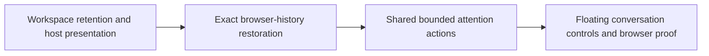

# Web Next needs you Implementation Plan

> **For agentic workers:** REQUIRED SUB-SKILL: Use superpowers:subagent-driven-development (recommended) or superpowers:executing-plans to implement this plan task-by-task. Steps use checkbox (`- [ ]`) syntax for tracking.

**Goal:** Add the approved floating Next and More controls at every web width, preserving the exact conversation through attention navigation and Back/Forward.

**Architecture:** Workspace records and existing pane lifetimes retain hidden conversations; hosts project only presented records. Runtime history entries reference those records, while one shell-owned action controller reads the existing bounded navigation store. The conversation body composes existing widgets over its transcript, with no new attention, composer or transcript authority.

**Tech Stack:** TypeScript, React, Zustand, Dockview, Vitest, existing Go/Chrome production-browser harness.

**Spec:** `docs/superpowers/specs/2026-10-20-web-next-needs-you-design.md`, including Jesse's hidden-retention decision. Read both documents before implementation.

## Global Constraints

- “Offer the control at every web width: phone, tablet, and desktop.”
- “Use floating placement above the composer, rather than reserving a footer row.”
- “The adjacent More control should not be a down arrow.” Use the approved horizontal ellipsis.
- “Preserve existing reading behavior when returning to an already-open conversation.”
- “Preserve the existing Stop placement and double-tap delay unchanged.”
- “Use the shared navigation store's `needs_you` section as the sole membership, ordering and paging owner.”
- “Ordinary navigation and explicit Close retain their existing behavior.” Hidden retention is attention-only and runtime-only.
- “No new widgets or widget props without Jesse's approval.” Import existing widgets through their barrel; use design tokens and no widget-internal CSS.
- “Tests assert behavior, identity, focus, state and geometry, not exact human-readable copy.” Read `docs/developing-evener/testing.md` and `design-system.md` first.
- “Run targeted checks and the required focused browser journey locally. Full gates run in CI.” No deployment, hub restart, document-review work, native changes or unread-opening implementation.
- Keep the running remote brainstorming preview and retained earlier scratch. Work in the existing isolated feature worktree. Never install through a shared `node_modules` symlink.

## Review Focus

1. Leave A, return to A, then receive an old page response: no navigation. Pin a monotonically invalidated intent in Task 3.
2. Two readers share one URL, or a cascade retypes while retained: Back restores the exact surviving reader, not a new session pane. Pin identities and retype/close fences in Tasks 1–2.
3. Parking removes a Dockview panel: its removal callback must not dispose the source. Pin pending image completion and unrelated group/tab geometry in Tasks 1–2.
4. Back then a new attention hop discards Forward history: release only unreferenced parked records, never a presented pane or a lifetime referenced by another entry. Pin branch cleanup in Task 2.
5. A later page fails after earlier choices loaded, or reconnect refreshes multiple pages: healthy choices remain usable, explicit demand can retry, and recovered data never revives a cancelled navigation. Pin these in Task 3 and the Task 4 real-stack journey.

---

## Scope and preparation

There are four sequential tasks. Each ends with working behavior, targeted evidence and a commit. Do not ship the button before retention works. Unread opening gets its own later design: this plan does not decide what counts as read or where a reply starts.

Before product changes, attach the required Linear ticket and move it to In Dev. Linear tools were unavailable during planning; resolve that tracking requirement rather than claiming a ticket exists. Read `scripts/web/web-preflight.sh`, `scripts/lib/gate-budgets.sh`, `scripts/lib/load-aware-workers.sh` and the relevant Makefile targets before running them. Use `make web-preflight` to provision this tree safely, then inspect the actual dependency installation. Disk space was constrained during planning; do not prune other worktrees or shared caches.

All paths below are repository-relative. Run targeted unit files from the frontend directory with the repository worker policy:

```sh
cd cmd/evener-hub/frontend
. ../../../scripts/lib/gate-budgets.sh
gate_source_helper ../../../scripts/lib/load-aware-workers.sh
# Supply only the exact files listed by the current task.
npx vitest run $(vitest_run_args) <task-test-files>
```

The angle-bracket expression above is explanatory, not a runnable argument. Each task gives its concrete file list. Before each commit, run pinned Biome on its touched TypeScript/CSS files, then `npm run typecheck`, inspect `git diff --check`, stage only that task's named files, read the staged diff, and commit normally. Do not bypass hooks. Unit success alone is not typecheck or browser proof.

## Ownership and dependency map



Tasks 1–2 establish the preservation path before any visible control. Task 3 gives keyboard and UI one action owner. Task 4 adds the approved affordance and verifies the full producer-to-browser journey.

### Task 1: Retain hidden records without changing visible geometry

**Files**
- Modify: `cmd/evener-hub/frontend/src/shell/workspace.ts`, `DockHost.tsx`, `mobile/StackHost.tsx`.
- Modify/test: `cmd/evener-hub/frontend/src/shell/sessionCycle.ts`, `sessionCycle.test.ts` so ordinary pane cycling uses presented records.
- Modify/test: `cmd/evener-hub/frontend/src/shell/sessionPlacement.ts`, `sessionPlacement.test.ts` so ordinary focus skips parked matches and parent ownership follows the exact opened pane.
- Modify/test: `cmd/evener-hub/frontend/src/shell/activitybar/activitySidebarStore.ts`, `activitySidebarStore.test.ts`, `shell/palette/paletteContext.ts`, `paletteContext.test.ts` so activity focus/source candidates and palette composer destinations use presented records.
- Modify/test: `cmd/evener-hub/frontend/src/panes/doc/openDoc.ts`, `openDoc.test.ts`, `panes/session/transcript/openTranscript.tsx`, `openTranscript.test.tsx`, `panes/zoom/actions.ts`, `actions.test.ts` for ordinary opener integration only. Document-review UI and workflow remain out of scope.
- Create: `cmd/evener-hub/frontend/src/shell/attentionPlacement.ts` for runtime presentation metadata only.
- Tests: `cmd/evener-hub/frontend/src/shell/workspace.test.ts`, `paneLifetime.test.ts`, `DockHost.slotGeometry.regression.test.tsx`, `mobile/StackHost.test.tsx`, `panes/zoom/inspectionOrigin.test.ts`.
- Read, preserve ownership: `shell/paneLifetime.ts`, `panes/session/Session.tsx`, `panes/zoom/Zoom.tsx`.

**Interfaces**
- Extend `PaneSlot` with `"parked"`. `workspace.panes` still contains every living record. `mainPane()` remains the single presented main.
- Export `presentedPanes(panes: readonly OpenPaneRecord[]): OpenPaneRecord[]` from `workspace.ts`.
- In `attentionPlacement.ts`, define `AttentionPlacementEntry` with `pane: OpenPaneRecord`, `lifetimeSerial: number | null`, `requestedRef: string | null`, `readViewId: string | null`, and `seatId: string`. Non-conversation keyboard origins have null reader fields.
- Export `captureAttentionPlacement(): AttentionPlacementEntry | null`, `presentAttentionTarget(targetRef: string): AttentionPlacementEntry | null`, `restoreAttentionPlacement(entry: AttentionPlacementEntry): boolean`, and `releaseUnreferencedAttentionPanes(retained: ReadonlySet<OpenPaneRecord>): void`.
- These functions transact through workspace; metadata contains only exact record/seat bindings, never composer or reader copies. Follow `onPaneRetype` when the same lifetime transfers. A ref/role rebound or disposed lifetime invalidates a historical reader binding.

**Placement decisions**

Assign an opaque runtime seat ID lazily when a presented record first participates. Retain its logical main/secondary placement. A fresh destination substitutes into the initiating focused seat, parking that seat's previous record. A target already presented is focused in place; do not park or move its peers. Reuse a parked target's existing record in the initiating seat, updating that live presentation binding without copying its lifetime. History remembers its earlier seat separately. A keyboard invocation with no focused pane creates a normal main target and has no source to park.

DockHost substitutes the destination into the source panel's actual group and tab index **before** removing the source panel. This keeps a sole-panel group and its dimensions alive. Mark this structural reconciliation so its `onDidRemovePanel` callback does not call explicit Close. Ordinary user removal still calls `closePane`. Keep presentation transition metadata outside saved layout and clear it after application; no replay of a full saved grid to restore one seat.

Back restoration of an already-presented record focuses it without undoing subsequent user layout changes. A parked record returns to its retained seat, displacing only that seat's current attention occupant. Use the surviving seat anchor; after host reconstruction use the workspace's logical placement and existing geometry reconciliation. Do not resurrect a deliberately removed group by restoring an obsolete whole-layout snapshot.

Cold layout serialization contains presented records only. Host changes preserve all living workspace records, including parked ones. Audit slot consumers: focus/back candidates and host projection must exclude parked records; lifetime and origin-membership checks must still include them. Existing ordinary open/replace/close semantics must not silently focus an invisible record. A non-attention opener that encounters a parked match uses its existing normal placement path, without adopting attention history. Explicit Close, reset and destructive primary replacement still dispose removed records through the existing lifetime subscription.

- [ ] **Write failing tests** named `attention substitution retains the source lifetime`, `parking preserves independent groups and tab order`, and `close retires parked readers without resurrection`. Arrange real workspace records A, independent pane X, and new target B; use actual Dockview in its existing geometry suite. Retain an A composer with a structured draft and a browser-boundary controlled image completion.

```ts
const origin = captureAttentionPlacement();
if (!origin) throw new Error("missing fixture origin");
const source = conversationPaneLifetime(origin.pane);
const destination = presentAttentionTarget("local:b");
expect(destination?.pane).not.toBe(origin.pane);
expect(workspaceStore.getState().panes).toContain(origin.pane);
expect(origin.pane.slot).toBe("parked");
expect(source.alive).toBe(true);
expect(restoreAttentionPlacement(origin)).toBe(true);
expect(conversationPaneLifetime(origin.pane)).toBe(source);
workspaceStore.getState().closePane(origin.pane.id);
expect(source.alive).toBe(false);
expect(restoreAttentionPlacement(origin)).toBe(false);
```

Also assert literal expected presented pane IDs, exact independent group IDs/tab order, unchanged main-group header behavior, unchanged image bytes after real encoder completion, no extra group, and no hidden records in saved layout. Exercise a secondary session, a cascade leaf, an existing presented target, a parked target, legitimate retype, replaced identity, phone/desktop host swaps and old ordinary `replacePrimary` disposal cases. A plain pane ID/ref match must not rescue a disposed record.

Add `ordinary session cycling skips parked neighbors` in `sessionCycle.test.ts`: next and previous choose the next presented session even when a parked record intervenes; a non-session origin chooses the first/last presented session; one presented session remains a no-op. Filter candidates through `presentedPanes` before computing the cycle, rather than merely rejecting a hidden focus target afterward.

Add ordinary-placement regressions in `sessionPlacement.test.ts`: with a parked same-ref record preceding a presented match, `openSessionByRef` focuses the presented match. With a parked child and an unchanged owner main, `openNestedSessionWithOwner` records parent ownership on the exact pane returned by `openPane`, leaving the parked record's metadata unchanged. Find the opened record by its returned ID instead of repeating a first-by-ref search.

Add parked-first and parked-only regressions in `activitySidebarStore.test.ts` and `paletteContext.test.ts`. Activity activation focuses a presented matching conversation or uses its existing explicit-scope behavior when no presented match exists. A stale parked cascade source cannot own a new focus request. Palette composer destinations must be presented, or null when no presented reader matches. Keep lifetime/origin membership checks over all living records.

Ordinary document and transcript openers use presented reuse/source candidates and bind the newly presented record, leaving parked matches' metadata untouched. Job-log deduplication excludes parked records. Retained conversation parent-context lookup prefers a presented same-ref holder, then falls back to retained holders. Cascade entry uses presented source candidates, without changing lifetime, reconciliation or resume ownership. Inspection Return closes the inspector as before and requests origin focus only when the exact surviving origin is presented; an unavailable origin uses existing host fallback without attention-history restoration. Prove parked-first and parked-only cases, unchanged retained metadata/lifetimes, competing parent chains, stale parked cascade sources and actual host fallback. Do not change document rendering, loading, review workflow or Back.

- [ ] **Run red:** `npx vitest run $(vitest_run_args) src/shell/workspace.test.ts src/shell/paneLifetime.test.ts src/shell/DockHost.slotGeometry.regression.test.tsx src/shell/mobile/StackHost.test.tsx src/shell/sessionCycle.test.ts src/shell/sessionPlacement.test.ts src/shell/activitybar/activitySidebarStore.test.ts src/shell/palette/paletteContext.test.ts src/panes/zoom/inspectionOrigin.test.ts src/panes/doc/openDoc.test.ts src/panes/session/transcript/openTranscript.test.tsx src/panes/zoom/actions.test.ts`. Confirm the new retention/geometry cases fail for the absent behavior, not missing dependencies.
- [ ] **Implement the interfaces and host projection above.** Keep `paneLifetime` as the disposal authority. If actual Dockview substitution cannot preserve unrelated geometry, stop here and report the failed test before broadening the design.
- [ ] **Run green:** the same files, formatting and typecheck must complete with no failures. Independently inspect the actual Dockview state in the geometry tests, not just the new metadata.
- [ ] **Commit:** stage only the files listed for this task that changed; use `feat(web): retain attention conversations without extra panes`.

### Task 2: Bind each attention history entry to the exact reader

**Files**
- Create: `cmd/evener-hub/frontend/src/shell/attentionHistory.ts`, `attentionHistory.test.ts`.
- Modify: `cmd/evener-hub/frontend/src/shell/routing.ts`, `AppShell.tsx`, `mobile/StackHost.tsx`, `rail/needsYouCycle.ts`.
- Modify: `cmd/evener-hub/frontend/src/panes/session/composer/Composer.tsx` to gate mount autofocus for an attention-owned reader.
- Tests: `cmd/evener-hub/frontend/src/shell/routing.test.ts`, `AppShell.test.tsx`, `mobile/StackHost.test.tsx`, `panes/session/Session.test.tsx`.
- Documentation: `docs/web-ui/parity/contracts-composer-queue-pending.md`, `docs/web-ui/parity/contracts-transcript-scroll-liveness.md`.

**Interfaces**
- Consume Task 1's `AttentionPlacementEntry` and placement functions.
- Export `openAttentionSession(ref: string): void`, `restoreCurrentAttentionEntry(): boolean`, `currentAttentionEntryToken(): string | null`, and `goBackInAttentionHistory(): boolean` from `attentionHistory.ts`.
- Export `attentionEntryOwnsReader(paneId: string, sessionRef: string): boolean` for the valid current binding. Composer keeps its existing `useMountAutofocus` behavior outside attention navigation, but declines that automatic editor focus for an attention-owned mount. Otherwise desktop Next would hide itself immediately on arrival. Explicit editor focus and the composer-focus shortcut remain unchanged.
- Add an optional `attentionEntry?: { generation: string; id: string }` to `navigate` options. Only attention calls may force a distinct history entry for a distinct reader at an identical URL. Ordinary identical-URL navigation remains a no-op.
- `restoreCurrentAttentionEntry()` returns true only for a valid runtime binding whose URL and reader still match. `goBackInAttentionHistory()` returns true only when it actually requests the known attention predecessor through `history.back()`.
- Export `openSessionRoute(ref: string): void` from `routing.ts` as the plain `paneToURL("session", { ref })`/`navigate` path for ordinary live navigation. It creates no attention binding. In `AppShell.openLiveSession`, use this route opener while preserving the existing ordinary placement and focus logic; that caller must not inherit attention retention from its currently shared helper.

**History decisions**

Before every successful attention push, capture the actual initiating reader and bind the current browser entry to that departure. Stamp an unbound entry with `replaceState`, preserving unrelated state fields and URL. If an already-tokenized entry names another reader because focus or a cascade leaf changed without navigation, replace its runtime binding in place, release its previous reference only when no surviving entry needs it, and never dispose a presented record. Focus-only movement adds no history step. Every distinct hop uses one `pushState`. Keep tokens and branch order in a runtime history owner; only generation/entry tokens go into browser state. Observe token changes even when pathname is unchanged. A page-generation mismatch, reload, explicit Close or identity mismatch falls through to ordinary route opening.

Restore a valid attention binding before AppShell's generic location/route placement, and treat that binding as satisfying placement during later location refresh. A stale or failed location read must not reconstruct a retained secondary/cascade as main. Keep the originating URL and exact reader as separate fields. StackHost must suppress its own URL publication/local-back recording while an attention restoration is applied. Its Back action first uses the current valid attention predecessor for a conversation, while document/other established Back behavior remains unchanged. Normal browser Back/Forward remains authoritative.

Track known app pushes after Back to prune discarded Forward entries, including a non-attention push. Release only parked records with no surviving entry. Never dispose presented records during pruning. Do not impose an arbitrary retention cap that silently drops drafts; Close, existing destructive navigation, discarded branches and page teardown are the disposal boundaries.

- [ ] **Write failing tests** named `attention back restores the exact originating reader`, `same URL entries restore different readers`, and `discarded forward entries release only unreferenced parked records`. Use real workspace placement and browser history, not a mocked navigation callback. Arrange A → B → C, then real history events.

```ts
openAttentionSession("local:b");
openAttentionSession("local:c");
// After awaiting the browser popstate caused by history.back():
expect(workspaceStore.getState().focusedPaneId).toBe(b.pane.id);
expect(conversationPaneLifetime(a.pane)).toBe(aLifetime);
// After a second Back, then Forward:
expect(workspaceStore.getState().focusedPaneId).toBe(b.pane.id);
expect(window.history.length).toBe(initialLength + 2);
```

The fixture variables above are captured Task 1 entries/lifetimes, not IDs rediscovered after navigation. Assert structured draft selections/mentions, staged PNG bytes, pending image success/failure, and retained away-reading capture against the exact owning source through navigation return, using the existing real Session fixtures. Do not add live cross-view draft synchronization; keep ordinary draft/cache behavior unchanged and do not promise permanently independent same-session drafts. For cascade origins assert the same pane lifetime and leaf read-view ID. Cover existing targets, secondary origins, same-URL/different-reader entries, retype transfers, explicit closure/ID reuse, history branching, later location refresh and host swaps. Add `attention mounts do not autofocus the editor`, asserting focus stays outside it until an explicit click/shortcut, while ordinary session-opening autofocus still works. Assert ordinary history and primary-replacement tests unchanged.

For distinct readers of the same session, preserve each exact reader's existing draft and attachment work when that reader returns through attention Back/Forward; do not require live cross-view synchronization or permanently independent same-session drafts. Keep exact reader/lifetime and attachment ownership assertions. Exercise the owning reader's real Send after restoration and assert its actual text and image bytes. Do not change ordinary navigation, stale-work fences or the shared reload-storage policy to satisfy the test.

Add `each hop captures a focus-only departure`: A → Next B → focus existing secondary X without navigation → Next C → Back → Forward restores X then C, with X's exact lifetime, composer/image bytes and placement, exactly two pushes, and unchanged independent panes. Include a cascade leaf change between hops. Add `live navigation does not create attention retention`: both next-live and previous-live use ordinary route/history and existing lifetime disposal, with `currentAttentionEntryToken()` null for their new entries.

- [ ] **Run red:** `npx vitest run $(vitest_run_args) src/shell/attentionHistory.test.ts src/shell/routing.test.ts src/shell/AppShell.test.tsx src/shell/mobile/StackHost.test.tsx src/panes/session/Session.test.tsx`.
- [ ] **Implement history binding and route interception.** After separating the ordinary live caller above, change the existing `openNeedsYouSession(ref)` seam to call `openAttentionSession(ref)`, giving the existing attention keyboard path a small end-to-end preservation path before adding UI. Its palette needs-you caller is also attention navigation; Task 3 routes that list's activation through the shared validated owner. Keep stale-target validation with Task 3's action owner, not this placement helper.
- [ ] **Run green:** the same suites, formatting and typecheck. Update the two preservation contracts with runtime retention and its disposal/reload boundaries, making no unread-opening claims.
- [ ] **Commit:** stage only the task's changed files and use `feat(web): restore attention readers through browser history`.

### Task 3: Give keyboard, Next and More one bounded action owner

**Files**
- Create: `cmd/evener-hub/frontend/src/shell/needsYouActions.ts`, `needsYouActions.test.ts`, `NeedsYouProvider.tsx`.
- Modify: `cmd/evener-hub/frontend/src/shell/AppShell.tsx`, `rail/needsYouCycle.ts`, `rail/needsYouCycle.test.ts`.
- Modify/test: `cmd/evener-hub/frontend/src/shell/palette/CommandPalette.tsx`, `CommandPalette.test.tsx`, `CommandPalette.edge.test.tsx`; only needs-you activation joins the shared controller, preserving other result kinds.
- Test integration: `cmd/evener-hub/frontend/src/shell/AppShell.test.tsx`.
- Consume unchanged: `appwire-client/typescript/state/navigation/{store,selectors,types}.ts` through `@evener/appwire-client` exports and the existing web `stores/navigation` binding.

**Interfaces**
- `NeedsYouChoice = { summary: NavigationSessionSummary; selectable: boolean }`.
- `NeedsYouSnapshot = { choices: readonly NeedsYouChoice[]; nextRef: string | null; canLoadMore: boolean; loading: boolean; readFailed: boolean; blocked: boolean }`. `blocked` reflects palette Find or another blocking modal, not editor focus.
- `NeedsYouController` exposes `getSnapshot(): NeedsYouSnapshot`, `subscribe(listener: () => void): () => void`, `next(): Promise<void>`, `select(ref: string): void`, `loadMore(): Promise<void>`, `cancel(): void`, `dispose(): void`.
- `createNeedsYouController(): NeedsYouController` owns one set of subscriptions to the existing navigation/workspace/modal authorities. Snapshots retain reference identity until their inputs change. `NeedsYouProvider({ children }: { children: ReactNode }): ReactElement` mounts one controller per AppShell lifetime. `useNeedsYou(): { controller: NeedsYouController; snapshot: NeedsYouSnapshot }` exposes that same owner to conversations.
- The keyboard registration calls the same `next()` as the floating control. `select()` rechecks current authoritative membership and source identity immediately before `openAttentionSession`.

**Action decisions**

Keep server page order, advance after current, wrap only at the known end, and exclude current. The controller derives presentation and validity from the shared store's visible resources, including freshness/error state; do not change shared selectors' existing display behavior or invent another status classifier. Retained stale rows may remain visible as unavailable; a healthy page remains selectable if a different page fails. Reuse the rail's existing attention-reason projection.

Demand limit remains 50. A Next action requests at most one required page; More's load action requests one page and never navigates. Cold/unknown/failed data keeps a demand path. Only an authoritative complete result can hide an empty control. After a successful page with only the current/duplicate rows and remaining data, leave the demand path available for another deliberate action rather than recursively filling the queue. On a failed boundary read, retain healthy choices, keep failure distinct from empty, and allow the next deliberate action to retry that same demand through `loadSection`.

Replace the effect-local permanent `requestedPages` set with shared-store in-flight deduplication and an action serial. Cancel on every focused reader transition, including A → B → A, ref/role change, disposal, another activation, modal opening, generation change and unmount. Also invalidate on every accepted app/browser route event, including same-path history-entry changes, before asynchronous route placement can change focus. Keep a monotonic route-intent fence in the controller's existing navigation-event subscription and check it before navigating; pathname or final-focus equality alone cannot detect a round trip. Reconnect may refresh choices but never resurrect a cancelled action. Keep the existing keyboard binding's editable-target policy; hiding the floating UI while editing does not silently disable its established shortcut.

- [ ] **Write failing tests** named `next excludes its only current session`, `a deliberate retry recovers a failed boundary page`, `leave and return cancels a pending next`, and `reconnect refreshes later-page choices without navigation`. Use the actual navigation store with its external FakeClient request boundary. Hold/release responses and emit actual store invalidation/reconnect inputs.

```ts
expect(nextNeedsYouRef(["a"], "a")).toBeNull();
expect(nextNeedsYouRef(["a", "b", "c"], "b")).toBe("c");
expect(nextNeedsYouRef(["a", "b", "c"], "c")).toBe("a");
expect(nextNeedsYouRef(["a", "b"], "absent")).toBe("a");
// Following a held demand, focus A -> X -> A and release the response:
expect(workspaceStore.getState().focusedPaneId).toBe(a.id);
expect(window.history.length).toBe(beforeDemandHistoryLength);
// A failed later page cannot invalidate a healthy earlier-page choice:
expect(controller.getSnapshot().choices.find((c) => c.summary.ref === healthyRef)?.selectable).toBe(true);
```

Also test cold data, valid empty, self-only complete, self-only incomplete, more than eight loaded choices, partial count with nonzero remaining, page overlap/dedup, stale selection, duplicate clicks during a read, explicit retry without a new generation, modal open/close while waiting, source disposal, and cancellation when leaving and returning to the same cascade ref. Verify requested offsets/limits and the resulting real URL/pane, not a spy on controller logic.

Add `accepted routes cancel next before placement`: hold a Next page response, accept another session route while holding its location read so the original reader stays focused, then release Next first. Assert the newer route survives and no extra history entry or attention hop occurs. Repeat a route-away-and-back before either read resolves and a same-path entry traversal. Add palette needs-you activation tests proving fresh membership is checked by the same controller and live/past result navigation remains ordinary. Close the palette before admitting the explicit selection, without letting a stale modal snapshot discard that deliberate activation.

- [ ] **Run red:** `npx vitest run $(vitest_run_args) src/shell/needsYouActions.test.ts src/shell/rail/needsYouCycle.test.ts src/shell/AppShell.test.tsx src/shell/palette/CommandPalette.test.tsx src/shell/palette/CommandPalette.edge.test.tsx`.
- [ ] **Implement the controller and provider.** Remove the old attention request loop from AppShell, leaving its other keyboard actions intact. Use existing palette state for in-session Find and one shell-level observation of blocking `aria-modal` surfaces; opening and closing a modal must cancel pending intent even if it finishes closed. The More popover itself is not a blocking modal.
- [ ] **Run green:** the same files, formatting and typecheck. Confirm one controller/subscription lifetime across multiple visible conversations and repeated host changes.
- [ ] **Commit:** stage only this task's changed files and use `refactor(web): share bounded needs-you navigation actions`.

### Task 4: Add the floating control and prove the full journey

**Files**
- Create: `cmd/evener-hub/frontend/src/panes/session/NextNeedsYou.tsx`, `NextNeedsYou.test.tsx`, `nextNeedsYou.module.css`.
- Modify: `cmd/evener-hub/frontend/src/panes/session/ConversationBody.tsx`, `composer/Composer.tsx`, `session.module.css`, `transcript/TranscriptBody.tsx`, `transcript/flow/FlowOverlay.tsx`, `transcript/flow/flowoverlay.module.css`.
- Tests: `cmd/evener-hub/frontend/src/panes/session/Session.test.tsx`, `composer/Composer.test.tsx`, `transcript/flow/FlowOverlay.test.tsx`, `cmd/evener-hub/frontend/src/panes/zoom/Zoom.test.tsx`.
- Browser: extend `cmd/evener-hub/cascade_browser_test.go` and `cmd/evener-hub/frontend/scripts/cascadeguard/run.mjs`; keep focused attention journey code in new `cmd/evener-hub/frontend/scripts/cascadeguard/attention.mjs` imported by that driver. Update its `README.md`.
- Product docs: `docs/web-ui/README.md`, `docs/product/subsystems.md`, and the Task 2 preservation contracts where the visible controls add guarantees.

**Interfaces and placement**
- `NextNeedsYou({ sessionRef, viewId, hidden }: { sessionRef: string; viewId: string; hidden: boolean }): ReactElement | null` consumes `useNeedsYou()`. It owns only list-open and pointer-hold state. Combine `hidden` with the shared snapshot's `blocked` flag; do not add another modal observer. A visible-to-hidden transition cancels the earlier UI intent, without forbidding a later keyboard action under its existing editable-target policy.
- Add `onEditingChange?(editing: boolean): void` to the application `ComposerProps`, driven by actual editor focus/composition rather than draft content or broad footer focus. This is not a widget API change. ConversationBody uses its existing seat/ref/read-view identity, `useAskDockPending(ref)` and the existing `model.pendingEscalations` authority.
- Add `attentionOverlay?: ReactNode` and `onOverlayHeightChange?(height: number): void` to the application-level `FlowOverlayProps` and `TranscriptBodyProps`. TranscriptBody forwards them; FlowOverlay owns one measured stack for Next and New Content, with Next at the trailing bottom edge and New Content above it. ConversationBody passes that stack's committed height into the existing synthetic `trailingRow` content as end clearance, composing with AskDock/held steers and including it in `renderedRowCount`. Do not use `trailingContent`, which sits outside the scrollport, or invent a source turn. Pin stable end-follow and away-reading through the stack's appear/disappear measurement so clearance cannot create a New Content visibility loop.
- For a dormant/empty transcript, render the same Next affordance above the composer without mounting a fake transcript. A focused cascade uses its active leaf only (`keyboardScrollPaneId` and exact focused ref), not every readable column's broad `seat.focused` value.

**Interaction decisions**

Use existing Button and IconButton native events/ref, horizontal ellipsis, and controlled Popover with `closeOnScroll={false}`. List rows use existing widgets and ordinary Tab/Shift-Tab/Enter activation within the existing focus scope. Use accessible naming for full titles while truncating their display. No custom menu role unless its full keyboard contract is implemented. More remains independently focusable.

Use a 500 ms hold and 10 CSS-pixel movement tolerance, matching the existing web HoverCard convention. Pin 499 ms as an uncompleted hold, 500 ms as completed, and movement beyond 10 pixels as cancellation; these are implementation choices within the approved spec. Cancel the timer on early release, pointer motion past tolerance, cancellation, lost capture, visibility loss and unmount. Consume the click belonging to a completed hold only; the next intentional click must still work. Dismiss on anchor disappearance or viewport/outer-scroll movement, while preserving list-internal scrolling. On Escape restore the trigger if it survives; outside dismissal must not steal focus from the clicked target or editor. Hide while editing, pending question/approval, palette Find or blocking modal; return automatically. An unfocused saved draft must not hide it.

- [ ] **Write failing component and real-browser assertions before UI code.** Name cases `hold opens once without navigating`, `cancellation does not poison the next click`, `only the focused leaf offers attention navigation`, and `suppression clears without losing the draft`. Unit assertions include:

```ts
expect(document.querySelectorAll('[data-testid="next-needs-you"]')).toHaveLength(1);
// Following a completed hold and its release click:
expect(workspaceStore.getState().focusedPaneId).toBe(originPane.id);
expect(listContainer).toBeVisible();
// After Escape:
expect(document.activeElement).toBe(moreTrigger);
expect(readView.getCapture()).toEqual(beforeDismissCapture);
```

Cover tap, keyboard shortcut, More, held opening, motion/early release/cancel/unmount, post-hold click suppression followed by a real click, stale row selection, list paging, focus restoration, long titles, every suppression condition and its recovery. Use real components and stores; do not mock the composer or navigation owner to prove these behaviors.

Extend the production-stack fixture with deterministic provider-driven attention sessions beyond the 50-row boundary. Keep actual daemon/hub/SPA and transport reads. The browser module receives the existing driver browser/RPC/control resources; do not create a parallel server or seed frontend stores. It must drive:

1. Structured draft plus real staged PNG, pending native encoder completion, away-reading source, independent pane, Next → Next → Back → Forward. Repeat for secondary/cascade origin and an already-presented target, then explicit Close and a host swap.
2. A later-page target, a real socket reconnect after multiple pages, and a real response held at native delivery while the user leaves and returns. Release the unchanged response and assert no late navigation. Use a transport-boundary failure for a later read, retry it deliberately, and verify earlier choices remained usable.
3. Actual geometry at 320, 390, 700, 899, 900, 1024 and 1400 CSS pixels, both themes, long titles, list bounds, viewport height/keyboard-style resize, distinct New Content and Next hit areas, final transcript content scrollable above the overlay, and unchanged Send/Stop geometry and 500 ms activation fence. Native touch/pointer input must exercise hold/cancel without replacing application event handlers or timers.

Assert actual DOM rectangles, first intersecting entry and within-entry progress, record/editor identities, exact bytes and provider-received submission. Use the existing native-completion hold mechanism, not fake images or generated frontend state. Unexpected console errors/warnings fail. Browser-width Chrome does not qualify Safari or physical phone keyboard behavior; report that limit.

- [ ] **Run red:** targeted units `src/panes/session/NextNeedsYou.test.tsx src/panes/session/Session.test.tsx src/panes/session/composer/Composer.test.tsx src/panes/session/transcript/flow/FlowOverlay.test.tsx src/panes/zoom/Zoom.test.tsx`; then from repository root run `make build-web` and `go test -tags browserguard ./cmd/evener-hub -run '^TestAgentCascadeBrowser$' -count=1 -v`. Confirm new assertions fail because the affordance/behavior is absent. Read the entire driver and Go test before executing their changes. Keep existing cascade assertions and deadline strictness.
- [ ] **Implement the component, visibility and measured floating layout above.** Do not change Stop/Send behavior, New Content semantics or the reader's positioning authority.
- [ ] **Run green:** the same units and focused real-stack browser command, touched-file formatting, `npm run typecheck` and `git diff --check`. If the producer journey needs a different fixture boundary, extract shared setup within this harness rather than expanding the single existing test past its budget or adding a production test hook.
- [ ] **Update evergreen docs and commit:** describe shared attention ownership, hidden lifetime boundaries, per-hop history and all-width controls in the named guides. Stage only named changed files, inspect the staged diff, then commit `feat(web): add floating next-needs-you controls`.

## Completion and handoff

Self-review each task against the spec. Before PR submission run the simplify-code and requesting-code-review workflows, preserving red/green behavior assertions. Resolve all findings in one coherent round, run affected targeted checks, push once and use the shepherd-pr workflow for CI/review. Do not report a green RoboRev check as a clean review without reading its findings. No full local gate or deployment.

The delivery report must name the PR, actual targeted commands and browser journey that passed, any untested platforms, and the separate unread-opening work left. Retain only evidence paths the report links. The working button must not be described as delivered until the preservation and recovery journeys pass.

## Plan self-review

The four tasks cover spec sections on placement/visibility, Next/More interaction, bounded order/paging/recovery, and history/preservation. All five Review Focus cases have explicit owners and tests above. The new placement/history/controller types are defined before use; no task copies composer, transcript or attention contents into another authority. Hidden retention is the approved architecture extension. No implementation, dependency installation or test execution is claimed by this plan.
