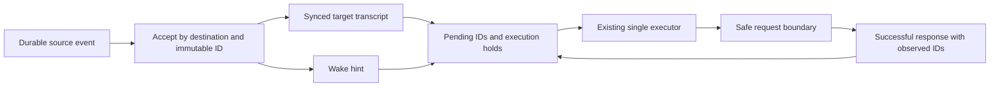
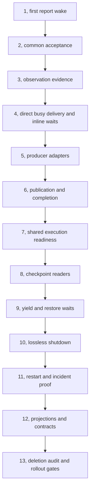

# Unified Session Notifications Implementation Plan

> **For agentic workers:** REQUIRED SUB-SKILL: Use superpowers:subagent-driven-development (recommended) or superpowers:executing-plans to implement this plan task-by-task. Steps use checkbox (`- [ ]`) syntax for tracking.

**Goal:** Every accepted notification becomes a durable message in its target session and causes that session to run at its next eligible boundary, regardless of message label or session role.

**Architecture:** Reuse the source outboxes and the transcript-backed receiver inbox. Share acceptance, observation evidence and execution readiness across roots and delegates. Replace polling waits with safe execution checkpoints while retaining resource ownership and the existing generation model.

**Tech Stack:** Go workspace, existing transcript/delegate/job/watch journals, scripted LLM adapters, AppWire TypeScript adapters, React web and native clients. No new storage service or dependency.

**Spec:** [Unified session notifications design](../specs/2026-10-23-unified-session-notifications-design.md). Read both documents. This plan supersedes the notification scheduling and waiting portions of the earlier terminal-report plan.

## Global Constraints

- Planning baseline: `9852924f0e1a06771ed1b985145a07eafefd1e4d`, branch `delegate-terminal-reports`. Recheck the execution base before editing. No runtime changes were made while writing this plan.
- Jesse: “Any notification from a delegate or an observer should just be a notification/message into the session it is supposed to notify.”
- Keep the sender-side rule: a delegate's `done` with a live child is refused in favor of `waiting_on_work`. It is not a receiver notification gate or a new root completion restriction.
- No human attention gate, Needs You entry, task-list completion gate or forced continuation when no actual work remains.
- Keep existing transcript, delegate, shell and watch identifiers. No transcript rewrite, historical payload reconstruction, or blanket acknowledgment.
- Keep current old-record readers. Do not introduce a new compatibility mode, migration store or legacy notification codec. Any additional backward-compatibility work needs Jesse's approval.
- Retain provenance, watch authorization, budgets, pre-acceptance coalescing and self-loop protection. Accepted message bodies are immutable.
- Keep the body codec: escape `&`, then `<`; decode only `&lt;` and `&amp;` once. Attribute encoding is separate. Do not revive a legacy body decoder.
- Preserve metadata-only job/delegate status reads and generation-matched report projections across shared client, browser, native and doctor.
- Keep queued human input in the client-mutation system, including edit/remove, revision and recovery semantics. Passive environment, notes and memory snapshots do not independently wake idle sessions.
- Read `AGENTS.md`, `docs/product/README.md`, the owning rows of `docs/product/subsystems.md`, and `docs/developing-evener/testing.md` before implementation. Read the design-system guide before any frontend change.
- Use an isolated worktree. Keep the existing unmerged PR intact until its replacement commits are reviewed. This document does not authorize a rewrite, push, merge or deployment.
- Every behavior change gets a failing behavioral test first. Commit tests with their fix, never a deliberately red intermediate commit. Existing passing characterization cases stay passing.
- Test plumbing with a scripted provider and real Evener code beneath it. Inject faults only at external provider, clock or filesystem boundaries. No mocked session/controller behavior and no assertions on human-readable phrasing.
- Run minimal local red/green reproductions. CI owns full module suites, race/fuzz lanes, lint, browser and native gates. Do not run large local batteries as pre-push gates.

## Review Focus

These failure classes require explicit tests in the owning tasks; a happy-path child report is insufficient.

1. Arrival between the final inbox check and executor release must either continue the current activation or claim its successor, never strand the message or run two executors. Tasks 7 and 11.
2. A successful response followed by receipt-index failure must recover bookkeeping without another model call, including after restart. Task 3.
3. A wait checkpoint must preserve the same generation and owned resources across teardown/reopen; a crashed in-flight tool must retain honest interrupted-runtime treatment. Tasks 8, 9 and 11.
4. Clearing a watch or ending one-shot execution must not erase a produced or accepted frame, including a callback already in flight. Tasks 5 and 10.
5. Inline `delegate_send`, compaction and delta requests must not invent observation, duplicate canonical messages or credit IDs absent from the successful request. Tasks 3 and 4.

---

## What changes, and what stays

The four independent reviews agreed on the central defect: shared delivery storage is surrounded by several different wake policies. The plan deletes those policies rather than adding a new inbox database.

| Concern | Current source of truth to retain | Change |
| --- | --- | --- |
| Delegate transport | `delegatestore.PendingDeliveries` and controller claims | Every accepted message uses one receiver acceptance contract |
| Shell transport | Job journal and `NotifyPending` | “Delivered” means receiver custody, not model observation |
| Watch transport | Durable sends/receipts and source event identity | Transport runs independently of the holder's next model turn |
| Receiver custody | Synced transcript steering record with `AttentionID` | One ordered fold for all actionable notifications |
| Model observation | Request coverage and attention resolutions | Add successful-response ID evidence, remove text scraping |
| Execution | Existing session executor, host callback and controller | One role-independent readiness rule and release handoff |
| Waiting | Currently a live polling loop | Safe transcript checkpoint, yielded activation, retained generation |
| Report meaning | Packet, disposition and task/work summary | Payload/diagnostics, plus the separate live-child completion rule |
| User input | Client mutations and their queue | Unchanged authority, shares execution ownership only |

### Intended flow



Acceptance takes custody even when the receiver is busy or parked. The wake hint prompts a durable readiness check. Only a successful request containing an ID observes it; settling a delegate generation is independent.

### File ownership map

| Files | Responsibility after migration |
| --- | --- |
| New `agent/session_notifications.go`; existing `agent/session_attention.go` | Common acceptance API and transcript-backed pending/observed fold |
| `agent/schema/turn.go`; transcript writer and history readers reached from it | Observation metadata and safe wait checkpoint, excluded from model content where appropriate |
| `agent/delegate_delivery.go`, `agent/delegate_tree_attention.go`, `agent/delegate_tree_restore.go` | Source delivery and execution ownership, no report/update wake distinction |
| `agent/session.go`, `agent/session_state.go`, `agent/session_lifecycle.go`, `agent/session_execution.go`, `agent/session_active_turn.go` | Safe request boundary, atomic execution release, transient recovery |
| `cmd/evener/serve.go`, `server/server.go`, `cmd/evener/run.go` | Actual daemon and one-shot execution adapters, guaranteed coalesced wake, existing user-input holds |
| `agent/session_jobtree_drain.go`, `agent/session_jobtree_drain_terminal.go` | Resource quiescence using the common execution path |
| New `agent/session_wait.go`; `agent/subagents.go`, `agent/delegate_runtime.go` | Yield and resume the current generation at a durable checkpoint |
| `agent/session_tools_communicate.go`, `agent/delegate_terminal_admission.go`, `agent/delegate_outstanding_work.go` | Accepted publication, narrow completion rule, observational inventory |
| `agent/jobs.go`, `agent/job_watch.go`, `agent/system_notification.go` | Producer adapters, custody acknowledgment, replay/retry |
| `agent/internal/jobstore/{event,record,fold}.go` | Durable watch production and receipt semantics, including callback-only frames |
| `agent/internal/delegatestore/{event,record}.go` and its fold/validation files | Preserve generation and packet invariants while publication stops depending on receiver scheduling |
| `agent/delegate_tree_stop.go`, `agent/delegate_shell_repair.go` | Stop cancels resources without consuming pending messages as a side effect |
| `agent/jobs_activity.go`, `agent/session_retirement_evidence.go`, `agent/doctor` | Read-only lifecycle/diagnostic projections |
| `appwire-client/typescript/{steeringNotifications,sessionActivity,sessionActivityStore,sessionActivityPresentation}.ts` | Shared parsing, generation matching and activity reads |
| Existing web/native notification and subagent renderers | Present report/wait metadata without controlling execution |
| Product guides, runtime contract, job-control docs, tool definitions and messaging fixtures | Describe the same implemented contract |

Do not reorganize entire large files. Extract only the common protocol and wait lifecycle; remove displaced logic in its owning task.

## Interfaces shared between tasks

These are proposed internal interfaces, not claims that HEAD already defines them. Introduce them in the tasks named here; do not leave placeholder implementations.

### Receiver protocol, introduced in Task 2

```go
type notification struct {
    ID         string
    Message    llm.Message
    Provenance *provenance.Causal
}

func (s *Session) enqueueNotification(n notification) error
func (s *Session) pendingNotificationIDs() ([]string, error)
func (s *Session) hasUnackedNotifications() (bool, error)
func (s *Session) ackNotifications(ids []string) error
func (c *delegateTreeController) enqueueNotification(ownerSessionID string, n notification) error
```

The controller resolves a resident or cold receiver through existing membership. It must not recursively call its own adapter; the resident method owns the final append and the cold branch uses the existing serialized cold writer. `pendingNotificationIDs` preserves acceptance order. `hasUnackedNotifications` is a thin query of that same fold, never a second cache or producer inventory. Read failures propagate.

`ackNotifications` records observation already proved by request coverage. Until Task 3, it delegates to the existing durable resolution path. After Task 3, a synced successful-response receipt is authoritative even if the derived resolution append needs retry. Callers never acknowledge solely because an execution was admitted.

### Execution dispatch, consolidated in Task 7

```go
func (c *delegateTreeController) requestSessionWake(ownerSessionID string)
```

This signals the existing execution owner. It creates no new queue or executor. Scheduling rechecks pending notifications, existing user-input readiness and explicit holds. Read failures enter scoped paced recovery. The same dispatcher services cold/resident and root/delegate destinations and rechecks on restore, registration, capacity release, hold release and executor release.

At the daemon boundary, preserve `Session.SetNotifyFunc` → `Server.SubmitNotification` → `processNextServeInput`. The server's coalesced guaranteed send remains a wake hint, not another message inbox. Delegate callbacks currently installed in `agent/delegate_runtime.go` must dispatch through the same readiness contract instead of parent drive-selection. An agent-package test helper is not proof that the real serve loop honors the contract.

### Wait checkpoint, introduced in Task 8 and written in Task 9

Add `schema.TurnWaitCheckpoint = "WAIT_CHECKPOINT"`, a transcript-only record, and `Turn.WaitCheckpoint *WaitCheckpointInfo`. Use:

```go
type WaitCheckpointInfo struct {
    SessionID         string `json:"session_id"`
    DelegateID        string `json:"delegate_id,omitempty"`
    Generation        uint64 `json:"generation,omitempty"`
    ExecutionTurnID   string `json:"execution_turn_id"`
    CommunicateCallID string `json:"communicate_call_id"`
    WaitingOn         string `json:"waiting_on,omitempty"`
    ResumedByTurnID    string `json:"resumed_by_turn_id,omitempty"`
}

func (s *Session) persistWaitCheckpoint(checkpoint schema.WaitCheckpointInfo) error
func readWaitCheckpoint(path, sessionID string) (*schema.WaitCheckpointInfo, error)
```

A checkpoint with empty `ResumedByTurnID` yields the completed safe activation. A later synced checkpoint with the same identity and a nonempty new turn ID claims its resumption; serialize that claim with the existing executor. A resumed record must reference an earlier yield. Missing, contradictory or unsynced evidence cannot establish safe waiting. The delegate journal still owns whether the generation is open. Session restoration uses both authorities rather than inventing a second generation ledger.

## Execution order and review slices

### Cutover-first sequencing

Complete the working common path and remove each displaced production route
before broad hardening. Keep the focused behavior tests and existing safety
guarantees required by each replacement. Defer speculative interleavings,
expanded failure matrices, and performance characterization until the cutover
works; they remain verification work before rollout, not reasons to retain
the old routes.

Split Task 8 into an independent checkpoint protocol foundation and its
runtime integration. The foundation owns only the new checkpoint helpers and
tests plus schema fields/tests, with no production writer or restore caller.
It can run in an isolated worktree alongside Task 6 completion and Task 7.
Integrate checkpoint classification and restore after Task 7, then implement
Task 9's yield/resume and Task 10's drain/purge removal. Task 8 is complete only
after both parts pass review.

Bring Task 13's deletion audit forward into every cutover task. Run the core
Task 11 incident journey as soon as yield/resume and drain are connected.
Finish broader restart-cut, performance, downgrade, and client verification
after that path works. Do not claim rollout readiness before those checks.



Use one small commit per task where feasible; a task can use several green commits when its tests and API need separate review. Never split a durable writer from the reader required to recover it in a deployable release.

Recommended dependent PR slices: **common notification protocol** (1–4), **producers and execution** (5–7), **durable waiting and shutdown** (8–11), **remaining projections and cleanup** (12–13). Update evergreen docs with each owning change; Task 12 is the cross-surface reconciliation, not permission to defer accurate docs. Keep slices 8–11 together for deployment. Tasks 3, 5, 8–10 change durable evidence or its meaning: run their old-record/new-record and downgrade checks before enabling each writer, not only at the final release gate. A writer may be reverted only if the resulting reader still honors records already written.

This is one coupled lifecycle project, not four independent rewrites. No parallel writers in these same files. Read-only review and independent wire-fixture work can overlap after interfaces are fixed.

## Task 1: Make a child report wake its draining parent

**Files:** Modify `agent/session_jobtree_drain.go`, `agent/session_state.go`, `agent/session_lifecycle.go`; tests `agent/delegate_update_test.go`, `agent/session_delegate_report_disposition_test.go`, `agent/delegate_messaging_test_helpers_test.go`; contract `docs/subagent-runtime-contracts.md`.

**Interfaces:** Consume existing `newMessagingAdapter`, `newMessagingRoot`, `serveSupervisionRootWakes` and `requestsFor`. Produce a passing real root → coordinator → worker journey; later tasks retain it unchanged except for API migration.

- [ ] **Write the behavioral regression.** Replace the negative `TestDelegateReportToADrainingCoordinatorWaitsForAnUpdate` expectation with `TestNotificationReportWakesDrainingParent`. Retain that fixture's attempted terminal call: HEAD enters ordinary drain before its late completion validation. Do not switch it to `waiting_on_work`, which would enter the already-report-aware polling path instead. Worker A reports an opaque payload while worker B remains blocked on a test channel. The coordinator must receive A's payload in a real provider request before B or any unrelated update is released, and must not settle while B is live. Check the report's delivery ID and captured request body, not notification wording. Task 6 migrates this sender to a valid wait when validation moves earlier; it retains the same user-visible report-wakes-parent assertion.
- [ ] **Characterize the adjacent live-wait path.** Add `TestNotificationReportWakesPollingParent` with the same real hierarchy and no helper-only admission call. This may already pass on HEAD; record the result rather than manufacturing a failing assertion. Preserve the marker-write failure variants' no-repeat and healthy-sibling assertions.
- [ ] **Run each new case before changing behavior.** From the repository root: `(cd agent && go test . -run '^TestNotificationReportWakesDrainingParent$' -count=1)`, then the polling case separately. The first is expected to expose update-only gating; if it does not, inspect actual request order before editing.
- [ ] **Use all pending notification IDs at the existing drain boundary.** Remove the report/update distinction from `notificationTurnOwed` and the associated no-tool route. Do not yet remove writer claims, root callback ownership or polling waits. The same report observed in an already successful request owes no gratuitous extra model round.
- [ ] **Rerun the two cases and existing marker-failure cases individually.** They must finish with exit 0 and prove actual requests, no second stimulus, and no duplicate observation. Update the runtime contract for this behavior only. Review the diff, stage the named touched paths and commit `fix(agent): wake draining parents for child reports`.

## Task 2: Centralize durable receiver acceptance

**Files:** Create `agent/session_notifications.go`, `agent/session_notifications_test.go`; modify `agent/session_attention.go`, `agent/delegate_delivery.go`; tests `agent/transcript_only_attention_test.go`.

**Interfaces:** Implement the receiver protocol above using `appendDelegateAttentionMessageDurably`, `appendColdDelegateAttentionMessageDurablyWithOpen`, `readDelegateAttentionFold` and `resolveAttentionDurably`. Keep their valid serialization and sync behavior; avoid a second append implementation.

- [ ] **Add `TestNotificationAcceptance` cases:** resident idle, resident running, cold receiver, duplicate ID/body, conflicting duplicate body, append failure, sync failure, and fold-read failure. Assert one canonical persisted record on duplicate success, unchanged original on conflict, and no source custody acknowledgment on failure. Opaque example values: ID `notification-test-1`, body `payload-7c41`.
- [ ] **Run `(cd agent && go test . -run '^TestNotificationAcceptance$' -count=1)` red.** First add the interfaces and tests together without behavior if compilation requires it; the meaningful red must come from the asserted acceptance behavior, not only an undefined symbol.
- [ ] **Implement the common adapter and route delegate acceptance through it.** Append and sync before waking, re-request readiness on successful deduplicated retries, preserve causal provenance and owner authorization, and propagate errors. A failed target must not block delivery to unrelated targets. Keep existing source FIFO and cold writer claims.
- [ ] **Run the acceptance case green and the first report-wake case again.** Read raw transcript records in tests as well as the fold to avoid a self-confirming oracle. Commit `refactor(agent): share durable notification acceptance` with the named files.

## Task 3: Record actual model observation durably

**Files:** Modify `agent/schema/turn.go`, `agent/session_attention.go`, `agent/session_lifecycle.go`, `agent/session_execution.go`; create `agent/notification_observation_test.go`; extend the existing schema/transcript tests reached by these fields.

**Interfaces:** Add `Turn.ObservedNotificationIDs []string` with JSON name `observed_notification_ids,omitempty` on successfully persisted assistant responses. Reuse `stagePresentedAttentionCoverage`, `promoteStagedAttentionCoverage` and `unionCoveredAttention`. Extend the common fold to consume the field, and make `ackNotifications` repair derived resolution markers.

- [ ] **Add `TestNotificationObservation` cases:** request success; request failure; provider retry with a different request snapshot; notification arriving after snapshot; compaction; successful Responses delta with unknown coverage; full-history fallback; successful response synced but resolution-index append fails; teardown/reopen after that failure. Assert pending IDs and captured request contents independently.
- [ ] **Run `(cd agent && go test . -run '^TestNotificationObservation$' -count=1)` red.** The receipt-failure case must show why retrying model execution is wrong: durable successful-response evidence exists but the derived marker is missing.
- [ ] **Persist exact settled-request coverage with the assistant response.** Preserve IDs and bodies through compaction. Do not infer coverage from rendered text or the original pre-retry request. Unknown delta coverage remains unobserved; if pending IDs cannot be proved present in a delta, select a full-history request before sending it. Test that the unknown-coverage case cannot spin through repeated delta requests. Remove launch-time consumption from `acceptDelegateAttention`; a launch claim is not a receipt.
- [ ] **Repair missing derived markers without a model request.** A crash before a durable successful response leaves IDs pending. A crash after it is an index-repair operation. Keep historical resolution records readable; do not rewrite old transcripts or infer historical receipts from prose.
- [ ] **Run the observation case green and Task 1's marker-failure cases.** Count recorded provider requests across restart and inspect response metadata. Commit `fix(agent): persist notification observation with responses`.

## Task 4: Accept during execution and make inline waits subscribers

**Files:** Modify `agent/delegate_delivery.go`, `agent/session.go`, `agent/session_lifecycle.go`, `agent/session_jobtree_drain.go`, `agent/subagents.go`; create `agent/notification_inline_delivery_test.go`; extend `agent/delegate_delivery_test.go`.

**Interfaces:** Consume Task 2 acceptance and Task 3 observation. Retain existing inline waiter APIs and `schema.DelegateDeliveryCommit` identity where useful; the waiter observes canonical source/delivery IDs and does not own delivery.

- [ ] **Add `TestNotificationDeliveryDuringToolRound`.** Block a real test tool at its external seam, deliver a child report, and confirm durable receiver custody before tool release. The subsequent provider request must contain matching tool-call/results and the notification once, never a spliced invalid tool pair.
- [ ] **Add `TestNotificationInlineDelivery`.** Cover result-before-timeout, timeout-before-result, canceled waiter, same-generation duplicate, tool-result persistence failure, and a result delivered while a different target is busy. Count canonical transcript entries and notification presentations in the next request.
- [ ] **Run each test red with `(cd agent && go test . -run '^TestNotificationDeliveryDuringToolRound$' -count=1)` and the inline case.** Do not fake completion by mutating a job map or invoking only a claim helper.
- [ ] **Remove the extra receiver delivery queue.** Delete `pendingDelegateDeliveries`, `delegateDeliveryWake`, `flushPendingDelegateDeliveries`, `requeueReplayableDelegateDeliveries` and their five flush call sites after switching them to direct durable acceptance. Retain writer serialization, per-source ordering and the minimal safe-boundary presentation latch. Remove held claims only where they exist solely to defer acceptance until a model boundary.
- [ ] **Project an inline result by the same ID.** Request construction chooses the persisted tool result when it carries that ID, otherwise the ordinary steering record. Source acknowledgment waits only for receiver custody. Timeout or failed result storage cannot swallow the message, and resolving the waiter cannot acknowledge model observation.
- [ ] **Run both tests green and acceptance duplicate/failure cases.** Commit `refactor(agent): remove deferred delegate delivery queue`.

## Task 5: Put shell, watch and system producers on the protocol

**Files:** Modify `agent/jobs.go`, `agent/job_watch.go`, `agent/system_notification.go`, `agent/session_lifecycle.go`, `agent/session_tools_communicate.go`, `agent/internal/jobstore/{event,record,fold}.go`; create `agent/notification_producers_test.go`; extend existing job/watch store tests for callback-frame production and receipt meaning; docs `docs/job-control.md`.

**Interfaces:** Consume common acceptance by owner session ID. Keep source identity builders, `NotifyPending`, watch delivery IDs and watch send receipts. Reuse `jobstore.WatchSendState`, `EventWatchSendPending` and `FoldWatchSends` for callback-only firings as well as explicit sends. Callback records name `ReceiverSessionID`, persist the rendered frame and provenance, and use the existing watch-generation/update-sequence delivery identity allocation. Each persisted payload version gets its own immutable `DeliveryID`; retries reuse it. Add no generic notification store.

- [ ] **Add `TestNotificationProducers` using actual producers.** Cover shell exit, timer, output match, session event, observer update/readiness/report, durable watch send, and actionable system notice. Test idle/running/cold receivers, failure before custody, retry after custody but before source ack, and a missing resident receiver. The holder must not need another model turn to send an already-produced watch message.
- [ ] **Add `TestAcceptedWatchNotificationSurvivesCancellation`.** Hold the callback at a controlled boundary, clear its watch, then release it. Cover cancellation after receiver acceptance as well. Assert the already-produced event is retained, while later source events do not produce new deliveries.
- [ ] **Add `TestWatchProductionSurvivesRestart`.** Cover both callback-only and explicit-send one-shot timers. Fail the source append before firing is spent, then separately crash after durable watch end but before receiver custody. Close and reopen the actual job/watch journals and confirm retry or one delivery as appropriate. A cleared registration must not erase its produced pending frame. Run `(cd agent && go test . -run '^TestWatchProductionSurvivesRestart$' -count=1)` red, then green after the production-order change.
- [ ] **Run each case red with `(cd agent && go test . -run '^TestNotificationProducers$' -count=1)` and the cancellation case separately.** The real callback and controller routes must participate.
- [ ] **Persist watch production before consuming the firing.** `fireProgressTick` currently ends the one-shot before enqueueing notifications or recording explicit sends. Reverse that durable ordering: snapshot and persist the pending frame first, then mark the fire spent/end the registration, then dispatch it. Failed persistence leaves a retryable firing and cannot consume its budget/end. Extend the same contract to callback-only event/output producers, and stop ignoring enqueue failures. Preserve configured pre-acceptance coalescing while keeping accepted payload versions immutable.
- [ ] **Route each producer through the same acceptance adapter.** Delegate packet kind and watch event kind affect only rendering. Transport source ack follows receiver sync; model observation follows Task 3. Replace `jobNotificationAlreadyInjected` text scraping with source/receiver IDs. An already accepted timer message survives `filterDeliverableJobNotifications` even when its watch is cleared.
- [ ] **Use the existing host/controller dispatch to pump durable watch sends without holder execution.** Closing or temporarily absent receivers retain retryable delivery; permanently removed receivers get a durable undeliverable outcome. Do not silently return from `routeWatchNotifications` for a foreign receiver. Respect recipient authorization and cold writer ownership.
- [ ] **Give actionable system notices stable source identity and durable custody.** Reuse the source event or source transcript record. A notice currently diverted into a terminal `communicate` tool result must instead remain independently pending until observed. Passive startup/context snapshots stay outside autonomous wake policy. Test callback provenance and loop budgets without widening them.
- [ ] **Run the producer and cancellation cases green.** Confirm `NotifyPending`/watch receipts change only at the defined custody boundary, and update the job-control contract. Commit `fix(agent): unify durable notification producers`.

## Task 6: Separate accepted publication from permission to finish

**Files:** Modify `agent/session_tools_communicate.go`, `agent/session_execution.go`, `agent/subagents.go`, `agent/delegate_terminal_admission.go`, `agent/delegate_outstanding_work.go`, `agent/delegate_delivery.go`, `agent/internal/delegatestore/{event,record}.go` and their event-fold/validation files; tests `agent/delegate_terminal_admission_test.go`, new `agent/notification_publication_test.go`; contract `docs/subagent-runtime-contracts.md`.

**Interfaces:** Keep `schema.CommunicateInfo` as the captured disposition/message tuple. Add `(*delegateTreeController).validateCompletion(actor delegateActor) error`, which checks live children at the existing lifecycle admission lock, not the all-work inventory. Extend the existing update publication method for a captured communicate tuple and typed payload; keep one update event and source outbox, not a parallel publication journal.

- [ ] **Add `TestNotificationPublication` for updates, readiness, waiting, done and blocked.** Validate full payload/structured output/blocker/waiting target from the same accepted call. Include two communicate calls in one tool batch, retry of the same call ID, inventory read failure, and valid publication while a settlement claim exists. A call from a closed/stale generation must still be rejected.
- [ ] **Add `TestCompletionWithLiveChild`.** Start a real child through a tool call and attempt `done`; the call must be refused without a terminal packet. Then use `waiting_on_work` and confirm its message reaches the owner. Repeat with child creation and completion calls in the same batch in both orders. Do not satisfy this test by changing the child inventory directly.
- [ ] **Add `TestTerminalNotificationFollowsSettlement`.** Hold finalization after the terminal call is durably captured but before its generation settles. The parent must receive no false completion notification. Release settlement and assert exactly one generation-scoped terminal outbox item reaches the parent's request. Add preparation/reopen and later-error cases proving the accepted message and structured output survive. Run `(cd agent && go test . -run '^TestTerminalNotificationFollowsSettlement$' -count=1)` before and after the refactor; its existing settled-outcome cases are preservation tests.
- [ ] **Run both cases red individually.** Commands: `(cd agent && go test . -run '^TestNotificationPublication$' -count=1)` and `(cd agent && go test . -run '^TestCompletionWithLiveChild$' -count=1)`. Some individual cases should already pass; preserve them.
- [ ] **Capture each accepted call atomically.** Fix the `comm.called` path in `session_execution.go` so an earlier update cannot leave a later terminal call with stale `blocker` or `waiting_on`. Claim acceptance only after completion validation. Serialize child-start admission and terminal admission, and finish the tool batch before generation settlement. Use an ordinary refused tool result for an invalid completion rather than ending and re-entering finalization. Task 9 replaces the remaining polling-wait sentinel. Migrate Task 1's attempted-`done` script to a valid wait while preserving its report-wakes-parent assertion.
- [ ] **Publish through the existing outbox regardless of receiver execution.** Updates, readiness and a valid waiting communicate publish immediately as nonterminal messages. Preserve `TerminalPrepared` as captured report/recovery evidence and `RunFinished` as the terminal-outcome/outbox boundary. Keep `applyRunFinished` and `generationFinishedPlansLocked`'s one generation-scoped delivery identity; do not create an early completion delivery or a second success-settlement notification. A later error must preserve the accepted report content alongside the failed outcome. Keep update publication valid for the owning in-flight batch until that batch closes; remove blanket settlement-claim rejection in `PostUpdate` without allowing stale actors. Preserve historical `ObserverCallbackDelivered` interpretation.
- [ ] **Remove broad terminal admission scans.** Delete `admitTerminalReport`, `admitTerminalWait`, `steerTerminalRefusal` and duplicate pre/post disposition switches once replaced. Move the existing `(*Session).validateWaitTarget(ctx context.Context, target string) error` check to communicate admission; keep it and the polling implementation until Task 9 supplies checkpointed yielding. Keep `outstandingDelegateWork` as a read-only summary; remove admission-only `outstandingDelegateWorkForAdmission`, shell-drop filters and `jm.watchCallbacks` evidence scans. Unknown inventory remains unknown and does not erase a valid message. Resource disposal stays with its existing owner until Task 10.
- [ ] **Run both cases green, source delivery retry and generation fold tests for the touched events.** Preserve task completed/current/incomplete summary data. Update the contract and commit `refactor(agent): separate publication from completion admission`.

## Task 7: Use one execution readiness path for roots and delegates

**Files:** Modify `agent/session.go`, `agent/session_attention.go`, `agent/session_state.go`, `agent/delegate_runtime.go`, `agent/delegate_tree_attention.go`, `agent/delegate_tree_restore.go`, `agent/session_active_turn.go`, `agent/session_retirement_evidence.go`, `agent/delegate_outstanding_work.go`, `agent/session_jobtree_drain.go`, `cmd/evener/serve.go`, `server/server.go`; create `agent/notification_scheduling_test.go` and `cmd/evener/serve_notification_delivery_test.go`; extend `server/notification_wake_test.go` and `cmd/evener/serve_state_test.go`.

**Interfaces:** Implement `requestSessionWake(ownerSessionID string)` above, backed by the existing execution admission. Consume pending IDs from Task 2 and successful observation from Task 3. Keep explicit Stop/subtree fences and interaction holds separate from readiness.

- [ ] **Add `TestNotificationScheduling` for root/delegate × resident/cold × idle/running.** Include an unanswered question, pending approval, explicit Stop, release of each hold, late callback registration, initial capacity refusal followed by capacity release, and a failed receiver alongside a healthy sibling. Assert no parallel executor for one session and no parent-model dependency for a child receiver.
- [ ] **Add `TestServeNotificationDelivery` through the actual serve loop and server wake channel.** Hold the input slot with unrelated input, accept a real child report, then free the slot. Assert the report reaches the root's provider request without another stimulus. Repeat with a pending question: delivery is durable while held and executes after the answer. Run `go test ./cmd/evener -run '^TestServeNotificationDelivery$' -count=1` red, then green after the dispatch change. Preserve the server's existing guaranteed-send tests.
- [ ] **Add `TestNotificationAtExecutorRelease` with barriers on both sides of the release handoff.** An arrival is observed in the current continuation or one successor. An already observed ID does not cause a new call. No artificial sleep is the ordering oracle.
- [ ] **Run each case red individually.** Use `(cd agent && go test . -run '^TestNotificationScheduling$' -count=1)` and the release case.
- [ ] **Consolidate the readiness and release handoff.** Publish synced append readiness under the scheduling owner's lock, without holding that lock during filesystem or model I/O. Release takes the same lock to change running/idle ownership and rechecks durable/in-memory-ready state. Retry registration, hold release and restore must re-evaluate durable work even if an earlier wake edge was lost. Preserve fair existing capacity dispatch; bound batches with existing context budgets and leave excess accepted messages pending.
- [ ] **Delete the special wake rails.** Remove `rootAttentionWakeIDs`, `rootAttentionWake`, `rootAttentionPaused`, `rootAttentionRetry`, `delegateAttentionArmIDs`, `delegateAttentionArmRetry`, `stableAttentionRetry`, update-only arming and parent drive-down selection/fences that select who should think. Retain lifecycle fences and cold writer/executor exclusion. Replace `sessionWorkPending`'s producer enumeration with common notifications plus existing user-input readiness; resource quiescence remains a separate question.
- [ ] **Consolidate recovery ownership.** Replace the triplicated parked/deferred derivation with the common execution state. Ensure `ActiveTurnID` release failures keep a recoverable handoff obligation after bounded retries, rather than permanently withholding subsequent wakes. A storage recovery event/retry rechecks that obligation without user intervention; do not spin indefinitely or restart unrelated receivers.
- [ ] **Run scheduling and release cases green; run the release case with `-race -count=1`.** Preserve Stop and pending-question assertions. Commit `refactor(agent): share notification execution readiness`.

## Task 8: Add safe wait checkpoint readers and recovery rules

**Files:** Create `agent/session_wait.go`, `agent/session_wait_test.go`; modify `agent/schema/turn.go`, `agent/delegate_tree_restore.go`, `agent/delegate_runtime.go`, transcript projection/restore switches that classify transcript-only records; extend schema and restore tests.

**Interfaces:** Implement `WaitCheckpointInfo`, `persistWaitCheckpoint` and `readWaitCheckpoint` as specified above. No production writer calls the helper until Task 9; this task is the reader and durable protocol foundation.

- [ ] **Add `TestWaitCheckpointRecovery` using real temporary transcript/journal files.** Exercise a completed safe tool batch with a checkpoint, an in-flight tool without one, resumed checkpoint, duplicate checkpoint, mismatched session/generation/call ID, truncated final append and unreadable evidence. Close all readers/writers and reopen them before asserting recovery classification.
- [ ] **Run `(cd agent && go test . -run '^TestWaitCheckpointRecovery$' -count=1)` red.** The test must prove a new reader makes the distinction, not seed an already-folded in-memory answer.
- [ ] **Read the latest valid checkpoint before generic `runtime_lost` reconciliation.** Cross-check the delegate generation and safe execution boundary. Do not settle a valid yielded generation or fabricate a terminal outcome. Keep interrupted-runtime behavior for calls that never reached a safe boundary. Treat an evidence read error as retryable uncertainty.
- [ ] **Classify checkpoint records consistently.** They are transcript-only state, never model instructions or visible duplicate reports. Extend raw reads, turn-span accounting, history projection and doctor readers as needed without exposing private receipt metadata in normal transcript content.
- [ ] **Run the case green and schema round-trip tests for the added fields.** Record the downgrade boundary: a pre-checkpoint reader cannot safely restore a yielded generation. Do not add a legacy compatibility path. Commit `feat(agent): read durable waiting checkpoints`.

## Task 9: Yield waits without settling their generation

**Files:** Modify `agent/session_wait.go`, `agent/session_execution.go`, `agent/session_lifecycle.go`, `agent/subagents.go`, `agent/delegate_terminal_admission.go`, `agent/delegate_runtime.go`; create `agent/notification_wait_test.go`; update owning runtime/product contract sections.

**Interfaces:** Consume Task 8 checkpoints and Task 7 dispatch. In `agent/session_wait.go`, define `activationDisposition uint8` with `activationSettled` and `activationYielded`, and `activationFinalization struct { Text string; Disposition activationDisposition; Checkpoint *schema.WaitCheckpointInfo }`. Change `subagent.drainForFinalization(ctx context.Context, result string)` to return `(activationFinalization, func(), error)`; retain the callback restoration return only until Task 10 removes that ownership swap. Refused calls are ordinary tool results within the active execution, not a third finalization state. The yielded result carries the accepted call and wait context through its checkpoint. Keep public input APIs unchanged. A yield releases execution ownership, not session resource ownership or generation.

- [ ] **Add `TestNotificationResumesYieldedWait`.** Run a real parent/child and a real background command in separate cases. Confirm `waiting_on_work` is delivered to the owner before the child/job completes, no `RunFinished` is written for the waiting generation, and model execution capacity is released. Completion resumes the same generation with a new execution turn.
- [ ] **Add `TestUnrelatedNotificationResumesWait` and `TestMissingWaitProducerNotifiesOnce`.** An unrelated child update wakes a session waiting on another job without claiming that job finished. A known missing/non-restorable producer emits one durable interruption notification; after it is observed and no work remains, the session can become idle. Unfinished task-list rows do not force another turn.
- [ ] **Add `TestAlreadyObservedTargetCannotStrandWait`.** First present and observe a real job/child completion, then attempt `waiting_on_work` naming it. Refuse that stale wait before publication/yield, return the actual terminal state in the tool result, and write no checkpoint or synthetic wake. Separately finish a target after validation but before checkpointing; its durable completion must resume the accepted wait. Run `(cd agent && go test . -run '^TestAlreadyObservedTargetCannotStrandWait$' -count=1)` red, then green.
- [ ] **Run each case red individually with `(cd agent && go test . -run '^TestNotificationResumesYieldedWait$' -count=1)` and the two named cases.** Use actual background processes for shell ownership assertions; their lifetime is controlled by pipes/channels, not arbitrary sleeps.
- [ ] **Publish, checkpoint, then release the activation.** Wait for the current tool batch to finish and sync the checkpoint before releasing execution. Keep live children, session-scoped jobs, watches and their callbacks owned by the existing generation. Do not run terminal disposal on yield. Validate target identity and authorization once and refuse a target already known terminal, as above; a target may complete after validation without losing its completion message. The target never filters later incoming messages. Do not add a named-target requirement to root waits. A synced safe checkpoint certifies the completed tool boundary even if the activation-completion marker still needs repair after a crash; add that cut to Task 8's reopen cases.
- [ ] **Resume through the common dispatcher.** Mark the old checkpoint resumed under single-executor admission, preserving the original generation. A crash after resume admission but before a new safe checkpoint uses normal interrupted-execution recovery. A notification arriving after an already completed generation uses the existing successor-generation path.
- [ ] **Delete polling and fabricated continuations.** Remove `waitForTerminalTarget`, `terminalWaitSatisfied`, `hasQueuedWaitInput`, duplicate `validateWaitTarget`, the 250 ms ticker, and the synthetic work-settled prompt. No new watch is created to replace the ticker; existing sources deliver actual messages.
- [ ] **Run the cases green and the checkpoint recovery case.** Update the contract for activation/generation/resource distinctions. Commit `feat(agent): yield and resume durable waits`.

## Task 10: Drain accepted messages without terminal purges

**Files:** Modify `agent/session_jobtree_drain.go`, `agent/session_jobtree_drain_terminal.go`, `agent/job_watch.go`, `agent/subagents.go`, `agent/delegate_tree_stop.go`, `agent/delegate_tree_restore.go`, `agent/delegate_shell_repair.go`, `agent/internal/delegatestore/{event,record,fold}.go`, `cmd/evener/run.go`; create `agent/notification_shutdown_test.go`; extend `agent/delegate_attention_stop_discard_test.go`, `agent/subagent_owned_job_drain_test.go`, `cmd/evener/run_drain_test.go` and the existing detached-job preservation tests.

**Interfaces:** Consume Task 7 execution and Task 9 yielded state. Resource quiescence reports whether producers can still produce; notification readiness reports whether accepted messages need observation. Add `SubtreeStopRequested.PreserveNotifications bool` with JSON name `preserve_notifications,omitempty`. New Stop requests write true. Fold it into `Aggregate.PendingStopPreservesNotifications` and restore it in `delegateStopState`; completion clears the pending field after applying its policy. False/missing keeps the existing historical fold. This field selects message preservation, never permission to execute: the common dispatcher still obeys the existing user Stop holds and subtree cancellation fence.

- [ ] **Add `TestNotificationShutdown` with real one-shot and daemon paths.** Cover a watch callback in flight at final communicate, child completion during parent settlement, accepted shell completion after final response, a pending user question, explicit user Stop, and a yielded wait with a live producer. Assert each produced/accepted message remains durable and is observed when execution is eligible.
- [ ] **Add `TestNotificationShutdownPreservesDetachedJob`.** Confirm terminal cleanup affects only owned non-detached resources and does not invent a wake from a canceled future timer. Include a repeated watch whose future production is closed under the existing one-shot ownership policy, while its already-produced frame still runs.
- [ ] **Add `TestSubtreeStopPreservesNotificationCustody`.** Use the real Stop entry point with both a produced-but-undelivered child message and an already accepted one, plus a shell completion needing repair. Close/reopen before and after Stop completion. Assert retained source obligations, no consumed/discarded receiver receipt, no execution while the applicable Stop hold remains, and delivery after the existing release path. Pair historical requests with new preservation requests: old events keep their prior fold and new ones retain messages for resumable targets. Run `(cd agent && go test . -run '^TestSubtreeStopPreservesNotificationCustody$' -count=1)` red, then green. Update the existing stop-discard tests deliberately rather than deleting their scope, cancellation and ordering assertions.
- [ ] **Run both cases red individually.** Use `(cd agent && go test . -run '^TestNotificationShutdown$' -count=1)` and the detached case.
- [ ] **Fence future production, join callbacks, then drain accepted work.** Keep the existing policy deciding which resources a completed one-shot owns. Apply it only after deciding this is terminal completion, not a yielded wait. Join callbacks already entered, finish their source records, then let the common executor observe pending messages.
- [ ] **Preserve new Stop requests across all three purge paths.** For preservation requests, `Reconcile` must not emit `delegateAttentionDiscarded`, `applySubtreeStopCompleted` must retain pending deliveries to resumable covered owners, and shell repair must not write `EventJobNotificationConsumed` solely because `suppressOwnerNotify` is set. Cancellation still ends owned work. Permanent destination closure still records the undeliverable result defined in Task 5. Restored pending Stops keep the policy recorded by their original request. Retain explicit Stop scope/release authority; do not add a new resume operation or treat an inbox append as permission to override a user hold.
- [ ] **Remove purge and callback swapping.** Delete `discardTerminalWatchLeftovers`, terminal-residue abandonment in `subtreeHasLiveTerminalDrainWork`, and `SetNotifyFunc` swapping inside `DrainJobTreeKeepingReport`. Do not discard pending IDs to obtain quiescence. Forced process death relies on persisted replay; user Stop parks the messages instead of pretending they were observed.
- [ ] **Remove timer-driven notification pumping.** Replace `drainRecheckInterval`, `drainIdleBackoff*` and ticker-driven `kickDriveTree` fan-out with Task 7's event/readiness and executor-release handoff. Retain timers only for real resource/stall deadlines and scoped infrastructure recovery. Add a real one-shot `cmd/evener/run.go` test whose source completion reaches the provider before any fallback clock advances; preserve resource deadline tests. The daemon and one-shot hosts must both install the common wake owner before the callback swap disappears.
- [ ] **Run the cases green and the accepted-watch cancellation case.** Commit `fix(agent): preserve notifications through terminal drain`.

## Task 11: Prove the original incident and restart cuts end to end

**Files:** Replace helper-only coverage in `agent/delegate_terminal_incident_replay_test.go`; extend `agent/notification_wait_test.go`, `agent/notification_scheduling_test.go`, `agent/notification_producers_test.go`; add `agent/notification_restart_test.go` and extend existing controller restart/program-fuzz cases.

**Interfaces:** Consume the complete protocol. No production-only test switches that bypass source production, acceptance, scheduling or restore. External I/O faults and scripted provider responses are allowed.

- [ ] **Add `TestNotificationIncidentReplay`.** Root starts a coordinator, coordinator starts a worker, worker starts a background shell and yields. Teardown and reopen the real state. Deliver the recovered shell outcome/interruption through its real source path, resume the worker, deliver its message to the coordinator, then deliver the coordinator's message to root. Assert captured requests at every hop and retained generation/resource facts. Include the worker-report/other-worker-still-running variant without injecting an unrelated update.
- [ ] **Add `TestNotificationRestartCuts`.** Cover crash before receiver append, after append/before source ack, after source ack/before wake, after request snapshot/before successful response, after response sync/before receipt-index sync, after wait checkpoint/before executor release, and after resume claim/before another safe checkpoint. Include watch production before durable one-shot end, durable end before receiver custody, terminal preparation before settlement, and Stop request before completion. Reopen both source and target stores, not just a controller helper.
- [ ] **Add release/storage recovery checks.** Failure lasting beyond the current `ActiveTurnID` retry budget must recover later without an extra user message. Include cold receiver restore, missing target, owner-held question with independently eligible observer delivery, batch-capacity release, and compaction while an unobserved report remains pending.
- [ ] **Run each new case red against the specific missing behavior, then fix that behavior at its owning boundary.** Commands: `(cd agent && go test . -run '^TestNotificationIncidentReplay$' -count=1)` and the restart-cuts case. If all pass initially, record them as characterization. Rename or replace `TestTerminalAdmissionRestartSafety` so it actually restarts; do not preserve a misleading test name.
- [ ] **Run the incident and deterministic interleaving cases with `-race -count=1`.** Seed the existing lifecycle/restart fuzz programs with the tested interleavings; CI runs the broader seeds/fuzz lanes. Remove the dead `allowDelegateNoAction` fuzz parameter and preserve every remaining distinct case.
- [ ] **Inspect raw request and store evidence.** The test oracle cannot merely call the production readiness/fold helper and compare it to itself. Record red/green commands and commit `test(agent): prove notification lifecycle across restart` with any narrowly required fixes.

## Task 12: Reconcile summaries, clients, prompts and evergreen docs

**Files:** Modify `agent/delegate_outstanding_work.go`, report construction/rendering in `agent/delegate_delivery.go`, `agent/subagents.go`, `agent/jobs_activity.go`, relevant `agent/doctor` readers; `agent/steering_notification_wire_fixture_test.go`, `agent/subagent_outcome_wire_fixture_test.go`; fixtures `agent/testdata/{notificationwire,subagentwire,messagingprompt}`; shared client files listed in the ownership map; existing web `cmd/evener-hub/frontend/src/panes/session/transcript/messages/NotificationCard.tsx` and `SteeringItem.wire.test.tsx`; native `mobile-native/src/session/NotificationCards.tsx`, `notificationRows.test.tsx`, `subagentRows.test.tsx` and activity binding tests. Update `docs/product/subsystems.md`, `docs/product/session-activity.md`, the owning product guides, `docs/subagent-runtime-contracts.md`, `docs/job-control.md`, and the actual tool-definition sources discovered from the messaging fixture tests.

**Interfaces:** Keep public addressing and existing discriminants. Render existing typed report/disposition data consistently. New observation/checkpoint fields are private state, not new tool-visible packet identities. Reuse the shared AppWire adapter, never independently reconstruct activity from navigation rows.

- [ ] **Add `TestNotificationReportProjection` in the existing Go producer fixture tests.** Produce update, readiness, waiting, done, blocked and interruption records from real runtime paths. Assert completed/current/incomplete task summary, unknown inventory, structured-result provenance and matching generation. Status/list/doctor reads must not acknowledge or consume a delivery.
- [ ] **Add one wire test per affected client surface.** Parse the recorded Go producers through the shared adapter and render them in web and phone tests. Assert data, identities, report availability and current generation rather than exact explanatory copy. Show a previous generation's report beside a newer running generation only under its own generation, never as the new run's outcome.
- [ ] **Add activity refresh/reconnect coverage if the lifecycle projection changes.** Load multiple pages, retain a visible later-page row, refresh and reconnect. Assert session/subtree scope, stable IDs, correct generation and shared subscription disposal in the existing shared-store and native binding tests.
- [ ] **Run each newly added test or touched test file alone before changing the projection.** The Go command is `(cd agent && go test . -run '^TestNotificationReportProjection$' -count=1)`. Use the actual package scripts for TypeScript/native tests after reading their manifests; do not invent a root npm runner or assume vitest typechecks.
- [ ] **Collapse duplicated report derivation.** Build one immutable generation-scoped summary and pass it to renderers. Remove the build/remove/re-render `ReportSummary` cycle and redundant summary copies in result shapes where the existing public contract permits. Replace readiness JSON-in-metadata construction with one typed internal payload projection; preserve existing durable record readers and on-wire semantics. Do not introduce compatibility fallback or change public shapes silently.
- [ ] **Update runtime teaching and product ownership.** State that every notification is a message into its addressed session; update/readiness/report are payload labels. Describe accepted versus observed versus generation-settled and yielded activation ownership. Remove old report-only wake, polling-wait and helper-only incident claims. Check tool schemas and prompt fixtures together; never assert phrasing as behavior. Update resolved friction entries only if their stated outcome is now proved.
- [ ] **Run focused tests, frontend `npm run typecheck`, and Biome on touched enforced paths.** Check dependency symlinks and lockfile parity first; never `npm ci` through a symlink. CI runs `make test-web`, `make test-web-browser`, `make test-api-package` and `make test-native`. Commit `docs(agent): align notification contracts and projections` with the corresponding tested code/fixtures.

## Task 13: Delete the remaining split and gate rollout

**Files:** Only the paths already owned by previous tasks, plus the exact remaining call sites found by the cleanup audit. Do not expand into unrelated retirement redesign.

**Interfaces:** No new runtime API. This task proves every production producer reaches common acceptance and every executor consults common readiness, then removes unreachable old helpers.

- [ ] **Run the cleanup ledger below against the final tree.** For each candidate, record removed, retained for a named safety guarantee, or outside scope. Search references before deleting; a symbol is not dead merely because its primary path moved. Any new behavioral discovery gets a failing regression in its owning test, not an untested cleanup patch.
- [ ] **Review all producer call graphs and shutdown owners.** Confirm there is no report/update predicate controlling readiness, no polling wait, no terminal message purge, no model-observed acknowledgment at acceptance, no delivered-by-rendered-text inference, and no dispatch that requires a parent model turn. Confirm passive context and human mutation ownership stayed separate.
- [ ] **Run the targeted tests for deleted code and inspect CI gates.** CI must pass `make lint`, `make vet`, `make test` across all modules, the applicable race/fuzz lanes, web/browser and native checks. The root `go test ./...` is not a substitute for all Go modules. The canonical pre/post-merge gate is `make merge-approval-gate`; inspect its current recipe before use. Heavy local gates run serially only when reproducing a specific CI failure.
- [ ] **Request a fresh architectural and adversarial review.** Provide this plan, the actual base/head, red/green evidence, restart-cut results and cleanup ledger. Reconcile findings by reproducing them. Do not claim clean from a successful review check alone; read its findings. Respect the repository's PR/approval policy.
- [ ] **Recheck each writer's rollout boundary.** Tasks 3, 5, 8–10 must already have tested new readers against copies of representative historical records and tested downgrade behavior on newly written response receipts, callback-frame source records, wait checkpoints and preservation Stop requests. Re-run those checks at the final integration head. Never mutate irreplaceable state as a test. If downgrade would lose pending work or misclassify a wait, stop new admissions and retain a reader that understands every record already written; reverting code alone or deleting records is not a rollback. No separate migration service or compatibility branch is implied.
- [ ] **Field-check the same invariants after approved deployment.** A real child report, observer frame and background completion must wake an idle/waiting owner; Stop must preserve and release them; a restart must retain a yielded generation. Use transcript IDs, requests and lifecycle evidence, not the model's claim that it received a message. Preserve existing human attention behavior and monitor normal provider/storage errors separately from notification backlog.
- [ ] **Commit the final deletions and documentation.** Split the unrelated retirement-reason changes from PR #4841 into a separate reviewed scope rather than carrying them under the notification fix. Do not rewrite or close that PR without first mapping which reviewed commits survive and getting the integration decision. Report actual changed files, checks, remaining limitations and rollout/downgrade result.

## Complete cleanup ledger

The ledger covers all distinct families raised by the four reviews. “Remove” means after the owning task's replacement passes, not an instruction to delete a safety boundary on sight.

| Candidate / location | Action and owner |
| --- | --- |
| `Session.carriedDelegateReport`; report argument to `routeNoToolCalls`; `delegateReportAcknowledgementExhausted` | Remove message-label control, Tasks 1 and 7 |
| `pendingRootReportAttention` | Remove root/report-specific readiness, Task 7 |
| `isDelegateUpdateAttentionID`, `pendingDelegateUpdateAttentionIDs`, `presentedDelegateUpdateAttentionIDs` | Remove scheduler use, retain a parser only if payload rendering still needs it, Tasks 1–3 |
| `hasUndrivenDelegateUpdate`, `drivenUpdates`, `settlePresentedDelegateUpdates` | Replace with ID observation, Tasks 3 and 7 |
| `notificationTurnOwed` update-only drain filter | Common pending IDs, Task 1 |
| Tests asserting report-without-update causes no turn | Replace with real request assertions, Tasks 1 and 11 |
| Dead `allowDelegateNoAction` fuzz parameter | Remove with distinct-case preservation, Task 11 |
| `admitTerminalReport`, `admitTerminalWait`, `steerTerminalRefusal` | Replace broad inventory gate with sender lifecycle validation, Task 6 |
| `outstandingDelegateWorkForAdmission`, `dropOwnedShellJobs`, `dropOwnedShellAttention`, `jm.watchCallbacks` as admission proof | Remove admission coupling, preserve operational callback accounting, Task 6 |
| Duplicate disposition switch in `drainForFinalization` | One accepted-call result, Tasks 6 and 9 |
| `errDelegateWaitResolved`, `errTerminalReportRefused` | Typed normal control outcomes, Tasks 6 and 9 |
| `waitForTerminalTarget`, `terminalWaitSatisfied`, `hasQueuedWaitInput`, duplicate `validateWaitTarget` | Safe checkpoint plus common wake, Task 9 |
| `pendingDelegateDeliveries`, `delegateDeliveryWake`, flush/requeue helpers and all five flush sites | Direct acceptance plus safe request presentation, Task 4 |
| Defer branch in `acceptDelegateDeliveryPlan`; `carriableHeldClaimLocked`; `holdDeliveryClaim` | Remove delivery-lifetime claim branches only after proving custody and inline timeout behavior, Task 4 |
| `hasColdDeliveryWorkForOwnerLocked`, cross-delivery head-of-line blocking | Preserve per-target writer single-flight, remove unrelated-target/global blocking, Tasks 2 and 7 |
| Owed-attention admission only at the empty flush boundary | Common acceptance/readiness on every arrival, Tasks 4 and 7 |
| Inline waiter's separate delivery ownership | Subscribe by existing delivery ID, Task 4 |
| Root wake fields and stable/delegate arm retries | One execution owner/retry path, Task 7 |
| Parked/deferred derivation in attention, retirement evidence and work inventory | Share actual execution state, Task 7 |
| `SetNotifyFunc` swap in `DrainJobTreeKeepingReport` | One registered host dispatch, Task 10 |
| `drainRecheckInterval`, `drainIdleBackoff*`, ticker-driven `kickDriveTree` | Remove periodic execution pumping, retain actual resource deadlines, Tasks 7 and 10 |
| Drive-down selection/fences/escalations in `delegate_tree_attention.go` | Remove parent decision dependency, retain Stop and execution safety fences, Task 7 |
| `sessionWorkPending` six-predicate enumeration | Common pending notifications plus client input readiness, Task 7 |
| `ActiveTurnID` bounded release retry stranding later wakes | Retained recoverable handoff obligation, Tasks 7 and 11 |
| `discardTerminalWatchLeftovers` and terminal-residue abandonment | Fence future production, preserve existing events, Task 10 |
| Stop's `Reconcile` discard plans, `applySubtreeStopCompleted` delivery purge, shell repair `suppressOwnerNotify` consumption | Preserve new resumable-target obligations, honor recorded historical policy and existing execution holds, Task 10 |
| Canceled-watch filtering of accepted timer notices | Preserve acceptance independently of watch existence, Task 5 |
| `fireProgressTick` ending a one-shot before durable production; `enqueueWatchNotifications` ignoring errors | Persist callback/explicit-send frame before spending the fire, replay independently of registration, Task 5 |
| `routeWatchNotifications` closing/foreign receiver early return | Durable retry or explicit undeliverable result, Task 5 |
| Watch sends pumped only at holder execution | Existing host dispatch owns transport, Task 5 |
| System notices diverted into terminal communicate result | Independent canonical notification, Task 5 |
| `jobNotificationAlreadyInjected` rendered-text scrape | Immutable ID evidence, Tasks 3 and 5 |
| Job marked delivered before a model request exists | Distinguish custody from observation in state and diagnostics, Tasks 3 and 5 |
| Watch callback notices versus durable watch sends | Shared existing watch-send source journal plus one receiver contract, Task 5 |
| Waits restored as `runtime_lost` | Check safe checkpoint first, Tasks 8–9 |
| `session_execution.go` later blocker/wait target dropped | Atomic accepted-call capture, Task 6 |
| `PostUpdate` rejection after settlement claim | Honor accepted in-flight batch, reject stale actors, Task 6 |
| `hasAcceptedTerminalCommunicate` treated as scheduling evidence | Keep only the actual route fact if needed, remove wake-policy inference, Tasks 6–7 |
| `ReportSummary` build/remove/re-render, readiness JSON and duplicated summaries | One typed internal projection with unchanged public identity, Task 12 |
| `TestTerminalAdmissionRestartSafety`, helper-only incident replay and direct job-map wait tests | Replace/supplement with teardown/reopen and real source journeys, Tasks 9 and 11 |
| Old tool definitions, design claims, prompt fixtures, runtime docs and client labels | Reconcile as payload semantics, Task 12 |
| Historical `ObserverCallbackDelivered`/other existing persisted readers | Retain existing decode/fold semantics, no new compatibility machinery |
| Retirement-reason redesign mixed into PR #4841 | Separate scope and review, Task 13 integration proposal |

## Evidence matrix

Each row needs a real producer-to-provider request assertion unless it explicitly tests a hold or permanent destination loss. Use table subtests to cover role/state combinations without creating a second runtime in the tests.

| Scenario | Required evidence | Tasks |
| --- | --- | --- |
| Child report while another child runs | Parent request before unrelated child releases | 1, 11 |
| Root/delegate, resident/cold, idle/running | One canonical accepted record and an eligible request | 2, 7 |
| Duplicate delivery and source ack retry | One record, one observation receipt, no lost source obligation | 2–5 |
| Busy tool round and inline waiter races | Valid call/result adjacency, one presentation of each ID | 4 |
| Shell, timer, output watch, observer, session event, durable send, system notice | Each real source reaches shared acceptance and host dispatch | 5 |
| Watch source-write failure and durable end before custody | Retryable fire or retained pending frame after teardown/reopen | 5, 11 |
| Clear/Stop/question/approval | Custody retained, no unauthorized execution, release resumes | 5, 7, 10 |
| Subtree Stop and shell repair | New preservation policy keeps source and accepted messages, historical fold unchanged | 10, 11 |
| Provider error/delta/compaction/late arrival | Only actually covered IDs observed, others preserved | 3 |
| Receipt-index failure after successful response | Reopened receipt repairs without a new provider call | 3, 11 |
| Yielded generation and restored wakers | Same generation, new activation, resources preserved | 8, 9, 11 |
| Named wait target already observed terminal | Refusal before publication/yield, no checkpoint or synthetic wake | 9 |
| Lost/non-restorable waker | One actual recovery notice, no silent wait or false success | 9, 11 |
| Parent settle and executor release races | One continuation/successor, no stranded accepted ID | 7, 11 |
| Terminal call captured before generation settlement | No early false completion, one settled outcome, report survives later failure | 6, 11 |
| One-shot shutdown with callback in flight | Produced message drains, future production closes, detached process survives | 10 |
| Later-page activity refresh and reconnect | Stable visible row, generation consistency, subscription ownership | 12 |
| No producers or notifications, stale incomplete tasks | Session may become idle without a new attention gate | 9, 13 |

## Completion definition

The implementation is done only when the common path handles every actionable producer, the old message-kind wake paths and polling waits are gone, and the restart/hold/shutdown evidence passes. A report that something was “queued,” a metadata read, or a green helper-only test does not prove a parent saw the message.

The final handoff must include the cleanup ledger disposition, focused red/green evidence, CI results for every affected module/client, the actual rollout boundary and any remaining unverified failure cut. Do not describe the proposed design as shipped until those checks are complete.
