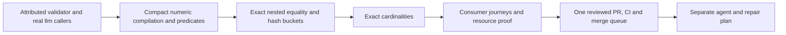

# Bounded Exact Validation Implementation Plan

> **For agentic workers:** REQUIRED SUB-SKILL: Use superpowers:subagent-driven-development (recommended) or superpowers:executing-plans to implement this plan task-by-task. Steps use checkbox (`- [ ]`) syntax for tracking.

**Goal:** Land a maintained, bounded exact JSON Schema validator with real llm consumers as the first independently useful validator PR.

**Architecture:** Derive public leaf packages `llm/jsonschema` and `llm/jsonschema/decimal` from the attributed v5.3.1 implementation. Replace every numeric expansion path, including compilation, metaschemas, identity and cardinalities, before publishing this cut. Preserve the different existing decoders in llm tool execution and object generation.

**Tech Stack:** Go 1.27.0, standard-library compact decimal arithmetic, v5.3.1-derived JSON Schema drafts 4/6/7/2019-09/2020-12, deterministic scripted LLM adapters.

**Spec:** `docs/superpowers/specs/2026-11-03-bounded-exact-validation-design.md`.

## Global Constraints

The following binding constraints are copied from the approved design:

- “Keep existing decoding and Go-type admission contracts. Add no numeric limit and widen no input boundary as part of this validator change.”
- “Both remain leaf packages. They import neither the parent `llm` package, agent nor app packages. There is no nested `go.mod`.”
- “Never parse the exponent through `int` or `int64`, materialize `10^E`, or allocate implied zero digits.”
- “There will be no old-path alias, hidden second authority, stale Rat field, approximate bound or automatic rational fallback.”
- “Keep `SchemaError` wrapping, `ValidationError.Causes`, `InstanceLocation`, `KeywordLocation`, cause order and error traversal behavior.”
- “Retain both upstream `uniqueItems` paths: pairwise comparison through length 20, hash buckets above 20.”
- “Cache entries stay immutable and all temporary arithmetic stays call-local.”
- “Every regression needs a behavioral red on the actual old path and a green on the replacement. A missing-symbol compile failure is insufficient.”
- “Local work stays limited to the smallest red/green selections; CI owns suites, lint, race and browser gates.”

Additional execution constraints: one implementation writer at a time, a fresh task reviewer after each task, append-only execution ledger, and normal commit hooks. Read `docs/developing-evener/testing.md`, `docs/product/README.md` and subsystem S15 before changing code. Assert numeric facts, dispatch and structured errors, never human-readable diagnostic copy. Preserve the held numeric and generation branches/remotes. This plan changes no notification runtime behavior.

## Review Focus

Each condition has a named owning test below:

1. A valid tiny nonzero value survives custom metaschema and reference compilation, not only a direct instance check. Task 2: `TestNumericMetaschemaReferences`.
2. Equivalent values inside differently ordered objects remain duplicates even when every hash collides. Task 3: `TestUniqueItemsCollisionResolution`.
3. A huge zero exponent, malformed programmatic number or nonfinite Go float cannot trigger expansion or broaden admitted Go kinds. Task 2: `TestNumericGoAdmission`; Task 5: `TestNumericResourceBound`.
4. Absent contains limits, explicit zero and multibyte string lengths retain their draft-specific meanings. Task 4: `TestExactCardinalityDefaults`.
5. Real llm handlers still receive float64, while streaming and nonstreaming object generation retain exact json.Number values. Task 5: `TestGenerateNumericValidationJourney` and `TestGenerateObjectNumericValidationJourney`.

---

## Delivery boundary and follow-on cuts

**This plan produces one PR, after all five tasks pass their reviews.** Intermediate commits are reviewable checkpoints, not independently publishable numeric libraries. Task 1 already connects the derived validator to production; Tasks 2–5 establish its new guarantee. Do not publish a partially bounded backend.

Subsequent independently landable changes get their own plans against the landed API:

| Next cut | Inputs and obligations | Kept outside this plan |
| --- | --- | --- |
| Agent validation and repair | Landed `jsonschema` and `decimal` APIs, registry/preparation/result migration, recursive repair identity, both gates, error traversal, concurrency and retained packet bytes | No agent imports, arithmetic, assertions or decoders change here |
| Exact tool ingestion | Migrated agent backend, held decoder's every-token overflow rejection, three explicitly approved assertion amendments, hooks/normalizer/dispatch/fingerprint agreement | Do not cherry-pick the held numeric branch wholesale |
| Lossless provider copies | Bounded backend at its actual consumers, chosen lossless helper contract, independent isolation/error evidence | Provider schema-copy normalization assertions remain unchanged here |

Lossless terminal decoding requires its separate admission ruling. Notification bookkeeping, generation and role adaptation remain separate. The approved design's agent/repair/dispatch obligations are deferred to those named cuts, not declared satisfied by this PR.



## File and interface map

- `llm/jsonschema/`: actual compiler, validator, metaschemas and concrete error types. Preserve upstream file boundaries; do not rewrite unrelated code.
- `llm/jsonschema/decimal/{decimal.go,compare.go,multiple.go}`: immutable decimal parsing/encoding, ordering and coefficient-bounded divisibility.
- `llm/jsonschema/numeric.go`: validator-specific Go-number conversion and count comparison. This owns the validator's existing `fmt.Sprint` interpretation, not repair's different float32 conversion.
- `llm/jsonschema/identity.go`: existing recursive equality/hash logic, moved from `schema.go` only because both are being changed; framed hashing and collision-resolving uniqueness.
- `llm/jsonschema/*_test.go`, `decimal/*_test.go`, `testdata/`: attributed baseline, independent arithmetic oracle, draft/identity/count/resource/distribution proofs.
- `llm/internal/numerictest/`: test-only subprocess/resource support shared by validator and llm journey regressions. No production file imports this helper package.
- `llm/generate.go`, `llm/generate_object.go`, `llm/generate_edges_fuzz_test.go`: the complete current llm import migration, including the concrete compiler hook.
- `llm/generate_numeric_test.go`, `llm/generate_object_numeric_test.go`: real deterministic consumer journeys.
- `llm/go.mod`, `llm/go.sum`: remove only llm's obsolete direct validator requirement/checksums when no llm consumer remains. Agent's dependency stays until its separate migration. No `go.work` change.
- `llm/jsonschema/README.md`, `LICENSE`, `UPSTREAM.md`, `llm/README.md`, `docs/product/subsystems.md`: ownership, provenance, public API and S15's actual scope.

Public decimal API, introduced in Task 2 and consumed by later tasks:

```go
type Number struct { /* unexported immutable identity */ }
func Parse(text string) (Number, error)
func (n Number) Sign() int
func (n Number) IsInteger() bool
func (n Number) Cmp(other Number) int
func (n Number) Equal(other Number) bool
func (n Number) MultipleOf(divisor Number) bool
func (n Number) String() string
```

The zero value represents zero. `String` returns compact canonical JSON-number syntax and is not exponent-expanding formatting. `MultipleOf` returns false for nonpositive divisors; schema compilation rejects those divisors. No general rational conversion, mutable limb access, interning or compatibility fields.

## Task 1: Import the attributed validator and connect llm callers

**Files:**
- Create in `llm/jsonschema/`: `compiler.go`, `content.go`, `doc.go`, `draft.go`, `errors.go`, `extension.go`, `format.go`, `loader.go`, `output.go`, `resource.go`, `schema.go`, `LICENSE`, `UPSTREAM.md`, `README.md`.
- Create: `llm/jsonschema/httploader/httploader.go` using the pinned optional loader, with its actual loader test caller.
- Import/adapt: `example_extension_test.go`, `example_test.go`, `extension_test.go`, `format_test.go`, `internal_test.go`, `schema_test.go`, existing upstream `testdata/`.
- Create: `llm/jsonschema/corpus_test.go`, `llm/jsonschema/draft_baseline_test.go`, `llm/jsonschema/testdata/JSON-Schema-Test-Suite/{LICENSE,tests/,remotes/}`.
- Modify: `llm/generate.go:13,392-417,519`, `llm/generate_object.go:13,38`, `llm/generate_edges_fuzz_test.go`, `llm/go.mod`, `llm/go.sum`.

**Interfaces:**
- Consumes: pinned module `github.com/santhosh-tekuri/jsonschema/v5@v5.3.1` and its matching conformance submodule commit `8cdfac41e37527795879e480a483997cbd6188f3` from `json-schema-org/JSON-Schema-Test-Suite`.
- Produces: the real public `jsonschema.NewCompiler() *Compiler`, `(*Compiler).AddResource(string, io.Reader) error`, `(*Compiler).Compile(string) (*Schema, error)`, `(*Schema).Validate(any) error`, draft constants and concrete error types. The existing llm compiler and validation signatures retain their names and use these new concrete types.

- [ ] **Step 1: Write corpus completeness and baseline behavior tests before transferring the implementation.** `TestFixtureCorpus` decodes/counts committed case sets in all five draft directories and reference fixtures, records the pinned revision, and fails on a missing directory or zero declared cases. It does not run the full validation corpus locally. Run `TestValidatorDraftBaseline` through the existing upstream compiler first; this is a preservation transfer, not a claimed arithmetic fix. Keep the upstream skip list exactly, with no newly skipped failures.

```go
// Assertions in TestFixtureCorpus, for every supported draft:
if files == 0 || groups == 0 || cases == 0 { t.Fatal("empty corpus") }
// In TestValidatorDraftBaseline, the real referenced schema accepts 1 and rejects -1.
if err := schema.Validate(1); err != nil { t.Fatal(err) }
if err := schema.Validate(-1); err == nil { t.Fatal("invalid value accepted") }
```

- [ ] **Step 2: Run only `cd llm && go test ./jsonschema -run '^TestFixtureCorpus$' -count=1`.** First failure must identify absent fixture content, not be passed off as a numeric regression. No default test downloads fixtures. Fetch source/corpus only during this authorized implementation task, verify their immutable identities, and commit their required contents and licenses.
- [ ] **Step 3: Transfer the pinned source and tests, then migrate the three current llm Go imports.** Preserve Apache-2.0 attribution and the corpus's MIT-style license. `UPSTREAM.md` records source version, corpus commit, retained baseline exclusions, modified-file attribution and llm ownership of security/upstream reconciliation. Do not copy upstream `go.mod`, `.git`, CI or repository scaffolding.
- [ ] **Step 4: Make the inherited tests deterministic.** Replace fixed localhost ports 1234/1235 with per-compiler `LoadURL` routing to committed reference fixtures. Fail unexpected external URLs. For the optional HTTP loader's real behavior, use `httptest.NewServer` and its actual loader, with no fixed port or public internet. Adapt inherited copy assertions and example expected output to structural/error-type facts, retaining their behavioral coverage. No disabled metaschemas or changed expected validity.
- [ ] **Step 5: Verify the focused corpus-presence check and `TestValidatorDraftBaseline`, plus existing `TestGenerateObject_Success` and `TestGenerate_ToolLoop_ExecutesToolsAndContinues`.** The new draft baseline test registers `urn:evener:positive` with `{"type":"integer","minimum":0}` and `urn:evener:entry` with `{"$ref":"urn:evener:positive"}` for each of the five compiler drafts; compiled entry accepts 1 and rejects -1. Run `cd llm && go test ./jsonschema -run '^Test(FixtureCorpus|ValidatorDraftBaseline)$' -count=1`, then `go test . -run '^(TestGenerateObject_Success|TestGenerate_ToolLoop_ExecutesToolsAndContinues)$' -count=1`. CI, not a local full-suite run, executes the complete imported corpus. Confirm `compileSchemaAddResource` and its fuzz seam use the new `*jsonschema.Compiler` type, and the ordinary/UseNumber decoder bodies are unchanged.
- [ ] **Step 6: Review the staged diff and commit exact imported paths plus the five llm migration/manifest paths.** Commit: `refactor(llm): own the attributed schema validator`. Report this as an unchanged-arithmetic checkpoint, never as the completed bounded validator.

## Task 2: Bound numeric parsing, compilation and predicates

**Files:**
- Create: `llm/jsonschema/decimal/decimal.go`, `compare.go`, `multiple.go`, `decimal_test.go`, `oracle_test.go`.
- Create: `llm/jsonschema/numeric.go`, `numeric_test.go`, `numeric_metaschema_test.go`.
- Create: `llm/internal/numerictest/subprocess.go`, `limits_linux.go`, `limits_other.go`.
- Modify: `llm/jsonschema/{schema.go,compiler.go,resource.go,draft.go,UPSTREAM.md}` only where numeric bootstrap/compilation or modified-file attribution requires it.

**Interfaces:**
- Consumes: Task 1's real compiler, built-in metaschemas and validator.
- Produces: the complete public decimal API above; private `numberValue(v any) (decimal.Number, bool)` for existing admitted validator number kinds; private `loadNumber(v any) (*decimal.Number, error)` for present schema bounds. All five public numeric `Schema` fields become `*decimal.Number`, nil when absent. Later tasks must not use removed `*big.Rat` fields.
- Produces test-only support: `numerictest.Run(t *testing.T, witness string, check func(*testing.T))`, with private platform-specific `limitChild(t *testing.T)`. This internal package is importable by both validator tests and llm journey tests. It serves actual old-path RED witnesses now and Task 5's resource proof later, not a second runner.

- [ ] **Step 1: Write `TestNumericBoundsExtreme`, `TestNumericMetaschemaReferences` and `TestNumericGoAdmission` against the actual imported old implementation.** Introduce the shared subprocess support here for unsafe old scenarios. It re-executes the current test binary for the exact test/witness with `GOMAXPROCS=1` and captures output; a temporary structured report proves that the callback started and completed and records allocation/CPU deltas after package initialization. `Run` enforces at most 64 MiB cumulative callback allocations and 5 CPU seconds, including witness compilation/validation. Parent deadline is 15 seconds. On Linux, set child `RLIMIT_CPU` to 10 seconds and `RLIMIT_AS` to its current virtual size from `/proc/self/statm` plus 512 MiB before invoking unsafe arithmetic; failures to install limits fail the test. Other platforms retain the subprocess/deadline and run the fixed backend, but the unsafe pre-fix RED is commissioned only on Linux. Do not call a soft Go memory target a hard limit. These are regression-harness budgets, not production admission limits. Required facts:

```go
cases := []struct { schema string; value json.Number; valid bool }{
    {`{"minimum":0,"maximum":1}`, "1e-1000000000", true},
    {`{"type":"integer"}`, "1e-1000000000", false},
    {`{"type":"integer"}`, "-0e999999999999999999999", true},
    {`{"multipleOf":1}`, "1e-1000000000", false},
    {`{"minimum":0}`, "-1e-1000000000", false},
}
// For each real AddResource/Compile result s and table row tc:
if got := s.Validate(tc.value) == nil; got != tc.valid { t.Fatal(got, tc.valid) }
```

Also pin later drafts' independent numeric exclusive bounds, Draft4's associated boolean exclusive bounds, custom `$schema`/`$ref` targets containing huge constraints, and compile rejection of multipleOf 0/-1. Check structured locations and cause order on an ordinary small nested failure before and after migration.

`TestNumericGoAdmission` pins the unchanged admitted switch: `json.Number`, float32/64, int/int8/int32/int64, uint/uint8/uint32/uint64. Preserve unsupported int16/uint16/uintptr/named-number handling and finite-value handling. Do not add conversion by reflection. For valid finite floats, preserve `fmt.Sprint` decimal interpretation. Malformed programmatic json.Number and nonfinite values use existing invalid-value error handling rather than arithmetic dereferences or newly accepted types.

- [ ] **Step 2: Run `cd llm && go test ./jsonschema -run '^TestNumeric(BoundsExtreme|MetaschemaReferences|GoAdmission)$' -count=1`.** Record which actual old numeric path failed and its semantic assertion. Parent containment must distinguish a killed/crashed child from a validation rejection; neither is a valid outcome for an accepted extreme witness. Do not cite missing decimal symbols as RED. Before any rewrite, characterize existing finite/nonfinite and unsupported-kind behavior using small values; preserve their admission policy rather than inferring it from a type label.
- [ ] **Step 3: Add `TestDecimalSmallOracle` and `TestDecimalExtremeIdentity` before implementing the kernel.** The oracle constructs `big.Rat` independently from integer mantissa and bounded powers for mantissas -125…125 and exponents -6…6. Cover pair comparisons and divisibility with a deterministic fixed-seed sample plus all sign/zero/2/5/residual-prime boundaries. Its reference parser must not call `decimal.Parse` or use its canonical output. These are test-domain bounds only. Reject `""`, `"01"`, `"+1"`, `".1"`, `"1."`, `"1e"`, `"NaN"` and `"Infinity"`; accept `"0"`, `"-0"`, `"0.0"`, `"1e+0000"` and `"1.20e-2"`. Assert zero is a multiple of every positive divisor and every instance returns false for a nonpositive divisor. The new API's missing-symbol failure is supplementary to the actual old-backend RED already obtained in Step 2, not a replacement for it.

```go
// Extreme test identities, asserted using public methods:
// 10e999999999999999999999 == 1e1000000000000000000000
// 0e-999999999999999999999 == -0e999999999999999999999
// 1e-999999999999999999999 > 0 and is not integral
// 3e999999999999999999999 is not a multiple of 7e999999999999999999998
// 6e999999999999999999999 is a multiple of 3e999999999999999999998
// 1e-999999999999999999999 is a multiple of 2e-1000000000000000000000
// The inverse divisibility relation is false.
a, err := Parse("1e-999999999999999999999")
if err != nil { t.Fatal(err) }
zero := Number{}
if a.Cmp(zero) <= 0 || a.IsInteger() || a.Equal(zero) { t.Fatal(a) }
b, err := Parse("2e-1000000000000000000000")
if err != nil { t.Fatal(err) }
if !a.MultipleOf(b) || b.MultipleOf(a) { t.Fatal(a, b) }
```

- [ ] **Step 4: Implement the immutable decimal API in the three named kernel files.** Store normalized sign/coefficient and arbitrary signed exponent. Parsing accepts JSON-number syntax, adjusts exponent by encoded fractional/trailing-zero counts and canonicalizes every zero spelling. `Cmp` compares arbitrary `len(C)+E`, then virtual coefficient padding. `MultipleOf` implements the approved 2/5 valuations and residual-core divisibility, with fresh coefficient-sized integer receivers. No loop or allocation follows exponent magnitude. Run the two new kernel tests to GREEN before wiring the compiler to them.
- [ ] **Step 5: Replace all five bound loaders and direct numeric predicates, from metaschema bootstrap onward.** `numberValue` preserves the existing Go-kind switch and decimal rendering. Invalid numeric values retain invalid-value errors. `loadNumber` returns immutable values or compile errors. Replace integer recognition, inclusive/exclusive comparisons and quotient tests; retain draft selection, resource validation, reference compilation, error nesting and cause order. Render numeric diagnostics with compact `Number.String()`, never Float64 conversion. Equality/hash remain Task 3; this checkpoint is not yet wholly bounded.
- [ ] **Step 6: Run the identical RED selector to GREEN, then only `go test ./jsonschema/decimal -run '^TestDecimal(SmallOracle|ExtremeIdentity)$' -count=1` from `llm`.** Check structured error type/keyword/instance paths, not prose. Audit numeric loops and receivers in the task review. Commit exact Task 2 files: `feat(llm): bound exact schema numeric arithmetic`.

## Task 3: Preserve exact nested identity and uniqueness

**Files:**
- Create: `llm/jsonschema/identity.go`, `identity_test.go`.
- Modify: `llm/jsonschema/schema.go`, `UPSTREAM.md`.

**Interfaces:**
- Consumes: `decimal.Parse`, `Number.Equal`, `Number.String`, Task 2's `numberValue`.
- Produces: private `equals(a, b any) bool`, `hash(v any, h *maphash.Hash)`, and `duplicateItems(items []any, hashValue func(any) uint64) (first, second int)`. The helper returns `(-1,-1)` for no duplicate and the same earliest pair as the existing traversal. `Schema.Validate` supplies the real hash function; tests supply a constant only to force otherwise unreachable collisions. No global mutable test hook.

- [ ] **Step 1: Write `TestNumericTreeIdentity`, `TestUniqueItemsPaths` and `TestUniqueItemsCollisionResolution`.** Compile real const/enum/uniqueItems schemas. Test array lengths 2, 20 and 21 with distinct tiny values versus zero and with equivalent spellings as duplicates. Nested maps have different insertion orders and numeric kinds; arrays stay ordered. Include framed string/array boundaries and distinct negative signs.

```go
// Equal nested values and hashes under the SAME maphash seed:
// {"a":[1e1000000000000000000000],"b":0}
// {"b":-0e999999999999999999999,"a":[10e999999999999999999999]}
// Unequal: ["ab","c"] versus ["a","bc"], tiny nonzero versus zero.
// Collision helper: 21 distinct values + constant hash -> (-1,-1).
// Replace final value with an earlier equivalent nested value -> exact pair.
a := map[string]any{"a": []any{json.Number("1e1000000000000000000000")}, "b": 0}
b := map[string]any{"b": json.Number("-0e999999999999999999999"), "a": []any{json.Number("10e999999999999999999999")}}
if !equals(a, b) { t.Fatal(a, b) }
var h1, h2 maphash.Hash
seed := maphash.MakeSeed()
h1.SetSeed(seed); h2.SetSeed(seed)
hash(a, &h1); hash(b, &h2)
if h1.Sum64() != h2.Sum64() { t.Fatal("unequal hashes for equal values") }
```

- [ ] **Step 2: Run `cd llm && go test ./jsonschema -run '^Test(NumericTreeIdentity|UniqueItemsPaths|UniqueItemsCollisionResolution)$' -count=1`.** Unsafe extreme old equality/hash witnesses run in the isolated child; record actual failure before replacing those paths. The collision-only new helper test is additional coverage, not the behavioral RED claim.
- [ ] **Step 3: Move and update equality/hash together in `identity.go`.** Recursive equality uses the admitted numeric converter, key-set equality and ordered arrays. Hash type tags, container/string lengths, keys and canonical numbers with unambiguous framing; sort object keys. Equal values hash identically for one seed. Bucket collisions always call exact equality. Keep pairwise comparison through 20 and bucket lookup above 20; no rational or Float64 identity path.
- [ ] **Step 4: Verify the identical selector is GREEN.** In helper tests a counting hasher must receive zero calls for length 20 and calls for length 21. Real `Schema.Validate` tests exercise both sizes too. Inspect the production call to that same helper. Confirm forced collisions still distinguish unequal values and recover the earliest actual duplicate. Commit exact Task 3 paths: `feat(llm): keep schema identity exact without expansion`.

## Task 4: Compile and compare exact cardinalities

**Files:**
- Create: `llm/jsonschema/cardinality_test.go`.
- Modify: `llm/jsonschema/{compiler.go,schema.go,numeric.go,UPSTREAM.md}`.

**Interfaces:**
- Consumes: Task 2's `loadNumber` and decimal comparison.
- Produces: `Schema.MinProperties`, `MaxProperties`, `MinItems`, `MaxItems`, `MinLength`, `MaxLength`, `MinContains`, `MaxContains` as `*decimal.Number`. Nil means absent. Private `compareCount(actual int, threshold decimal.Number) int` parses only the actual native count's encoded decimal spelling and compares it to the compact threshold. No threshold-to-int conversion or sentinel field remains.

- [ ] **Step 1: Write `TestExactCardinality` and `TestExactCardinalityDefaults` against the still-native-count implementation.** For every applicable draft, `1e1000000000000000000000` is a valid threshold: huge minimum fails small input and huge maximum accepts it. Negative and fractional thresholds fail schema compilation. Pin explicit 0, absent limits, empty input and exact values around a real count; expose loaded fields to prove the schema token was not rounded.

```go
// Actual count 2: 2.000 accepts as threshold; 2.0000000000000000000001 is invalid.
// minLength/maxLength count Unicode code points: "é🙂" has length 2.
// contains with absent minimum requires one match in supported drafts.
// Draft2019/2020 minContains 0 accepts zero matches; maxContains 0 rejects a match.
// contains limits remain inactive where the draft does not define them.
// contains default/explicit-zero behavior preserves unevaluatedItems accounting.
// After successful real compilation for each table row:
if got := s.Validate(instance) == nil; got != wantValid { t.Fatal(got, wantValid) }
// For every nonintegral/negative threshold:
if _, err := c.Compile(uri); err == nil { t.Fatal("invalid threshold compiled") }
```

- [ ] **Step 2: Run `cd llm && go test ./jsonschema -run '^TestExactCardinality(Defaults)?$' -count=1`.** Keep actual out-of-range/rounding RED evidence. A public-field compile error is not sufficient evidence.
- [ ] **Step 3: Replace the eight loaders, field types and comparisons.** Preserve vocabulary selection and contains defaults explicitly in validation. Keep the same keyword and instance error locations and evaluation accounting. Never expand or narrow a threshold. Update attributed modification notes.
- [ ] **Step 4: Rerun the identical selector to GREEN.** Include compile errors through `SchemaError`, valid compiled-schema reuse, and contains error causes. Commit exact Task 4 paths: `fix(llm): preserve exact schema cardinality thresholds`.

## Task 5: Prove llm journeys, numeric resource bounds and distribution

**Files:**
- Create: `llm/generate_numeric_test.go`, `llm/generate_object_numeric_test.go`, `llm/jsonschema/resource_bound_test.go`, `llm/jsonschema/concurrency_test.go`, `llm/jsonschema/distribution_test.go`.
- Modify: `llm/jsonschema/{README.md,UPSTREAM.md}`, `llm/README.md`, `docs/product/subsystems.md` S15.
- Temporary RED mutation only, restored byte-for-byte: `llm/generate.go`, `llm/generate_object.go`, `llm/generate_edges_fuzz_test.go`, `llm/go.mod`, `llm/go.sum`.

**Interfaces:**
- Consumes: Tasks 1–4's compiler/kernel; `numerictest.Run(t *testing.T, witness string, check func(*testing.T))`; unchanged `Generate`, `GenerateObject`, `StreamGenerateObject` and existing deterministic `scriptedAdapter`/`scriptedStreamAdapter` test support.
- Produces: behavior evidence for the shipped PR, its documented numeric guarantee and leaf-package distribution check. No new runtime API, decoding mode or provider-copy contract.

- [ ] **Step 1: Write real consumer witnesses and obtain their behavioral RED with the old arithmetic paths.** `TestGenerateNumericValidationJourney` scripts an actual tool call, result continuation and handler. A schema with huge bounds compiles; valid arguments execute once and arrive as float64. A genuinely invalid argument never executes; a later valid call succeeds. Preserve overflow rejection and the existing loss of raw-token precision under ordinary Unmarshal. Use exact `ToolCallData` and `GenerateOptions` patterns from `generate_test.go`, not a fake Evener dispatcher.

`TestGenerateObjectNumericValidationJourney` covers both GenerateObject variants, with schemas whose const/range/integer constraints decide the exact supplied value. Assert returned `json.Number` token/value, typed rejection and retained raw output on failure. Required payloads include `9007199254740993`, `1e400`, `1e-1000000000`, a huge zero exponent, an invalid fractional integer and a value outside a huge bound. Each script proves a nonnil schema was compiled and validation affected the outcome. Stream real text deltas through the existing deterministic stream boundary.

```go
// In the actual tool handler, for the valid ordinary-Unmarshal witness:
if _, ok := args.(map[string]any)["n"].(float64); !ok { t.Fatal(args) }
// On a successful exact object result with payload {"n":9007199254740993}:
if n, ok := result.Output.(map[string]any)["n"].(json.Number); !ok || n != "9007199254740993" { t.Fatal(result.Output) }
// On genuine schema rejection, including the streamed terminal result:
var invalid *NoObjectGeneratedError
if !errors.As(err, &invalid) || invalid.RawText != payload { t.Fatal(err) }
```

- [ ] **Step 2: Run `cd llm && go test . -run '^TestGenerate(NumericValidationJourney|ObjectNumericValidationJourney)$' -count=1`.** These journey tests import no new decimal-specific types. For behavioral RED, make exact scratch copies of `llm/generate.go`, `llm/generate_object.go`, `llm/generate_edges_fuzz_test.go`, `llm/go.mod` and `llm/go.sum`, temporarily restore only their upstream validator imports and llm's v5.3.1 requirement, and run the same tests through that real old backend with the shared subprocess containment for unsafe witnesses. Confirm the scenario reached old compilation/validation. Restore every copied file byte-for-byte before GREEN and remove the scratch copies after checking their hashes. Never use shared stash, mutate a held lane or claim a missing-package failure as behavioral RED.
- [ ] **Step 3: Complete `TestNumericResourceBound`.** Reuse `numerictest.Run` with `GOMAXPROCS=1`. Cover actual compiler/Validate/identity paths with positive/negative exponents beyond int64, huge zero exponents, nearly cancelling divisibility and 21-item nested identity. The helper measures callback allocation delta with `runtime.MemStats.TotalAlloc` and CPU delta with `runtime/metrics` user plus total-GC CPU classes, including witness compilation/validation. Include 32-digit and 1024-digit encoded exponents; verify values and validation outcomes, not only successful termination. Task 2's regression thresholds are not production admission limits or a universal bound. A timeout, crash or nonzero child exit fails the test. The code review remains the primary exponent-magnitude proof.
- [ ] **Step 4: Add `TestCompiledNumericConcurrentValidation` and `TestLeafPackagesOutsideWorkspace`.** Concurrent goroutines reuse one compiled numeric/identity/cardinality schema with distinct instances, producing stable validity/error locations. No shared mutable decimal receivers or caches. The distribution test writes a temporary consumer module requiring llm with a local replace, imports both public leaf packages, and compiles/validates an exact value with `GOWORK=off GOPROXY=off GOSUMDB=off`; it uses no sibling replacement or preexisting workspace module. Run only the new leaf graph. Report existing whole-module publication debt separately. CI executes the race variant and tagged compile gates; do not run them locally.
- [ ] **Step 5: Update evergreen ownership/API docs in the same commit.** Document the five numeric/eight cardinality field types, nil/default semantics, compact exact diagnostics, upstream/corpus provenance, arithmetic-only resource guarantee, llm decoder distinctions and release ownership. S15 names the maintained backend. Explicitly state that agent still uses its old validator until the separate agent cut. Add no claim about raw terminal precision or provider cloning.
- [ ] **Step 6: Run only the new journey selectors and the resource/distribution/concurrency test selection, then inspect `git diff --check` and exact staged paths.** The resource/concurrency test name selection is `cd llm && go test ./jsonschema -run '^Test(NumericResourceBound|CompiledNumericConcurrentValidation|LeafPackagesOutsideWorkspace)$' -count=1`. Commit exact Task 5 files: `test(llm): prove bounded numeric validation journeys`. CI owns the complete conformance corpus, existing llm regressions, fuzz seeds, lint, race and tagged consumers. Do not declare these passed from targeted local output.

## Whole-cut review and landing gate

- [ ] The controller self-checks the full imported-source delta against v5.3.1, then obtains the prescribed whole-branch review and simplify review. Review every numeric expansion site, compiler/bootstrap path and diagnostic; no remaining arbitrary-number Rat/Float64 conversion is permitted in the derived validator.
- [ ] Independently inspect the exact regression executions and corpus manifest. A script's printed count is not proof it traversed cases. Inventory exact imported files, corpus case counts and baseline exclusions from actual contents; absence fails rather than skips.
- [ ] Verify all llm imports, including fuzz seams, use the new concrete types. Agent remains untouched and still requires upstream. Confirm no new module edge, global retention, provider-copy behavior or decoder change entered the diff.
- [ ] Push this cut once after its local microchecks/reviews, wait once with the standard exact-head shepherd detector, read combined and per-commit review bodies, and let CI run full gates. Repair only evidenced in-scope failures. Do not bypass an unrelated red check.
- [ ] Enqueue only when checks are green and the exact head is approved. Record GitHub's actual merge result before starting the separately scoped agent plan. Existing queue-bystander policy and parked lanes remain in force.

## Self-review and requirement coverage

The controller performs this review before presenting the plan, not through another delegate:

| Approved requirement | Owning task or explicit follow-on |
| --- | --- |
| Existing llm ownership, real caller, attributed source/corpus, draft baseline | Task 1 |
| Immutable compact representation, comparison, integrality and 2/5 divisibility | Task 2 |
| Compiler/bootstrap, custom metaschemas, references and exact diagnostic bounds | Task 2 |
| Recursive identity, framing, both uniqueness paths and forced collisions | Task 3 |
| Eight exact cardinalities and draft defaults/evaluation | Task 4 |
| Independent small oracle, extreme witnesses and code complexity proof | Tasks 2 and 5 |
| Real llm tool and streamed/nonstreamed object journeys, unchanged decoders | Task 5 |
| Concurrent reuse, downstream leaf import and evergreen ownership docs | Task 5 |
| Registry/preparation/repair/result and retained terminal packet contracts | Separate agent and repair plan after this PR lands |
| Three held assertion amendments, exact ingestion and provider copies | Separate dependent cuts, no assertions amended here |

Type check of the plan: later tasks consume `decimal.Number`, `Parse`, `Cmp`, `Equal`, `MultipleOf` and `String` exactly as declared. Private helper seams have production callers. No rational compatibility fields survive. Review Focus entries each map to named tests. The five tasks fit one backend/llm subsystem PR; follow-on subsystem plans are deliberately separate. No implementation, test run or empirical resource result is claimed by this document.
