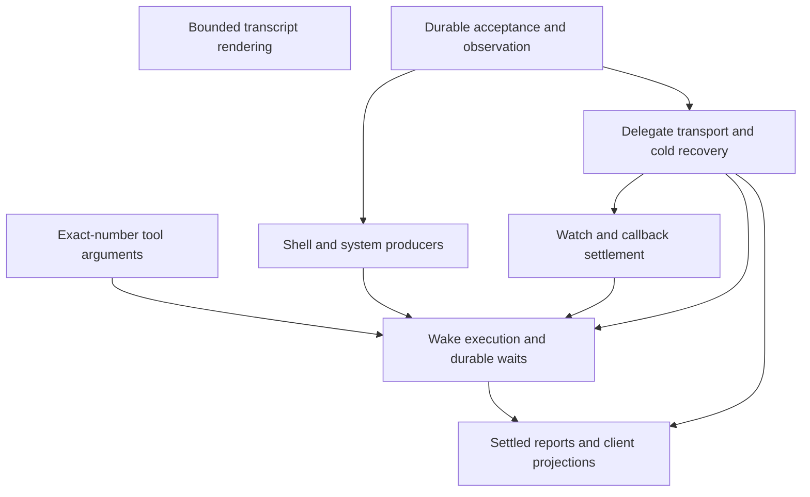

# Independent notification delivery

## Goal and authority

Take over the unfinished notification work and land useful, independently verified
changes instead of another combined delivery PR. Preserve the existing branches
and draft PR. The accepted unified-notification design is recorded in
`notification-delivery-main:docs/superpowers/specs/2026-10-23-unified-session-notifications-design.md`.
That design supersedes the earlier terminal-report admission design. The current
request changes delivery sequencing, not the accepted behavior.

Reconstruct each patch against current `origin/main`. The old branch contains
unrelated history and changes already present on main. Neither whole-file copies
of mixed files nor blanket cherry-picks are safe extraction methods.

## Global Constraints

- Each PR has a production caller, an independent behavior check, CI, review,
  and its own merge-queue landing. No inactive framework or temporary adapter
  merely to make a later PR compile.
- Every persisted format remains readable. Preserve messages across waits,
  Stop and restart. Keep identity, provenance, terminal output and result schema
  exact. No unapproved compatibility layer or replacement inbox store.
- Notification production, durable receiver acceptance and successful model
  observation are distinct facts. Wake signals are hints, not custody evidence.
- Preserve the existing executor's serialization and safe tool boundaries.
  Questions and approvals hold execution, not independent notification transport.
- A wait yields the activation while retaining the delegate generation and its
  resources. Preserve the narrow refusal to finish while children are live.
  Do not add task-inventory, human-attention or extra report-observation gates.
- Keep main's existing lifetime-lock fix and inherited-descriptor coverage.
  Comic is out of main and stays out of these PRs.
- Immediate healthy recovery may finish transport before restore returns. Prove
  exact custody, acknowledgment and idempotence rather than pending-only counts.
- Finalization may consume a notification in the same run. Test actual completed
  idle separately when proving a successor-run wake.
- Deliberately nonpersistent sessions use the same delivery path with existing
  session-local state. A failed configured writer never silently becomes
  memory-only. Keep wake handlers simple and fairness a separate contract.
- Read `docs/developing-evener/testing.md` before changing tests. Prove behavior,
  not copy. Default tests use no live providers or ambient credentials.
- Local verification is limited to the smallest regression test/file needed for
  red/green development. CI owns suites, lint and browser gates.
- Preserve all unrelated files, worktrees, branches and existing PRs.

## Landing map

The first two cuts have independently identifiable source patches and need no
notification-runtime changes. The remaining boundaries are construction targets:
validate each against source and a real end-to-end path before promoting it to an
implementation task. Split them further where they leave useful working behavior;
there is no PR-count ceiling.



Receiver changes must use the existing attention authority and an existing real
producer. Shell, delegate and watch cuts retain the working executor until its
replacement lands. Wait claims stay with their execution and recovery consumers.
Settled reports include summary/output preservation, settled-generation agreement,
shared-client adaptation, and the supported web/native activity surfaces. Review
these obligations explicitly; they must not disappear behind the execution cut.

Every new durable writer must prove restart, Stop, in-flight model response,
finalization, source-only replay and downgrade boundaries relevant to that writer.
Final runtime delivery must include automatic recovery to useful operation, not
only the state at failure. Update the owning product guide and subsystem map in
the same PR as changed behavior. Do not restore obsolete client code from the old
branch or weaken current user-visible assertions.

## Task 1: Bound transcript fit probes

**Purpose:** Stop rendering the rest of a transcript once a budget probe has
already overflowed, while preserving the full renderer and selected entry window.
This is a standalone performance/correctness extraction with no wire changes.

**Own:** `agent/transcript_render.go`,
`agent/transcript_render_budget_test.go`, and only additional existing rendering
test files demonstrably required by this change. Do not stage the plan or ledger.

**Source:** inspect
`a6b293be54c57c8cb55ac7610251d012528fa87c:agent/transcript_render_budget_test.go`
and the bounded-probe hunks in `agent/transcript_render.go` at that commit.
Compare source against this lane's main, not the old commit's parent. Ignore
unrelated readiness, report-summary, background-job and imports changes.

**Implementation:** Share the actual entry-writing path between ordinary rendering
and bounded fit probing. A positive probe limit ends rendering after an entry
exceeds the limit. Unlimited ordinary rendering keeps its current behavior.
`budgetedEnd` uses the bounded predicate. Do not retain evidence for abandoned fit
probes. Preserve entry pairing, pinned spans, headers and evidence in real reads.

**Tests:** Use the source tests as candidates, not unquestioned authority:
`TestMarkdownBudgetProbeStopsAfterOverflow`,
`TestMarkdownBudgetProbeMatchesFullRender`, and
`TestBudgetedEndMatchesFullRender`. Check the test names do not already exist.
Use full rendering as the independent oracle for fit/window equivalence. Prove
bounded work without a timing threshold and show the overflow path actually ran.
Start with a behavioral red against current production, then the smallest
production patch and green. Existing full-render behavior must remain unchanged.
A compile failure from a missing helper alone is not the behavioral red.

**Check:** `go test ./agent -run '^(TestMarkdownBudgetProbeStopsAfterOverflow|TestMarkdownBudgetProbeMatchesFullRender|TestBudgetedEndMatchesFullRender)$' -count=1`.
A narrow additional existing rendering test selection is allowed, no package/full
suite or lint runs locally. Report the exact executed tests and exit status.

**Finish:** Format only touched Go files with gofmt. Read the final diff. Commit
only named owned paths with all hooks enabled. Do not push, open a PR or merge.
Write a report with red and green commands/output, committed SHA, changed paths,
self-review, and any uncertainty. Return DONE, DONE_WITH_CONCERNS, NEEDS_CONTEXT
or BLOCKED. Do not delegate or start another reviewer.

## Task 2: Preserve exact-number tool arguments

**Purpose:** Preserve JSON numeric identity from decoding through validation,
normalization, dispatch and failure fingerprinting. Prevent precision loss in
tool arguments without a second conversion layer. Terminal-result and schema
cloning boundaries remain obligations of the later report-preservation cut.

**Source:** inspect all 20 paths in commit
`1e975cdb7a1b378f9581a59a93d260e553993faf`. Reconstruct against the then-current
main. Keep `DecodeArguments`, `ValidateArguments`, `WholeNumberInt`, breaker
canonicalization, hooks/argument repair, registry and numeric consumers together.
The normalizer consumes canonical numeric representations, so a nil-normalizer
breaker test alone cannot prove a breaker-only extraction is safe.

**Own:** `agent/internal/hooks/hooks.go`,
`agent/internal/hooks/numeric_test.go`, `agent/internal/tool/arguments.go`,
`agent/internal/tool/arguments_numeric_test.go`,
`agent/internal/tool/breaker.go`, `agent/internal/tool/registry.go`,
`agent/internal/tool/registry_numeric_test.go`,
`agent/internal/tool/registry_program_fuzz_test.go`,
`agent/internal/tool/repair/explain.go`,
`agent/internal/tool/repair/numeric_test.go`,
`agent/session_numeric_ingestion_test.go`,
`agent/session_numeric_task_test.go`, `agent/session_tool_repair.go`,
`agent/session_tools.go`, `agent/session_tools_find.go`,
`agent/session_tools_jobs.go`, `agent/session_tools_model_list.go`,
`agent/session_tools_shell.go`, `agent/session_tools_task.go`,
`docs/architecture.md`. Directly required existing numeric tests and the owning
product guide may be changed with an evidence-based reason reported. Do not
include notification admission, waits, custody or client UI changes.

**Tests:** Start with the smallest failing existing/public path proving exact
large integer and equivalent whole-number behavior. Cover decoder rejection,
schema validation/panic containment, exact integer conversion, repaired/hooked
arguments, task normalization and dispatch/fingerprint agreement. Inspect source
`TestExactArgumentDocuments`, `TestExactArgumentDuplicateNumbers`,
`TestWholeNumberInt`, `TestExactBreakerNumbers`, `TestExactSchemaNumbers`,
`TestExactSchemaRejections`, `TestRegistryNumericIngestion`,
`TestRegistryNumericValidationRecovery`, `session_numeric_ingestion_test.go` and
`session_numeric_task_test.go`. Preserve duplicate-key and malformed-input rules.
Do not invent a new numeric resource budget or compatibility policy.

Preserve `TestFailureFingerprint_ToolNormalizerFoldsWhatItRemoves` unchanged.
Main passes bare in-range integers as int64 to normalizers; preserve that
assertion. Decimal/exponent spellings currently pass through float64, so the
exact-number change must prove built-in normalizers still assign them the same
meaning as dispatch. Add a cross-normalizer check rather than relying only on
the source patch's nil-normalizer tests. Test oracles must not reuse the production decoder when
the claim is decoder correctness. Start parallel Go tests with `t.Parallel()`
unless they change process-wide state.

**Checks:** Start with the smallest existing/public-path red, such as
`go test ./agent/internal/tool -run '^TestRegistryNumericIngestion$' -count=1`.
After the fix, run narrow numeric selections, not full suites:

```sh
go test ./agent/internal/tool -run '^(TestExactArgumentDocuments|TestExactArgumentDuplicateNumbers|TestWholeNumberInt|TestExactBreakerNumbers|TestExactSchemaNumbers|TestExactSchemaRejections|TestValidationRecoveryDoesNotCoverExecution|TestRegistryNumericIngestion|TestRegistryNumericValidationRecovery|TestFailureFingerprint_ToolNormalizerFoldsWhatItRemoves)$' -count=1
go test ./agent/internal/hooks -run '^TestHookUpdatedInputExactNumbers$' -count=1
go test ./agent/internal/tool/repair -run '^TestNumericExact$' -count=1
go test ./agent -run '^(TestPrepareNumericValidationGates|TestPrepareNumericPreservation|TestNumericReaders|TestTaskTool_ExactDependencyNumbers|TestTaskDependencyZeroClassification)$' -count=1
```

Include any added cross-normalizer regression explicitly in the command. Let CI
run broader suites and lint. Format and commit only named owned paths with hooks
enabled. Do not push, open a PR or merge. Write the full report with actual
red/green output, committed SHA, paths, self-review and concerns. Return DONE,
DONE_WITH_CONCERNS, NEEDS_CONTEXT or BLOCKED. Do not delegate or start a reviewer.
The parent obtains independent review, simplifies the diff, pushes once for the
round, settles CI and RoboRev, and merges through the queue.

## Task 4: Isolate typed schema containers

**Purpose:** Make the existing shared schema clone isolate valid serializable
containers that its type switch currently returns unchanged. This correction is
independent of exact argument ingestion, provider normalization and validation
arithmetic. Existing decorators already call the shared clone on main.

**Base:** `818cb733c1aeeb99dcb77a8aea7a661867692c4c`, on the isolated branch
`wip/notification-schema-clone-isolation`. Preserve the held numeric lane and its
remote PR unchanged.

**Own:** `agent/internal/tool/registry.go`, a new directly covering
`agent/internal/tool/schema_clone_test.go`, and one evergreen ownership sentence
in the S14 row of `docs/product/subsystems.md`. The parent owns this plan.
Do not edit existing tests, provider decorators, argument ingestion, terminal
validation, dependencies, notification runtime or client code.

**Source:** Inspect only the `cloneSchemaValue` correction in
`0eee1aaa018493d0f0c2a7e98b09aa1a7a100792..35e2e938f660187fa9ebd8175d7bc672b3013cb9`.
Reconstruct against this task's base; do not cherry-pick the numeric commits or
copy their agent-level tests. Real callers include `WithIntentParameter`,
`WithoutIntentParameter`, tool-definition decorators and provider definition
cloning. Use the existing shared clone rather than adding another clone helper.

**Contracts:** Preserve the current generic-map recursion, every explicitly
supported slice type, scalar Go representations including `float64`, nil and
empty behavior, and fallback for unserializable input. Previously unhandled
serializable typed maps, slices, arrays, structs and pointers must not alias
mutable source state. Preserve `json.Number("9007199254740993")` exactly in those
containers. No numeric rejection policy, compatibility layer or validator change
is authorized. Do not orphan an existing production symbol or weaken assertions.

**Tests:** Read the product guide, S14 map row and testing guide first. Record up
to five ranked hypotheses before production edits. Add
`TestCloneSchemaMapTypedContainerIsolation`, covering each newly handled container
kind, exact numeric contents and mutation in both directions. Add
`TestWithIntentParameterTypedSchemaIsolation` through the existing production
decorator, with a valid typed nested schema. Start parallel tests with
`t.Parallel()`. Assert semantic contents independently of the concrete clone
representation; a type-assertion panic is not an aliasing reproduction. Existing
`TestCloneSchemaMap_DeepClonesEverySliceKind` and decorator assertions stay intact.
Prove behavioral RED on unchanged production before the smallest shared repair,
then GREEN. Reuse the already-reviewed fallback only if it meets all contracts.

**Checks:** Run only the new tests for RED, then:

```sh
go test ./agent/internal/tool -run '^(TestCloneSchemaMapTypedContainerIsolation|TestWithIntentParameterTypedSchemaIsolation|TestCloneSchemaMap_DeepClonesEverySliceKind|TestWithIntentParameter_LeavesRequiredUntouched|TestWithIntentParameterRequired_MarksIntentRequired|TestWithoutIntentParameter_RemovesFromRequired)$' -count=1
```

No local full suite, race, broad lint or browser gates. CI owns them. Gofmt only
touched Go files. If any preserved assertion or contract conflicts, stop with
NEEDS_CONTEXT and its evidence instead of inventing another policy.

**Finish:** Inspect the staged diff and commit only the three owned paths with
normal hooks. Do not amend, push, post remotely, delegate, create a reviewer,
stash, switch branches/worktrees or edit the parent ledger/brief. Append the full
red/green commands and exit codes, exact base/head, changed paths, shape and
isolation coverage, self-review and concerns to the report path supplied by the
parent. Return DONE, DONE_WITH_CONCERNS, NEEDS_CONTEXT or BLOCKED. The parent
reviews the whole independent cut before its own push and merge-queue attempt.
