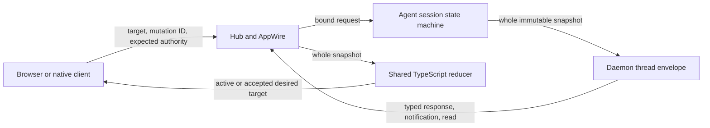

# Focused Model-Control Snapshot Implementation Plan

> **Superseded:** Use `docs/superpowers/plans/2026-11-17-strict-model-control-client-authority.md`. This plan permits identity-free requests and empty responses that the approved replacement design forbids.

> **For agentic workers:** REQUIRED SUB-SKILL: Use superpowers:subagent-driven-development (recommended) or superpowers:executing-plans to implement this plan task-by-task. Steps use checkbox (`- [ ]`) syntax for tracking.

**Goal:** Make every accepted model choice visible during a running turn and keep browser and native clients converged through one daemon-owned, revisioned model-control snapshot.

**Architecture:** `agent.Session` owns one immutable `ModelControlSnapshot` per thread instance and daemon boot. The daemon carries that whole value through the model-set response, a typed notification, and `thread/read`; the hub preserves the typed response at every hop; one shared TypeScript reducer installs whole snapshots by authority and revision for both clients. Existing context-status, reasoning-effort, vision, catalog, persistence, and provider-call timing remain independent.



**Tech Stack:** Go, AppWire JSON-RPC, generated TypeScript, React/Zustand/Vitest, React Native/Vitest.

**Spec:** `docs/superpowers/specs/2026-11-15-model-switch-authority-design.md`

## Global Constraints

- Version 1 is one whole `ModelControlSnapshot`; never merge its active, desired, authority, or revision fields independently.
- `instanceId` and `bootGeneration` are equality fences. Compare revisions only inside one exact authority.
- Provider and model remain separate on the wire and in client state. Qualification for profile lookup may join them; no code reparses a qualified string.
- Assign request sequence only after request shape and expected authority validate, and before admission begins.
- Direct refusal and supersession remain per-call outcomes. Only pending, applied, and deferred-rejected accepted requests change shared state.
- Same-model and legacy acceptance advance the same snapshot revision.
- A successful response follows its origin-fenced envelope commit; a later read in that authority returns that revision or newer.
- Only `refreshFacets` writes the envelope's model-control facet; `appThread` reads that facet without a session callback.
- `ModelControlSnapshot` owns active provider, model, reasoning levels, and reasoning support. Existing context status, current reasoning effort, vision routing, usage, cost, work time, and turn status keep their current owners.
- Clients enable version 1 only through an accepted capable `thread/read`, and disable it atomically on every accepted read that omits version 1.
- Subscriptions start before establishing reads. Quarantine model-control carriers until the read establishes or rejects capability.
- Model-set responses are fenced by the authority and client/read generation captured when the request was issued.
- Preserve conservative old-client, old-hub, old-daemon, and daemonless behavior. An old `{}` response is valid and unsupported.
- Keep `thread/model/changed` for legacy clients; after version 1 it may update context status but not snapshot-owned active metadata.
- Default tests use scripted providers and real Evener code below that boundary. No network, credentials, internal mocks, sleeps, or assertions on human-readable phrasing.
- Generated `appwire-client/typescript/types.gen.ts` and `docs/appwire-protocol.md` change only through `make generate`.
- This replacement supersedes PR #6345, but implementation does not merge or close that PR without Jesse's separate authorization.

## Review Focus

1. Equal authority and revision with different content must invalidate and reread, never pick one carrier. Task 5 pins this in the shared reducer table.
2. A notification that beats the capability-establishing read must replay only when that read installs matching version-1 authority; an unsupported read discards it. Tasks 5, 6, and 7 pin reducer and client integration.
3. A delayed model-set response issued under retired authority must be discarded without invalidating a freshly installed replacement. Tasks 5, 6, and 7 pin captured request-generation fences.
4. A fallback model may change effective context policy while canonical model-control metadata stays unchanged. Tasks 2 and 5 pin independent ownership on both sides of AppWire.
5. An older hub may relay the new notification while dropping version-1 read fields; clients must remain in legacy mode and invent no desired display. Tasks 4, 6, and 7 pin the split-carrier path.

## File Structure

### New focused files

- `agent/session_model_control.go`: request, sequencing, snapshot transitions, display-independent active metadata, immutable publication, and legacy `SetModel` adapter.
- `agent/session_model_control_test.go`: state-machine tables and concurrent ordering cases that do not fit one existing model-switch test.
- `appwire/model_control_test.go`: wire JSON, optional capable fields, typed response, and `{}` compatibility.
- `server/model_control_test.go`: authority binding, response/read/notification equality, origin fencing, and synchronous envelope commit.
- `appwire-client/typescript/modelControl.ts`: pure whole-snapshot reduction, authority/revision comparison, read install/downgrade, and display projection.
- `appwire-client/typescript/modelControl.test.ts`: carrier-order and failure-order table shared by browser and native.

### Existing responsibilities retained

- `agent/session.go`, `agent/session_set_model.go`, and `agent/session_quota_wait.go` retain profile resolution and safe-point application; they call the focused state machine rather than creating another authority.
- `server/thread_envelope.go` remains the sole sampled projection writer. `server/appwire_thread_projection.go` remains the read serializer.
- `appwire-client/typescript/reducer.ts` remains live-notification reduction. `transcriptHistory.ts` remains read-generation and history adoption.
- Browser authority lives in `cmd/evener-hub/frontend/src/stores/threads.ts`; React components only render the shared projection.
- Native transport authority lives in `mobile-native/src/conversation/services/conversation.ts`; conversation state adopts the shared reduction; session UI keeps catalog and Board-row fallback.

---

### Task 1: Define the additive AppWire contract

**Files:**
- Modify: `appwire/types_turn.go:1150-1186`
- Modify: `appwire/types_thread.go:70-110,611-635`
- Modify: `appwire/types_protocol.go:79-81,310-325`
- Modify: `appwire/protocol.go:180-190`
- Modify: `appwire/client.go:630-645`
- Modify: `appwire/notification_target.go`
- Modify if the operation is represented there: `appwire/session_tools.go`
- Create: `appwire/model_control_test.go`
- Modify: `appwire/types_test.go`
- Modify: `appwire/cov_rhub_appwire_test.go`
- Modify: `appwire/protocol_test.go`
- Modify: `appwire/protocol_version_test.go`
- Generate: `appwire-client/typescript/types.gen.ts`
- Generate: `docs/appwire-protocol.md`

**Interfaces:**
- Consumes: existing `ThreadReadResponse`, `EvenerThread`, `ThreadCapabilities`, JSON-RPC method registration, and notification targeting.
- Produces:
  - `const ModelControlVersion1 uint = 1`.
  - `ModelControlAuthority{InstanceID string, BootGeneration string}`.
  - `ModelControlActive{ModelProvider string, Model string, ReasoningEffortLevels []string, SupportsReasoning bool}`.
  - `ModelControlLifecycle` values `"pending"`, `"applied"`, `"rejected"`.
  - `ModelControlDesired{RequestSequence uint64, ClientMutationID string,omitempty, ModelProvider string, Model string, Lifecycle ModelControlLifecycle}`.
  - `ModelControlSnapshot{Authority ModelControlAuthority, Revision uint64, Active ModelControlActive, Desired *ModelControlDesired,omitempty}`.
  - `ModelControlDisposition` values `"accepted"` and `"superseded"`.
  - `ThreadModelSetParams` adds optional `clientMutationId`, `expectedInstanceId`, and `expectedBootGeneration`.
  - `ThreadModelSetResponse{ModelControlVersion uint,omitempty, Disposition ModelControlDisposition,omitempty, ModelControl *ModelControlSnapshot,omitempty}`; a decoded `{}` has version 0 and nil snapshot.
  - `ThreadModelControlChangedParams{ThreadID string, Ref string, ModelControl ModelControlSnapshot}`.
  - `ThreadCapabilities.ModelControlVersion uint` and `EvenerThread.ModelControl *ModelControlSnapshot`.
  - `NotifyThreadModelControlChanged = "thread/model/controlChanged"`.
  - `SessionControlResponse.Model *ThreadModelSetResponse` carries the typed model result for Manager/session-tools forwarding.
  - `Client.ThreadModelSet(context.Context, ThreadModelSetParams) (ThreadModelSetResponse, error)`.

- [ ] **Step 1: Write failing AppWire shape and compatibility tests**

Add table cases asserting exact separate provider/model fields, all three capable request fields, all-absent legacy fields, version-1 response/notification/read reuse of the same snapshot shape, and `{}` decoding to version 0 without error. Extend protocol and target catalogs so the new method result and notification are discoverable.

- [ ] **Step 2: Run the focused AppWire tests and confirm the red state**

Run: `go test ./appwire -run 'Test(ModelControl|ThreadModel|Protocol|Client)' -count=1`

Expected: FAIL because the new types, fields, typed client result, and notification registration do not exist.

- [ ] **Step 3: Add the minimal wire types and typed client method**

Implement the Interfaces block exactly, including the `SessionControlResponse.Model` arm. Reject no legacy shapes at the decoding layer. Keep `ThreadModelChangedParams` unchanged.

- [ ] **Step 4: Generate and verify the contract**

Run: `make help && make generate && go test ./appwire -run 'Test(ModelControl|ThreadModel|Protocol|Client)' -count=1`

Expected: generation exits 0; focused tests PASS; generated TypeScript and protocol docs contain the additive request, response, read, and notification types.

- [ ] **Step 5: Commit the contract**

```bash
git add appwire/types_turn.go appwire/types_thread.go appwire/types_protocol.go appwire/protocol.go appwire/client.go appwire/notification_target.go appwire/session_tools.go appwire/model_control_test.go appwire/types_test.go appwire/cov_rhub_appwire_test.go appwire/protocol_test.go appwire/protocol_version_test.go appwire-client/typescript/types.gen.ts docs/appwire-protocol.md
git commit -m "feat(appwire): define model control snapshot protocol"
```

### Task 2: Make Session own one model-control state machine

**Files:**
- Create: `agent/session_model_control.go`
- Create: `agent/session_model_control_test.go`
- Modify: `agent/session.go:1157-1183,1880-2260`
- Modify: `agent/session_set_model.go`
- Modify: `agent/session_quota_wait.go`
- Modify: `agent/session_tools_ask.go:102-133`
- Modify: `agent/session_envelope_sampling.go`
- Modify: `agent/events/events.go`
- Modify: `agent/events/eventdata.go`
- Modify: `agent/events/payloads.go`
- Modify: `agent/session_model_switch_queue_test.go`
- Modify: `agent/session_quota_wait_test.go`
- Modify: `agent/session_model_change_events_test.go`
- Modify: `agent/session_set_model_test.go`
- Modify: `agent/session_envelope_sampling_test.go`

**Interfaces:**
- Consumes: Task 1 snapshot and response types; existing profile resolution, membership validation, turn boundary, quota retry, `modelSwitchPublishMu`, and `SetBootGeneration`.
- Produces:
  - `agent.ModelControlRequest{ModelProvider string, Model string, ClientMutationID string, ExpectedInstanceID string, ExpectedBootGeneration string}`.
  - `func (s *Session) SetModelControl(ModelControlRequest) (appwire.ThreadModelSetResponse, error)`.
  - Existing `func (s *Session) SetModel(model string) error` delegates as a legacy request with `ModelProvider == ""`, `Model == model`, and no identity fields.
  - `func (s *Session) ModelControlSnapshot() appwire.ModelControlSnapshot` returns a detached immutable value.
  - `events.ModelControlChangedData{Snapshot appwire.ModelControlSnapshot}` and `EventModelControlChanged` for every shared transition.
  - `EnvelopeSampling.ModelControlSnapshot() appwire.ModelControlSnapshot`.
- State decisions:
  - `SetBootGeneration` starts a new authority with revision 1, complete active metadata, and no desired record. It never restores prior desired state.
  - Shape and exact authority validate under `s.mu`; legacy means all three identity fields absent; a partial identity is invalid.
  - `modelControlRequestSequence` increments before admission. Any request with a lower sequence when validation settles returns `superseded` plus the current whole snapshot and changes no shared state.
  - Accepted pending, accepted immediate, queued applied, deferred rejected, same-model accepted, and legacy accepted each advance revision once and publish one immutable snapshot after unlocking under existing publication serialization.
  - Deferred apply/reject changes state only when request sequence and optional mutation ID still match the current desired record.
  - `ModelControlActive` is captured from the committed profile in the same critical section as `s.profile` changes.
  - Direct admission errors return errors and leave revision and desired unchanged. Request processing continues after sequence assignment even if the RPC transport disconnects.

- [ ] **Step 1: Write the red state-machine and safe-point tests**

Table-test initial revision, partial/stale identity rejection before sequence assignment, pending and immediate acceptance, direct refusal preserving an older desired record, slow-old validation supersession, exact pending-to-applied/rejected settlement, same-model revision advance without `EventModelChanged`, legacy replacement without mutation ID, and immutable detached snapshots. Extend existing queue and quota tests to assert turn-boundary and quota-retry snapshots, and assert an older deferred result cannot touch a newer desired record.

Add the fallback review case: a fallback answer changes effective context status while `ModelControlSnapshot.Active` and revision remain unchanged.

- [ ] **Step 2: Run the focused Session tests and confirm the red state**

Run: `(cd agent && go test . -run 'Test(ModelControl|ConcurrentMidTurnPicks|RejectedPickDoesNotCancel|SupersededPending|ACommittedSwitch|ModelSwitchWhileWaiting|StopDuringTheSwitch|SetModel_)' -count=1)`

Expected: FAIL because Session has no snapshot API, transition event, or exact desired identity.

- [ ] **Step 3: Implement the minimal state machine and adapt existing model application**

Move only model-control sequencing and transitions to `session_model_control.go`. Keep profile resolution, marker recording, persistence, safe-point timing, and legacy `EventModelChanged` behavior in their existing owners. Copy slices when publishing or returning snapshots so no carrier can mutate a published value.

- [ ] **Step 4: Run focused and neighboring Session tests**

Run:

```bash
(cd agent && go test . -run 'Test(ModelControl|ConcurrentMidTurnPicks|RejectedPickDoesNotCancel|SupersededPending|ACommittedSwitch|ModelSwitchWhileWaiting|StopDuringTheSwitch|SetModel_|SetModel)' -count=1)
```

Expected: PASS with no uncaptured warning/error output.

- [ ] **Step 5: Commit the Session authority**

```bash
git add agent/session_model_control.go agent/session_model_control_test.go agent/session.go agent/session_set_model.go agent/session_quota_wait.go agent/session_tools_ask.go agent/session_envelope_sampling.go agent/events/events.go agent/events/eventdata.go agent/events/payloads.go agent/session_model_switch_queue_test.go agent/session_quota_wait_test.go agent/session_model_change_events_test.go agent/session_set_model_test.go agent/session_envelope_sampling_test.go
git commit -m "feat(agent): own model control snapshot transitions"
```

### Task 3: Bind daemon authority and publish one envelope snapshot

**Files:**
- Modify: `server/server.go:650-700`
- Modify: `server/appwire_thread_settings.go:44-90,150-190`
- Modify: `server/appwire_identity.go`
- Modify: `server/thread_envelope.go:44-110,379-470`
- Modify: `server/appwire_thread_projection.go:87-157`
- Modify: `server/bridge.go:220-250`
- Modify: `internal/appprojector/appwire_projection.go`
- Modify: `cmd/evener/serve_status.go`
- Modify: `cmd/evener/serve.go`
- Modify: `cmd/evener/serve_wiring.go:113-145`
- Create: `server/model_control_test.go`
- Modify: `server/model_set_test.go`
- Modify: `server/thread_envelope_test.go`
- Modify: `server/appwire_runtime_test.go`
- Modify: `cmd/evener/serve_model_switch_test.go`
- Modify: nearest model projection tests under `internal/appprojector`

**Interfaces:**
- Consumes: Task 2 `SetModelControl`, snapshot accessor, envelope sampler, and transition event.
- Produces:
  - `server.ModelControlBinding{Set func(appwire.ThreadModelSetParams) (appwire.ThreadModelSetResponse, error), Envelope ThreadEnvelopeSource}`.
  - `Server.SetModelControlBindFunc(func(appwire.ModelControlAuthority) (ModelControlBinding, error))` replaces `SetModelFunc`.
  - The binder is invoked while server identity resolution holds the lock that verifies stable ref, current `appThreadID`, and current `appBootGeneration`. It captures one Session pointer and a fixed envelope source before admission starts.
  - `facetModelControl` in `threadEnvelope`; `refreshFacets` samples and commits it only when the captured origin authority is still current, and never lets a lower same-authority revision replace a higher one.
  - `appThread` emits `ThreadCapabilities.ModelControlVersion = 1` only with a complete facet and writes that exact `EvenerThread.ModelControl` value.
  - `handleAppThreadModelSet` accepts either all three capable identity fields or none, binds the origin once, invokes the bound Session, commits the bound source's result through origin-fenced `refreshFacets`, and only then returns the typed response.
  - The bridge/projector turns `EventModelControlChanged` into `thread/model/controlChanged` with ref, thread ID, and whole snapshot; legacy `EventModelChanged` remains intact.

- [ ] **Step 1: Write red daemon and envelope behavior tests**

Cover malformed partial identity, stale expected boot/instance, request bound across concurrent clear, response snapshot equality with notification and read, successful response before immediate-read freshness, deferred rejection identity, same-model notification without a legacy model event, legacy acceptance, daemonless capability omission, and cached-envelope overlap rejecting an older revision. Extend the existing envelope cut tests rather than duplicating their harness.

- [ ] **Step 2: Run the focused daemon tests and confirm the red state**

Run:

```bash
go test ./server -run 'Test(HandleAppThreadModelSet|ModelControl|ThreadEnvelope|Envelope|SampleLanding)' -count=1
go test ./cmd/evener -run 'TestServeModelSwitch' -count=1
go test ./internal/appprojector -run 'Test.*Model' -count=1
```

Expected: FAIL because the binder, facet, typed notification, and synchronous response commit do not exist.

- [ ] **Step 3: Implement authority binding, facet refresh, read, and notification**

Bind a fixed Session and `liveThreadEnvelopeSource` inside the server identity critical section. Translate the wire target into `agent.ModelControlRequest` without splitting a qualified model. Use the bound source for the response's synchronous facet refresh; if clear/restart retires the origin, do not write the replacement envelope. Remove the old `UpdateSessionInfoFrom` model-response workaround after the focused facet owns this guarantee.

- [ ] **Step 4: Run the daemon tests and the real scripted-provider path**

Run the three commands from Step 2.

Expected: PASS; response, notification, and read assertions compare complete typed snapshots, not independently sampled fields.

- [ ] **Step 5: Commit daemon publication**

```bash
git add server/server.go server/appwire_thread_settings.go server/appwire_identity.go server/thread_envelope.go server/appwire_thread_projection.go server/bridge.go server/model_control_test.go server/model_set_test.go server/thread_envelope_test.go server/appwire_runtime_test.go internal/appprojector cmd/evener/serve_status.go cmd/evener/serve.go cmd/evener/serve_wiring.go cmd/evener/serve_model_switch_test.go
git commit -m "feat(server): publish authority-fenced model snapshots"
```

### Task 4: Preserve the typed response through every hub hop

**Files:**
- Modify: `cmd/evener-hub/internal/appsource/source.go:25-40`
- Modify: `cmd/evener-hub/internal/appsource/local_daemon.go:1490-1510`
- Modify: `cmd/evener-hub/internal/appsource/remote_hub_mutations.go:275-295`
- Modify: `cmd/evener-hub/app_model.go`
- Modify: `cmd/evener-hub/app_rpc.go:1655-1675`
- Modify: `cmd/evener-hub/session_controls.go:45-58`
- Modify: every `appsource.Source` implementation and test double reported by the compiler
- Modify: `cmd/evener-hub/internal/appsource/remote_hub_mutations_test.go`
- Modify: `cmd/evener-hub/app_rpc_test.go`
- Modify: `cmd/evener-hub/app_rpc_effort_resume_test.go`
- Modify: `cmd/evener-hub/session_tools_hub_control_test.go`
- Modify: `cmd/evener-hub/e2e_model_switch_test.go`

**Interfaces:**
- Consumes: Task 1 `Client.ThreadModelSet` typed return and Task 3 daemon method.
- Produces:
  - `Source.SetThreadModel(context.Context, appwire.ThreadModelSetParams) (appwire.ThreadModelSetResponse, error)`.
  - `LocalDaemonSource` uses typed `localForward`, not `localForwardVoid`.
  - `RemoteHubSource` uses typed remote forwarding and returns the exact decoded response.
  - `setThreadModelWithResume`, Manager/session-tools `SessionControlResponse.Model`, and browser-facing `MethodThreadModelSet` return the typed response through `relayWithResumeAfter`.
  - An old remote hub's `{}` remains a successful version-0 response; omitted read capability remains authoritative for downgrade.

- [ ] **Step 1: Write red forwarding tests**

Extend the existing local/remote forwarding tables and Manager control test to assert exact version, disposition, authority, revision, active metadata, and desired mutation survive daemon → remote hub → controller hub → application RPC and the `SessionControlResponse.Model` arm. Add `{}` and new-controller/old-remote cases that remain unsupported and omit version 1 from read.

- [ ] **Step 2: Run the focused hub tests and confirm the red state**

Run:

```bash
go test ./cmd/evener-hub/internal/appsource -run 'Test.*(RemoteHub|ThreadModel)' -count=1
go test ./cmd/evener-hub -run 'Test.*(ModelSwitch|ThreadModel|AppRPC)' -count=1
```

Expected: FAIL because each current hop discards the response.

- [ ] **Step 3: Change the source, resume, and RPC contracts to typed forwarding**

Follow compile errors to update every implementation and test double. Preserve the response verbatim; do not reconstruct a snapshot from a read or notification.

- [ ] **Step 4: Run focused forwarding and integration checks**

Run:

```bash
go test ./cmd/evener-hub/internal/appsource -run 'Test.*(RemoteHub|ThreadModel)' -count=1
go test ./cmd/evener-hub -run 'Test.*(ModelSwitch|ThreadModel|AppRPC)' -count=1
make test-hub-integration
```

Expected: PASS; integration uses local scripted daemons and no provider credentials.

- [ ] **Step 5: Commit end-to-end response forwarding**

```bash
git add cmd/evener-hub/internal/appsource cmd/evener-hub/app_model.go cmd/evener-hub/app_rpc.go cmd/evener-hub/session_controls.go cmd/evener-hub/app_rpc_test.go cmd/evener-hub/app_rpc_effort_resume_test.go cmd/evener-hub/session_tools_hub_control_test.go cmd/evener-hub/e2e_model_switch_test.go
git commit -m "feat(hub): forward model control responses"
```

### Task 5: Build the shared whole-snapshot reducer

**Files:**
- Create: `appwire-client/typescript/modelControl.ts`
- Create: `appwire-client/typescript/modelControl.test.ts`
- Modify: `appwire-client/typescript/model.ts:331-570`
- Modify: `appwire-client/typescript/reducer.ts:215-430`
- Modify: `appwire-client/typescript/transcriptHistory.ts:839-1170,1320-1410`
- Modify: `appwire-client/typescript/index.ts`
- Modify: `appwire-client/typescript/reducer.test.ts`
- Modify: `appwire-client/typescript/reducer.history.test.ts`

**Interfaces:**
- Consumes: generated Task 1 types and existing read/client-generation/boot/instance admission fences.
- Produces:
  - `ThreadModel.modelControlVersion?: number` and `ThreadModel.modelControl?: ModelControlSnapshot`; no component-local desired-model field.
  - `type ModelControlCarrier = { kind: "read"; version: number; snapshot?: ModelControlSnapshot } | { kind: "response" | "notification"; snapshot: ModelControlSnapshot }`.
  - `type ModelControlDecision = "applied" | "duplicate" | "ignored" | "invalidate"`.
  - `reduceModelControl(model: ThreadModel, carrier: ModelControlCarrier): { model: ThreadModel; decision: ModelControlDecision }`.
  - `modelControlAuthority(model: ThreadModel): ModelControlAuthority | undefined`.
  - `modelControlDisplay(model: ThreadModel): { modelProvider: string; model: string }` chooses pending/applied desired, otherwise active, and falls back to legacy fields when version 1 is absent.
  - An accepted read with version 1 replaces capability and snapshot atomically before projecting active fields. An accepted read without version 1 clears both before legacy fields become visible.
  - A current-generation mismatched notification and an equal-revision content conflict return `invalidate`; lower revisions return `ignored`; equal identical content returns `duplicate`.
  - After version 1, legacy `thread/model/changed` updates only existing context fields. Without version 1 it retains current full legacy behavior.
- Client-owned, shared-type bookkeeping:
  - Export `ModelControlRequestFence{authority: ModelControlAuthority; clientGeneration: number; readGeneration: number}` for clients to capture before a request.
  - Clients discard retired fences before calling `reduceModelControl`; a still-current response follows ordinary reducer mismatch rules.
  - Quarantine queues remain client lifecycle state, not part of `ThreadModel` and not another authority.

- [ ] **Step 1: Write the complete red reducer table**

Table-test response/notification order, lower revision, exact duplicate, equal conflicting content, pending→applied/rejected, accepted pick then refused call then deferred rejection, foreign accepted choice, same-model metadata correction, legacy event after capability, fallback context update, legacy accepted snapshot, same-authority reconnect, authority replacement, current-generation notification mismatch, retired response discard, capable install, capable→unsupported downgrade, revision-2 quarantine replay over revision-1 read, and unsupported-read quarantine discard.

The equal-conflict case must assert `invalidate`, not a chosen value. The fallback case must assert context fields change while snapshot active metadata and revision do not.

- [ ] **Step 2: Run the shared-client tests and confirm the red state**

Run from the repository root:

```bash
npm --prefix cmd/evener-hub/frontend exec -- vitest run ../../../appwire-client/typescript/modelControl.test.ts ../../../appwire-client/typescript/reducer.test.ts ../../../appwire-client/typescript/reducer.history.test.ts
```

Expected: FAIL because the focused reducer and state fields do not exist.

- [ ] **Step 3: Implement pure replacement rules and integrate reads/live events**

Use structural equality on the complete generated snapshot for equal-revision validation. Route every accepted read through the read carrier before exposing legacy model fields. Keep request-fence admission and quarantine ownership out of the pure reducer.

- [ ] **Step 4: Run shared reducer tests and package qualification**

Run:

```bash
npm --prefix cmd/evener-hub/frontend exec -- vitest run ../../../appwire-client/typescript/modelControl.test.ts ../../../appwire-client/typescript/reducer.test.ts ../../../appwire-client/typescript/reducer.history.test.ts
make test-api-package
```

Expected: PASS; package qualification builds the public exports and exact generated types.

- [ ] **Step 5: Commit shared reconciliation**

```bash
git add appwire-client/typescript/modelControl.ts appwire-client/typescript/modelControl.test.ts appwire-client/typescript/model.ts appwire-client/typescript/reducer.ts appwire-client/typescript/transcriptHistory.ts appwire-client/typescript/index.ts appwire-client/typescript/reducer.test.ts appwire-client/typescript/reducer.history.test.ts
git commit -m "feat(client): reconcile whole model control snapshots"
```

### Task 6: Make the browser store own capability and request fences

**Files:**
- Modify: `cmd/evener-hub/frontend/src/stores/threads.ts:1288-1410,8980-9010`
- Modify: `cmd/evener-hub/frontend/src/panes/session/chrome/ModelSwitch.tsx`
- Modify: `cmd/evener-hub/frontend/src/panes/session/chrome/ModelSwitchTrigger.tsx`
- Modify: `cmd/evener-hub/frontend/src/stores/threads.sessionActions.test.ts`
- Modify: `cmd/evener-hub/frontend/src/panes/session/chrome/ModelSwitch.test.tsx`
- Modify: `cmd/evener-hub/frontend/src/panes/session/chrome/ModelSwitchTrigger.test.tsx`
- Modify: `cmd/evener-hub/frontend/src/panes/session/Session.recovery.test.tsx`

**Interfaces:**
- Consumes: Task 4 typed browser RPC and Task 5 reducer, display projection, authority accessor, and request-fence type.
- Produces:
  - `ThreadsStore.setModel(ref, modelProvider, model): Promise<void>` keeps its public signature.
  - After accepted version-1 read, `setModel` captures authority plus current client/read generations, generates `crypto.randomUUID()`, and sends all three identity fields. Without version 1 it sends only legacy ref/provider/model and does not speculate.
  - The store merges a still-current typed response through `reduceModelControl`; direct failure changes no shared model state.
  - Existing `pendingThreadHydrations` owns pre-read model-control quarantine in arrival order. A capable read replays only matching-authority carriers; rejected/unsupported reads discard them.
  - `thread/clear` removes capability/snapshot and blocks identity-bearing mutation until a replacement read is accepted.
  - React model labels and selections use `modelControlDisplay`; no local pending label may override it.

- [ ] **Step 1: Write red store, composer, and recovery tests**

Drive the real AppWire test client. Assert capable request UUID/authority fields, accepted pending label, no pre-response speculation, direct refusal preservation, foreign supersession across two views, exact rejected fallback live and after read, same-model response/notification settlement, notification-before-establishing-read replay, unsupported downgrade, old-hub split notification ignored, retired response discarded, and clear-before-read legacy request behavior.

- [ ] **Step 2: Run the focused browser tests and confirm the red state**

Run:

```bash
npm --prefix cmd/evener-hub/frontend test -- src/stores/threads.sessionActions.test.ts src/panes/session/chrome/ModelSwitch.test.tsx src/panes/session/chrome/ModelSwitchTrigger.test.tsx src/panes/session/Session.recovery.test.tsx
```

Expected: FAIL because the store ignores the typed response and the components lack the shared projection.

- [ ] **Step 3: Implement store admission, quarantine, downgrade, and rendering**

Extend the existing subscribe-before-read hydration boundary rather than adding a second notification queue. Keep per-request captured fences local to each call while writing accepted snapshots to the one shared thread store.

- [ ] **Step 4: Format, typecheck, and run focused browser tests**

Run:

```bash
cd cmd/evener-hub/frontend
npx biome check --write src/stores/threads.ts src/stores/threads.sessionActions.test.ts src/panes/session/chrome/ModelSwitch.tsx src/panes/session/chrome/ModelSwitch.test.tsx src/panes/session/chrome/ModelSwitchTrigger.tsx src/panes/session/chrome/ModelSwitchTrigger.test.tsx src/panes/session/Session.recovery.test.tsx ../../../appwire-client/typescript/modelControl.ts ../../../appwire-client/typescript/modelControl.test.ts ../../../appwire-client/typescript/model.ts ../../../appwire-client/typescript/reducer.ts ../../../appwire-client/typescript/transcriptHistory.ts
npm run typecheck
npm test -- src/stores/threads.sessionActions.test.ts src/panes/session/chrome/ModelSwitch.test.tsx src/panes/session/chrome/ModelSwitchTrigger.test.tsx src/panes/session/Session.recovery.test.tsx
```

Expected: Biome and typecheck exit 0; focused tests PASS.

- [ ] **Step 5: Commit browser behavior**

```bash
git add cmd/evener-hub/frontend/src/stores/threads.ts cmd/evener-hub/frontend/src/stores/threads.sessionActions.test.ts cmd/evener-hub/frontend/src/panes/session/chrome/ModelSwitch.tsx cmd/evener-hub/frontend/src/panes/session/chrome/ModelSwitch.test.tsx cmd/evener-hub/frontend/src/panes/session/chrome/ModelSwitchTrigger.tsx cmd/evener-hub/frontend/src/panes/session/chrome/ModelSwitchTrigger.test.tsx cmd/evener-hub/frontend/src/panes/session/Session.recovery.test.tsx appwire-client/typescript
git commit -m "fix(web): show accepted model control state"
```

Before committing, inspect `git status` and stage only Task 5 formatter changes under `appwire-client/typescript`; do not use a broad add if unrelated files appear.

### Task 7: Adopt the same protocol in native conversation state

**Files:**
- Modify: `mobile-native/src/conversation/services/conversation.ts:150-220,480-830,960-990`
- Modify: `mobile-native/src/conversation/state/conversation.ts:750-780,1540-1570,1710-1745,1890-1920,2700-2730`
- Modify: `mobile-native/src/session/sessionFacts.ts`
- Modify: `mobile-native/src/session/ModelSheet.tsx`
- Modify: `mobile-native/src/conversation/services/conversation.test.ts`
- Modify: `mobile-native/src/conversation/state/conversation.rereadSnapshots.test.ts`
- Modify: `mobile-native/src/session/sessionFacts.test.ts`
- Modify: `mobile-native/src/session/ModelSheet.test.tsx`

**Interfaces:**
- Consumes: Task 5 reducer, display projection, authority accessor, and request fence; generated typed RPC response.
- Produces:
  - `ConversationService.changeModel(modelProvider: string, model: string): Promise<void>` keeps its public signature.
  - Capable requests use a secure UUID and installed expected authority; legacy requests retain the old shape and no speculative display.
  - The service's existing subscribe-before-read/open epoch owns model-control quarantine, response fence, replay, downgrade, and clear wait.
  - Conversation state adopts live and read reductions through the same shared reducer; it does not reproduce revision logic.
  - `sessionFacts` and `ModelSheet` use `modelControlDisplay` while preserving catalog labels and the existing Board-row `rowName` fallback when metadata is incomplete.

- [ ] **Step 1: Write red native service, reread, and label tests**

Assert UUID and expected-authority request fields, typed response merge, live update, establishing-read quarantine/replay, unsupported downgrade/discard, retired old-authority response, reconnect recovery, old hub/daemon legacy behavior, clear-before-read, pending/applied/rejected display, and Board-row fallback. Include the old-hub split-carrier review case: opaque notification alone cannot enable version 1.

- [ ] **Step 2: Run the focused native tests and confirm the red state**

Run:

```bash
npm --prefix mobile-native exec -- vitest run src/conversation/services/conversation.test.ts src/conversation/state/conversation.rereadSnapshots.test.ts src/session/sessionFacts.test.ts src/session/ModelSheet.test.tsx
```

Expected: FAIL because native sends legacy-only requests and reads raw model fields.

- [ ] **Step 3: Implement native transport bookkeeping and shared projection adoption**

Extend the existing `opening`/subscription buffer and conversation generation. Discard retired responses before reducer admission. Keep catalog lookup and Board fallback after the shared target selection.

- [ ] **Step 4: Format, typecheck, and run focused native tests**

Run:

```bash
cd mobile-native
npx biome check --write src/conversation/services/conversation.ts src/conversation/services/conversation.test.ts src/conversation/state/conversation.ts src/conversation/state/conversation.rereadSnapshots.test.ts src/session/sessionFacts.ts src/session/sessionFacts.test.ts src/session/ModelSheet.tsx src/session/ModelSheet.test.tsx
npm run check
npm exec -- vitest run src/conversation/services/conversation.test.ts src/conversation/state/conversation.rereadSnapshots.test.ts src/session/sessionFacts.test.ts src/session/ModelSheet.test.tsx
```

Expected: Biome and TypeScript check exit 0; focused tests PASS.

- [ ] **Step 5: Commit native convergence**

```bash
git add mobile-native/src/conversation/services/conversation.ts mobile-native/src/conversation/services/conversation.test.ts mobile-native/src/conversation/state/conversation.ts mobile-native/src/conversation/state/conversation.rereadSnapshots.test.ts mobile-native/src/session/sessionFacts.ts mobile-native/src/session/sessionFacts.test.ts mobile-native/src/session/ModelSheet.tsx mobile-native/src/session/ModelSheet.test.tsx
git commit -m "fix(native): reconcile model control snapshots"
```

### Task 8: Update evergreen contracts and run repository gates

**Files:**
- Modify: `docs/llm-providers.md`
- Modify: `docs/product/subsystems.md`
- Modify: `docs/web-ui/README.md`
- Modify: `docs/web-ui/parity/parity-m5-composer.md`
- Modify: `docs/native-app.md`
- Modify: `docs/architecture.md`
- Modify: `docs/superpowers/specs/2026-11-15-model-switch-authority-design.md`
- Regenerate if any Go type changed after Task 1: `appwire-client/typescript/types.gen.ts`, `docs/appwire-protocol.md`

**Interfaces:**
- Consumes: all implemented behavior and test evidence from Tasks 1-7.
- Produces: evergreen ownership and compatibility documentation; design status `Implemented` only after behavior gates pass; generated artifacts matching the final Go contract.

- [ ] **Step 1: Update docs from verified behavior**

Document Session as model-control owner, envelope source of truth, three whole-snapshot carriers, typed local/remote hub response path, capable read establishment/downgrade, browser/native shared reduction, legacy conservative behavior, and separate context-status ownership. Remove any resolved open friction entry if one exists, without renumbering unrelated entries. Mark the design implemented only after the focused behavior suite is green.

- [ ] **Step 2: Regenerate once from the final contract and inspect the diff**

Run:

```bash
make help
make generate
git diff -- appwire-client/typescript/types.gen.ts docs/appwire-protocol.md
```

Expected: generation exits 0; the diff contains only the intended additive model-control contract.

- [ ] **Step 3: Run focused suites and static document checks**

Run sequentially from the repository root:

```bash
(cd agent && go test . -run 'Test(ModelControl|ConcurrentMidTurnPicks|RejectedPickDoesNotCancel|SupersededPending|ACommittedSwitch|ModelSwitchWhileWaiting|SetModel_)' -count=1)
go test ./appwire ./server ./internal/appprojector ./cmd/evener ./cmd/evener-hub/internal/appsource ./cmd/evener-hub -run 'Test.*(ModelControl|ModelSwitch|ThreadModel|Envelope)' -count=1
make test-api-package
(cd cmd/evener-hub/frontend && npm run typecheck)
make test-web
make test-native
make docs-check
git diff --check
```

Expected: every command exits 0 with no failures or unexpected error output.

- [ ] **Step 4: Run the required repository gates one at a time**

Run:

```bash
make vet
umask 022 && make lint
```

Expected: both exit 0. Run `make lint` once before push, not after each edit. If whole-repository confidence is needed before PR submission, run `make merge-approval-gate` separately rather than in parallel with another heavy gate.

- [ ] **Step 5: Commit docs and final generated state**

```bash
git status --short
git add docs/llm-providers.md docs/product/subsystems.md docs/web-ui/README.md docs/web-ui/parity/parity-m5-composer.md docs/native-app.md docs/architecture.md docs/superpowers/specs/2026-11-15-model-switch-authority-design.md appwire-client/typescript/types.gen.ts docs/appwire-protocol.md
git diff --cached --check
git commit -m "docs: document model control snapshot authority"
```

Omit unchanged files from `git add`. Do not push, close PR #6345, enqueue, or merge until the finished replacement has passed review and Jesse separately authorizes the repository action.
