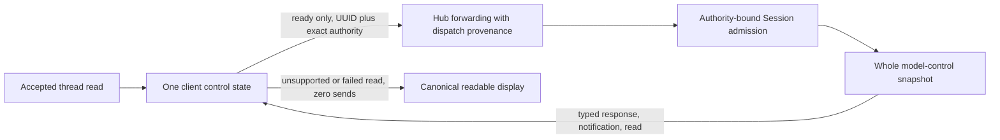

# Strict Model-Control Client Authority Implementation Plan

> **For agentic workers:** REQUIRED SUB-SKILL: Use superpowers:subagent-driven-development (recommended) or superpowers:executing-plans to implement this plan task-by-task. Steps use checkbox (`- [ ]`) syntax for tracking.

**Goal:** Make an accepted model choice appear during a running turn while preventing stale, authority-free, or replayed model mutations across browser, native, hub, daemon, and Manager paths.

**Architecture:** Keep the existing daemon-owned `ModelControlSnapshot` and its response, notification, and read carriers. Tighten `thread/model/set` in place so every request and successful response is complete, preserve dispatch provenance through every hub hop, and represent client authority as one discriminated `uninitialized | ready | recovering | unsupported` state. Browser, native, and Manager may compose a mutation only from a complete version-1 read; recovery performs one read and never replays a dispatched mutation.



**Tech Stack:** Go, AppWire JSON-RPC, generated TypeScript, React/Zustand/Vitest, React Native/Vitest.

**Spec:** `docs/superpowers/specs/2026-11-15-model-switch-authority-design.md`

## Global Constraints

- Change `thread/model/set` in place. Do not add a compatibility RPC, identity-free mutation path, old-response decoder, or mixed-version routing guarantee.
- Require `clientMutationId`, `expectedInstanceId`, and `expectedBootGeneration` on every request. Refuse empty or partial identity before Session sequence assignment.
- Require version 1, a valid `accepted | superseded` disposition, and one complete `ModelControlSnapshot` on every successful response. `{}` and partial responses are post-dispatch protocol failures. The response version validates structure but never establishes client authority; only an accepted read can do that.
- `instanceId` and `bootGeneration` are equality fences. Compare revision only within one exact authority, and replace the snapshot as one immutable value.
- Browser and native use one discriminated `ModelControlClientState`; only `ready` contains mutation authority. Every connection generation retires authority and request fences before a mutation can run.
- An establishing or replacement read has one terminal result. Unsupported, malformed, rejected, cancelled, or transport-failed reads promptly fail every waiting mutation with zero model sends and do not immediately rearm another read.
- One recovery episode starts at most one replacement read. Stale-authority refusal and post-dispatch response loss recover without replay; ordinary validation refusal does not recover.
- The Manager schema exposes only ref, provider, and model. The hub resumes availability, performs an unsubscribed just-in-time read, then injects a generated UUID and exact authority.
- Provider and model remain separate fields. Never reconstruct either by splitting a qualified string.
- Never infer mutation identity from FIFO order, target value, timing, warning text, or transport request ID, and never show an unaccepted target speculatively.
- `ModelControlSnapshot` owns active provider, model, reasoning levels, and reasoning support. Current reasoning effort, vision routing, context status, usage, cost, work time, and turn status keep their existing owners.
- Do not change model catalogs, profile resolution, provider qualification, reasoning-effort controls, vision-model controls, model persistence, or safe-point timing.
- Model-control recovery is independent of transcript-history retention. Canonical `thread/model/changed` remains readable display information outside `ready`, not mutation authority.
- Keep the existing Session safe-point timing and whole-snapshot transition implementation. This plan corrects protocol and client authority; it does not rebuild the accepted Session design.
- Generated `appwire-client/typescript/types.gen.ts` and `docs/appwire-protocol.md` change only through `make generate`.
- Default tests use scripted providers and real Evener code below the provider boundary. They use no network, credentials, sleeps, mocked behavior, or assertions on human-readable phrasing.
- Run heavy gates serially. Run `make lint` once before any authorized push.
- Every implementation commit ends with `Co-authored-by: Evener 4f8bd7e (codex-jesse-at-pr/gpt-5.6-sol) <034x68SNMyZllQPzVOzzMg@magic-kingdom>`.
- Do not push, close PR #6345, enqueue, or merge until the implementation passes its behavior gates and Jesse separately authorizes that repository action.

## Review Focus

1. A connection change while a capable read is held must retire old authority first; the selector call waits for that exact read and sends only if the same binding becomes `ready`. Tasks 5, 6, and 7 pin the state transition and both clients.
2. Malformed, rejected, cancelled, and transport-failed establishing or recovery reads must settle all waiters promptly, send zero mutations, and create no immediate retry loop. Tasks 5, 6, and 7 pin reducer effects and real client lifecycles.
3. A response lost after pick 1 dispatch, followed by accepted pick 2, must never replay or resurrect pick 1. Tasks 3, 4, 6, and 7 pin local, remote, Manager, browser, and native paths.
4. `{}` or any partial successful response must become blocked outcome-unknown plus one read, never silent success or `unsupported`. Tasks 1, 3, 5, 6, and 7 pin Go, generated, shared TypeScript, and client behavior.
5. An absent or unknown protocol version must keep the conversation readable and canonical while disabling model changes; Manager must send zero mutations. Tasks 4, 5, 6, and 7 pin all three clients.

## File Structure

### Focused shared owners

- `appwire/errors.go`: machine-readable stale-authority and blocked outcome-unknown constructors.
- `appwire/types_turn.go`: strict request and successful-response wire shapes.
- `appwire/client.go`: Go response validation after dispatch.
- `appwire-client/typescript/modelControl.ts`: the discriminated state, pure reducer, response validator, authority helpers, and display projection.
- `appwire-client/typescript/modelControl.test.ts`: exhaustive shared transition and validation table.

### Existing lifecycle owners retained

- `agent/session_model_control.go` remains the Session snapshot and sequencing authority.
- `server/appwire_thread_settings.go` remains the atomic wire-to-Session authority binder.
- `cmd/evener-hub/internal/appsource/local_daemon.go` and `remote_hub_mutations.go` retain forwarding ownership and add model-specific dispatch provenance.
- `cmd/evener-hub/session_controls.go` owns the Manager adapter; the tool-facing schema stays in `appwire/session_tools.go` and `agent/session_tools_hub_control.go`.
- `cmd/evener-hub/frontend/src/stores/threads.ts` owns browser binding, read waiters, quarantine, and request fences.
- `mobile-native/src/conversation/services/conversation.ts` owns native binding, opening/recovery reads, quarantine, and request fences.

---

### Task 1: Make AppWire model control structurally strict

**Files:**
- Modify: `appwire/types_turn.go:1194-1207`
- Modify: `appwire/errors.go`
- Modify: `appwire/client.go:637-640`
- Modify: `appwire/model_control_test.go`
- Modify: `appwire/protocol_test.go`
- Modify: `appwire/protocol_version_test.go`
- Modify: `appwire/cov_rhub_appwire_test.go`
- Generate: `appwire-client/typescript/types.gen.ts`
- Generate: `docs/appwire-protocol.md`

**Interfaces:**
- Consumes: existing `ModelControlSnapshot`, `ModelControlDisposition`, `ErrorData`, `MutationOutcomeUnknown`, and `RetryDispositionBlocked`.
- Produces:
  - `ThreadModelSetParams{Ref, ModelProvider, Model, ClientMutationID, ExpectedInstanceID, ExpectedBootGeneration}` with all three identity JSON fields required in the generated schema.
  - `func (p ThreadModelSetParams) Validate() error` requires non-empty ref, provider, model, mutation ID, expected instance, and expected boot generation. The server calls it before authority binding or sequence assignment.
  - `ThreadModelSetResponse{ModelControlVersion uint, Disposition ModelControlDisposition, ModelControl *ModelControlSnapshot}` with JSON tags that omit no field. Generated TypeScript therefore requires `modelControl` but permits `null`; runtime validation rejects `null`. The required response version must be 1, but only an accepted read establishes support.
  - `const ErrorModelControlAuthorityStale ErrorInfo = "authorityStale"`.
  - `func ModelControlAuthorityStale(clientMutationID, message string) WireError` with `mutationOutcome=notAccepted` and `retryDisposition=none`.
  - `func MutationOutcomeUnknownBlocked(clientMutationID, message string) WireError` with `evenerErrorInfo=mutationOutcomeUnknown`, `mutationOutcome=unknown`, and `retryDisposition=blocked`.
  - `func ValidateThreadModelSetResponse(ThreadModelSetResponse) error` accepts only version 1, disposition `accepted` or `superseded`, and a complete snapshot with non-empty authority, positive revision, complete active target, and a valid desired record when present.
  - `Client.ThreadModelSet` validates every decoded success and returns `MutationOutcomeUnknownBlocked(params.ClientMutationID, ...)` when successful-response validation fails. The daemon remains the required request-shape enforcement boundary.

- [ ] **Step 1: Replace compatibility tests with strict request and response tests**

In `appwire/model_control_test.go`, replace `TestModelControlRequestShapes` cases that allow identity-free requests and `TestModelControlLegacyResponseDecodesUnsupported`. Add table cases that marshal every request identity key and reject decoded empty/partial identity before use. Reject `{}`, each response missing version, disposition, or snapshot, version 0 or unknown, invalid disposition, and incomplete authority/active/desired fields. Assert error code and structured `ErrorData`, never message text. Keep `TestModelControlSnapshotCarriersReuseWholeShape` and assert the response, notification, and read use the same complete snapshot type.

Extend protocol tests to assert the method name remains `thread/model/set`, all request identity fields are required, and response disposition and snapshot are required.

- [ ] **Step 2: Run the focused AppWire tests and verify the intended red state**

Run:

```bash
go test ./appwire -run 'Test(ModelControl|ThreadModel|Protocol|Client)' -count=1
```

Expected: FAIL because identity fields and response fields remain optional, `{}` still decodes as success, and the two machine-readable error helpers do not exist.

- [ ] **Step 3: Implement strict shapes, validators, and Go client failure mapping**

Keep the required response snapshot pointer so existing producers remain source-compatible, remove its `omitempty` tag, and reject `nil` after decode. Validate the response only after `c.request` returns so malformed success is classified as dispatched and non-replayable. Keep human-readable messages diagnostic only; callers branch on `ErrorData`.

- [ ] **Step 4: Generate the contract and run the focused tests**

Run from the repository root:

```bash
make help
make generate
go test ./appwire -run 'Test(ModelControl|ThreadModel|Protocol|Client)' -count=1
```

Expected: generation exits 0; focused tests PASS; generated TypeScript requires all three request identity fields plus response version, disposition, and snapshot.

- [ ] **Step 5: Commit the strict contract**

```bash
git status --short
git add appwire/types_turn.go appwire/errors.go appwire/client.go appwire/model_control_test.go appwire/protocol_test.go appwire/protocol_version_test.go appwire/cov_rhub_appwire_test.go appwire-client/typescript/types.gen.ts docs/appwire-protocol.md
git diff --cached --check
git commit -m "fix(appwire): require model control authority" -m "Co-authored-by: Evener 4f8bd7e (codex-jesse-at-pr/gpt-5.6-sol) <034x68SNMyZllQPzVOzzMg@magic-kingdom>"
```

### Task 2: Refuse stale authority before Session admission

**Files:**
- Modify: `server/appwire_thread_settings.go:44-97`
- Modify: `agent/session_model_control.go:13-43`
- Modify: `server/model_control_test.go`
- Modify: `server/model_set_test.go`
- Modify: `server/appwire_retirement_admission_test.go`
- Modify: `agent/session_model_control_test.go`
- Modify: `agent/session_model_switch_queue_test.go`
- Modify: `agent/session_envelope_sampling_test.go`
- Modify: `cmd/evener/serve_model_switch_test.go`
- Modify: `cmd/evener/serve_residual_fuzz_test.go:173-174`

**Interfaces:**
- Consumes: Task 1 `ThreadModelSetParams.Validate`, required params, and `ModelControlAuthorityStale`; existing `Server.modelControl(authority)` atomic binding and `Session.SetModelControl` sequencing.
- Produces:
  - `handleAppThreadModelSet` rejects any missing identity field before stable-ref lookup, binding, or Session sequence assignment.
  - `Session.SetModelControl` also rejects any missing identity field before sequence assignment; no direct caller retains the legacy all-absent branch.
  - A mismatched boot or instance returns `ModelControlAuthorityStale(params.ClientMutationID, ...)`; ordinary target validation keeps its existing non-stale error classification.
  - Once bound, admission reaches error, superseded, or accepted-with-transition even if the request context is cancelled.
  - The residual fuzz seed invokes the returned binding's `Set` function and checks its result instead of discarding the binding.

- [ ] **Step 1: Add pre-admission, stale-reason, terminal-outcome, and residual tests**

Extend the nearest tables to cover empty and each partial identity shape, stale boot, stale instance, concurrent clear/replacement, shutdown after assignment, direct target refusal, fallback context ownership, and immediate read after success. Replace `TestModelControlLegacySetModelReplacesDesiredWithoutMutationID` and `TestHandleAppThreadModelSet_LegacyRequestStillBindsCurrentAuthority` with strict refusal cases. For every missing/partial/stale case, assert request sequence, snapshot revision, desired identity, and replacement session are unchanged. Assert stale errors carry `authorityStale`, while ordinary model validation does not.

In `cmd/evener/serve_residual_fuzz_test.go`, make the existing seed call `binding.Set` with a complete authority-bound fixture and assert a valid terminal result. This is the deferred review correction: the seed must exercise the setter it claims to cover.

- [ ] **Step 2: Run focused daemon and Session tests and verify the red state**

```bash
(cd agent && go test . -run 'Test(ModelControl|ConcurrentMidTurnPicks|RejectedPickDoesNotCancel|SupersededPending|ACommittedSwitch|ModelSwitchWhileWaiting|StopDuringTheSwitch|SetModel_)' -count=1)
go test ./server -run 'Test(HandleAppThreadModelSet|ModelControl|Retirement|ThreadEnvelope)' -count=1
go test ./cmd/evener -run 'Test(ServeModelSwitch|Residual)' -count=1
```

Expected: at least the identity-free request and stale-reason cases FAIL; the residual seed demonstrates that the current test never calls the binding.

- [ ] **Step 3: Tighten the server boundary without changing Session timing**

Call `params.Validate()` before `s.modelControl(authority)`, then retain Session's defensive identity check for direct callers. Reuse the one bound Session and envelope source through admission and synchronous facet refresh. Do not add request-ID deduplication or a receipt ledger; dispatch blocking in Tasks 1 and 3 is the replay guarantee.

- [ ] **Step 4: Run focused and real scripted-provider paths**

Run the commands from Step 2, then:

```bash
go test ./internal/appprojector -run 'Test.*Model' -count=1
```

Expected: all commands PASS; no test emits uncaptured warning or error output.

- [ ] **Step 5: Commit strict daemon admission**

```bash
git status --short
git add server/appwire_thread_settings.go server/model_control_test.go server/model_set_test.go server/appwire_retirement_admission_test.go agent/session_model_control.go agent/session_model_control_test.go agent/session_model_switch_queue_test.go agent/session_envelope_sampling_test.go cmd/evener/serve_model_switch_test.go cmd/evener/serve_residual_fuzz_test.go
git diff --cached --check
git commit -m "fix(server): fence model changes before admission" -m "Co-authored-by: Evener 4f8bd7e (codex-jesse-at-pr/gpt-5.6-sol) <034x68SNMyZllQPzVOzzMg@magic-kingdom>"
```

### Task 3: Preserve dispatch provenance through every hub hop

**Files:**
- Modify: `cmd/evener-hub/internal/appsource/local_daemon.go:1497-1501,1675-1695,1839-1851`
- Modify: `cmd/evener-hub/internal/appsource/remote_hub_mutations.go:282-285`
- Modify: `cmd/evener-hub/internal/appsource/mutation_errors.go`
- Modify: `cmd/evener-hub/internal/appsource/remote_hub_mutations_test.go`
- Modify: `cmd/evener-hub/internal/appsource/coverage_completion_test.go`
- Modify: `cmd/evener-hub/internal/appsource/remote_hub_refs_test.go:71-93`
- Modify: `cmd/evener-hub/app_model.go`
- Modify: `cmd/evener-hub/app_session_resume.go:27-90`
- Modify: `cmd/evener-hub/app_force_stop_test.go`
- Modify: `cmd/evener-hub/app_retirement_resume_test.go`
- Modify: `cmd/evener-hub/app_rpc_effort_resume_test.go`
- Modify: `cmd/evener-hub/e2e_model_switch_test.go`

**Interfaces:**
- Consumes: Task 1 typed Go client and blocked outcome-unknown error; existing `localForwardMutation`, remote request-not-sent provenance, `withSessionResume`, and typed `Source.SetThreadModel`.
- Produces:
  - `LocalDaemonSource.SetThreadModel` and `RemoteHubSource.SetThreadModel` return the exact typed response and use mutation-aware forwarding.
  - A proven pre-dispatch failure retains its existing retry-safe classification. Any failure after dispatch, including malformed success, returns the original `clientMutationId`, `mutationOutcome=unknown`, and `retryDisposition=blocked`.
  - `withSessionResume` may retry only a failure proven to precede model dispatch. A resume never rewrites expected authority; a new authority therefore returns typed stale refusal.
  - `TestForwardedRemoteThreadCapabilitiesPolicy` expects `ModelControlVersion1` and the complete snapshot.

- [ ] **Step 1: Add local, remote, resume, and lost-response tests**

Replace `TestRemoteHubSetThreadModelAcceptsVersionZeroFromOldHub` with strict malformed-response cases for `{}` and each partial response. Extend local and remote forwarding tables with pre-dispatch refusal, delivered daemon refusal, response loss after dispatch, and exact typed response preservation.

Add an end-to-end sequence: dispatch pick 1, lose its response, accept pick 2, perform the one diagnostic read, and assert pick 1 was sent once and cannot replace pick 2. Assert the resume wrapper retries a proven pre-dispatch failure but never a blocked unknown. Correct the deterministic forwarded-capability expectation in `remote_hub_refs_test.go`.

- [ ] **Step 2: Run focused hub tests and verify the red state**

```bash
go test ./cmd/evener-hub/internal/appsource -run 'Test.*(RemoteHub|LocalDaemon|ThreadModel|CapabilitiesPolicy)' -count=1
go test ./cmd/evener-hub -run 'Test.*(ModelSwitch|ThreadModel|Resume)' -count=1
```

Expected: FAIL because model set still uses non-mutation forwarding, an empty response remains accepted, and post-dispatch failures are not blocked.

- [ ] **Step 3: Add model-specific mutation-aware forwarding**

Reuse the generic dispatch-provenance machinery but pass blocked retry disposition for model control. Preserve daemon `WireError` data unchanged when a response arrived. Do not reconstruct a response from a read, notification, or canonical model event.

- [ ] **Step 4: Run focused and hub integration checks**

```bash
go test ./cmd/evener-hub/internal/appsource -run 'Test.*(RemoteHub|LocalDaemon|ThreadModel|CapabilitiesPolicy)' -count=1
go test ./cmd/evener-hub -run 'Test.*(ModelSwitch|ThreadModel|Resume)' -count=1
make test-hub-integration
```

Expected: all commands PASS; the integration path uses local scripted daemons and no provider credentials.

- [ ] **Step 5: Commit non-replayable hub forwarding**

```bash
git status --short
git add cmd/evener-hub/internal/appsource/local_daemon.go cmd/evener-hub/internal/appsource/remote_hub_mutations.go cmd/evener-hub/internal/appsource/mutation_errors.go cmd/evener-hub/internal/appsource/remote_hub_mutations_test.go cmd/evener-hub/internal/appsource/coverage_completion_test.go cmd/evener-hub/internal/appsource/remote_hub_refs_test.go cmd/evener-hub/app_model.go cmd/evener-hub/app_session_resume.go cmd/evener-hub/app_force_stop_test.go cmd/evener-hub/app_retirement_resume_test.go cmd/evener-hub/app_rpc_effort_resume_test.go cmd/evener-hub/e2e_model_switch_test.go
git diff --cached --check
git commit -m "fix(hub): block model mutation replay" -m "Co-authored-by: Evener 4f8bd7e (codex-jesse-at-pr/gpt-5.6-sol) <034x68SNMyZllQPzVOzzMg@magic-kingdom>"
```

### Task 4: Make Manager establish authority just in time

**Files:**
- Modify: `appwire/session_tools.go:270-356`
- Modify: `appwire/model_control_test.go`
- Modify: `agent/session_tools_hub_control.go:17-38,148-150`
- Modify: `agent/session_tools_hub_control_test.go`
- Modify: `agent/session_tools_hub_schema_test.go`
- Modify: `cmd/evener-hub/session_controls.go:45-65`
- Modify: `cmd/evener-hub/session_tools_hub_control_test.go`
- Modify: `cmd/evener-hub/session_tools_hub_payload_test.go`

**Interfaces:**
- Consumes: Tasks 1 and 3 strict typed method; existing `withSessionResume`, `Source.ReadThread(context.Context, appwire.ThreadReadParams)`, `setThreadModelWithResume`, and `uuid.NewString()`.
- Produces:
  - `SessionControlModelParams{Ref string, ModelProvider string, Model string}` in `appwire/session_tools.go`.
  - `SessionControlRequest.Model *SessionControlModelParams`; generated Manager schema never includes mutation or authority fields.
  - `func setManagerThreadModel(ctx context.Context, cfg hubcore.WebConfig, sources *appsource.Registry, relays *hubRelay, params appwire.SessionControlModelParams) (appwire.ThreadModelSetResponse, error)`.
  - The adapter uses `withSessionResume` around one unsubscribed `Source.ReadThread` call with `ThreadReadParams{Ref: params.Ref, IncludeTurns: false, Subscribe: false}`; it requires `read.Thread.Evener.Capabilities.ModelControlVersion == ModelControlVersion1`, a complete `read.Thread.Evener.ModelControl`, and snapshot authority equal to `read.Thread.Evener.InstanceID` plus `read.BootGeneration` before generating `uuid.NewString()` and invoking one model set.
  - Stale-authority or blocked outcome-unknown may cause one unsubscribed diagnostic read for structured reporting, but never another model set.

- [ ] **Step 1: Add tool-schema and real adapter tests**

Assert the schema exposes exactly ref/provider/model for the `model` action. Drive `session_control` through the hub adapter for: exited-session resume then supported read and one send; absent version; unknown version; missing snapshot; mismatched instance; mismatched boot; read refusal; read cancellation; read transport failure; stale-authority mutation refusal; and lost response followed by a newer accepted pick. Every non-ready read case asserts zero model-set calls. Lost response asserts one model-set call and one diagnostic read.

- [ ] **Step 2: Run focused Manager tests and verify the red state**

```bash
go test ./appwire -run 'TestSessionControl' -count=1
(cd agent && go test . -run 'Test.*SessionControl.*Model' -count=1)
go test ./cmd/evener-hub -run 'Test.*SessionControl.*Model' -count=1
```

Expected: FAIL because the tool currently reuses authority-bearing `ThreadModelSetParams` and dispatches without a just-in-time read.

- [ ] **Step 3: Implement the user-only schema and authority adapter**

Decode the user-controlled fields into `SessionControlModelParams`. Resume through the read path, not by trying a model mutation. Validate the read as one value, generate the UUID only afterward, and preserve separate provider/model fields. Keep `SessionControlResponse.Model *ThreadModelSetResponse` as the typed result carrier.

- [ ] **Step 4: Run focused Manager tests**

Run the three commands from Step 2.

Expected: PASS; schema inspection finds no identity fields and every non-ready path records zero sends.

- [ ] **Step 5: Commit the Manager adapter**

```bash
git status --short
git add appwire/session_tools.go appwire/model_control_test.go agent/session_tools_hub_control.go agent/session_tools_hub_control_test.go agent/session_tools_hub_schema_test.go cmd/evener-hub/session_controls.go cmd/evener-hub/session_tools_hub_control_test.go cmd/evener-hub/session_tools_hub_payload_test.go
git diff --cached --check
git commit -m "fix(manager): establish model authority before mutation" -m "Co-authored-by: Evener 4f8bd7e (codex-jesse-at-pr/gpt-5.6-sol) <034x68SNMyZllQPzVOzzMg@magic-kingdom>"
```

Omit unchanged files from `git add`; do not broaden these explicit paths.

### Task 5: Replace optional client fields with one control state

**Files:**
- Modify: `appwire-client/typescript/model.ts:332-390`
- Modify: `appwire-client/typescript/modelControl.ts`
- Modify: `appwire-client/typescript/modelControl.test.ts`
- Modify: `appwire-client/typescript/errors.ts:442-472`
- Modify: `appwire-client/typescript/errors.test.ts`
- Modify: `appwire-client/typescript/reducer.ts`
- Modify: `appwire-client/typescript/reducer.test.ts`
- Modify: `appwire-client/typescript/reducer.history.test.ts`
- Modify: `appwire-client/typescript/transcriptHistory.ts`
- Modify: `appwire-client/typescript/index.ts`
- Modify: `appwire-client/typescript/tsconfig.build.json` if its explicit build list changes

**Interfaces:**
- Consumes: Task 1 generated strict types and `WireError(message, code, data)`; existing read-generation, boot, and instance fences.
- Produces:
  - `ModelControlDisplay{modelProvider: string; model: string}`.
  - `ModelControlClientState = {kind: "uninitialized"; canonicalDisplay: ModelControlDisplay} | {kind: "ready"; snapshot: ModelControlSnapshot} | {kind: "recovering"; lastSafeDisplay: ModelControlDisplay} | {kind: "unsupported"; canonicalDisplay: ModelControlDisplay; observedVersion?: number}`.
  - `ThreadModel.modelControlState: ModelControlClientState`; remove independent optional `modelControlVersion` and `modelControl` authority fields from the client model.
  - `ModelControlInput = {kind: "connectionRetired"} | {kind: "readAccepted"; version?: number; snapshot?: ModelControlSnapshot; authority: ModelControlAuthority} | {kind: "snapshot"; source: "response" | "notification"; snapshot: ModelControlSnapshot} | {kind: "authorityStale"} | {kind: "postDispatchFailure"}`. A read input carries its accepted read authority so version-1 snapshot identity is validated as one unit.
  - `reduceModelControl(model: ThreadModel, input: ModelControlInput): {model: ThreadModel; decision: "applied" | "duplicate" | "ignored" | "recovering" | "unsupported"; replacementReadRequired: boolean}`.
  - `modelControlAuthority(model: ThreadModel): ModelControlAuthority | undefined` returns authority only for `ready`.
  - `modelControlDisplay(model: ThreadModel): ModelControlDisplay` follows desired pending/applied, active for rejected/absent desired, last safe display while recovering, and canonical display otherwise.
  - `validateThreadModelSetResponse(value: unknown, clientMutationId: string): ThreadModelSetResponse`; malformed success throws `WireError` code `-32603` with `evenerErrorInfo="mutationOutcomeUnknown"`, matching mutation ID, `mutationOutcome="unknown"`, and `retryDisposition="blocked"`.
  - `isModelControlAuthorityStale(error: unknown): boolean` reads only `WireError.data.evenerErrorInfo === "authorityStale"`.

- [ ] **Step 1: Write the exhaustive red reducer and response-validation tables**

Table-test all spec transitions: connection retirement; complete matching version-1 read to `ready`; absent/unknown version to `unsupported`; malformed/mismatched read to `recovering` without another read effect; newer, lower, duplicate, and equal-conflicting snapshot; current identity mismatch; pending to applied/rejected; local then foreign accepted pick; same-model metadata correction; stale-authority versus ordinary refusal; post-dispatch failure; retired response; delayed canonical event; fallback context independence; capable-to-unsupported read; and eligibility false for every state except `ready`.

Assert `replacementReadRequired` is true exactly once when a live `ready` authority enters recovery from mismatch, conflict, typed stale refusal, or post-dispatch loss. Add `{}` and every partial response to the validator table and assert structured error data rather than message text.

- [ ] **Step 2: Run shared-client tests and verify the red state**

```bash
npm --prefix cmd/evener-hub/frontend exec -- vitest run ../../../appwire-client/typescript/modelControl.test.ts ../../../appwire-client/typescript/errors.test.ts ../../../appwire-client/typescript/reducer.test.ts ../../../appwire-client/typescript/reducer.history.test.ts
```

Expected: FAIL because `ThreadModel` still represents capability and snapshot as independent optional fields and malformed responses have no runtime validator.

- [ ] **Step 3: Implement the discriminated state and pure effects**

Keep binding promises, quarantine, and I/O in browser/native owners. The reducer replaces complete snapshots only, projects snapshot-owned model fields atomically, and never invalidates transcript history. Canonical events may update canonical display and context status but cannot overwrite `ready` snapshot-owned metadata.

- [ ] **Step 4: Format and qualify the shared package**

```bash
cd cmd/evener-hub/frontend
npx biome check --write ../../../appwire-client/typescript/model.ts ../../../appwire-client/typescript/modelControl.ts ../../../appwire-client/typescript/modelControl.test.ts ../../../appwire-client/typescript/errors.ts ../../../appwire-client/typescript/errors.test.ts ../../../appwire-client/typescript/reducer.ts ../../../appwire-client/typescript/reducer.test.ts ../../../appwire-client/typescript/reducer.history.test.ts ../../../appwire-client/typescript/transcriptHistory.ts ../../../appwire-client/typescript/index.ts
npm exec -- vitest run ../../../appwire-client/typescript/modelControl.test.ts ../../../appwire-client/typescript/errors.test.ts ../../../appwire-client/typescript/reducer.test.ts ../../../appwire-client/typescript/reducer.history.test.ts
cd ../../..
make test-api-package
```

Expected: Biome and focused tests exit 0; package qualification builds, packs, installs, imports, requires, checks declarations, and completes the scripted exchange.

- [ ] **Step 5: Commit shared client authority**

```bash
git status --short
git add appwire-client/typescript/model.ts appwire-client/typescript/modelControl.ts appwire-client/typescript/modelControl.test.ts appwire-client/typescript/errors.ts appwire-client/typescript/errors.test.ts appwire-client/typescript/reducer.ts appwire-client/typescript/reducer.test.ts appwire-client/typescript/reducer.history.test.ts appwire-client/typescript/transcriptHistory.ts appwire-client/typescript/index.ts appwire-client/typescript/tsconfig.build.json
git diff --cached --check
git commit -m "refactor(client): make model authority explicit" -m "Co-authored-by: Evener 4f8bd7e (codex-jesse-at-pr/gpt-5.6-sol) <034x68SNMyZllQPzVOzzMg@magic-kingdom>"
```

Omit unchanged files from `git add`.

### Task 6: Bind browser mutations to one terminal read

**Files:**
- Modify: `cmd/evener-hub/frontend/src/stores/threads.ts:399-402,586-589,4291-4525,7657-7708,9032-9095`
- Modify: `cmd/evener-hub/frontend/src/stores/transcriptRepository.ts`
- Modify: `cmd/evener-hub/frontend/src/stores/transcriptRepository.test.ts`
- Modify: `cmd/evener-hub/frontend/src/stores/threads.test.ts`
- Modify: `cmd/evener-hub/frontend/src/stores/threads.sessionActions.test.ts`
- Modify: `cmd/evener-hub/frontend/src/panes/session/chrome/ModelSwitch.tsx`
- Modify: `cmd/evener-hub/frontend/src/panes/session/chrome/ModelSwitch.test.tsx`
- Modify: `cmd/evener-hub/frontend/src/panes/session/chrome/ModelSwitchTrigger.test.tsx`
- Modify: `cmd/evener-hub/frontend/src/panes/session/Session.recovery.test.tsx`

**Interfaces:**
- Consumes: Task 5 state, reducer, response validator, display, authority accessor, and typed stale predicate; existing `ensureThread`, `PendingThreadHydration`, subscribe-before-read quarantine, client/read generations, and shared transcript repository.
- Produces:
  - `ThreadsStore.setModel(ref, modelProvider, model): Promise<void>` keeps its public signature.
  - One per-ref binding record owns the current establishing/replacement read promise and its terminal outcome. The record is installed in the same store action that publishes `uninitialized` or `recovering`.
  - `teardownWiring` retires every ready authority, request fence, and old waiter before the replacement client is callable; rewire installs the new binding's establishing read.
  - `setModel` waits only when the same binding is `uninitialized` or `recovering`, then rechecks ref, client generation, read generation, and `ready` authority before generating `crypto.randomUUID()` and sending once.
  - Unsupported or unsuccessful read outcomes reject all waiters locally. General transcript hydration may later retry for its own reasons, but model-control recovery does not immediately rearm.

- [ ] **Step 1: Add red real-store and composer lifecycle tests**

Drive the real AppWire test client. Cover accepted running-turn label, direct refusal preserving prior display, foreign supersession across two views, exact deferred rejection live and after reconnect, same-model acceptance, notification quarantine/replay, capable-to-unsupported downgrade, unknown version, and clear-before-read.

Add the five review-focus boundaries: hold reconnect read and attempt a model change before release; mismatch authority and hold replacement read; fail establishing/recovery reads by malformed response, rejection, cancellation, and transport; deliver typed stale refusal versus ordinary refusal; and lose/empty/partially decode a dispatched response before accepting a newer pick. Assert zero model-set calls before a same-binding `ready`, one send after it, one replacement read per episode, no replay, prompt promise settlement, and independence from transcript-history discard.

- [ ] **Step 2: Run focused browser tests and verify the red state**

```bash
npm --prefix cmd/evener-hub/frontend test -- src/stores/threads.test.ts src/stores/threads.sessionActions.test.ts src/stores/transcriptRepository.test.ts src/panes/session/chrome/ModelSwitch.test.tsx src/panes/session/chrome/ModelSwitchTrigger.test.tsx src/panes/session/Session.recovery.test.tsx
```

Expected: FAIL at least because reconnect leaves old `ready` authority callable, invalidated authority can send, unsuccessful reads do not settle a model waiter, and malformed responses return silently.

- [ ] **Step 3: Implement serialized retirement, terminal waiters, and one-read recovery**

Extend the current hydration owner and quarantine instead of adding a second read or subscription. Settle the model waiter from the first accepted or failed hydration attempt before any generic retry is scheduled. Pass every successful RPC frame through `validateThreadModelSetResponse` before reduction. On typed stale or blocked post-dispatch failure, enter recovery and start one read; never call model set from recovery code.

Enable `ModelSwitch` and its trigger only when `modelControlState.kind === "ready"`. Render `modelControlDisplay` in every state.

- [ ] **Step 4: Format, typecheck, and run focused browser tests**

```bash
cd cmd/evener-hub/frontend
npx biome check --write src/stores/threads.ts src/stores/threads.test.ts src/stores/threads.sessionActions.test.ts src/stores/transcriptRepository.ts src/stores/transcriptRepository.test.ts src/panes/session/chrome/ModelSwitch.tsx src/panes/session/chrome/ModelSwitch.test.tsx src/panes/session/chrome/ModelSwitchTrigger.test.tsx src/panes/session/Session.recovery.test.tsx
npm run typecheck
npm test -- src/stores/threads.test.ts src/stores/threads.sessionActions.test.ts src/stores/transcriptRepository.test.ts src/panes/session/chrome/ModelSwitch.test.tsx src/panes/session/chrome/ModelSwitchTrigger.test.tsx src/panes/session/Session.recovery.test.tsx
```

Expected: formatting and typecheck exit 0; focused tests PASS.

- [ ] **Step 5: Commit browser authority lifecycle**

```bash
git status --short
git add cmd/evener-hub/frontend/src/stores/threads.ts cmd/evener-hub/frontend/src/stores/threads.test.ts cmd/evener-hub/frontend/src/stores/threads.sessionActions.test.ts cmd/evener-hub/frontend/src/stores/transcriptRepository.ts cmd/evener-hub/frontend/src/stores/transcriptRepository.test.ts cmd/evener-hub/frontend/src/panes/session/chrome/ModelSwitch.tsx cmd/evener-hub/frontend/src/panes/session/chrome/ModelSwitch.test.tsx cmd/evener-hub/frontend/src/panes/session/chrome/ModelSwitchTrigger.test.tsx cmd/evener-hub/frontend/src/panes/session/Session.recovery.test.tsx
git diff --cached --check
git commit -m "fix(web): bind model changes to current reads" -m "Co-authored-by: Evener 4f8bd7e (codex-jesse-at-pr/gpt-5.6-sol) <034x68SNMyZllQPzVOzzMg@magic-kingdom>"
```

### Task 7: Give native the same authority lifecycle

**Files:**
- Modify: `mobile-native/src/conversation/services/conversation.ts:250-311,520-560,578-708,715-986,1047-1097,1147-1166`
- Modify: `mobile-native/src/conversation/services/conversation.test.ts`
- Modify: `mobile-native/src/conversation/state/conversation.ts`
- Modify: `mobile-native/src/conversation/state/conversation.rereadSnapshots.test.ts`
- Modify: `mobile-native/src/session/sessionFacts.ts`
- Modify: `mobile-native/src/session/sessionFacts.test.ts`
- Modify: `mobile-native/src/session/ModelSheet.tsx`
- Modify: `mobile-native/src/session/ModelSheet.test.tsx`

**Interfaces:**
- Consumes: Task 5 shared state and helpers; existing `openEpoch`, `opening` notification buffer, subscribe-before-read flow, `idFactory()`, and Board-row fallback.
- Produces:
  - `ConversationService.changeModel(modelProvider: string, model: string): Promise<void>` keeps its signature and has no identity-free branch.
  - `extractCapabilities` records absent or unknown `modelControlVersion` as unsupported instead of throwing or aborting the conversation.
  - The current `openEpoch` owns one establishing/replacement read promise and terminal result. `beginOpen`, reconnect, rebind, clear, and `close` retire prior authority and waiters before mutation is callable.
  - A racing `changeModel` waits for the same epoch's read, rechecks epoch/ref/thread binding and `ready`, generates `idFactory()` UUID, and sends once.
  - `sessionFacts` and `ModelSheet` render `modelControlDisplay`; selector enablement requires `ready`; Board row keeps its existing `rowName` fallback when catalog metadata is incomplete.

- [ ] **Step 1: Add red service, reread, and presentation tests**

Cover secure UUID and exact authority, typed response and live notification, notification quarantine/replay, capable-to-unsupported read, absent and unknown versions keeping the conversation usable, reconnect retirement with held read, delayed retired response, clear-before-read, pending/applied/rejected display, foreign supersession, and Board fallback.

For malformed, rejected, cancelled, and transport-failed establishing/recovery reads, assert every waiting `changeModel` rejects promptly and model-set call count stays zero. For typed stale, response loss, `{}`, and each partial response, assert one recovery read, no replay, and a later accepted pick cannot be replaced by the older request.

- [ ] **Step 2: Run focused native tests and verify the red state**

```bash
npm --prefix mobile-native exec -- vitest run src/conversation/services/conversation.test.ts src/conversation/state/conversation.rereadSnapshots.test.ts src/session/sessionFacts.test.ts src/session/ModelSheet.test.tsx
```

Expected: FAIL because an unknown version currently throws, `changeModel` has an identity-free branch, and malformed response returns without terminal recovery.

- [ ] **Step 3: Implement epoch-bound state, waiters, and presentation**

Extend the existing `opening` buffer and `openEpoch`; do not add another subscription. Keep all response and notification revision logic in `reduceModelControl`. A failed read settles its deferred result before later open/retry work. `close` rejects unresolved waiters and clears authority. Keep catalog resolution and Board fallback after shared display selection.

- [ ] **Step 4: Format, typecheck, and run focused native tests**

```bash
cd mobile-native
npx biome check --write src/conversation/services/conversation.ts src/conversation/services/conversation.test.ts src/conversation/state/conversation.ts src/conversation/state/conversation.rereadSnapshots.test.ts src/session/sessionFacts.ts src/session/sessionFacts.test.ts src/session/ModelSheet.tsx src/session/ModelSheet.test.tsx
npm run check
npm exec -- vitest run src/conversation/services/conversation.test.ts src/conversation/state/conversation.rereadSnapshots.test.ts src/session/sessionFacts.test.ts src/session/ModelSheet.test.tsx
```

Expected: formatting, checks, and focused tests exit 0.

- [ ] **Step 5: Commit native authority lifecycle**

```bash
git status --short
git add mobile-native/src/conversation/services/conversation.ts mobile-native/src/conversation/services/conversation.test.ts mobile-native/src/conversation/state/conversation.ts mobile-native/src/conversation/state/conversation.rereadSnapshots.test.ts mobile-native/src/session/sessionFacts.ts mobile-native/src/session/sessionFacts.test.ts mobile-native/src/session/ModelSheet.tsx mobile-native/src/session/ModelSheet.test.tsx
git diff --cached --check
git commit -m "fix(native): bind model changes to current reads" -m "Co-authored-by: Evener 4f8bd7e (codex-jesse-at-pr/gpt-5.6-sol) <034x68SNMyZllQPzVOzzMg@magic-kingdom>"
```

### Task 8: Update evergreen contracts and run behavior gates

**Files:**
- Modify: `docs/architecture.md`
- Modify: `docs/llm-providers.md`
- Modify: `docs/native-app.md`
- Modify: `docs/web-ui/README.md`
- Modify: `docs/web-ui/parity/parity-m5-composer.md`
- Modify: `docs/product/subsystems.md`
- Modify: `docs/superpowers/specs/2026-11-15-model-switch-authority-design.md`
- Regenerate if the final Go contract changed after Task 1: `appwire-client/typescript/types.gen.ts`
- Regenerate if the final Go contract changed after Task 1: `docs/appwire-protocol.md`

**Interfaces:**
- Consumes: Tasks 1-7 behavior and test evidence.
- Produces: evergreen documentation of strict in-place authority, explicit client state, one-read recovery, dispatch blocking, and Manager adaptation; design status `Implemented` only after all behavior gates pass.

- [ ] **Step 1: Update docs from verified behavior**

Document: only `ready` sends; reconnect retires authority first; unsupported remains readable; unsuccessful reads settle waiters; stale authority is machine-readable; response loss and malformed response read once without replay; Manager reads and injects authority; response/notification/read carry one snapshot; canonical context ownership remains separate. Remove compatibility language that calls `{}` valid, identity-free model mutation supported, or `thread/model/changed` mutation authority. Mark the design implemented only after Steps 2-4 pass.

- [ ] **Step 2: Regenerate once and inspect generated output**

```bash
make generate
git diff -- appwire-client/typescript/types.gen.ts docs/appwire-protocol.md
```

Expected: generation exits 0; generated output matches the strict request and response contract and contains no hand edits.

- [ ] **Step 3: Run focused behavior and client gates serially**

Run from the repository root, one command at a time:

```bash
(cd agent && go test . -run 'Test(ModelControl|ConcurrentMidTurnPicks|RejectedPickDoesNotCancel|SupersededPending|ACommittedSwitch|ModelSwitchWhileWaiting|SetModel_)' -count=1)
go test ./appwire ./server ./internal/appprojector ./cmd/evener ./cmd/evener-hub/internal/appsource ./cmd/evener-hub -run 'Test.*(ModelControl|ModelSwitch|ThreadModel|SessionControl|Envelope|CapabilitiesPolicy)' -count=1
go test ./cmd/evener-hub/internal/appsource ./cmd/evener-hub -count=1
make test-api-package
(cd cmd/evener-hub/frontend && npm run typecheck)
make test-web
make test-native
make docs-check
git diff --check
```

Expected: every command exits 0 with no failures or unexpected error output. The explicit hub packages are required; do not treat the client gates as coverage for Go forwarding or Manager.

- [ ] **Step 4: Run repository static gates one at a time**

```bash
make vet
umask 022 && make lint
```

Expected: both exit 0. If a heavy gate fails under load, record `uptime`, rerun the touched focused suite only after load falls, and call it a regression only if that second low-load run fails.

- [ ] **Step 5: Commit docs and final generated state**

```bash
git status --short
git add docs/architecture.md docs/llm-providers.md docs/native-app.md docs/web-ui/README.md docs/web-ui/parity/parity-m5-composer.md docs/product/subsystems.md docs/superpowers/specs/2026-11-15-model-switch-authority-design.md appwire-client/typescript/types.gen.ts docs/appwire-protocol.md
git diff --cached --check
git commit -m "docs: document strict model control authority" -m "Co-authored-by: Evener 4f8bd7e (codex-jesse-at-pr/gpt-5.6-sol) <034x68SNMyZllQPzVOzzMg@magic-kingdom>"
```

Omit unchanged files from `git add`. Do not push, close PR #6345, enqueue, or merge. Run the required implementation review first, then ask Jesse for separate repository-action authorization.
