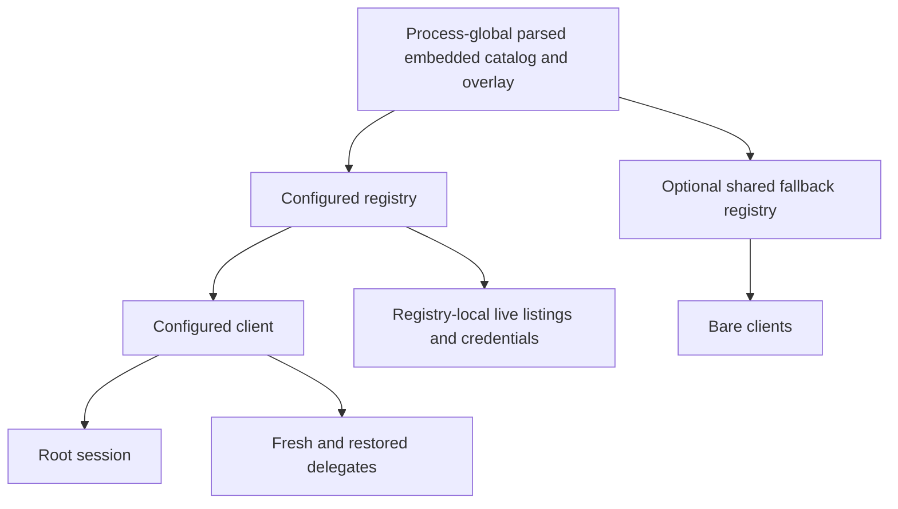

# Catalog ownership baseline

This experiment measures the heap held by the pinned baseline offline registry.
It does not establish savings or the number of registries in a running daemon.

The subsequent [paired candidate measurements](measurements.md) show lower
retained heap and construction allocations. See that report for source identities,
startup peak RSS, lookup/list CPU and limitations.

## Source and environment

- Product source: `f18fe2290a5c1037aab21bd3201ce20bf09c9862`.
- Audit head: `4938db535bcb73e50942c58b18d0aef143fb7f48`, whose additional commits
  contain only first-wave audit documentation.
- Linux amd64, Go 1.27.0, `GOMAXPROCS=2`.
- Three fresh processes, each retaining one, two and eight independently loaded
  registries, then releasing all eight. Each registry exposes 219 provider IDs.
- `WithNoUserLayer`, `WithOffline(true)`, `WithoutCache`, and an empty injected
  environment prevent reads of user provider configuration, runtime catalog
  caches and credentials, and prevent network refresh.

## Reproduce

Run from the repository root. The build tag excludes this research program from
normal package discovery; explicit-file `go build` builds the probe.

```sh
GOMAXPROCS=2 go build -p=1 -o "$EVENER_SCRATCH_DIR/catalog-retention" \
  docs/superpowers/research/2026-10-20-catalog-ownership/catalog-retention.go
for sample in 1 2 3; do
  GOMAXPROCS=2 "$EVENER_SCRATCH_DIR/catalog-retention"
done
```

`baseline.jsonl` contains the three six-checkpoint sequences. The program keeps
registry roots alive across each measurement with `runtime.KeepAlive`. Its
helper returns before the final release checkpoint. It records exact bytes,
objects and cumulative allocation counters. The first-load pre-forced-GC sample
is a checkpoint, **not a measured peak**. Load wall time excludes the explicit
checkpoint GC but includes any automatic GC; it is not a CPU measurement.

## Results

Median `HeapAlloc` across the three fresh processes:

| Checkpoint | Bytes | MiB |
| --- | ---: | ---: |
| Before loading, post-GC | 147,120 | 0.140 |
| First load, before checkpoint GC | 17,147,992 | 16.354 |
| One registry held, post-GC | 14,958,320 | 14.265 |
| Two registries held, post-GC | 23,649,576 | 22.554 |
| Eight registries held, post-GC | 75,802,760 | 72.291 |
| All registry roots released, post-GC | 6,227,800 | 5.939 |

The paired one-to-two-registry delta is 8,691,280 median bytes (8.289 MiB).
The paired two-to-eight delta, divided by six, is 8,692,192 median bytes per
additional registry (8.290 MiB). These are incremental registry costs in this
fixture, not per-delegate costs. The retained heap after release includes
process-global parsed catalog/overlay caches and runtime/measurement metadata;
subtracting the initial checkpoint does not isolate catalog ownership exactly.

The existing `BenchmarkLoadEmbeddedDefaults` ran separately with
`-benchtime=5x -count=3`. Its first result includes first-use global parsing:
16,195,641 B/op. The later two report 11,588,076 and 11,588,025 B/op. Do not merge
that mixed cold/warm series into a startup or steady-state claim. The planned
comparison must separate fresh-process startup from warmed repeated loads.

## Candidate and limits

`record.fold` creates a fresh `capLayer.rows` map and copies every `src.Models`
entry unchanged. That duplicates source-map containers already retained by the
embedded parsed catalog and overlay. Merged `head.Models` serves different
consumers and remains independent. The candidate is to borrow the immutable
source map for replay layers while preserving copy-on-filter inheritance and
separate merged heads.

An independent source review confirmed the candidate: the unchanged-value copy
at `load.go:757` is the only capability-layer map-entry write. Filtering replaces
maps (`488–505`, `763–776`), and inheritance reset replaces layer references
(`701–705`). Current layer copies already share nested values. `WithInstances`
already requires supplied reference-valued fields to remain unchanged while the
registry is in use (`101–106`); public `Provider` views are deep-owned copies.

For runtime-cache or custom-snapshot data, the source map can instead become the
only retained map. Removing its copy saves construction work but does not imply
the same retained saving as globally rooted embedded maps.

No product sources have changed. No before/after memory, startup peak,
lookup/list CPU, configured daemon or delegate-lifecycle result is established
by this baseline. The existing registry package suite passed with
`GOMAXPROCS=2 go test -p=1 ./llm/registry -count=1` before any product change.

## Source-level ownership



The daemon loads a client/registry through `cmdutil/load_client.go:12–17` and
`cmdutil/registry.go:64–84`. Fresh delegates reuse `s.client`
(`agent/subagents.go:1135–1147`); restored stable delegates also receive it
(`agent/delegate_runtime.go:2830`). Ordinary descendants therefore add no
registries along these paths. The optional fallback is process-wide
(`llm/client.go:108–142`), not per bare client. This is a static construction
argument; the experiment did not count roots in a live daemon.

Embedded converted providers and the parsed overlay remain rooted by
`loadEmbeddedCatalog` and `loadEmbeddedOverlay` (`llm/registry/load.go:54–73`).
Every configured Load builds all curated records and its explicit instances
(`294–324`). Their instance map points at existing records rather than another
catalog. Background refresh validates a temporary registry and writes the cache;
it does not replace its origin registry (`llm/registry/refresh.go:131–201`).
Live listings, credential sources and user-config state stay registry-local.
