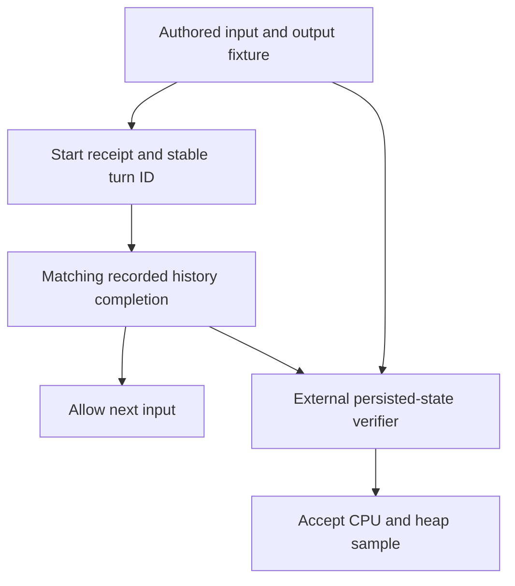

# Runtime measurement evidence follow-up

The next aggregate comparison needs correlated completion and verified outputs.
The existing first-wave counters cannot prove these facts retrospectively. This
is a source-based design, not implemented or executed evidence.

Source baseline: `f18fe2290a5c1037aab21bd3201ce20bf09c9862`.

## Confirmed gaps

- `cmd/evener/memharness_test.go:205–223` accepts any idle notification, without
  root/thread/mutation/turn correlation. Lines 264–280 discard the start receipt
  and use queue fallback before consuming one idle frame.
- The adapter's global call counter selects output sizes (`64–110`), including
  unrelated naming calls. All final messages are identical, so they cannot
  identify the answered input.
- `Complete` discards its context and never stamps protocol (`64–75`). Production
  persists the API-attempt group's protocol, not an arbitrary response field.
- First-wave `closeout-prepare.py` changes only profiler/report behavior and is
  pinned to its old comparison. `closeout-cpu.py` accepts exit status plus final
  counters. Neither verifies requested inputs or outputs. Keep that evidence
  unchanged and use a new controlled driver for this wave.

## Minimal new measurement contract



1. Author the expected case IDs, input texts, tool rounds, call IDs, shell output
   bytes and final messages before submission. Do not derive the expected set
   from observed events or adapter counters.
2. Retain each `TurnStartResponse` and validate mutation/thread/instance/turn
   identity. An applied receipt proves admission, not completion. On uncertainty,
   retry the same mutation and payload. A fresh serial primary fixture should
   not need queue fallback; force queue behavior in a separate test.
3. Consume `history/updated`, not a presumed `turn/completed` event. Filter
   `HistoryUpdatedParams` by root ref/thread and current boot/epoch, retain
   notifications that precede the reply, and merge turns and items separately.
   Require the matching user input and a successful recorded terminal turn.
   Duplicate, unrelated and stale notifications cannot advance the expected set.
4. Recover missing pushes with authoritative `ThreadRead(IncludeTurns:true)` and
   cursor paging, never just a bounded latest page. Before the final sample,
   require no run-owned unresolved mutation, queue entry or active turn.
5. Keep fresh state via `-memharness-state`. After the measured process exits,
   independently decode the mutation journal and transcript. Require one original
   input per expected mutation, its stable turn, successful completion, terminal
   journal state, and exact expected tool and communicate outcomes. Compaction
   copies with `OriginalOrdinal` do not count as original inputs. Save the
   pre-shutdown transcript boundary so shutdown cannot supply missing work.
6. Verify actual complete shell output. Large output is windowed; read its full
   retained log and validate the journal's output path and dropped-byte state.
   Small foreground results need not create a durable job. Counting jobs is not
   a tool-success oracle. Pass `mode:"foreground"` explicitly.
7. Keep expensive transcript parsing and output hashing in the post-exit verifier,
   outside measured `wait4` CPU. Reject any run whose independent verifier fails.
   Use identical harness/verifier sources on both comparison sides.

## Existing authority and APIs

- Admission: `appwire/types.go:2549–2559,2612–2637`,
  `agent/session_client_mutation.go:267–390`.
- Queue-to-turn claim: `agent/session_queue.go:734–807`; typed `TurnQueue`
  currently discards the response receipt (`appwire/client.go:654–659`).
- Recorded histories: `appwire/types.go:1849–1875,2021–2102,2214–2229` and
  `server/appwire_histories.go:49–71,115–123`.
- Completion append: `agent/session_execution.go:86–119`.
- Journal paths/schema: `agent/session_client_mutation_persist.go:20–33,128–190`
  and `agent/session_client_mutation.go:92–111,145–225`.
- Strict transcript reads: `agent/transcript/transcript.go:197–267,331`.
- Full command-output retention: `agent/session_tools_shell.go:527–576,714–736`
  and `agent/jobs.go:645–649,717–738`.

## Protocol variants

Resolve the primary fixture's configured model once at setup. Record its exact
instance/model/protocol identity, and stamp every scripted adapter completion,
including namer branches, using the real API:

```go
llm.NoteAPIAttemptProtocol(ctx, func() string { return a.protocol })
```

`llm/api_attempt.go:140–156` records identity without inventing HTTP attempts or
forensic payloads. The current harness model is `openai/gpt-5.2`; verify the
resolved `registry.ProtocolOpenAIResponses` value before using it. Label this
fixture **synthetic provider with valid recorded protocol identity**, not a
real-provider benchmark.

Run a separately labeled **legacy-missing-protocol** control with identical work
and provider/model identity but without the stamp. Do not clear provider identity:
that bypasses the fallback being measured. Persisted modern assistant entries
must carry the expected protocol; legacy entries must intentionally omit only
that field. Exercise real replay beside
`agent/session_replay_provenance_test.go:318–334`: modern rows must avoid
`protocolOf`; legacy rows must call it while preserving the same payloads.

## Negative checks

The checker must reject a missing input/completion, duplicate original input,
wrong-thread completion, failed/interrupted/reopened turn, unclaimed queue item,
missing/nonzero/timed-out tool result, early or wrong-case final communicate,
incorrect protocol provenance, and middle-of-output corruption hidden by the
inline preview. Duplicate notifications and completion-before-reply must still
resolve the correct input once. Disconnect must recover authoritatively or fail
with unresolved case identities.

## Limits

The proposed first fixture is a fresh root session. Resume, delegate lifecycle,
compaction and idle scenarios need separately authored expectations. Keep the
production-sized catalog because its retained heap is under investigation.

`history/updated` proves recorded state, not power-loss durability. The transcript
writer permits a recorded-but-unsynced error (`agent/transcript/record.go:49–95`).
Check persisted completion and journal state and reject persistence diagnostics;
do not label that a power-loss test. Existing fail-closed fault tests exercise
that separate contract.

No new flags, tests, verifier or harness behavior described here exists yet.
