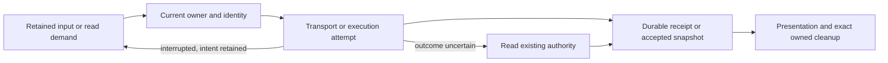

# State-machine audit and proposed changes

**Status: Proposed, before implementation.** Audited 2026-11-09 at `72d140976807005c4ddf38a1e588288eaa8beb9a` in the isolated `wip/state-machine-audit` worktree. This is a research record, not an evergreen product contract or an approved implementation plan.

## Decision

Keep the existing owners. Make their protocols discoverable, remove duplicated declarations, and repair demonstrated ownership failures before adding enforcement.

The app already declares twelve shared lifecycles in `appwire/lifecycle.go`. Many additional protocols are explicit locally; others emerge from generations, leases, durable receipts, pending obligations and cleanup flags. A single global status or workflow engine would erase distinctions the app needs to preserve work.

I recommend a small first batch:

1. Fence connection notifications by attachment generation and disposal.
2. Replace the web host-operation terminal-state copy with the generated predicate.
3. Expand the lifecycle guide with owner, authority, recovery and preservation-test links, correcting two stale mutation descriptions.

Then qualify the highest-value recovery improvements separately: bounded connection setup, retained Send/resume failure presentation, and structured recovery explanations. These need the decisions and evidence below. None has been implemented.

This inventory spans runtime, hub/server, shared clients, web/native, providers, authentication, plugins, installation and worktrees. It is a family-level source audit, **not proof that every stateful protocol in the repository has been enumerated**. Remaining coverage gaps are explicit at the end. Most test references identify existing assertions, not tests run here.

## What is proved

### Retired connection callbacks still run: reproduced

Tracked as [retired connection notification callbacks](https://github.com/prime-radiant-inc/evener/issues/5864).

`appwire-client/typescript/state/connection/core.ts:193–212` detaches the old notification listener when the store changes clients. `appwire-client/typescript/client.ts:893` dispatches notifications over `Array.from(this.notificationHandlers)`. An earlier callback can replace or clear the client, or dispose the subscriber, after that snapshot has already captured the later callback.

A scratch probe ran unchanged production `AppwireClient`, `createConnectionStore` and `onConnectionNotification`, using the repository's `FakeSocket` only at the transport boundary. It delivered an `evener/plugin/updated` notification while an earlier subscriber retired the later subscription:

```text
{"mode":"swap","staleCallbacksDelivered":1,"expected":0}
{"mode":"clear","staleCallbacksDelivered":1,"expected":0}
{"mode":"A-B-A","staleCallbacksDelivered":1,"expected":0}
{"mode":"dispose","staleCallbacksDelivered":1,"expected":0}
{"scenarios":4,"invariantFailures":4}
exit 1
```

**Impact established:** obsolete callbacks run after ownership ends. **Impact not established:** wrong-hub data, lost input or a production incident. `state/extensions/storeLifecycle.ts:91–95` explicitly bounds its existing consumer's cost to a conservative redundant read from the current hub.

**Proposed repair:** retain unsubscribe cleanup and add an attachment-generation/disposed check around callback invocation. Client identity alone is insufficient for A→B→A. The existing connection-state mirror already checks a generation at `core.ts:138`.

### Host-operation terminality is still duplicated: source-verified

Tracked as [host-operation terminality duplication](https://github.com/prime-radiant-inc/evener/issues/5865).

`cmd/evener-hub/frontend/src/stores/hostOps.ts:483–486` maintains its own set of `complete`, `failed`, `interrupted`. `appwire/lifecycle.go:496–520` already owns that fact; `appwire-client/typescript/lifecycle.ts` exports `lifecycleStateIsTerminal` through the package root.

The sets currently agree. This is drift risk, **not a demonstrated polling defect**. Replace only that classification. Preserve `operationNeedsRead`: an unread terminal seed still owes a read, `orphan-unverified` keeps polling, and `gone` stops it.

### Two mutation descriptions are stale: source-verified

- `docs/product/lifecycles.md:189` omits outbox `superseded`, declared in `appwire-client/typescript/state/mutation/records.ts:61`.
- `appwire-client/typescript/state/mutation/outbox.ts:22–24` says native has no outbox. `mobile-native/src/nativeMutationRuntime.ts:213–233` constructs SQLite storage, dispatcher and outbox.

The adjacent inventory also includes pure classifiers, notably plugin display status and favorite authority. Label them as projections so nobody mistakes them for transaction owners.

### Remote installation still bypasses the updater transaction: source-verified

The Go updater stages, snapshots and restores under an installation lock (`internal/selfupdate/update.go:598–804`). The embedded remote installer instead copies the executable and changes its symlink directly (`internal/remoteinstall/install.sh:162–170`); its trap only removes download scratch. These are separate publication protocols. No concurrent-install or failed-publication experiment ran in this audit.

This gap is already tracked in [shell and source installers bypass the updater's transaction](https://github.com/prime-radiant-inc/evener/issues/2345). Its older two-binary examples need requalification: the current embedded script installs only `evener`. Preserve the agreed single-transaction direction, but settle the concrete bootstrap/publication contract in that workstream rather than folding an installer redesign into this audit's first batch.

### Further candidates need qualification

| Candidate | Evidence | What remains unsettled |
| --- | --- | --- |
| Bound WebSocket-open waiting | `appwire-client/typescript/client.ts:801–812` has no open deadline. Initialize timeout begins after open at `:600–604`. Held reconnect blocks `retryNow()` at `:539`. | Silent-transport production incidence is unverified. Choose the dial deadline and visible first-connect behavior before implementing. Preserve existing initial-close versus established-retry policy. |
| Show retained Send/resume failure on return | `cmd/evener-hub/frontend/src/panes/session/composer/useComposerActions.ts:172–193` presents a toast only with a mounted composer. First mounting seeds the observed sequence. | Reproduce an unmounted failure and returning pane in the real UI. Preserve durable pending work and the no-retoast assertion in `Composer.resume.test.tsx:339`. Use Send for recovery, not a separate Resume control. |
| Explain recovery admission and delivery stage | ResumeLocks, retirement, mutation receipts, watch sends, delegate attention and job notifications have distinct authorities listed below. | Design a derived read from existing owners. No second store, guessed aggregate status, sensitive payloads or silent wire-contract expansion. |
| Report plugin partial application structurally | `internal/plugins/errors.go:24–40` defines uninstall-applied/cache-remains; CLI and hub pass the error through. | Wire parity is explicitly deferred. Reopen that product decision before implementation; do not silently treat it as approved scope. |

## Why several machines must stay separate



Retiring an attempt can revoke its callbacks without discarding the work it owed. A receipt can prove admission without proving transcript reflection, answer consumption or audible playback. A readable saved session can require explicit resume; a finished delegate run can still have a reusable delegate and undelivered attention.

### Boundaries that must survive every change

- Completion, terminality, residency and action admission remain distinct.
- Acknowledged notification is not consumed attention. Background attention is not automatically a human question.
- Durable accepted work survives response loss, compaction, reconnect and retirement. Uncertain work is reconciled, never blindly resent.
- Every asynchronous publication belongs to an exact owner/generation, including same-ID reopening and A→B→A replacement.
- Draft cleanup clears only the captured, unchanged composition. Automatic restoration never injects another pane's work; deliberate QueueStrip recovery actions remain available regardless of owner (`docs/product/message-recovery.md:109–119`).
- Failed atomic publication distinguishes pre-commit failure from applied-but-not-confirmed-durable. Cleanup failure never means the operation did not apply.
- Recovery returns to useful operation automatically where current contracts permit it. No new broad lockout or repair button substitutes for existing recovery.
- Existing older-producer handling stays intact. No new compatibility layer or persisted-format migration is proposed.

## Inventory

**Classification:** **R** = shared registry model; **L** = locally explicit machine or decision model; **I** = composite protocol whose state spans fields, identities or ledgers; **P** = observation/classification rather than transition authority. A family can have more than one classification. These are review units, not a count of disjoint mathematical machines.

Paths are repository-relative. Abbreviations: **W** = `cmd/evener-hub/frontend/src/`, **N** = `mobile-native/src/`, **V** = `mobile-native/modules/evener-voice/`, **C** = `appwire-client/typescript/`. Anchors describe the audited commit.

### Existing shared registry

`appwire/lifecycle.go:543–573` registers the following twelve models. `docs/product/lifecycles.md:43–56` maps their authorities and consumers. The existing adjacent table has eighteen rows, but that table is not a completeness guarantee.

| Model | Classification and authority | Important distinction |
| --- | --- | --- |
| session | R, `agent/session_state.go`, restored from retained history/work | idle/active/awaiting/closed does not alone decide the next runnable action. |
| threadStatus | R/P, AppWire observation vocabulary | Includes cold/error/restart observations; no owner edge graph. |
| turn | R, session-written transcript turn evidence | Recovery can record same-ID reopening; reconcile this before blanket terminal-edge enforcement. |
| job | R, `agent/internal/jobstore` | Execution outcome is separate from output retention and notification settlement. |
| delegate | R, `agent/internal/delegatestore` fold | Aggregate lifecycle is separate from a run outcome and finalization ownership. |
| delegateRun | R, `agent/subagents.go` and run evidence | Completed run does not close the stable delegate. |
| delegateOutcome | R, durable delegate journal | Outcome vocabulary differs from activity success/failure/neutral rollup. |
| watch | R, jobstore plus live watch registration | armed/ended/unknown does not describe pending durable sends. |
| task | R, `agent/task/task_store.go` | done/cancelled can reopen; settled is not terminal. |
| goal | R, `agent/internal/goal/goal.go` | active/complete/blocked coexists with continuation/breaker counters. |
| hostOperation | R, `cmd/evener-hub/internal/hostops` | Complete operation need not mean connected host or finished cleanup. |
| mutationProjection | R, session mutation journal | pending/reflected/removed is not delivery or admission state. |

The registry's transition predicate is used by the delegate fold and host-operation store; other owners retain their guards. The prior design explicitly defers universal edge enforcement and client-only rewrites (`docs/superpowers/specs/2026-11-08-implicit-state-machines-design.md:42–51`).

### Runtime and agent protocols

Unless prefixed otherwise, paths in this table begin `agent/`.

| Family | Class, owner and effective state | Trigger/recovery and preservation evidence |
| --- | --- | --- |
| Turn admission and execution handoff | I, `session_active_turn.go:44,72,245,295`; `session_execution.go:25,54,88,129`, reservation/running/announced/recorded/completed identity | Session releases exact claims and recovers abandoned executions while preserving reclaimable work. `session_execution_resume_test.go:52,91,121,136,178`. |
| Questions and answer fences | I, `session_tools_ask.go:118,160,240,316`; `session_client_mutation_ask.go:18,41,80,91`, atomic snapshot, boot/revision and captured call IDs | Fenced answers resolve only their captured questions; later asks survive. Unfenced input, legacy records, accepted interrupt and close retain whole-set behavior (`docs/product/session-questions.md:97–103`). `session_ask_fence_consumption_test.go:28,68,143,169`. |
| Mutation admission, attempts and durable holds | L/I, `session_client_mutation.go:91–246`, inFlight/applied/rejected/terminal; reserved/replayed/joined; attempt and Stop fences | Session journal owns replay/reclaim and held work. Server response-loss checks: `server/appwire_mutation_recovery_test.go:16,181,377,483`. |
| Delegate generation reservation and finalization | I, `delegate_tree_controller.go:46,142,168,198,238`; `delegate_tree_start.go:109,191`; `delegate_tree_finish.go:79,140,154` | Controller coordinates exact-generation leases, runtime bindings and quiescence before another start. `delegate_send_finalizing_test.go:336,345,373,386`. |
| Delegate delivery and consumed attention | I, `delegate_delivery.go:605–668`, pending delivery, transcript attention, acknowledgment, wake, presentation and consumption | Durable receiver evidence precedes acknowledgment; retries keep identity. `attention_survives_compaction_test.go:58,97,123,159`. |
| Job notification settlement | L, `internal/jobstore/record.go:44`; `jobs.go:1825,1980,2027,2039`, not_armed/pending/delivered/consumed | Tool-result durability precedes owner-only consumption. `job_notify_consume_test.go:118,166,231,281`. |
| Watch firing, durable sends and teardown | I, `watch_types.go:218–298`; `watch_timers.go:74–100`; `watch_send_settlement.go:45–154` | Failed end persistence retries teardown without refiring; settlement remains pending work. `watch_teardown_persist_failure_test.go:66,90,120`. |
| Task eligibility and final-output gate | L/I, `task/task_store.go:222,563,699,738`; `session_tools_task.go:642–671` | Atomic dependency updates, one in-progress task, ready-for-output versus blocking delegates. `task/task_update_atomic_test.go:11`. |
| Goal continuation and breaker | I, `internal/goal/goal.go:36–186`; `session_goal.go:243,365,418`, iterations, no-progress streak, prior-progress and report latch | Restore keeps the breaker regime; terminal goals do not continue. `internal/goal/goal_test.go:31,78,99,128`. |
| Stop, close and owned-work drain | I, `session_close.go:155`; `session_jobtree_drain.go:16,92,257,652,1000,1082` | Parent joins descendants/jobs and settles held notifications without losing steering. `subagent_owned_job_drain_test.go:257,285,305`. |
| Residency retirement | L/I, `retirement.go:64,99,167,416,569,600,632,655,705`, resident/preparing/retiring with admission/reader leases | Abort only before commit; committed release failure stays retiring. `session_retirement_preservation_test.go:63,118,169`. |
| Compaction and transcript publication | I, `session_compaction.go:188–259`; `session_fail_closed.go:39,55,159,175`; `internal/contextmgr/summary_failure.go:143,168` | Owner validates fold revision and retries publication without losing retained attention/questions. `session_compaction_retained_test.go:18,45,123`. Session-log summaries remain a separate authority. |
| Human sandbox approval | I, `session_escalation.go:165,216,241,307`, pending waiter to allow/rerun, deny or cancel | Resolver alone records human decisions; close cancels rather than inventing denial. `session_escalation_invariants_test.go:27,40,51,102,129`. |
| Skill delivery obligations | L/I, `session_skill_delivery.go:23,132,215,243,347,547`, revision, durable carrier, delivered/already_present/failed | Save failure restores matching obligations; stale revisions revalidate. `session_skill_delivery_test.go:64,176,343`. |
| Command process-group and output drain | I, `execenv/command_runtime.go:55,67,166,271,292`, launch/wait, pipes, cancellation and teardown ownership | One owner handles group termination and output settlement. `execenv/command_runtime_test.go:21,59,99,113`. |

### Hub, server and transport protocols

| Family | Class, owner and effective state | Trigger/recovery and preservation evidence |
| --- | --- | --- |
| Force-stop/resume admission | I, `cmd/evener-hub/internal/hubcore/resumelocks.go:18–60,72–182,706–717`, stopping, resume-required, exit-confirmed, alias group, epochs and exact process identity | Intent persists before signaling. Automatic retirement recovery cannot clear explicit-resume obligation. `cmd/evener-hub/app_recovery_persistence_test.go:34–156`. |
| Daemon residency projection | P/I, `server/appwire_daemon.go:12–18,47–83`; `cmd/evener-hub/app_retirement_resume.go:66–176` | Status is passive; lost retire reply requires a read, not inference of refusal. Replacement requires exact-owner exit proof. `server/appwire_daemon_test.go:149,204,335`. |
| SSH attach and requested-build effects | L/I, `cmd/evener-hub/internal/sshconn/manager.go:29–63,405–505`, disconnected/preflighting/deploying/restarting/attaching/attached/reconnecting plus pending restart effect | Supervisor retries connection separately from deployment; compatible live connection must not mutate binaries. `internal/sshconn/compatible_connect_test.go:49–87` under the hub. |
| Host configuration transaction and teardown | I, `cmd/evener-hub/app_host_record_store.go:244–248,339–416`; `app_host_remnants.go:97–100,295–314`, staged/runtime-swapped, swap/teardown flags, generation and fingerprint | Store publication precedes host-file publication; recovery retains staged evidence until rollback durability is proved. `app_host_crash_matrix_test.go:343–447`. Legacy compensation remains readable. |
| Subscription capture and response handoff | I, `internal/appserver/subscriptions.go:9–32,64–74`; `hydration.go:102–144`, buffering/withdrawn, generation, captured cut, commit/abort | Matching response precedes notifications and upstream handoff. Unsubscribe cannot resurrect a feed. `internal/appserver/server_test.go:808–890,1229,1608`. |
| Relay ownership and remote replacement | I, `cmd/evener-hub/app_relay_types.go:18–57`; `internal/appsource/remote_hub_subscription.go:25–121` under the hub | Provisional/canonical identities, publication drains and deferred unsubscribe protect a successor. `cmd/evener-hub/app_relay_test.go:3151,3284`. |
| Live history publication and stopped repair | I, `server/thread_history.go:121–193`; `cmd/evener-hub/app_threadread_repair.go:18–29,147–180`, gap/overflow/recovery, in-flight repair and retry budget | Transcript is authority; read-triggered repair is joined and paced. `server/thread_history_queue_test.go:250,340,604`; `app_threadread_repair_test.go:403,461,712,863,993,1074` under the hub. |
| Logical turn grouping and index publication | L/I, `internal/apptranscript/logical_turn.go:80–112`; `internal/transcriptindex/index.go:175–220`, open owner, slot and covered length | Sidecar remains derived; recovery rebuilds from transcript. `internal/apptranscript/logical_turn_grouping_test.go:143,209`; `internal/transcriptindex/kill_test.go:92,297`. |
| Deletion and partial cleanup | L/I, `cmd/evener-hub/internal/hubcore/deletion_store.go:18–50,85–156`, deleting/deleted, stable target set and generation | Restart resumes retained deletion; mark deleted only after cleanup. `cmd/evener-hub/project_delete_test.go:783,1256,1524,1569,1700`. |
| Launch trust and favorite authority | P, `cmd/evener-hub/internal/launchconfig/trust.go:65–89`; `internal/hubcore/favorite_authority.go:10–19,58–73,103–122` under the hub | Hash/decision and completeness classify evidence. Dormant favorites remain persisted. Tests in `trust_test.go` and `favorite_authority_test.go:34,99,201,229`. |
| Voice intake and durable delivery | L/I, `cmd/evener-hub/internal/hubcore/voice_journal.go:30–78`, open/committed/aborted turn and prepared/uncertain/accepted/rejected intent | Journal records intent before attempt; uncertain work requires reconciliation; valid late receipts survive binding retirement. `voice_journal_intake_test.go:81–161` alongside owner. |
| Hub provider sign-in continuation | I, `cmd/evener-hub/app_auth.go:90–132,463–552,1170–1246`, map membership, endpoint fingerprint, start time and poll outcome | Expiry/restart and endpoint revalidation protect credential writes. OAuth `State` is CSRF data, not a lifecycle enum. `app_auth_flow_expiry_test.go:84,126`; `app_auth_flow_endpoint_test.go:61,219,379,509`. |
| Device pairing invitation and claim | L/I, `cmd/evener-hub/device_pairing.go:20–45,90–179`, pending/approved/expired, rejected competing claims | Ten-minute invitation expiry, single-winner approval, restart revokes invitations without deleting credentials. `device_pairing_test.go:207,236,298`. |
| Thread Clear journal | L, `server/thread_clear_journal.go`, reserved/applied | Existing adjacent entry; deeper ownership and crash recovery were not traced in this pass. |

### Shared client protocols

| Family | Class, owner and effective state | Trigger/recovery and preservation evidence |
| --- | --- | --- |
| TypeScript connection and request ownership | L/I, `C/client.ts:14,249–297,544–559,600–604,801–846`, idle/connecting/ready/reconnecting/closed plus socket/handshake/heartbeat/backoff | Established disconnect retries without replaying pending requests. `C/client.test.ts:882,928,1024,1506`. Open phase is currently unbounded by the client. |
| Go request delivery and close | I, `appwire/client.go:29–57,114–165,273–306,343`, send slot, pending map, close latch, proven-unsent versus possibly delivered | Overflow closes instead of dropping notifications; reconnect belongs to callers. `appwire/client_presend_test.go:98,150,220,323`; `client_test.go:424,459,671`. |
| Go reverse-call binding | I, `appwire/client_session_tools.go:21–30,95–120,177–235`, binding context, slots, calls and watches | Cleanup bypasses saturation; failed reply retires connection. `client_session_tools_test.go:348,407` alongside owner. |
| Connection mirror and following notifications | L/I, `C/state/connection/core.ts:93–212`, exact client and connect generation | State callbacks are fenced; notification callback fence is the reproduced gap. Existing sequential tests at `core.test.ts:493–543` do not exercise captured fanout. |
| Thread subscription leases | I, `C/threadSubscription.ts:25–49,70–81,108–280`, holders, epochs, acquisitions, orphan subscribe and revision | Last-holder cleanup and late-success handling preserve a replacement membership. `threadSubscription.test.ts:155,187,262,295,330,358,401,447`. |
| Recorded history and live overlay | L/I, `C/model.ts:248–289,345–360`; `C/reducer.ts`, boot/epoch/incarnation, issued/applied generations, deferred pages, overlay identity | Reducer rejects stale snapshots and preserves live overlay through failed reads. `C/reducer.history.test.ts:325,359,396,413,512,616,649,680,703,938`. |
| Older-page demand | I, `C/historyPaging.ts:3–19,92–149`, pending/loading/error/permanent, active consumers and retry timer | Cursor progress satisfies demand; paced retries retain intent; one reader cannot cancel another's demand. `historyPaging.test.ts:33,57,112,161,182,212,312,355,421`. |
| Session activity reads and pages | I, `C/sessionActivityStore.ts:35–102,221–277`, observer demand, root/page queues, cursor/epoch, completeness and refresh walk | Last observer fences late work; reconnect rebuilds authoritative membership. `sessionActivityStore.test.ts:498,510,549,667,692,816`. |
| Navigation convergence | L/I, `C/state/navigation/types.ts:185–198`; `revalidator.ts:21–35,84–97,112–215`, revisions, ETag, force token, request/rerun and generation | Revalidator owns convergence; caller owns deadline. Tests located: `revalidator.test.ts`, `store.test.ts`, `backgroundDemand.test.ts`; bodies not fully audited. |
| Durable outbox, dispatch and recovery projection | L/I, `C/state/mutation/records.ts:61–62,119–179`; `dispatcher.ts:149–360`, submitting/blockedUnknown/canceled/superseded, rejected/orphaned/editing, accepted projection | Transactions and Stop epochs preserve uncertain wire identity and exact ownership. `C/testing/mutationOutboxStorageConformance.ts:251–350`; `records.test.ts:104,162,168`. |
| Submission and question-batch ownership | L/I, `C/state/mutation/submission.ts:49–69`; `pendingTurns.ts:294–308`; `C/askDock.ts:28–61,480–509`; `C/reconcileBatches.ts:35–75` | Sending batch membership freezes; later questions remain separate. Local send commitment does not prove answer consumption. `submission.test.ts:18,36,99,123`; `C/askDock.test.ts:305,385,408,424`. |
| Shared read/editor/update controllers | L/I, `C/readyGenerationFence.ts:69–129`; `state/extensions/storeLifecycle.ts:41–81,180–224`; `documentReadDemand.ts:24–117`; `hubUpdate.ts:49–68,124–160` | Read/write tokens, retained list demand, disposal epochs and restart claim fence stale completion. Corresponding test files located, not exhaustively inspected. |

### Web and native protocols

| Family | Class, owner and effective state | Trigger/recovery and preservation evidence |
| --- | --- | --- |
| Workspace/pane/composition lifetime | L/I, `W/shell/workspace.ts:34–93,154–198`; `paneLifetime.ts:8–121`, main/secondary/parked plus exact record/seat/lifetime | Retype transfers ownership; close/reopen retires old callbacks. `paneLifetime.test.ts:161`; `workspace.test.ts:266`. |
| Visible readers and host handoff | I, `W/stores/conversationClaimHandoff.ts:9–19,44–135`, readers, overlap, generation, target and actual visibility | Acquire destination overlap before host replacement; old completion cannot release reversed ownership. `W/stores/useThreadClaim.handoff.test.tsx:139,238,349`. |
| Hydration, cache publication and residency slots | I, `W/stores/threads.ts:1088–1227`; `transcriptResidency.ts:20–57,83–250`; `entryTranscriptRoutes.ts:120–128,204–227,921–936` | Retiring publication rights settles owner wait, but issued network slot stays occupied until real settlement. `transcriptResidency.test.ts:78`; `threads.parallelHydrationEntry.test.ts:152,206,440`. |
| Reading position and active older-history demand | L/I, `W/panes/session/transcript/useTranscript.ts:69–160`; `transcriptReadView.ts:5–88`; `N/session/useOlderHistory.ts:43–113` | Committed reader owns demand; inactive views retain intent; new binding/position invalidates old captures. Web `useTranscript.test.ts:808,1236`; native `useOlderHistory.test.tsx:154,279,622`. |
| Native conversation binding and latest-read validity | L/I, `N/conversation/state/conversation.ts:93–143,179–318`, idle/opening/open/error/closed and unknown/reading/ready/error | Only accepted current latest-window publication establishes ready; retained display survives failed refresh. `conversation.openProjected.test.ts:87,214,256,778,863`. |
| Composer capture, recovery and cleanup | I, `W/panes/session/composer/sourceState.ts:62–295`; `submitProtocol.ts:75–127`; `N/draftDocument.ts:485–659`; `N/useNativeMutationRecovery.ts:45–78,127–152` | Capture before awaits; checkpoint before transport; clear exact unchanged token, including successor-document ownership. Web `Composer.submit.test.tsx:173,223`; native `draftDocument.test.ts:214,233,278`. |
| Focus intent and Needs-you navigation | L/I, `W/panes/session/composer/composerFocus.ts:13–69`; `W/shell/needsYouActions.ts:21–45,69–90,135–318` | Focus survives remount until consumed; route/source/modal/generation changes retire held Next. `composerFocus.test.ts:44`; `needsYouActions.test.ts:880,1675,1791,2105`. |
| Web provider acquisition and verification | L/I, `W/panes/settings/sections/credentials/ProviderConnection.tsx:429–433,498–562,612–739`, idle/saving/refreshing/checking/review/result | Saved access and reconciliation owed survive obsolete attempts; read-back precedes another uncertain write. `ProviderConnection.test.tsx:1177,1641,2005,2754`. |
| Native provider sign-in | L/I, `N/providerSignIn.ts:37–73,90–373,399–403`, idle/starting/device/browser/authorized/expired/error | Background pauses polling; generation retires callbacks; configured credentials do not prove an uncertain exchange succeeded. `providerSignIn.test.ts:142,193,355,373,657,682`; `providerSignInRecovery.test.ts:80`. |
| Host-scoped extension reads and writes | I/P, `W/stores/extensions.ts:59–68,100–109,128–288`, independent lists, write gate, connection and host identity | Writes outlive screens; confirmed removal disposes cores. Display dot is a separate pure classifier. `extensions.test.ts:398,745,993,1081`. |
| Deploy/restart confirmation and operation polling | L/I, `W/stores/hostOps.ts:348–527,1068–1184,1243–1316`, plan/restart/remnant state, token and operation identity | Submit displayed token; stale token needs new plan/confirmation; keep observing original record despite host replacement. `hostOps.test.ts:273,303,342,433,980,1046`. |
| Native foreground connection supervisor | L/I, `N/ConnectionProvider.tsx:61–118`; `N/hubConnection.ts:8–33,84–216`, profile/origin/foreground/attempt tuple | Background retires ordinary connection; foreground retries; protocol failure periodically rechecks so upgrade heals. `hubConnection.test.tsx:315,358,419,470`. |
| Voice authorization, capture and played evidence | L/I, `N/voice/voiceClient.ts:4–18,86–231`; `V/core/VoiceCore.swift:38–267`; `V/ios/VoiceAudioDevice.swift:100–216`, disarmed/recovering/quiet/conversing/speaking plus capture/output epochs | Native recovery retires incomplete capture and stale speech; generated audio is not physically played evidence. `N/voice/voiceClient.test.ts:193,305,338`; `V/tests/VoiceCoreTests.swift:35,60,73,99`; `VoiceRecoveryTests.swift:31`. |

### Providers, credentials, plugins and process support

| Family | Class, owner and effective state | Trigger/recovery and preservation evidence |
| --- | --- | --- |
| Stream retry and budgets | L/I, `llm/stream_retry.go:9–44,82–172`, open/consume/silent-stall/fast-reject, partial output and streak/budget | Caller owns retry; exposed partial output cannot replay without explicit reset. `llm/stream_retry_test.go:75,89,115,143,183,240,329`. |
| Provider stream assembly and terminal publication | L/I, `llm/providers/internal/transport/runner.go:31–147`; provider `stream.go` files; `llm/stream_accumulator.go:9–169` | Parser completion, attempt settlement and final event publication are ordered; decoder does not own another retry loop. `llm/provider_wire_outcomes_test.go:178`; `llm/chan_stream_test.go:9,51,63`. |
| Logical API attempt group | L/I, `llm/api_attempt.go:160–175,275,317,356,454–501`, pending attempts, settling, sink and forensic completeness | Freeze admission, await attempt writes, append one settlement; forensic write failure does not replace provider outcome. `llm/api_attempt_group_test.go:230,256,291,311,386–413,596,670`. |
| Bounded image normalization resend | I, `llm/providers/chatcompletions/image_recovery.go:25–140`, repair stage, size constraints and sent digests | Only definite HTTP rejection enters recovery; exposed stream never replays here. `image_recovery_boundaries_test.go:22,42,106`; `image_recovery_test.go:275,304,398,480,520,595`. |
| Model-list authority and fallback | P/I, `llm/client.go:413–484,525–533`, Live/Usable/Models and registry owner | Failed and unusable-success listings differ; generation-fenced hub publication remains separate. `llm/registry/model_ids_live_test.go:23,41`; `load_test.go:79`. `agent/internal/modelavailability` is an existing adjacent family, not deeply retraced. |
| OAuth acquisition and parallel login | I, `auth/openai/service.go:203–377,687–728`; `device.go:178–282`, callback/manual/poll and concurrent-login channels | Cancellation/deadline errors retire one completion path while preserving the other; other completion errors terminate login. `auth/openai/cov_au_login_completion_test.go:80–97`; `auth/openai/device_test.go:173,210,250,367,462,538,646`. |
| Credential refresh and refusal evidence | I/P, `auth/openai/service.go:58–82,456–567`; `refresh_rejection.go:20–84`; `llm/providers/tokenauth/codex.go:59–94,193–225` | Serialize and reread by record identity. Transient refresh failure preserves the stored record and permits retry, but returns no usable credentials and does not silently fall back to environment access. New credentials retire old refusal evidence. `auth/openai/service_test.go:297,427,478,516,545,588,694`. |
| Command-minted credentials and containment | I, `execsupport/valueexpr/evaluate.go:96–188,229–314`, cache expiry/singleflight, process deadline/drain | Freshness begins at command completion; failures are uncached; output is secret. `evaluate_test.go:27,62,126,144,226,265,326`; `timeout_hardbound_linux_test.go:25,117,146,189,226`. |
| Atomic credential publication | L/I, `internal/credentials/store.go:103–163,193–196`; `execsupport/fsatomic/fsatomic.go:15–27,54–94` | Pre-rename rollback differs from ErrPublished; applied change cannot be reported as untouched. `internal/credentials/store_test.go:190,251,273,325,415`. |
| Plugin publication, selection and removal | I, `internal/plugins/install.go:132–244,284–344,376–415` | Publish immutable revision before selection; uninstall commits registry removal before cleanup. `managed_publication_test.go:247,321`; `revision_preservation_test.go:79,117,149`; `gc_test.go:21`. |
| Plugin rename/metadata migration | L/I, `internal/plugins/marketplace_migration.go:24–34,61–85,204`; `store_format.go:14–36,60–94`; `publication.go:123–200` | Durable marker authorizes recovery; unreadable ownership is retained; taken destination is not overwritten. `migration_preservation_test.go:265,364,638`; `metadata_migration_test.go:110,364,399,427`. |
| Go updater transaction | I, `internal/selfupdate/update.go:111–177,598–804` | Stages, snapshots, commits or restores under the updater's install lock. Restart remains separate. `internal/selfupdate/install_rollback_test.go:50,269,289,330,348,378,411`; `upgrade_checksum_test.go:51,72,93,110`. |
| Remote transfer and shell publication | I, `internal/remoteinstall/remoteinstall.go:64–77`; `internal/remoteinstall/install.sh:77–84,162–170` | Checks embedded script transfer, then executes shell installation. Publication does not share the updater lock/snapshot/rollback protocol. `internal/remoteinstall/remoteinstall_test.go:20,31,47` covers handoff, not transactional parity. Existing gap tracked in the installer-transaction issue above. |
| Daemon rendezvous, clear and exit ownership | L/I, `cmd/evener/internal/rvreg/rvreg.go:13–77`; `rendezvous/ownership.go:79–166`; `cmd/evener/serve_live_session.go:13–35,65–120`; `serve_retirement.go:50–184` | Persist identity before adopting it; only exact owner removes registration; precommit failure aborts, postcommit retirement exits. `rvreg_test.go:26,139,326,404,473`; `serve_retirement_test.go:843,885,925,1429,1500`. |
| One-shot CLI questions and background drain | I, `cmd/evener/run.go:509–526`; `run_ask_responder.go:75–100,142–181` | Responder failure retains unanswered question; run drains managed work before Close and output join. `run_ask_responder_test.go:98,153,202,232,261,336`; `run_drain_test.go:242,326,402`. |
| Worktree occupancy/disposal/provenance | L/I, `agent/internal/worktree/lockstate.go:15–140,251–498`; `sidecar.go:21–105`, Unlocked/OwnSession/OwnDelegate/Foreign plus provenance/removal records | Existing pure decision owner guards lock transitions and recovery. `lockstate_test.go:11–157` is an independent normative table. Changed delegate lanes remain preserved. |

## Proposed delivery sequence and proof obligations

### First batch: correctness, consistency and discoverability

| Change | Intended files | UX / DX / AX benefit | Required proof |
| --- | --- | --- | --- |
| Fence retired notification callbacks | `C/state/connection/core.ts`, `core.test.ts` | UX: avoid obsolete refresh work. DX: subscriber lifetime matches its contract. AX: events have one current attachment owner. | Red then green through real AppwireClient fanout for replacement, clear, A→B→A and disposal; new attachment still receives once; listeners are cleaned up. Existing connection tests remain unchanged. |
| Consume declared host terminality | `W/stores/hostOps.ts`, `hostOps.test.ts` | UX: polling follows the real lifecycle. DX: remove a duplicate list. AX: doctor declarations and client observation agree. | Explicit expected behavior for all six states plus unknown, unread terminal seed and gone record. Preserve orphan polling and displayed outcome. Do not test the predicate against itself. |
| Correct and extend lifecycle ownership map | `docs/product/lifecycles.md`, relevant `docs/product/subsystems.md` rows, `C/state/mutation/outbox.ts` comment | UX: recovery work is specified against actual preservation rules. DX: find each existing owner. AX: distinguish durable authority from projection and know the next recovery trigger. | Source-backed state/owner links, no claim that local machines are missing implementations, no stale native-outbox statement. Label document-only benefit as indirect, not a measured UX change. |

No new dependency, workflow engine, wire state, storage migration or broad edge enforcement belongs in this batch.

### Next batch: connection and retained-work recovery

1. **Bound connection setup**, after choosing its deadline and visible policy. Single settlement, socket-generation cleanup and one outstanding reconnect are mandatory. Test silent initial and reconnect sockets, late open, close while waiting, protocol-terminal failure, heartbeat, Force Stop and Resume. Keep transport from replaying mutation requests.
2. **Present retained Send/resume failure in its owning context**, after a real UI reproduction. Preserve newer drafts, pending payloads, attachments and own-pane ownership. Returning to the pane must explain what remains pending without re-toasting; retry through Send must drive the retained work once.
3. **Expose recovery reason and next owner action from existing state**, starting with force-stop/resume and delivery settlement. Agree the read shape and client/tool consumers first. Keep observed stage, remaining obligation and allowed action separate. Validate same-generation reads across consumers; omit transcript, credential and audio contents.

These are separate changes with separate acceptance evidence. Do not make the small first batch depend on redesigning all recovery diagnostics.

### Later, only where a demonstrated need justifies it

- Add owner-conformance checks around turn handoff, watch sends, subscription handoff and host crash recovery before changing their transitions.
- Extend shared declarations only when a real shared consumer needs them. Native voice capture and local worktree locking keep their existing owners.
- Revisit plugin applied-with-cleanup-failure wire results only after its recorded deferral is resolved.
- Preserve current image persistence limits rather than promising durability the client does not provide.

**Alternative rejected:** moving every boolean, projection and local protocol into the central registry. It introduces another authority, grows coupling and obscures independent evidence. **Alternative insufficient:** documentation alone; it leaves the demonstrated callback violation and duplicated terminality in place.

## Verification performed and limits

The inspected Go registry contract selection ran to completion with exit 0:

```sh
GOMAXPROCS=2 go test -p 1 -count=1 \
  -run 'Test(Lifecycle|SessionLifecycle|DelegatePhaseTransitions|DelegateRunTerminal|JobStatusTerminal|JobOutcome|DelegateOutcomeRollup|TurnLifecycleTerminal|ThreadStatusPredicates|TaskStatusLifecycle|WatchStatusLifecycle|GoalStatusValid|HostOperationLifecycle|JobListStatusFilter)' \
  ./appwire
```

Output on the initial run: `ok primeradiant.com/evener/appwire 0.055s`; final rerun: `ok primeradiant.com/evener/appwire 0.126s`, exit 0. This checks declarations and selected predicates/contracts, not app-wide behavior.

The connection diagnostic transpiled unchanged TypeScript with the installed TypeScript module and ran Node v22.23.3. Four expected-zero callback invariants failed as shown above. It used no real hub or user data. It is a reproduction, not a passing regression suite or a production incident measurement.

Five read-only subsystem investigations supplied source and existing-test anchors; their findings were reconciled here. No full Go suite, frontend gate, browser/device test, crash experiment, live provider call, SSH deployment, credential read or physical audio qualification ran. Heavy checks were avoided under the observed workstation load and disk pressure. The recommended changes have not been tested because they have not been made.

Two independent adversarial reviews found overbroad claims about automatic versus deliberate draft recovery, fenced versus unfenced answers, OAuth error handling, and remote installer transaction ownership, plus a test-file suffix error. Those claims were checked against source and corrected. The remote installer finding was reconciled with its existing issue; the callback defect and terminal-state duplication were filed separately.

### Coverage still open

- End-to-end QR/native enrollment consumers and native share extension.
- A separate server approval-request lifecycle beyond the inspected agent sandbox approval owner.
- Every launch/create, search, document-reader, preference, native alert-feed, wake-trial and attachment-decoding subprotocol.
- Full Go caller reconnect loops, navigation delta production, storage transaction implementations, all provider observer callbacks and plugin migration branches.
- Full boot sequencing, thread Clear recovery and model-availability probe internals.

Pure parsers, stateless capability calculations, external library internals and test-only state were intentionally excluded. No-regression confidence requires the targeted and impacted behavior checks above, then the repository's ordinary CI gates. “Without breaking anything” is a verification obligation, not a guarantee this source audit can honestly issue.

## Approval boundary

Approve the first batch, revise it, or ask for deeper coverage before changes. The connection deadline, recovery UI and new diagnostic surface are later design decisions. Product code is unchanged; this report is the only proposed repository addition.
