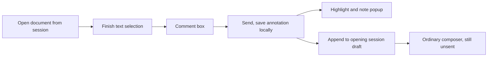

# Markdown document annotations

Date: 2026-10-04

Status: Written specification approved by Jesse on 2026-10-04, including the
saved-pane origin compatibility below. Subsequent storage/parser approvals are
recorded under local storage. The implementation plan awaits review; product
implementation has not started.

Source baseline: `abd240265411bb1a35f10d1761a56cf0685339ea`.

## Intent and agreed scope

Jesse wants to select text in a Markdown document, write a note, see a persistent
highlight with that note, and add a file-specific annotation to the session's
composer without submitting it. Reading and writing several notes should remain
one uninterrupted activity.

The feature covers the desktop browser document pane, the phone-browser document
viewer, and the native iPhone Reader. Android remains deferred under the native
release scope. Saved annotations belong to a session and file in the browser or
native app where they were created. They survive reopening and restart while the
document remains unchanged. A detected source change expires and deletes its
saved annotations. They do not sync between devices, between browser profiles,
or between browser and native storage on the same phone.

The document is read-only. Creating an annotation does not modify its source
file, send input, queue a turn, steer an agent, or start/resume a session.

## User journey

1. The user opens a Markdown file from a session. The viewer retains that file's
   session identity and the originating composer context.
2. The user selects document text. Finishing the selection opens a comment box
   with the selected passage and a Send button. Ordinary copying and adjusting
   the selection remain available. Opening the box requires no extra Comment
   menu action.
3. Send saves the annotation locally and appends its formatted note to the
   opening session's draft. Existing draft work survives. The reader stays open
   at its current reading position.
4. The selected passage has a readable highlighter band. Hover or keyboard focus
   reveals the note on desktop. Tap reveals it on touch clients. Overlapping
   annotations reveal all notes for the touched/focused passage.
5. More annotations append in creation order. Returning to the composer shows
   the complete accumulated draft. The user edits or submits it through the
   ordinary composer controls.
6. Reopening the unchanged document or restarting the client restores saved
   highlights and notes. Restoration never appends an already-applied annotation
   again. A detected document change deletes its saved annotations without
   modifying text already inserted into the composer.



Send completes a local annotation operation. It has no agent-input side effect.
The local operation owns both saved-note preservation and draft handoff until
those outcomes are settled or the annotation expires.

Send requires a nonempty selection and a nonblank note. Preserve the entered note
text, including line breaks. Editing the note freezes its selected passage;
another selection must not silently retarget that work. The comment field's
Return key inserts a line break and cannot trigger the session's Send shortcut.

## Passage references and anchors

A composer entry starts with this line:

```text
A note on `docs/plan.md:42:5-44:18` (captured source positions), selecting “ship the smaller core”: "Keep this scope."
```

Every entry also includes the captured whole-file revision, or an explicitly
prefix-scoped fingerprint when no whole-file revision exists, and the selected
passage's distinguishing surrounding text. These values travel as literal draft
text; device-local annotation metadata alone cannot identify the passage for the
receiving session. Emit the actual captured revision/fingerprint, not a claim
that it exists elsewhere.

A reference describes the captured document, not a live location. Its text
tells the receiving session to verify the quotation and context against current
content before relying on the coordinates. The document endpoint serves current
content; including a revision does not promise historical reads. Later source
edits and annotation expiry must not rewrite an applied entry, append it again,
or overwrite the user's draft edits. The original quotation, context, and
revision keep the snapshot interpretable after its coordinates become stale.

The path is the session-relative document path already used by document reads.
Positions refer to the original Markdown source, not the rendered DOM or a
reconstructed Markdown string. Line and column numbers are one-based. Columns
count UTF-16 code units, with tabs counting as one source character. Stored
ranges use zero-based UTF-16 offsets with an exclusive end. Conversion preserves
the original newline spelling, including CRLF. The displayed final position is
inclusive, while the stored end remains exclusive. Endpoints never split a
Unicode surrogate pair.

Each annotation retains:

- a unique operation/annotation identity and creation order;
- its local hub/connection namespace, session reference, and file path;
- original source positions and the exact selected rendered text;
- surrounding text sufficient to distinguish repeated occurrences;
- the selected document's revision and renderer/source range mapping;
- the literal note text;
- its draft-handoff state and destination provenance.

A source range may contain Markdown syntax between the selected endpoints. The
quoted selection remains the exact text the user selected. Formatting, entities,
escapes, list markers, and repeated words must not move the anchor to another
occurrence. Source coordinates must come from a verified rendering map, not a
first string match, approximate block index, or regex that strips Markdown.

Retain the endpoint's whole-file revision when present and a fingerprint of the
displayed source with its coverage. When no whole-file revision exists, identify
the fingerprint's scope honestly. A truncated prefix fingerprint is not a
whole-file revision. Users may annotate text in the visible prefix of a truncated
document; references must stay within that prefix.

The selected range may cross inline formatting and textual Markdown blocks,
including paragraphs, lists, quotes, tables, and code. Browser and native adapters
must capture the actual selected range. Diagram shapes, raster images, viewer
chrome, and non-text controls are outside text annotation scope.

## File changes, expiry, and unavailable content

For unchanged source, restore the original exact range. A successful current
document read that establishes a source change expires the affected session/file
annotations. Delete their saved quote, note, and anchor payloads and remove their
highlights. Cancel draft handoffs that have not been applied. There is no
relocation, Unplaced notes disclosure, expired-note archive, or automatic
restoration if the old passage or file contents later return.

Compare whole-file revisions when both are available. A changed whole-file
revision expires annotations even if their selected text or the displayed prefix
is unchanged. Otherwise compare the captured and current displayed-source
evidence only over comparable coverage. Missing revision metadata or changed
coverage alone is not evidence of an edit. Without a whole-file revision, edits
outside a truncated prefix cannot be detected; expose that detection limit and
never claim a prefix fingerprint covers the whole file. Do not infer expiry from
an incomplete quotation search.

Expiry is a versioned local operation. Serialize it with annotation creation and
draft handoff so stale reads, old tabs, delayed saves, retries, and restart cannot
resurrect expired records or delete annotations created for a newer accepted
version. Retain only the operation receipts or cancellation/version markers
needed for that guarantee, without retaining expired note payloads. If deletion
cannot be persisted, keep expired highlights hidden, cancel pending appends, and
show expiry as pending while retrying when local storage recovers. Final expiry
requires durable cancellation and deletion receipts. The next successful read
must reconcile stored versions and any durable expiry receipts before painting
restored highlights. Process death before any expiry receipt is persisted cannot
guarantee deletion if the source reverts before the next read; expose that limit
instead of claiming the stored notes have already been erased.

Draft text already inserted remains unchanged, including edits the user made.
Reconcile an interrupted handoff against its committed draft edit before deciding
whether it was applied or must be cancelled. Expiry never removes composer text
or resends it. Comment text that has not been sent remains available; require a
fresh selection before saving it against changed content, rather than silently
retargeting the old selection.

A missing file or failed read retains annotations and in-progress comment work.
The existing document read boundary remains the content authority. Annotations
can be added to already-loaded content while disconnected because saving a note
and editing an unsent draft are local actions. On recovery, a successful read
restores exact highlights for unchanged content or expires saved annotations for
changed content. Read failure alone never deletes them.

## Composer ownership and preservation

The destination is captured from the opening session. Changing focus, visiting a
child session, or opening another document cannot retarget an annotation.
Browser origin context must retain the originating conversation pane's lifetime
when available. Native identity includes hub and session.

Use the real draft owner, including its detached-write and revision protections.
Do not implement document annotations by feeding several notes into the current
single-slot quote-insert requests. That would lose earlier notes while the phone
reader has unmounted its composer.

Draft handoffs are durable, ordered, and identified. An applied operation is
recorded with its draft edit so restart, remount, interrupted acknowledgment, or
repeated callbacks cannot duplicate it. A later user edit, removal of inserted
text, or ordinary composer submission does not reactivate an applied operation.
Apply appends to the current draft rather than a snapshot captured when the
comment box opened. Preserve attachments, selected skills/commands, mention
locations, and existing recovery ownership.

If the originating pane is closed, replaced, or temporarily lacks a writable
composer, retain the unexpired note and pending handoff for that same session.
Reconcile against its retained draft owner when useful composition returns.
Expiry cancels an unapplied handoff. Never write through a disposed lifetime,
overwrite another pane's newer work, or redirect to the currently focused
session. Read-only session views can retain unexpired annotations; a
permanently unavailable destination exposes the saved note and its copyable
formatted text rather than losing it or inventing a different recipient.

**Approved saved-pane compatibility:** Existing saved browser document
pane records contain a session/path but no originating pane identity. Keep
those panes readable and allow unexpired annotations to retain a session-bound
pending handoff until the correct draft owner is available. Do not guess an
unrelated pane or add other legacy-schema migrations. Approval of this
specification covers only this narrow compatibility behavior. The separately
approved supported-draft transfer is recorded below.

## Local storage, recovery, and retention

A shared, headless annotation model owns reference formatting, range
validation, version/expiry decisions, ordered handoff semantics, and
exact-range restoration. Browser and native adapters own their existing local
storage and actual draft editors. No new hub protocol or server-side annotation
store is required.

Jesse separately approved transferring currently supported browser composer
drafts from localStorage into the existing IndexedDB infrastructure, retaining
their work and current owner protections. Ordinary edits, clearing, recovery,
and annotation handoffs use that transactional authority so an applied receipt
commits with its actual draft edit. This authorizes the supported-draft transfer,
not additional historical-schema adapters.

Jesse also approved a pinned source-aware extension of Marked 18.0.6, including
lexer/tokenizer instrumentation for original-source positions. Preserve document
rendering and sanitization and leave transcript rendering unchanged. Replacing
Marked with another parser is outside this approval.

Persist saved annotations independently of disposable document-reading caches
and independently of native review-comment membership. Reuse local-storage
infrastructure without inheriting the existing native DocumentMemory's
100-document eviction cap. Opening many files must not delete authored notes or
pending handoffs.

Saving has a durable receipt. A storage failure retains the comment, anchor,
and unexpired pending operation in memory and exposes the unsaved state beside
the note. Duplicate Send activation retries the same operation, not a new
annotation. Reopening the relevant reader/composer, client foregrounding, and
observed local storage recovery trigger another bounded persistence/handoff
attempt for unexpired operations. Healthy reading, other sessions, and other
saved annotations remain usable. Do not show a fully saved annotation when the
local write failed. An unpersisted operation cannot promise survival of process
death; its status must make that limitation clear.

Successful draft insertion and acknowledgment must be recoverable as one logical
operation. Injected interruption between writes must result in one applied note
or one still-pending unexpired handoff, with no duplicate or dropped note.
Confirmed expiry may instead cancel an unapplied handoff. Multiple browser
panes/tabs must reconcile their changes against the current local owner without
clobbering a newer draft or silently deleting another annotation.

Closing a viewer, sending/clearing a composer draft, clearing session-history
cache, and sending a native review do not delete saved annotations. Detected
document changes delete the affected saved annotations under the expiry
contract. Existing explicit local-data reset or native hub-removal boundaries
may remove their owned annotation data and pending operations; they must leave
other hubs/sessions untouched. No background cleanup infers deletion from
inactivity.

In-progress comment text and its selection survive ordinary remount/navigation
and native backgrounding while their source remains unchanged. Source changes
preserve unsent comment text under the fresh-selection rule above. Cancel is an
explicit dismissal of that unsaved comment; it leaves existing highlights and
composer work unchanged. Text entry, focus, touch selection handles, and the
on-screen keyboard must remain usable.

## Native Reader and existing Review

Keep the native Reader and its reading behavior. Extend its renderer boundary to
report finished selections and draw interactive persisted ranges. The pinned
renderer already supplies selection offsets to selection-menu callbacks, but
has no public completed-selection event or saved-range highlight property.
Menu-only Comment activation and block comment-count pills are insufficient
implementations of the approved journey.

Selections must identify source ranges across native's current block rendering
boundaries as well as inline styles. Renderer/layout changes needed for that
capability must preserve reader position, change markers, code/table scrolling,
links, text scaling, and the current selection/copy actions. Existing native
patches provide an extension mechanism; do not replace the Reader with a WebView.

Existing Add comment and explicit Review retain their current review membership
and send/queue semantics. New annotations share presentation/storage plumbing
where useful but remain distinct records. Review must neither resend annotation
handoffs nor clear annotation highlights. Previously saved review comments stay
unchanged; no comment migration or compatibility layer is requested.

## Boundaries, security, and non-goals

- Preserve existing local and remote document-read permissions and routing.
- Keep Markdown sanitation. Render notes and selected quotes as literal user
  text; do not interpolate them into raw HTML, native links, or executable code.
- Escape multiline quotes, backticks, and delimiters so the composer reference
  remains readable and the original note remains intact.
- No cross-device synchronization, source-file writes, automatic submissions,
  PDF/image annotations, review redesign, WebView replacement, or annotation
  editing/deletion UI beyond existing local-data clearing boundaries. No
  cross-version reanchoring or expired-note archive.
- Do not change transcript selection quoting, ordinary composer Send, queue
  behavior, history caching, or Android's recorded release deferral.

## Source ownership and documentation

Current entry points and constraints, verified from the source baseline:

| Boundary | Existing source |
| --- | --- |
| Shared browser document viewer | `cmd/evener-hub/frontend/src/panes/doc/DocPane.tsx` |
| Browser file identity and opening context | `panes/doc/openDoc.ts`, `panes/session/transcript/fileOpenBeside.tsx`, `shell/paneActions.ts` under the frontend source tree |
| Browser Markdown renderer | `cmd/evener-hub/frontend/src/widgets/markdown/index.tsx` |
| Existing selection UI and single-slot insertion | `panes/session/transcript/SelectionQuote.tsx`, `panes/session/composer/quoteInsert.ts` under the frontend source tree |
| Browser lifetime and real draft editing | `shell/paneLifetime.ts`, `panes/session/composer/sourceState.ts`, `panes/session/composer/draft.ts` under the frontend source tree |
| Document content/revision contract | `appwire-client/typescript/docContent.ts` and `cmd/evener-hub/doc_serve.go` |
| Native reader, block parsing and local memory | `mobile-native/src/reader/ReaderScreen.tsx`, `ReaderBlock.tsx`, `documentBlocks.ts`, `documentMemory.ts`, `nativeDocumentMemory.ts` |
| Native comment/review and draft handoff | `mobile-native/src/reader/CommentSheet.tsx`, `ReviewSheet.tsx`, `mobile-native/src/session/pendingQuote.ts`, `mobile-native/src/screens.tsx` |
| Native renderer extension | `mobile-native/patches/react-native-enriched-markdown+1.0.2.patch` |

Implementation must publish reusable headless annotation behavior through the
shared AppWire TypeScript package's documented export boundary. Consumers import
it by package name. Browser/native renderers retain platform-specific selection,
layout, storage, and focus adapters.

Add `docs/product/document-annotations.md` as the evergreen behavior and recovery
guide. Link it from `docs/product/README.md`, `docs/web-ui/README.md`,
`mobile-native/README.md`, and product subsystem rows S02/S03/S05. Update affected
renderer/client contracts with current ownership. Keep this dated specification
separate from evergreen guides.

## Proof obligations

Implementation is complete only with failing-before/passing-after evidence for
these behaviors and passing affected gates. Test oracles use independently
specified source ranges and actual rendered selections, not the new anchor
algorithm to manufacture its own expected values.

| Scenario | Required evidence |
| --- | --- |
| Desktop selection to draft | Real browser selection opens the box, Send draws the exact highlight, hover/focus shows the note, and the opening draft receives one reference with zero input mutations |
| Phone-browser reading | Touch-sized viewport and selection, usable comment box above the keyboard, multiple notes while the composer is unmounted, Return preserves reading/draft work |
| Native iPhone journey | Built current-source native renderer demonstrates automatic completed-selection opening, exact persistent highlights and tap notes, correct session draft handoff, and no send/queue/steer |
| Markdown coordinate cases | Independent fixtures cover duplicate passages in one block and different blocks, emphasis, links/entities/escapes, Unicode, CRLF, lists, tables, code, and multi-block selections |
| Captured draft references | Edits after handoff move the selected passage and put an identical quotation at its old coordinates; saved annotations expire, while the draft entry retains its captured revision and distinguishing context, stays snapshot-scoped, and preserves later user edits |
| Persistence and recovery | Reload/restart/background/foreground restores unchanged-file notes, resumes unexpired pending handoffs once, and preserves in-progress comment work |
| Draft lifetime and concurrent work | Origin/focus/session changes, pane remount/replacement/close, updated draft text, attachments, skills/commands and mentions survive without wrong-recipient writes |
| Storage faults | For an unexpired operation, failure before save and interruption around draft acknowledgment retain honest pending state, automatically recover after the fault clears, and apply one note |
| Expiry and read recovery | Source changes delete saved quote/note/anchor payloads and cancel unapplied handoffs, keep existing composer text unchanged, and never restore expired notes when old content returns; failed reads preserve notes until a successful read settles the version |
| Truncated/version evidence | A whole-file revision change expires notes even with an unchanged prefix; changed comparable prefixes expire notes without revision metadata; missing metadata and changed coverage alone do not prove edits; unseen suffix changes remain an explicit detection limit |
| Expiry races and storage faults | Old tabs, delayed callbacks, and restart cannot resurrect durably expired notes, apply cancelled handoffs, or delete newer-version annotations; failed expiry writes suppress highlights/appends and recover after storage returns, with honest process-death limits before any receipt |
| Retention and review isolation | More than 100 annotated files retain all authored notes; explicit native Review affects only its comments; history-cache clearing leaves annotations intact |
| Security and non-regression | Literal malicious note/quote text remains inert, Markdown sanitation survives, and transcript quoting and ordinary review/composer controls keep working |

Run fast targeted tests red-first, then the owning package/browser/native gates.
The canonical frontend gate is `make test-web`; browser qualification includes
`make test-web-browser` and a real annotation journey through production viewer
and draft code. Native source checks use `make test-native`. Native renderer
extensions also require compilation and an installed iPhone/simulator journey;
JavaScript tests and Metro bundling alone do not prove native selection or range
painting. Record the exact artifact/source revision and verification limits.

The implementation plan must establish access to that native qualification
route before treating renderer work as verified. Do not claim completion if the
actual native selection/highlight journey remains untested. Existing unrelated
native review-comment eviction is tracked separately in
[the native comment-retention issue](https://github.com/prime-radiant-inc/evener/issues/3711).
