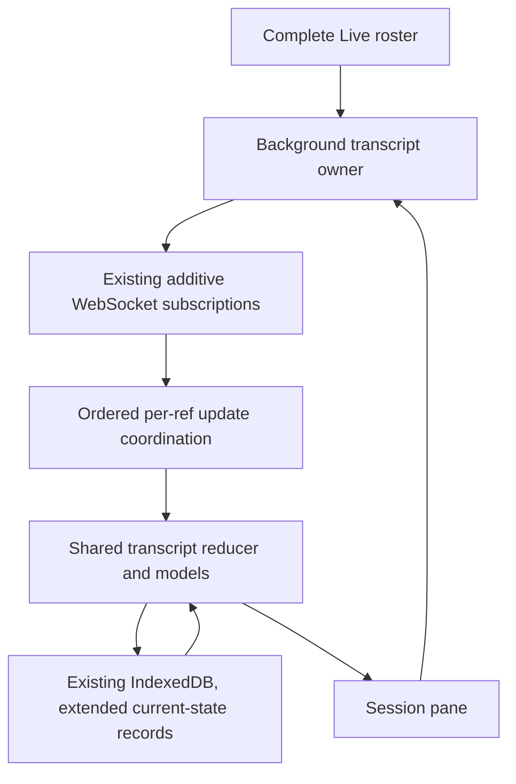

# Disk-backed background transcripts for Live sessions

## Intent and approval boundary

Opening a Live session should show its current transcript without a network
round trip while the web app is connected and caught up. The app must keep
background transcript memory bounded and use local disk state when a transcript
leaves RAM.

Jesse approved every session in Live, including idle sessions, and explicitly
chose bounded memory with current state on disk. This document proposes the
implementation contract. It requires written approval before the implementation
plan and product changes. Implementation will use Luna subagents.

"Current" means that the client has applied the notifications it has received
through a defined local handoff point. It cannot include events still in transit,
or guarantee freshness across a disconnected or suspended browser.

## Scope

- Web UI, including its narrow-screen layout.
- All session refs represented in the complete Live navigation resource, across
  projects and attached remote hosts, including idle sessions.
- Existing WebSocket, additive thread subscriptions and shared transcript reducer.
- Bounded background RAM, disk-backed live state, foreground adoption, reconnect,
  cache clearing and older-history preservation.

Delegates and archived sessions are outside discovery scope, even if running.
An explicitly opened pane keeps its existing behavior regardless of Live
membership. Native and CLI clients do not acquire background transcript demand.
Navigation remains shallow; this feature does not load activity collections or
reconstruct their ownership from navigation rows.

No wildcard subscription, new server paging cursor, new outbox behavior, service
worker, cross-tab leader election or separate cache database is proposed.

## Existing behavior

The existing IndexedDB cache stores recorded history, including loaded older
pages and their cursor. It does not store the live overlay containing streaming
text and tool output. Its 32 MiB aggregate budget and 14-day TTL bound disk use,
not the in-memory thread store.

`ensureThread` and `releaseThread` own canonical pane models in `threads.ts`.
The shared subscription lease combines transcript and activity owners. A pane
can adopt an already hydrated model without another read. `watchThread` has a
separate model store and bypasses persistence, so it is not the backing store for
this feature.

Existing reads establish the snapshot/notification boundary. Reconnect and
resync require authoritative hydration; recorded-history cursors do not replay
missed WebSocket events. The reducer preserves older held pages and their cursor
when newer windows merge on the same connection. Reconnect invalidates held
history, so its authoritative read replaces it with the latest window and the
response cursor. Unloading a whole model and restoring it intact within an
uninterrupted connection avoids inventing a cursor for a truncated history prefix.

Relevant sources:

- `cmd/evener-hub/frontend/src/stores/threads.ts`
- `cmd/evener-hub/frontend/src/stores/sessionCacheIndexedDB.ts`
- `appwire-client/typescript/reducer.ts`
- `appwire-client/typescript/threadSubscription.ts`
- `appwire-client/typescript/state/navigation/store.ts`
- `appwire-client/typescript/state/navigation/revalidator.ts`
- `cmd/evener-hub/navigation_service.go`, whose semantic revision covers all pages
  of one logical navigation resource
- `docs/product/session-activity.md`
- `docs/superpowers/specs/2026-09-29-web-session-cache-design.md`

## Architecture

One web-lifetime owner follows Live membership. It acquires subscription demand
independently of panes. One per-ref coordinator owns ordered updates, model
residency and disk commits. Panes use that same coordinator and canonical model;
there is no second transcript fold with subtly different semantics.

The persistence extension lives in the existing cache database. Recorded-history
cache records remain useful for reopening after a reload. Current-state records
add the live state needed to continue reducing notifications after RAM eviction.
A current-state record is a checkpoint, not a claim that a previous connection
is still live.

## Complete roster without expanding the rail

The owner uses the existing navigation store and revalidator. It walks Live pages
until the terminal page, deduplicates opaque refs and follows invalidations,
reconnects and generation changes. It includes session refs nested in the Live
resource where those rows represent eligible Live sessions, rather than
inferring sessions from unrelated project or delegate trees.

Background discovery demand and visible rail page demand are separate. Loading
all pages for background work must not expand the rail, remove its Load more
control or change the user's loaded-page boundary. Shared reads and revalidation
remain deduplicated. The boundary also applies to any selector whose contract is
visible/loaded navigation, rather than the complete background roster.

Demand ownership also scopes convergence waits. A foreground navigation mutation
waits for the resources it previously needed, excluding pages registered solely
for background discovery. A failed hidden Live page must not turn a successful
archive action into a reported failure. A page with both owners participates in
the foreground wait normally. Background sweeps use their own complete-page wait
set while sharing the underlying requests and revalidator.

A completed sweep uses settled pages from one navigation generation and one
logical Live revision, with contiguous offsets and a terminal page. Reordering,
invalidation, non-advancing pages, errors and mixed revisions cannot prove that a
session disappeared. Additions can be acquired from fresh pages; removals wait
for a coherent complete sweep. Existing owners remain while discovery retries.
A newer invalidation supersedes pending work without starting duplicate sweeps.

A source going offline is not proof that its final transcript is empty. A ref
removed from Live releases only this background owner's demand. Open panes,
activity readers and explicit mutation pins retain their own demand.

## Ownership and ordered handoff

Keep requested refs opaque and client-qualified. A stable routing alias retains
its requested subscription key even when its resolved session identity changes.

The coordinator distinguishes:

- foreground demand, including active transcript/history readers;
- background Live membership;
- existing mutation pins and other subscription owners;
- resident model, valid disk checkpoint, pending update work and recovery demand.

Background discovery and hydration never enqueue, resume or dispatch mutations.
Existing user-initiated outbox recovery remains responsible for queued actions.
Adding a background owner must not call a pane-only hydration completion hook
that schedules unrelated mutation dispatch.

Every accepted update is ordered per ref. Assign a local monotonic receive
sequence within the actual client/connection generation. Persist the last
applied sequence with each current-state checkpoint. This is a client-local
coordination value, not a new server event-replay cursor.

A resident model receives updates through the existing reducer path. A
nonresident ref loads its checkpoint, folds a bounded batch through the same
path, commits the replacement checkpoint, and releases its temporary model.
Per-ref work is serialized; unrelated refs may proceed within the shared worker
limit. The foreground takes priority over queued background work.

Retain one coalesced work entry per ref and drain ready background refs fairly.
Use the existing resident write debounce, but force a commit for RAM eviction.
Nonresident work drains bounded batches as the worker becomes available rather
than starting a read/write pair for every chunk. A slow storage operation has
the existing storage deadline; it cannot occupy the only worker indefinitely.

### Moving from RAM to disk

1. Select a background-only model. Never evict a model held by a foreground
   reader, in-flight foreground history operation or mutation pin.
2. Commit a checkpoint through a known receive cut, including recorded history,
   older cursor and live overlay.
3. Transfer subsequent updates to the nonresident coordinator queue. No update
   can fall between the committed cut and that queue.
4. Release the model only after commit succeeds and ownership/generation still
   matches. An interrupted transfer leaves one authoritative owner, never two.

Failed persistence cannot be treated as a successful handoff. The bounded
storage-failure recovery policy below applies instead.

### Opening a disk-resident session

Promotion joins the coordinator, captures a receive cut, loads the local
checkpoint and applies all accepted updates through that cut before publishing
the foreground model. Later notifications follow the ordinary foreground path.
A notification racing with promotion is applied exactly once.

Healthy RAM eviction therefore requires no `thread/read` on click. Adoption of
a resident model keeps the same model identity and issues no duplicate read.
A disk promotion may take an asynchronous local read; it must not display an
older snapshot as verified current while pending updates remain.

## What goes on disk

Use an explicit versioned codec for recorded history, its complete paging
boundary, live overlay, resolved session identity and the server-owned fields
needed to continue the existing reducer. Rebuild derived display turns instead
of storing duplicate projections. Preserve omitted-text markers and streaming
chunk semantics across serialization.

Exclude local mutation queues, dispatch permissions, promises, timers,
subscription handles, view scroll state and other process-local state. Existing
outbox storage remains separate. A disk record alone never grants permission to
send a mutation.

While connection continuity holds, the live coordinator retains the small
authoritative admission/capability state needed for foreground actions. A disk
promotion cannot dispatch queued work as a side effect. After continuity breaks,
normal authoritative reconciliation restores action admission.

Current-state records are scoped to a browser-instance owner token and requested
ref, with connection generation, resolved history identity, clear epoch and
applied receive sequence. A tab cannot replace another tab's current checkpoint
or borrow its continuity proof. Recorded-history cache records may retain their
existing shared-by-ref behavior. Both record classes share cache clearing,
delete fencing, size accounting and expiry in the existing database.

Only a still-live in-memory coordinator can certify a checkpoint as current:
its owner token, connection generation, clear epoch and applied cut must match,
and no known gap or pending resync may exist. After reload, disconnect, client
replacement or alias rebind, disk content is a stale display seed until the
existing authoritative read reconciles it. Persisted running indicators and
capabilities must not revive an old connection's authority.

This is a best-effort cache, not a crash-proof notification journal. A crash may
lose updates since the last committed write; a new browser instance reconciles
with the server before claiming live freshness.

Bump the cache schema to add current-state storage without deleting compatible
recorded-history rows. Old tabs follow the existing version-fence behavior;
there is no dual-version protocol or compatibility adapter. Expired owner-scoped
checkpoints are disposable under the cache's existing cleanup policy.

## Memory and disk policy

Proposed starting limits, injectable in tests:

| Resource | Limit |
| --- | --- |
| Resident background transcript payload | 16 MiB aggregate |
| Pending background notification payload | 4 MiB aggregate |
| Background load/reduce/commit workers | 1 |
| Concurrent background network hydrations | 2 |
| Cache records on disk, both classes combined | Existing 32 MiB aggregate |
| Cache TTL | Existing 14 days |

Payload accounting uses the encoded state/update size, including live overlay
and structured item data, not just message counts. The implementation must avoid
serializing the entire retained transcript on every text chunk solely to measure
it. Account changes at the same boundaries used to fold and persist them.

The same budgets cover background frame buffers, hydration buffers, retained
write payloads and models awaiting disk handoff. A completed background read
does not enter an unaccounted staging list. Admission checks precede retention;
over-limit staging takes the bounded recovery path instead. A single incoming
message may need decoding before its size is known, but retaining a sequence of
such messages is not an allowed exception.

This bounds retained background payload, not total browser heap. Foreground
models, JavaScript object overhead, navigation/subscription metadata, one decoded
incoming packet and serialization/IndexedDB copies are outside the resident
budget. The single worker may hold one cache-sized model while updating it;
its maximum record size is limited by the disk budget. Tests report these
separate bounds instead of calling the nominal budget a hard process-RAM cap.

Evict least-recently-foreground-used background models first. Background traffic
does not make a model recently viewed. Eviction writes current state before
unloading it. Do not evict live state merely to force a server read on opening.
Do not continuously load and evict an unchanged ref to cycle the working set.

Keep entire recorded histories and their cursors together when unloading.
Existing loaded pages survive a successful disk round trip. If a record no
longer fits the disk budget because of old history, a background-only latest
window can be rebuilt by an authoritative read with its server-issued cursor.
Older history remains on the server and is available through ordinary paging.
Never truncate turns while retaining a cursor that skips the removed range.
No open reader loses loaded pages, its scroll anchor or Find demand.

The disk cache remains finite and best-effort. Prefer retaining Live current
checkpoints over unrelated stale cache records. If current records themselves
exceed the disk budget, storage is unavailable, or an individual current item
cannot fit, mark the affected ref unverified and fall back to ordinary
cache-seeded authoritative hydration. RAM eviction alone is not such a failure.
The app must distinguish this exceptional recovery from a healthy local reopen;
tests assert both paths. These pressure limits and exceptions are part of the
written-spec approval, not silently assumed performance guarantees.

## Recovery and preservation

### Disconnect, resync and source replacement

Invalidate currentness immediately, preserve usable display state, and reconcile
all desired refs through the existing snapshot/notification handoff. Pace
background reads and prioritize foreground work. Retrying one unavailable host
must not block healthy local or remote sessions. Disconnected time does not
create a replay promise the protocol cannot satisfy.

Retain the existing reconnect replacement rule: missed events cannot be repaired
by merging an old disk checkpoint just because its identity still matches.
Older pages dropped by that authoritative replacement remain available through
the returned cursor and normal paging. This feature promises lossless
uninterrupted RAM/disk handoff, not new automatic older-page backfill across a
connection gap. Test paging back to an item from a previously loaded later page
after reconnect; do not assert that the old cursor survives replacement.

### Slow storage and update overload

Do not retain an unbounded queue of deltas or full model snapshots while IDB is
blocked. Coalesce only where the existing event semantics permit it; text chunks
cannot be dropped while claiming continuity. When the bounded queue would
overflow, invalidate that ref's checkpoint, discard its now-unusable incremental
work and schedule paced authoritative recovery. Persist the invalidation before
later code could reuse the checkpoint as current, or keep that rejection in the
live coordinator until the old checkpoint cannot be promoted.

Storage recovery retries automatically with bounded backoff while demand exists.
A successful probe/checkpoint write restores the disk-backed path. A permanent
retry spinner or a repair button is not the recovery mechanism. The app remains
usable through its existing foreground live path when local storage fails.

### Clear cache, deletion and shutdown

Clear both record classes atomically under the existing durable clear epoch.
The transaction's epoch comparison rejects every pre-clear write. Same-tab clear
also synchronously fences pending promotions and asynchronous hydrations.

Clear enters an explicit `clear-suppressed` persistence state for held refs.
Continue live foreground use, retain background models only within the RAM
budget, and release excess background payload without trying to write it back.
An opening that cannot use an already-held current model uses authoritative
hydration. Suppression is intentional, so it does not start storage-repair retry
loops or spin on a successful IDB probe.

Background membership is separate from a user cache lifetime. Pre-clear
foreground/history readers and mutation pins keep their existing suppressed
lifetime until they release. After those holders are gone, a new explicit
foreground acquisition may establish a cache lifetime at the current epoch,
following authoritative hydration. With no pre-clear foreground holder, the
next explicit foreground acquisition can do so. Background discovery, RAM
eviction, remove/re-add churn and reconnect cannot reset suppression on their
own. A new browser instance also starts a new lifetime. Thus closing/reopening
a pane can restore caching even while its session stays continuously Live,
without the background owner silently undoing Clear.

Cross-tab clear preserves the existing bounded-staleness contract rather than
claiming atomic publication across browser realms. A checkpoint lookup captures
the durable epoch in its own transaction. A sibling can clear after that read
and before in-memory publication, before its broadcast arrives. That promotion
may briefly publish pre-clear content. It cannot write it back under the old
epoch. On observing the new epoch, revoke its persistence/current-checkpoint
claim and enter the suppressed recovery path, retaining visible content as a
stale seed until authoritative reconciliation. Recheck the durable epoch after
disk promotion, within the existing cache lookup deadline, so a delayed or lost
broadcast cannot leave this particular read/publication race undetected. An
epoch-check failure also requires authoritative reconciliation. This check is
not a global lock and does not erase already-visible transcripts on Clear.

Session deletion removes both record classes and cancels ref-specific queued
work. A late read, write or page result cannot resurrect the session. Client
replacement and teardown cancel queued work and retire owner tokens; their
completions cannot publish into the replacement lifetime.

When a coherent roster removal ends background demand, drain accepted updates
and commit their final available state before releasing the model/subscription.
If the source is reachable, reconcile a final snapshot so navigation ordering
cannot hide final transcript updates. Failure preserves known state as stale;
it does not retain an unbounded model or block other releases. A ref that
reappears during release cancels that release under its ownership generation.

## Acceptance and evidence

Default tests use a scripted provider at the LLM boundary and real Evener
plumbing. Store/reducer tests may use the existing transport, clock and IndexedDB
test seams. End-to-end tests must not substitute mocked Evener internals.

1. **Unopened to current pane:** produce recorded messages, streaming text and
   tool output while a Live session is unopened. Open it and verify rendered
   content and running state, with no activation `thread/read` after background
   catch-up.
2. **Disk handoff:** force RAM eviction using an injected small budget, continue
   streaming while the model is absent from the resident map, then open it.
   Verify current content from local state, no network hydration, no duplicate
   chunks and no overlay-to-history duplication when the turn completes.
3. **Ownership:** exercise pane/background/activity holders in both release
   orders, two panes, mutation pins and client replacement. One shared wire
   membership survives until its final owner releases. Background hydration
   produces no mutation request.
4. **Full roster:** use more than two Live pages, including an idle session and
   an attached-remote session on a later page. Reorder, remove and add rows during
   refresh and reconnect. Every eligible ref is discovered; mixed/failed pages
   do not release existing owners. The rail's visible later-page row and Load
   more boundary remain unchanged by background discovery. Fail a background-only
   page while archiving a visible session; the successful action and its normal
   foreground convergence must remain successful.
5. **Older history:** load multiple older pages, retain a visible later-page
   item and cursor through same-connection updates, then close, evict to disk
   and reopen. Verify lossless restoration and further paging without holes.
   Separately reconnect, verify authoritative latest-window replacement, and
   page back to the previously visible later-page item without duplicates or
   skipped items. Test pressure-driven rebuilding only with no reader.
6. **Codec:** round-trip representative text, omitted text, structured tool
   data, images, reasoning chunks, overlay retirement and delegate entities.
   Continue reducing the same subsequent real notifications on restored and
   uninterrupted models and compare user-visible results and paging identity.
7. **Ordering races:** pause disk reads/writes at transaction boundaries and
   inject notifications, foreground adoption, pane release, reconnect, alias
   rebind and deletion. Assert one accepted update path and stale-result fencing.
8. **Storage recovery:** blocked/failed IDB, a quota error, an oversized item,
   disk eviction and queue overflow remain bounded and cannot claim freshness.
   Remove the fault and verify automatic return to local disk-backed opening.
9. **Clear and multiple tabs:** clear during resident writes, nonresident
   updates and promotion. Verify no durable resurrection or cross-tab continuity
   borrowing. Pause after a lookup transaction, clear in a sibling and delay its
   broadcast: verify the permitted temporary display, old-epoch write refusal,
   post-promotion epoch detection and authoritative recovery. With more Live
   payload than RAM permits, clear and close/reopen a pane while its ref stays
   Live; assert bounded suppression, no futile writes, then explicit foreground
   restoration of caching. Preserve existing outbox behavior.
10. **Producer-to-renderer journey:** run real daemon/hub WebSocket routing with
    deterministic provider output into the shared adapter and web renderer.
    Cover background → disk eviction → further output → pane activation, then
    reconnect and older-history paging. Assert content against produced output
    and inspect read requests, rather than relying only on coordinator flags.

Run targeted cache, transcript, navigation, subscription and reducer tests for
each implementation piece. The implementation plan must name the concrete
journey harness and runnable commands. Run the canonical frontend/package gates
and impacted native/shared-client tests before submission; CI runs the full
repository gates. Measure persisted writes, queue bytes, residency and activation
reads under a sustained deterministic workload. No latency or traffic benchmark
has yet established production-scale defaults.

## Documentation and delivery

Update the owning product guide, subsystem map and cache contract alongside the
implementation. Explain disk-backed currentness, bounded background residency,
recovery ownership, affected web surfaces and unchanged native demand. Correct
any affected protocol prose that suggests replacing all subscriptions when
reacquiring multiple refs.

Before implementation: adversarially review this spec with two independent
reviewers, resolve evidenced findings, commit it and obtain Jesse's written
approval. Then write and approve the implementation plan and execution method.
Use Luna implementation subagents, red/green behavior tests and the required
implementation review, simplification and PR workflow.
