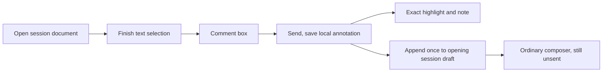

# Markdown document annotations, browser delivery

Date: 2026-10-05

Status: Jesse approved splitting browser delivery from the blocked native feature.
This written scope amendment awaits independent review and Jesse's approval.
The browser implementation plan must then receive written approval before new
product implementation begins. Deployment remains outside the authorization.

## Authority and scope

Deliver desktop-browser and phone-browser Markdown annotations through verified
merge as one independent release. Both clients use the existing `DocPane`.
Native iPhone annotations remain blocked and require separate delivery.

Read this amendment together with the [original design](2026-10-04-markdown-document-annotations-design.md).
All of its browser and shared requirements remain binding. This amendment changes
only the affected-client scope, the native-first qualification gate, publication
of native annotation behavior, and cleanup ownership. Its native-specific
requirements remain obligations for the deferred native deliverable. Historical
status paragraphs in the original design and plan do not describe this release's
approval or completion state.

The original approved specification is commit
`19afe6b9e69b3caffcf9e6d4d7efebf6b0f74727`. The seven browser/shared behavior
sections in the browser base's original design are byte-identical to that version:
intent, user journey, passage references, expiry/read recovery, composer ownership,
local storage/recovery/retention, and security/non-goals. Their native-only clauses
apply when the separate native deliverable resumes.

The new browser plan replaces the original full-client plan's execution order for
this release. Approval of the scope choice permits writing this amendment;
approval of the written amendment permits writing that plan. The earlier
subagent-driven execution choice is retained.

## Browser behavior to preserve

The user opens a Markdown file from a session, selects text, and finishes the
selection. A comment box opens automatically with the selected passage and Send.
Send saves the annotation locally and appends a reference to the opening session's
unsent draft. The document stays open at its reading position. Highlights reveal
notes on desktop hover/focus or touch tap, including overlapping notes. Further
notes append in creation order without requiring the phone composer to be mounted.
Ordinary copying and selection adjustment remain available.

Send creates a local annotation operation. Creating, restoring, or retrying it
must cause zero send, queue, steer, or session-start/resume mutations. Only the
ordinary composer controls submit the accumulated draft.

The following original guarantees retain their full meaning:

- Require a nonempty selection and nonblank note. Preserve note text and line
  breaks. Editing freezes the captured passage. Return in the comment field
  cannot trigger the composer's Send shortcut. Keep comment text and its selection
  through ordinary navigation/remount; changed source preserves unsent text and
  requires fresh selection. Cancel dismisses only that unsaved comment.
- Map actual rendered selections to original Markdown source. Use zero-based
  UTF-16 `[start,end)` ranges and one-based, inclusive displayed positions. Preserve
  BOM/newline spelling, CRLF, tab counting and surrogate-pair boundaries. Cover
  inline formatting and textual blocks, including lists, quotes, tables and code.
  Use verified source mapping rather than first-match text searches.
- Put captured coordinates, literal revision or honestly scoped fingerprint,
  selected quotation and distinguishing context into the draft reference. Keep
  references snapshot-scoped. Neither expiry nor later file edits rewrite an
  applied entry or the user's later edits.
- Persist per hub/connection namespace, session and file within the same browser
  profile. Restore unchanged-source highlights and notes across reopen/restart.
  Restoration cannot append an applied note again. Keep annotations independent
  of disposable reading/history caches and retain notes across more than 100 files.
  No cross-device, cross-profile or browser/native synchronization is introduced.
- Preserve delete-on-source-change. A successful comparable read expires saved
  quote/note/anchor payloads and cancels unapplied handoffs. Whole-file revision
  changes are authoritative even with an unchanged visible prefix. Missing
  metadata, changed coverage alone and failed reads do not establish an edit.
  Keep the detection limit for unseen truncated suffixes explicit.
- Serialize creation, handoff and versioned expiry. Durable cancellation/deletion
  prevents old tabs, delayed saves, restart or source reversion from resurrecting
  expired notes or deleting newer-version notes. Pending expiry hides highlights,
  suppresses appends and retries after storage recovery. State the process-death
  limit before any receipt persists. Existing composer text survives every expiry.
- Capture the opening session and originating pane lifetime. Preserve the current
  draft, attachments, skills/commands and mention locations. A focus change or
  unavailable/disposed owner cannot redirect or clobber work. Retain unexpired
  pending handoffs for their original destination and reconcile when useful
  composition returns. Read-only or permanently unavailable destinations expose
  the saved note and copyable formatted text.
- Use the real transactional draft authority. Transfer currently supported
  localStorage drafts into existing IndexedDB infrastructure with their owner
  protections intact. Commit an applied receipt with its actual draft edit.
  Interruption, duplicate callbacks, concurrent typing/tabs and acknowledgment
  recovery produce one applied edit or one still-pending unexpired operation.
  Ordinary draft submission, clearing or later user edits never reactivate it.
- A save fault preserves the comment, anchor and pending operation in memory,
  labels the unsaved state honestly, and retries the same operation after recovery.
  Healthy reading and other sessions remain usable. Do not promise process-death
  durability before persistence. Existing explicit local-data reset removes only
  its owned annotations and pending operations; history-cache clearing leaves them.
- Preserve Markdown sanitation, inert literal note/quote text, readable escaping,
  document permissions and read routing. Leave transcript rendering/selection
  quoting, ordinary composer Send/queue and other established controls unchanged.

The approved parser remains a source-aware extension of Marked **18.0.6** for
document rendering. No parser replacement is authorized. The only approved
compatibility work remains supported-draft transfer and restored browser document
panes that lack origin-pane identity. Those panes stay readable with session-bound
pending handoffs until the correct owner is available; do not guess another pane
or introduce other historical-schema adapters.

## Implementation and native boundary

Start the browser lane from accepted shared-contract commit
`447d6bc616cd55d2ae1846ab61743c5f9cf28fc9`. Reuse completed shared Task1 rather
than implementing or reviewing it as a new task. Publish reusable headless behavior
through `@evener/appwire-client` and its documented export boundary. Browser source
mapping, selection, highlight geometry, storage and draft adapters remain owned by
the browser. No new hub protocol or server annotation store is requested.

The accepted baseline includes the behavior-preserving native fingerprint-hash
import/re-export. Preserve it as shared infrastructure. Every unqualified native
feature/harness change after that baseline is excluded from this browser delivery.
Do not modify native Reader selection/rendering, native annotation storage,
CommentSheet/ReviewSheet behavior or native annotation qualification harnesses.
Existing native comments and explicit Review keep their present behavior.

Native Task2 remains incomplete after three unsuccessful behavior fixes, all
reverted. Its latest installed long-press test failed the Copy-menu assertion;
completed-selection behavior remains unqualified and the cause unconfirmed.
Browser evidence cannot qualify native selection, saved highlights, keyboard
behavior or native draft handoff. No fourth native fix or further native experiment
is authorized by this split. Native work resumes only under a separately reviewed
and approved scope/design, with its original proof obligations intact.

Preserve the unmerged `wip/markdown-document-annotations` branch/worktree at
`7f2bacf33fad854c849a9db6aafd34dbb680ed4c`, its original RED/source/harness pins,
all retained evidence and failed-fix history. Browser merge/cleanup must never
prune, dispose, delete, merge or rewrite that lane. The browser branch and its own
disposable artifacts may be cleaned up only after its merge is independently
verified and required evidence is archived.

## Browser proof and completion

Keep every original browser/shared proof obligation. Qualify these journeys
through production browser viewer and draft code:

| Area | Required evidence |
| --- | --- |
| Desktop selection to draft | Genuine rendered selection opens the box, Send paints the exact range, hover/focus reveals the note, and the opening draft receives one captured reference with zero input mutations |
| Phone-browser reading | Touch-sized viewport and selection, usable comment box above the keyboard, multiple notes with composer unmounted, and Return preserving reading/draft work |
| Source coordinates | Independently specified duplicate passages, inline formatting, links/entities/escapes, Unicode/BOM/CRLF, lists, tables, code and multi-block ranges |
| Snapshot and persistence | Applied references keep captured provenance and user edits after source changes; reopen/restart restores only unchanged-source notes and never repeats applied handoffs |
| Ownership and concurrent work | Focus/session/pane changes, owner close/replacement/remount, concurrent edits, attachments, skills/commands and mentions remain correctly owned and preserved |
| Fault recovery and expiry | Real authority boundaries cover save/commit/ack interruption, automatic recovery, changed/read-failed/truncated sources, stale tabs and callbacks, durable cancellation, source reversion and honest persistence limits |
| Retention and security | More than 100 annotated files retain authored notes, history-cache clearing preserves them, notes/quotes stay inert, sanitation and existing reading/copy/composer controls survive |

Run deterministic targeted tests red-first, then `make test-api-package`,
`make test-web` and `make test-web-browser`. The whole annotation journey also
requires agentic end-to-end browser testing through the actual application and
real APIs. Do not substitute mocked annotation, draft or transport behavior for
that evidence. Record source/artifact identities, commands, results and limits.
Distinguish emulated touch/viewport evidence from a real phone's OS keyboard;
emulation alone cannot prove real on-screen phone keyboard interaction.

Normal repository CI and current-head review/merge policies still apply, including
checks covering shared infrastructure. Installed native annotation qualification
is deferred to native delivery and does not block browser completion. Never
present a native JavaScript test, browser test or bundle as that qualification.

Before the authorized browser-only admin squash merge, finish independent task
and whole-branch reviews, implementation PAR, simplification, and matching-head
CI/RoboRev. Completion requires the intended browser content verified at the merge
SHA, preserved native work, and verified owned cleanup. Deployment is excluded.

## Evergreen documentation

Publish `docs/product/document-annotations.md` with actual desktop/phone-browser
behavior, ownership, source-of-truth and recovery, plus an explicit native
deferral. Link it from `docs/product/README.md`, `docs/web-ui/README.md` and
subsystem rows S02/S05. Update affected browser/shared contracts in the same
change. S03 and `mobile-native/README.md` must not advertise the deferred native
feature as implemented. Keep dated approval/qualification history out of the
product guides.
