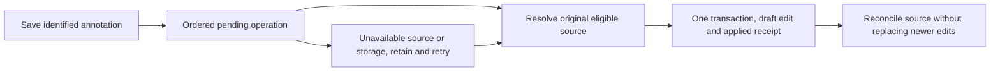

# Browser annotations: draft revisions without persistent pane ownership

Date: 2026-10-06
Status: Jesse approved the simpler direction and latest-wins draft races. This written amendment awaits review and approval; product implementation has not resumed.

## Scope and authority

Keep the existing pane-owned composer and its hidden-editor lifetime. Add only the transactional persistence needed for ordered, once-only annotation references. Use the existing `evener-mutation-outbox` IndexedDB database and composition stores. No persistent pane claims, adoption, takeover, liveness protocol, second database or two-backend draft writer is introduced.

This replaces the draft-owner approach in the [browser plan](../plans/2026-10-05-markdown-document-annotations-browser.md) and the [guarded-owner amendment](2026-10-06-browser-draft-owner-recovery-design.md), including its unimplemented plan. Keep accepted shared annotation contracts and browser source mapping. The [original specification](2026-10-04-markdown-document-annotations-design.md) and [browser scope](2026-10-05-markdown-document-annotations-browser-design.md) remain binding except for persistent draft-owner machinery and competing-draft preservation as amended below. Their no-clobber guarantees still govern annotation insertion and stale continuations; explicit competing draft edits follow latest-wins.

Jesse's ruling is: “In the case of a race, latest wins is fine.” Two independently edited drafts for one session need not both survive a competing save. There is no losing-draft archive, conflict-copy UI, automatic merge or separate persistent draft per pane. This exception does not relax annotation receipts, recipient routing, expiry, stale cleanup guards or submitted-input recovery.

## Draft writes and source lifetime

The session's latest committed explicit draft edit wins. Transactions establish commit order; wall-clock timestamps do not. Each write advances a durable session revision, including clear and recreation. Namespace reset invalidates previous revision tokens. Keep revision metadata after an empty draft so stale work cannot match a reused revision.

An explicit edit is typing, a selection change or another deliberate draft-producing action, including fork seeding. Serialize a source's accepted edits and save its current structured value. A revision conflict between explicit competing edits does not create a recovery feature. The later committed edit supersedes the earlier draft contents, including any reference text it replaces; saved annotations and terminal insertion receipts remain intact.

Hydration, acknowledgment, attachment cleanup and submission settlement are continuations, not new explicit edits. They must not overwrite or clear a newer local generation or durable revision. Typing before hydration stays visible and becomes an explicit write. A late acknowledgment cannot replace subsequent typing. Preserve text, skills/commands, meaningful absent-versus-empty mention metadata, and the existing attachment/cursor/selection ownership.

Retain `ComposerSourceState` across editor unmount and Return. Closing or replacing its pane ends annotation eligibility and prevents late publication into the replacement. Already accepted ordinary saves may finish from their immutable queued values; disposal must not silently cancel them. Do not create a retired-source ownership or recovery subsystem. Uncommitted work cannot promise survival of process death, and competing commits follow latest-wins.

## Annotation insertion

Capture opening session and actual pane/source provenance. Focus, matching text, a reused pane ID or an arbitrary same-session pane does not identify the recipient. Hidden editors remain eligible while their original source is retained. Restored legacy document panes without origin identity keep the already approved session-bound pending/copyable fallback.

Append through the eligible source using the current winning session draft revision, never the text captured when the comment box opened or a detached reader's foreign-draft fallback. Reconcile that source with the winning saved value and its queued explicit edits before preparing the append. Recheck source lifetime, local edit generation, revision, operation status and document expiry at the transaction's last abortable boundary. A stale preparation retries against current state without generating another operation or overriding newer typing.

The same transaction writes the actual draft change and the operation's applied receipt. For recovered input, it updates the actual recovery row with its identity/version guards and writes the receipt; it does not seed a duplicate ordinary draft or invoke resend. All recovery edits, replacement and discard participate in those guards.

Applied receipts are terminal. Missing acknowledgment, restart, duplicate callbacks, removing reference text, ordinary edits, clear or submission never reactivate an applied operation. If a transaction's outcome is uncertain, read its receipt before retrying. A committed receipt remains authoritative after the source closes; its late acknowledgment cannot write through a disposed lifetime.

If the original source is unavailable or cannot be identified, retain the unexpired operation for that destination and expose the saved note and copyable reference. Retry when eligible composition returns. A session revision alone does not establish original-source identity after restart. Annotation create, restore and retry cause zero send, queue, steer, session-start/resume or recovery-resend mutations.

## Persistence and existing behavior

Transfer only currently supported localStorage drafts using the approved decoder and exact inspected-byte cleanup guards. Transfer is initialization, not a new explicit edit: import only before this namespace/session has a durable draft revision. An existing revision, including an explicit empty draft, wins over migration input. Record the inspected transfer outcome durably before removing matching legacy bytes; changed bytes require a fresh inspection. Once transferred, all supported production draft writers use IndexedDB; localStorage is migration input, not a second active writer. Narrow the inactive repository rather than adding another authority. Preserve its useful transaction, namespace, revision, decoding and interrupted-transfer tests; do not activate its owner protocol.

Ordinary submission remains owned by the existing outbox. Browser submission/settlement awaits the real transactional boundary and clears only the submitted unchanged generation/backing. Preserve native's existing synchronous default and behavior. A settlement failure cannot reclassify accepted input as failed or cause a second submission.

Keep annotations independent of reading/history caches. Keep ordered operations, snapshot reference formatting, delete-on-confirmed-source-change, durable expiry cancellation and namespace isolation. Expiry never rewrites applied draft text. Save failure retains the comment and same operation in memory, labels durability honestly and retries after recovery; reading and healthy sessions remain useful. No process-death guarantee precedes persistence.

## Required evidence

Use observed RED/GREEN tests against real production logic and two repository adapters sharing one IndexedDB database. Existing paused tests are preserved until deliberately adapted to this amendment; superseded owner assertions are not evidence for it.

| Scenario | Required result |
| --- | --- |
| Hidden composer, several notes, Return | Original source retains current work; references appear once in creation order, with metadata and attachments preserved |
| Competing explicit edits | Controlled commit order proves latest-wins, with no conflict archive or restoration UI; ordinary draft overwrites never reactivate receipts |
| Typing before hydration, during insertion and before acknowledgment | Latest local edits stay visible and persist; stale preparation/acknowledgment never replaces them |
| Clear/recreate, fork seed, send/queue/steer/drain and recovery edit/discard/resend | Every supported writer participates; stale settlement cannot clear newer work, duplicate input or recreate discarded recovery |
| Close/replacement and restart around commit | Uncommitted annotation stays pending or expires; committed edit/receipt reconciles once; queued ordinary saves are not silently dropped; no replacement-source publication |
| Transaction abort, storage/open failure and interrupted transfer | No false saved/applied status, no duplicate retry, supported work retained within stated durability limits, useful operation returns after recovery |
| Source change, stale tab and namespace reset | Expiry prevents resurrection and newer-version deletion; applied text and unrelated namespaces remain unchanged |

Run `make test-api-package`, `make test-web`, `make test-web-browser`, and agentic end-to-end journeys through the actual viewer, storage and APIs. Genuine-phone selection and OS-keyboard qualification still gate completion, merge and deployment. Emulation does not satisfy that gate.

The native lane, retained evidence and exhausted three-fix cap stay untouched. No native experiment is authorized. Preserve independent task/whole-branch reviews, implementation PAR, simplification and matching-head CI/RoboRev before merge. Update the browser/shared composer contract, annotation guide and subsystem responsibilities with verified implementation, not with this proposal.
