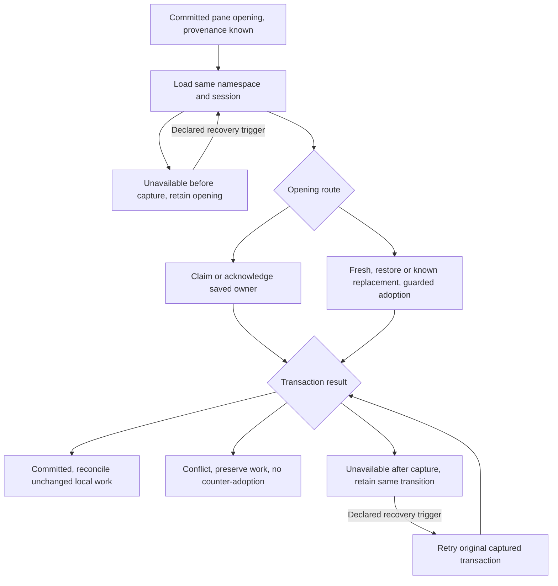

# Guarded browser draft recovery

Date: 2026-10-06

Status: Jesse approved automatic crash recovery and the live-tab transfer trade-off. This written amendment awaits independent review and written approval. Product integration remains paused.

## Scope and authority

This amends only composer opening and draft-owner recovery in the [browser annotation design](2026-10-05-markdown-document-annotations-browser-design.md) and its inherited composer-preservation requirements. The [browser implementation plan](../plans/2026-10-05-markdown-document-annotations-browser.md) remains binding elsewhere. Keep the completed shared contracts, source mapping and inactive draft repository accepted.

Reopening a composer must recover its persisted structured draft automatically after normal closure, reload or a crash. A newly opened source may take ownership from a live tab. Preserve saved work and keep the displaced tab's unsaved work recoverable. Protecting that tab means preserving its work and rejecting stale writes; uninterrupted write ownership is not promised.

Use the existing transactional draft authority. Do not add dead-tab detection, locks, heartbeats, leases, a service worker, hub endpoint, storage schema/version, compatibility format or HTTPS-only requirement. Keep existing supported-browser and served-origin requirements. No new browser API is required by this design.

## Opening is an explicit owner transition

An opening belongs to a committed pane lifetime, not a mounted React component. The workspace establishes its provenance before asynchronous hydration. A source cannot infer permission from a pane ID, a row read, silence or a claim failure.

| Opening | Required behavior |
| --- | --- |
| Existing lifetime remount, focus change or Return | Retain the same source and owner. No new adoption. |
| Restored pane with saved owner metadata | Retain that owner ID. Claim an absent/unclaimed row or acknowledge the matching owner. If the current durable owner differs, the explicit restore-opening may adopt that exact owner/token using the retained ID. Do not generate another ID merely because the process restarted. |
| Known local pane replacement | Give the replacement its new owner identity and use the identified predecessor's complete token and owner for explicit adoption. Establish accessible preservation of its dirty work as specified below before runtime serial/alive guards retire the predecessor. |
| Genuinely fresh pane, including reopen without saved owner metadata | Generate a new owner ID. Load the same browser-namespace/session draft. Claim an absent/unclaimed row; explicitly adopt an owned row using the exact loaded predecessor owner and complete token. |

The fresh/restore-opening route selects claim or adopt from its established opening provenance and the loaded row. It does not convert arbitrary competing `claim` failures into takeover. A claim from an unrelated owner still loses without changing structured work.

Adoption checks namespace incarnation, persistent revision, owner revision, expected predecessor owner and the live opening guard in the existing transaction. A successful different-owner adoption changes only ownership and owner revision. Preserve text, ordered skills/commands, mention presence and positions, actual backing and existing attachment ownership. A same-owner acknowledgment does not create a new ownership generation.

A conflict leaves the durable row unchanged. Retain local work and reconcile the result. Do not reload a newer token and automatically counter-adopt, repeatedly transfer ownership or replay an old whole-value snapshot. Ordinary edits, subscriptions, focus, annotation retries and submission cleanup never start adoption.

A storage fault leaves opening recovery pending. If the initial load fails before a transition is captured, retain the opening provenance and local work. On the already declared composer-open/foreground recovery trigger, retry that load and capture its first transition under the same opening guard.

After capture, retry only that same transition with the original expected token and predecessor, rather than creating a new takeover attempt from refreshed ownership. A read may recognize an already committed transition for the same opening; it cannot authorize transfer from a different current owner. Distinguish an aborted transaction from interrupted acknowledgment of a commit. No timer or tight retry loop is introduced.

Opening provenance chooses the transaction. Its result decides whether the source can publish the claimed snapshot, must preserve conflicting work or awaits storage recovery. Neither a subscription nor a dirty editor becomes a new opening.

## Preserve local work through displacement

The durable compare-and-swap fence protects persisted work. Source integration must separately protect memory-only work:

- Keep the synchronous structured projection and its dirty/edit revision while hydration or a write is unresolved. A late load or subscription never replaces newer typing, skills/commands, mentions or attachments.
- If adoption commits while the displaced tab has a write in flight, reject its stale owner/token. Keep its latest local structured value available in that tab as recoverable work; it remains visible and copyable through the composer. Never silently replace it with the new owner's draft or label an uncommitted edit saved.
- Before local close or replacement disposes a dirty predecessor, retain its full structured projection, dirty/edit revision, actual backing and existing attachment bag/generation in user-accessible in-process recovery/conflict state for the original namespace/session. Complete that preservation before source disposal or attachment-operation reset. Reopening the original session must expose the retained work even while its write remains delayed or faulted. Work held only in an unreachable disposed source is insufficient; retirement must wait until accessible preservation is established.
- Keep the persisted value authoritative until a separately guarded reconciliation commits. Retaining a retired predecessor's unsaved work neither permits disposed-source writes nor authorizes automatic counter-adoption or redirection to another session.
- Reconcile identified later edits against an acknowledged committed snapshot only while ownership still matches. After ownership is lost, retain the local conflict instead of reacquiring automatically or overwriting the new owner's value.
- The opening source's edits made before adoption completes receive the same protection. Adoption carries the persisted predecessor value; it cannot replace the new source's dirty projection or silently discard either value.
- With duplicated saved owner IDs, complete tokens still fence stale writes. Treat an owner ID as identity, not proof of a unique live tab. Preserve losing local work, including same-text metadata edits.
- Keep existing attachment bag/generation and exact marker-cleanup guards. Ownership transfer creates no additional attachment durability or fabricated backing bytes.

Memory-only edits have the existing process-death limit until persistence succeeds. This amendment promises automatic recovery of persisted work, not recovery of unsaved memory after that tab crashes. Healthy reading and other sessions remain usable during pending recovery or conflict.

Keep the original annotation destination and pending-handoff rules. This transition cannot redirect a note because focus changed or a pane ID was reused. Hold handoffs during unresolved hydration/typing. Keep the full submission guard, actual recovery backing and atomic recovery-resend settlement; adoption cannot make accepted input send again or stale cleanup clear newer work.

## Required proof before accepting the cutover

Add red-first tests through the real source/pane integration and two repository adapters sharing one IndexedDB database. Keep the initial losing-claim and fork seed-before-open assertions strict. Qualify actual tab behavior in the existing browser journey gate.

| Scenario | Independent outcome to assert |
| --- | --- |
| Close/reopen, crash/reload with and without saved owner metadata, including a saved ID that differs from the current durable owner | Same persisted structured value and actual backing return automatically, with the appropriate retained or new owner and zero input mutations. No liveness signal is needed. |
| Fresh opening against a live owner | One full-token adoption preserves saved work; stale writes and cleanup from the displaced source cannot change the new owner's value. |
| Dirty losing source, delayed subscription and stale write | Its full latest local structured value remains recoverable. The winning durable value is unchanged; no counter-adoption occurs. |
| Dirty local predecessor with a delayed or faulted write, actual committed-pane removal on close/replacement, then original-session reopening | Independently assert accessible preservation before disposal and recovery of its full structured work afterward, including same-text metadata-only edits and existing attachment ownership/generation. Release the old callback after removal. The winning persisted value/backing stays unchanged; stale writes and cleanup cannot discard either value or attachments, redirect work or counter-adopt. |
| Typing before hydration/adoption and after commit before acknowledgment | Late results preserve both persisted predecessor work and identified newer local edits. No old whole-value replay. |
| Two openings racing from the same captured predecessor/token, stale token/namespace/predecessor | Only one matching ownership transition wins. Conflict changes nothing and does not trigger another adoption. |
| Duplicated restored owner IDs and metadata-only edits | Complete-token races preserve both values; a stale same-owner writer cannot overwrite the newer value. |
| Initial load failure before token/predecessor capture | Pending recovery retains opening provenance and full local work. The next declared trigger retries the initial load under that opening guard and captures its first transition, not a refreshed previously attempted adoption. |
| Storage abort after capture, interrupted acknowledgment and next declared recovery trigger | Aborted transition changes no durable work. Retry retains its captured guard; committed work is recognized without another ownership transfer or duplicate input. |
| Focus, React remount, Return, annotation retry and ordinary claim failure | No adoption is initiated. Existing correct-destination, attachment and zero-mutation assertions remain strict. |

Unit/IDB evidence does not replace actual two-tab/crash browser qualification or the mandatory genuine-phone keyboard qualification. Keep source/artifact identities and full RED/GREEN, regression and storage-fault evidence. Do not present this design or the accepted inactive repository as implemented recovery.

## Implementation boundary

Keep Task2B's existing source, pane, repository, outbox and submission paths. Its bounded written plan change must specify opening provenance and local preservation before the same stopped writer resumes. Preserve the existing schema, accepted contracts, full supported-writer cutover, atomic recovery-resend ruling and minimal browser `threads.ts` forwarding scope.

After implementation, update only the affected composer/recovery contract and browser/shared-input subsystem responsibilities with verified current behavior. Annotation persistence, origin capture, UI and final journey tasks remain separate. The frozen native lane, evidence and exhausted native fix cap remain untouched. Genuine-phone qualification still gates completion, merge and deployment.
