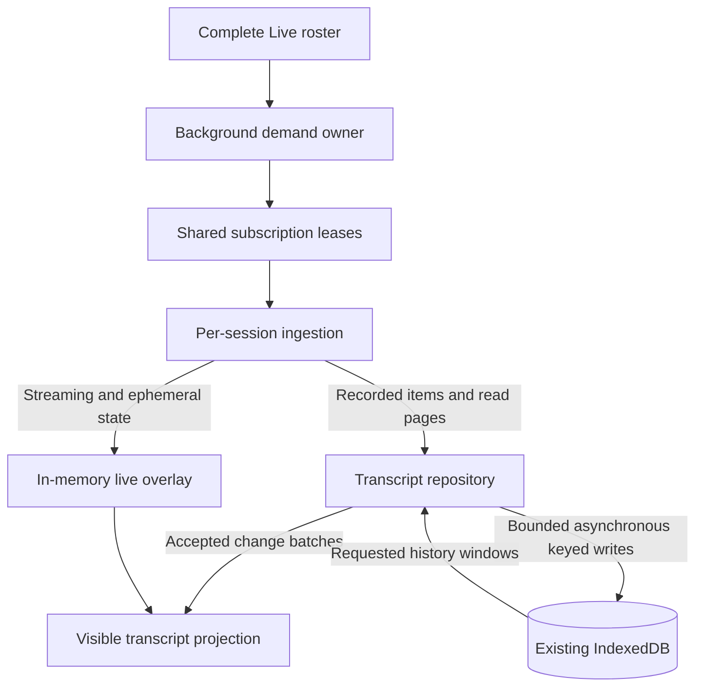

# Entry-backed background transcripts

## Intent and approval boundary

Opening a Live session should show the transcript the browser has already
received, without a new network read while its subscription and local history
remain healthy. Store recorded items individually in IndexedDB. Keep active
output in memory and reuse existing discovery, subscription and rendering code.

Jesse chose database-backed history and explicitly allowed unfinished active
output to exceed the background memory budget. The design bounds completed
history and pending completed writes, not total browser RAM. It provides no
streaming spill store and does not discard active output to enforce that budget.

Jesse also accepted refetching after a crash. One repository publishes accepted
recorded updates immediately and persists them asynchronously. Local storage
never gates display; only successful commits advance cached coverage.

Jesse chose these constraints and authorized writing this specification. His
approval of the written specification is still required before planning. The
written plan and execution method then require separate approval.
Nothing here authorizes publication, a main merge or deployment.

This design supersedes the storage architecture in
[the session-checkpoint specification](2026-10-05-background-live-transcripts-design.md)
and its delivery plans. Preserve their work and evidence. Reuse code that serves
this design; do not keep whole-session persistence behind an entry-shaped API.

## Scope

- Browser UI, including narrow-screen use, for every session in the complete
  Live navigation resource, including idle sessions and attached remote hosts.
- Background discovery, recorded-history persistence, memory-only active output,
  local opening, older paging, reconnect, cache clearing and source removal.
- Existing AppWire reads and notifications, additive subscription leases and
  shared identity, merge and display rules.

Delegates and archived sessions do not acquire automatic background demand.
Explicitly opened panes retain their existing behavior regardless of membership.
Native and CLI clients keep their current ownership and storage behavior. Shared
helper changes must preserve their behavior. Navigation stays shallow; this work
adds no activity-collection reads or activity ownership inferred from rail rows.

No protocol changes, wildcard subscription, service worker, cross-tab leader,
new database, outbox changes or persistence of streaming chunks are proposed.

## Source model and reusable parts

The protocol already separates recorded content from live state:

- `HistoryUpdatedParams` carries the full current form of changed items and
  item-free turn metadata. `server/thread_history.go` projects these from recorded
  entries. `thread/read` and `thread/turns/list` supply history windows.
- Recorded items have stable transcript keys, positions and versions. A later
  tool result updates an earlier recorded item. Storage therefore uses versioned
  upserts, not an append-only list of completed UI rows.
- `internal/appoverlay/overlay.go` owns one open model round with separate text,
  reasoning, preview and tool slots. The live tail can contain several items.
  Recorded history covers streams by round, previews by call and tool state by
  completion identity. Notices have their existing separate lifetime.
- The shared reducer derives display turns from recorded history plus overlay.
  Reuse its identity and coverage rules. Browser publication must also honor the
  pending-retirement contract below; immediate removal on `overlay/end` cannot
  bypass a recorded replacement that has not yet reached the browser.

Reuse candidates and their boundaries:

| Existing code | Role in this design |
| --- | --- |
| `stores/backgroundTranscripts.ts` and shared navigation demand | Discover all Live refs without expanding visible rail pages |
| `appwire-client/typescript/threadSubscription.ts` | Share additive membership among background, pane and activity owners |
| `appwire-client/typescript/reducer.ts` | Reuse or extract item decoding, version/identity comparison, history acceptance and overlay coverage/display rules |
| `stores/idbConnection.ts` and cache transaction helpers | Reuse open deadlines, transaction completion and clear fencing |
| `useTranscript.ts`, transcript renderers and `HistoryPaging` | Preserve display, scroll, Find and reader-demand behavior |
| Existing recovery and browser fixtures | Preserve applicable behavior assertions, adapting storage-specific setup to entry rows |

Replace whole-session record encoding/writes and the coordinator that restores a
background model to fold an update and rewrites that model afterward. Keep
proven behavioral tests when their contracts still apply; remove neither a
failure nor a requirement merely because its old fixture names a checkpoint.

## Architecture and ownership

The server transcript remains authoritative. The repository is the browser's
single owner of recorded-history ingestion and persistence. It accepts a batch
once, publishes it to open readers and queues entry-sized writes. Storage success,
failure or delay changes cache readiness, not that publication. A commit never
replays content or retires overlay a second time. Cached reads pass through the
same owner and merge rules; there is no competing socket-to-UI history writer.

A visible view can be current with the server before its recorded content is
cached. Local-only opening additionally requires complete cached coverage plus
any still-retained accepted changes. Losing uncommitted cache work in a crash is
acceptable: the next browser lifetime reconciles from the server.

Each desired session has a small coordinator for identity, subscription demand,
read ordering, overlay and recovery. A background-only coordinator holds no
completed history after its writes finish. Mounted readers hold the history
windows they need; multiple panes share session ingestion and subscriptions,
while keeping their own scroll and paging intent.

Keep foreground action admission and mutation ownership separate from history.
Neither loading cached rows nor acquiring background demand may enqueue, resume
or dispatch a mutation. Cached capabilities and running flags never grant live
authority after a connection break.

## Entry storage

Extend the existing `evener-session-cache` database. The logical record types are:

| Record | Identity and contents |
| --- | --- |
| Item | Resolved host/session identity, history incarnation and transcript key; ordered position, version and complete recorded item payload |
| Turn | Same history identity plus turn ID; versioned status and other turn metadata, with no embedded item list |
| Coverage | Read-established ranges, committed live-suffix extensions and their server paging boundaries for that history identity |
| Session cache metadata | Requested-ref binding, resolved identity, history identity, saved/access times, byte totals and format version |
| Clear metadata | Existing durable clear epoch |

Requested refs stay opaque and client-qualified. A stable alias's requested
subscription address is distinct from the resolved session whose rows it shows.
Do not key data by display turn number, a bare session ID shared across hosts,
or a generated display-item ID when a transcript key exists.

The item payload preserves the existing codec's omitted-text and identity-only
semantics, images, structured tool results, reasoning and error fields. Absence
must not become a supplied empty value. Persist source records, not duplicate
derived display turns, promises, local outbox state or UI intent.

A history update transaction reads only its affected keys and the metadata
needed to validate and account for the change. It commits item/turn upserts,
coverage changes when justified, and byte totals atomically. An older item or
turn version cannot replace a newer one within the same history identity.
Equal-version handling preserves richer known content and existing reducer
semantics. Reuse the shared rules in a bounded form; do not duplicate them in
storage and display code.

A real read page establishes coverage. Accepted recorded notifications may
extend its live suffix while the coordinator has uninterrupted subscription
continuity under the same authority. Commit the appended rows and the extended
range boundary, including the represented history snapshot, in one transaction.
That durable boundary makes the suffix queryable after completed batches leave
memory; the tab's continuity authority remains in memory, not in a certificate
another tab or a later connection may adopt.

An isolated update to an older item establishes no intervening coverage. A
snapshot length alone proves no range complete. Disconnect, missing input or
replacement stops suffix extension until authoritative reconciliation establishes
a new baseline. No transaction may report a range complete before its rows have
committed. If pending writes are abandoned, later commits cannot certify across
that missing work, even when an open reader received every update. Reconcile the
gap before restoring local-opening readiness. Queries use the position index
within known coverage, rather than enumerating all rows on every open or append.

The history cache may be shared across tabs. Each tab retains its own connection
and read-generation authority in memory. Transactions compare durable clear
state and stored versions; one tab cannot regress another's item or erase its
coverage with a shorter same-identity window. An alias replacement selects a
different resolved history. Another tab's write is not proof of this tab's
subscription continuity. A read or write that races with replacement must not
publish into the replacement binding.

## Ingestion and the live-to-recorded handoff

1. Classify input under the resolved identity, boot generation, epoch and local
   connection/read lifetime using existing acceptance rules. A newer invalidating
   signal starts authoritative recovery; it does not mix incompatible rows.
2. Send recorded items from notifications, latest-window reads and older pages
   through the same repository acceptance path. A response cut orders input;
   it does not prove that a latest window contains every earlier recorded change.
   Preserve accepted, compatible pre-response upserts outside the returned window
   in committed rows or bounded pending work. Within the window, merge by item
   and turn version without regressing newer content. Apply the response cut to
   overlay-delta replay so already represented deltas are not appended twice.
   Invalidation and authoritative replacement revoke incompatible work through
   their identity/lifetime fences, rather than blindly unioning old input.
3. Apply streaming deltas, resets, tool execution state and ephemeral notices
   directly to the live overlay. Do no IndexedDB work per streaming delta and
   load no recorded background history to apply it.
4. Publish each accepted recorded batch and retire the overlay content it covers
   in the same publication. Queue its keyed persistence work without waiting for
   a transaction. Never show both copies, briefly remove both copies, or append a
   delta twice. Refusing or aborting a cache write does not undo accepted content.

`overlay/end` closes the round's streaming lifetime; it is not proof that its
recorded replacement has reached the browser. Keep uncovered slots pending
retirement, including when end precedes history. An end frame cannot remove a
pending handoff. Retire covered slots atomically with publication of their
recorded replacement, whether history or end arrived first.
Once that replacement is published, its pending cache write requires no overlay
retention or separate rendering mode.

If end leaves slots with no known replacement, schedule a coalesced, bounded
authoritative reconciliation after that end. Each attempt uses the existing read
deadlines and a fixed history boundary; later traffic cannot extend it.
Existing reads/pages and the
authoritative overlay must establish their disposition: publish recorded content
before removing covered slots, or apply the source's reset/interruption outcome
for genuinely unrecorded work. Absence from a latest window alone is not proof
that an older replacement does not exist. Obtain the needed page coverage within
the bounded attempt; if it cannot be established, leave the history unverified
and enter recovery instead of declaring the slots safely covered or draining
indefinitely. An explicit stream reset still discards that superseded attempt;
notices keep their separate lifetime.

Retained handoff payload becomes completed-write work when its recorded
replacement or round end arrives, whichever comes first. It counts against that
queue, not an indefinitely extended active-output exception. Publishing the
replacement releases the covered handoff bodies; only pending recorded writes
remain. Failed or incomplete reconciliation retires background pending-retirement
bodies and keeps any held foreground content as a stale provisional view. Paced
recovery can retry without retaining those background bodies. Queue overflow
follows the same policy. A cache-write failure alone leaves an already accepted
foreground replacement current under the ordinary live acceptance rules.

Coalesce complete updates only where version and item semantics permit it.
Streaming updates use the overlay's ordering and reset rules; they are not a
replay journal. State kept solely for accounting uses scalars and identities,
not hidden copies of item bodies or old whole-session models.

## Opening, paging and retaining readers

A foreground open joins the session coordinator and captures a fixed boundary
in that session's accepted input. Attach the reader before starting the local
query, retaining the session's pending recorded updates and subsequent accepted
changes until the query is merged. Load the latest local history window and merge
those updates and overlay state through the captured boundary before marking the
pane current. Use the shared version and richness rules: a stale local result
cannot overwrite a newer accepted item. Retained opening work belongs to the
foreground reader, even if its write commits and leaves the background queue
before the query returns. A racing newer change either joins that publication or
follows it once. Opening never waits for other sessions or for input to stop.

A caught-up session with healthy local coverage needs no activation
`thread/read`, even when no foreground model was resident. An already mounted
current model can be adopted without rebuilding it. Pending writes need not
finish if their accepted payloads complete the opening boundary. If that work
was dropped or local coverage is incomplete, reconcile from the server rather
than labelling a partial local view current. Local reads remain asynchronous and
respect the lookup deadline, replacement and Clear fences.

Older demand first uses contiguous cached coverage. A missing range uses the
existing server cursor or supported position-based paging request. Publish the
accepted page to its reader immediately; commit its rows and boundary before
extending cached coverage. Never invent an opaque cursor or retain a cursor that
skips discarded rows. Same-connection updates and local close/reopen retain cached
older pages and their usable boundaries.

Open readers keep their loaded pages, scroll anchor and Find demand during
background history reclamation. Their models may outlive disk eviction. Loading
another session or adding a background owner does not acquire or cancel their
paging intent. Reconnect retains the existing replacement rule: missed events
require a fresh latest window, with its returned cursor, and older pages can be
read again. Previously cached rows cannot silently certify that missed range.

## Resource policy

Preserve the existing injectable starting limits where they still apply:

| Resource | Policy |
| --- | --- |
| Background recorded-history residency | None after completed writes, apart from bounded in-flight work |
| Completed-write queue and retained write payload | 4 MiB aggregate, including pending handoff and ended-slot bodies |
| Active unfinished output | Memory-only, allowed above the background budget by Jesse's decision |
| Background database work | One bounded batch at a time, fair across ready sessions |
| Background network hydrations | At most two issued client reads awaiting settlement |
| Disk cache | 32 MiB aggregate encoded records, 14-day TTL |
| Local opening wait | Existing 250 ms lookup deadline before ordinary recovery can proceed |

The former 16 MiB whole-model residency budget and 32 MiB temporary restored
model are not new storage tiers. Do not recreate them behind the repository.
One decoded incoming response and IndexedDB's transaction copies are transient
costs outside the queue limit. A response larger than queue capacity must be
processed as the sole immediate bounded batch if it fits the disk limit, or
refused for caching under the capacity policy below; it must not enter an unbounded
staging list. Neither case delays foreground publication. Account and report that
single-batch exception separately. Foreground-held content, JavaScript overhead,
metadata and active output also prevent a total-RAM claim.

Account completed payload at item/batch boundaries without serializing an
entire session on each delta. Track active payload separately so measurements
show the chosen exception rather than hiding it. Metadata is reclaimed when
its lifetime ends and does not accumulate one entry per historical event.

Disk pressure first reclaims expired and unused history, preferentially retaining
Live sessions. Evict a session's cached history and coverage together rather than
creating silent holes. A reader's in-memory pages survive. If desired history
cannot fit, mark its local backing unavailable; foreground publication continues
through the same repository. Finite storage is an explicit exception to local-only
opening; retaining active output above budget does not make disk capacity
unlimited.

Queued background work yields to foreground demand. Cancellation retires queued
work and its publication authority promptly. Already issued client reads retain
their capacity charge until response, rejection or the existing client deadline;
a counter change cannot manufacture an available network slot.

## Failure, reconnect and release

### Storage failure and capacity

Open transcripts and live output remain usable when IndexedDB stalls, fails or
cannot hold a valid recorded item/window, including on first opening an uncached
session. The same repository publication path works in all these cases. Failed
or refused writes never advance cached coverage. Storage recovery neither
republishes an accepted batch nor replaces a newer foreground view with a cached
one. Stale provisional content stays labelled stale until reconciled.

Foreground-held content uses the existing reader memory exception. Background
coordinators do not retain those completed bodies after the bounded attempt.
Keep completed retry work within the queue bound. On overflow, retire affected
incremental cache work, revoke local-opening readiness, and schedule paced
authoritative recovery. An open reader that received all accepted updates remains
usable and may remain current. A reader missing input still needs reconciliation.
The server's recorded transcript remains the source for what the cache could not
retain.

An indivisible recorded item can exceed the disk budget even when storage is
healthy. Memoize that capacity refusal for the unchanged record/window within
the cache lifetime. Do not reread or retry encoding/writing solely because it
still cannot fit. Ordinary foreground reads and live updates continue. Reconsider
caching when the recorded item/window or capacity changes could remove the
refusal cause, the history is replaced, or a new cache lifetime begins. Freeing
unrelated rows cannot make an item above the total disk limit fit. A streaming
delta alone does not make the same oversized recorded item eligible.

Retry transient storage faults automatically with bounded backoff while demand
exists. Restore durable operation only after eligible storage succeeds and
authoritative reconciliation completes. A successful probe alone is not recovery;
foreground usability does not depend on this durable recovery succeeding. A
failed host or session cannot block healthy sessions.
Do not discard unfinished active output merely to satisfy a memory counter.

### Disconnect and replacement

Disconnect, resync, browser reload and alias rebind revoke live currentness.
Preserve readable content as a stale seed and reconcile through the existing
subscription/read handoff. Boot generations and epochs keep their existing
comparison semantics; request generations are local ordering, not global
cross-tab versions. Same-generation authoritative replacement still retires
older work even if a local receive sequence has not advanced.

Live overlay is not persisted. A browser crash or reload may lose unfinished
local display state and recorded updates whose cache writes had not committed.
Keep successfully cached history as a stale seed; authoritative reads reconstruct
what the server holds. Refetching is normal. This cache is not a crash-proof
notification journal.

### End of background demand

Release background demand only after a coherent complete Live sweep proves
absence. Preserve pane, activity and mutation owners. When the final transcript
owner is retiring, reconcile one fresh final read if the source is reachable,
then seal a finite accepted-input boundary and finish its recorded writes before
releasing the subscription. Graceful release still attempts to cache that finite
boundary; foreground publication never waits for this flush. An older in-flight
read does not substitute for this final reconciliation. Later input beyond the
sealed boundary cannot create an unbounded drain; a renewed owner cancels
retirement and resumes ordinary input.

On read/storage failure, retain successfully cached recorded content as stale,
retire the failed work and finish release. Unrecorded overlay has no new disk
persistence guarantee after its last owner is gone. Never hang shutdown, invent
a successful final save or publish a retired completion into a new lifetime.

## Cache migration, clear and deletion

Bump the existing database schema and convert compatible recorded-history blobs
into item and turn records, with coverage only where provenance proves a range.
Migration is the sole permitted bulk read of a legacy session blob. Process one
legacy record at a time; remove its source only in the transaction that commits
its complete conversion. Interrupted or failed conversion leaves the source
intact for retry. Preserve compatible item content and omitted-content markers.
Imported rows are stale history, never restored live authority.

The existing flattened blobs and their single opaque `olderCursor` do not
identify which rows came from pages and which came from isolated notifications.
Import those rows as stale item seeds with no certified ranges. This is an
explicit exception to loaded-page-boundary preservation where legacy provenance
is absent; it does not permit dropping compatible rows. A legacy cursor alone
cannot authorize skipping an unverified interval. Obtain usable boundaries and
cursors from authoritative page reads, without decoding or inventing opaque
cursors. A fresh latest window validates only its returned range, not every
imported older row. Preserve older seeds while demand fills missing ranges.

Preserve compatible recorded portions of any prior current-state records, but
do not migrate their streaming overlay or continuity certificates. Coalesce
shared recorded identities under the version rules. The combined old/new cache
obeys the existing byte/expiry policy. Migration failure does not erase the old
cache, drafts or outbox and does not prevent ordinary foreground server use.
Old tabs use the existing schema-version fence; no dual-version writer is added.

Clear atomically removes all history record types and advances the durable clear
epoch. Every write, migration and asynchronous publication respects that fence.
Same-tab Clear immediately revokes pre-clear publication/persistence claims.
Cross-tab Clear retains the existing bounded-staleness contract: reject old-epoch
writes, invalidate on observation, and recheck the epoch after a local opening
within the lookup deadline. Do not promise atomic UI publication across tabs.

Clear suppresses persistence for the existing cache lifetime. Background
rediscovery, reconnect and successful storage probes must not undo it. Existing
foreground/history/mutation holders keep suppression until they release; after
those holders are gone, a new explicit foreground acquisition and authoritative
read may establish a fresh cache lifetime. A new browser lifetime may do so too.
Visible content and active output remain usable while caching is suppressed.

Session deletion cancels queued work and removes its cache records. Late reads,
writes, pages and migrations cannot resurrect it. Client replacement and teardown
retire their own publication claims. Outbox and draft stores remain independent.

## Whole-journey verification

Use a scripted provider only at the LLM boundary, with real daemon, hub, AppWire,
IndexedDB and browser rendering below it. Default tests require no credentials
or live provider. Unit tests may use the existing external-dependency seams,
including fake IndexedDB and controlled clocks. Assertions name user-visible
content and actual storage/transport effects, not internal success counters alone.

Required evidence:

1. **Unopened to current pane:** record history, stream text/reasoning and tool
   output while a Live session is unopened. Open it from local entry rows plus
   overlay with zero activation reads and correct content/running state.
   Include enough completed appends to pass the original read window, after their
   write payloads have been released; verify the committed suffix is queryable.
2. **Entry-sized updates:** with substantial cached history and no background
   display model, append new items and settle an old tool. Inspect actual IDB
   requests to prove only affected rows/metadata change and no whole history is
   loaded or rewritten. Compare rendered and stored content with producer input.
3. **Display before persistence:** hold a real transaction, deliver a recorded
   replacement and later input. Assert immediate recorded display and overlay
   retirement while the transaction is still held. Commit or abort; neither may
   replay or roll back visible content. Cached coverage advances only on commit.
   Include text, reasoning, previews, tool completion, retries/resets and a
   same-sequence authoritative replacement.
   Exercise both end-before-history and history-before-end with commit held.
   End a genuinely unrecorded/interrupted round and prove finite disposition,
   including reconciliation failure and a replacement outside the latest window.
   Race a local opening query with pending writes and newer accepted input;
   completing the query after those writes settle cannot regress or omit content.
   Reopen after losing uncommitted cache work and recover from the server without
   treating the old cached boundary as current.
4. **Memory exception:** exceed an injected background threshold with unfinished
   output. It remains usable in RAM and causes no streaming persistence or
   pressure-induced reread. On recording, completed-write accounting applies;
   after commit no background completed body remains retained by a hidden model.
5. **Paging:** load multiple server pages, retain a visible item from a later
   page, close/reopen locally and continue paging without holes. Repeat after
   refresh and reconnect; prove the earlier item remains recoverable through the
   new boundary. Include an isolated old-item update outside cached coverage.
   During same-connection refresh, receive an old tool completion before a latest
   response that excludes it; the compatible completion must survive the cut.
6. **Ownership and discovery:** more than two Live pages, idle and attached-host
   sessions, mixed/reordered/failed sweeps, two panes and activity holders. Preserve
   visible rail boundaries and foreground convergence. Background work sends no
   mutation and never releases another owner's subscription.
7. **Recovery:** stall/abort/quota-fail real storage operations through the proper
   test seams, overflow completed work, then restore storage and source access.
   Prove automatic return to usable durable history, preserved visible work,
   bounded pending work and progress for an unrelated healthy session. Distinguish
   simulated quota faults from an actual browser quota measurement.
8. **Identity and competing work:** reconnect, resync, alias replacement, multiple
   tabs, Clear, deletion and late completions. No old binding publishes into a
   new one, no older version replaces newer content, no clear/delete is undone,
   and cached authority cannot dispatch input.
9. **Migration and capacity:** convert real legacy record shapes with multiple
   pages and omitted text, interrupt conversion, retry, and inspect row identity
   and coverage. Test TTL/disk eviction and oversized records without erasing
   held reader state or manufacturing complete ranges.
   Include multiple loaded pages plus an isolated completion below them: preserve
   every compatible row without certifying the intervening gap. Open a completed
   item larger than the disk budget with healthy storage and no held reader.
   Prove usable authoritative content, atomic overlay retirement, no unchanged
   oversize retry/read loop, and durable recovery when the content becomes eligible.
10. **Final release:** emit final recorded content during navigation removal,
    hold an earlier read/write, fail final reconciliation, and reacquire during
    retirement. Prove the fresh final read, finite release, persisted accepted
    boundary where successful, and honest stale recovery on failure.
    Include a compatible old-tool completion received before the final response
    but outside its latest window; successful retirement must persist it too.

Reusing the existing browser workload is useful; its blob-specific residency
milestones are superseded by actual entry-storage and overlay assertions. Keep
historical failed-run evidence. Do not weaken later user-visible assertions or
change pressure data merely to make the new harness pass. Use awaitable lifecycle
boundaries rather than sleeps, widened timeouts or forced eviction hooks.

## Delivery and documentation

The implementation plan must deliver a small end-to-end path first: one real
session's recorded rows plus streaming overlay, immediate recorded handoff with
asynchronous writes, then local opening. Add paging, complete-Live ownership,
failure recovery and migration in independently verifiable increments. Code and
probes use Jesse's selected author model; review does not authorize a stopped
repair loop to resume.

Update `docs/product/subsystems.md`, the owning web/cache guide and affected
shared-client contracts alongside implementation. Evergreen docs describe only
verified behavior. Keep this specification, its future plan and retained review
and failure evidence separate from those references.

Completion requires the entry-storage journey and recovery evidence above,
applicable shared-client regressions, targeted checks, independent review and
simplification. Written-spec approval permits planning only. Implementation and
publication remain separately gated.
