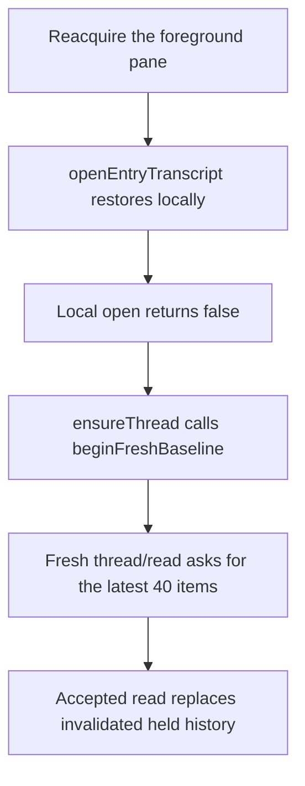

# Preserve loaded transcript history when a browser pane reopens

## Intent and scope

A session pane that remains open in the workspace must retain the history the
user has loaded when a narrow layout remounts it or the user switches away and
back. The user must not page through that history again because the browser
reclaimed its background bodies.

Jesse chose a separate PR for this repair. It addresses
[frontend history preservation](https://github.com/prime-radiant-inc/evener/issues/4681).
The hub relay deadlock repair remains in its own branch and PR. This document
proposes the frontend behavior and proof obligations for Jesse's approval; it
does not claim that the cause has been reproduced in a unit test or fixed.

Affected clients: desktop and narrow-screen **web hub** session panes. Native,
TUI, server protocol, relay routing and daemon behavior are outside this repair.
Production deployment or restart requires separate authorization.

## Evidence and remaining uncertainty

The real browser journey produced 240 loaded items after reconnecting and
paging older history. At 420px, switching away and back left 94 items. Of those,
54 matched original item objects and 40 were new notices. Waiting for cache
work to settle did not restore the missing range. This proves a persistent
browser-model contraction, not deletion of the server transcript.

A captured request stack identifies this path:



The source read replaces history because `beginFreshBaseline` invalidates the
held model. The unanswered question is why the local open returns false.
Repository currentness and the store's retained-body fallback are separate
checks. A recovery flag observed after `beginFreshBaseline` cannot establish
which check originally failed.

Investigate these hypotheses in order before choosing a production change:

1. The bounded local restore omits a body needed by the retained-body fallback,
   after background reclamation removes that body from memory.
2. Cache item rows exist, but missing turn metadata or a version mismatch
   prevents the requested body from reaching the restored display.
3. Coverage or authority at the captured opening boundary is rejected, and the
   retained-body fallback cannot preserve the usable loaded range.
4. The local-open deadline, a caught exception, or a concurrent lifetime change
   ends restoration before the necessary rows can be published.

Capture the first failing key and structural decision data before invalidating
the baseline. Do not log transcript payloads, credentials or authentication
URLs. If a smaller fixture exposes only a 200-item display limit, distinguish
that result from the observed 94-item recovery path.

## Required behavior

### Retain a still-open pane's loaded range

- After older pages have loaded, returning to the same logical workspace pane
  restores every previously loaded keyed body in its accepted history range.
  Desktop-to-mobile host replacement and temporary foreground reader count
  zero do not by themselves abandon that range.
- Compare item identity, position, version and complete recorded payload,
  including tool arguments, output and status. Identity-only placeholders do
  not count as restored content. Explicit-empty bodies and valid tools with
  omitted text remain valid content.
- Local restoration may be asynchronous. After it settles, the loaded range is
  present without another paging gesture. The existing local-opening hold must
  settle on success, recovery and cancellation.
- Accepted updates may add content or replace an older version. They must not
  regress versions, duplicate items or silently remove unchanged loaded bodies.
- A healthy, authoritative local restore requires no activation `thread/read`
  or server older-page request. A missing certificate alone must not erase
  usable bodies that the existing authority rules allow the browser to retain.
- Preserve the same logical pane's semantic reading point across responsive
  host replacement using the existing reflow policy. Width changes preserve
  approximate progress through the entry's usable reading depth or its visible
  tail, as documented in `docs/web-ui/README.md`. Mounted and remounted readers
  follow the same policy; an identical pixel offset is not required when entry
  geometry changes. Height-only changes retain the existing reading-line rule.
  A genuine close followed by a new pane still lands at latest under the
  existing scroll contract.
- Placement must distinguish an in-flight local body restoration from a settled
  empty or anchorless projection using the existing ref-scoped opening state.
  Empty geometry or missing source candidates alone cannot establish readiness.
  Keep retained placement pending while bodies are opening, then retry against
  accepted content and committed geometry when that opening settles. Success,
  recovery, cancellation and supersession must not leave an empty pane waiting
  forever or let obsolete placement override newer reader intent.

### Keep bounded background operation

This is the builder's proposed scope boundary, not a new retention policy:

- First opening a background-only session keeps the existing latest-200-body
  promotion behavior. Older retained identities remain pageable locally.
- Preserve the existing resident and pending byte budgets, unfinished-output
  exceptions, and background body reclamation. Do not retain all transcript
  bodies in memory merely to make reopen pass.
- Restore the previously loaded foreground range through the existing
  repository, retained history and reader ownership. Choose the smallest
  mechanism after the failing decision is measured.
- Do not add a second transcript owner, a cache format migration, a new widget,
  a new setting or a compatibility path.

### Recover when local data is insufficient

- Evicted or unwritten rows, missing metadata, failed writes and local-open
  deadlines retain automatic bounded server recovery. Healthy panes remain
  usable while another pane recovers.
- Local body restoration does not manufacture coverage, freshness or a server
  cursor. Existing source, incarnation, revision and lifetime checks still
  decide whether evidence is current.
- A genuine reconnect or source change retains its existing reconciliation
  semantics. This repair must not merge obsolete pre-gap cursors into a newly
  accepted baseline. The measured preservation obligation applies to the
  loaded range established after that reconciliation.
- Clear, deletion, final release and superseded openings continue to fence
  late results. Clearing the cache must not be undone by an old local read.
- Recovery must return to useful operation: the pane renders the authoritative
  window, resumes older paging and accepts later live updates without another
  repair gesture.

## Ownership and likely change locations

The browser transcript repository owns ingestion, retained history and durable
restoration. The thread store owns foreground acquisition and its decision to
recover. The pane/read-view lifetime already owns reading placement.

Inspect and change only the owning boundaries the reproduction establishes:

- `cmd/evener-hub/frontend/src/stores/transcriptRepository.ts`
- `cmd/evener-hub/frontend/src/stores/threads.ts`
- Their focused tests, especially `threads.entryProduction.test.ts` and the
  repository's restoration tests.
- The existing transcript placement owner in
  `cmd/evener-hub/frontend/src/panes/session/transcript/flow/useTranscriptScroll.ts`
  and its composed `TranscriptBody` and `transcriptAnchors` tests. Preserve the
  current reflow policy and reuse the store's opening state; add no readiness
  owner, timeout or geometry-based substitute for that state.
- Existing dev evidence surfaces and the background transcript guard only when
  needed to expose or assert real behavior. Keep assertions at least as strict.

If the evidence requires changing pane ownership, shared-client contracts,
cache budgets or reconciliation policy, stop and amend this spec for approval.
Do not import the relay lane's uncommitted two-tab work into this PR.

Update the browser-cache contract in `docs/web-ui/README.md` and the S02 row in
`docs/product/subsystems.md` with verified ownership and preservation behavior.
Keep investigation logs and rollout claims out of those evergreen guides.

## Verification plan

### Deterministic failing regression first

Use the production entry route and repository with the existing external
transport/storage test boundaries. Do not mock Evener internals.

Start with the existing 250-item background promotion fixture: open its latest
200 bodies, page the remaining 50, settle persistence, keep background
ownership, release foreground ownership, and reacquire. Compare captured keyed
payloads and request counts after settlement. Preserve the fixture's initial
200-body expectation.

If this does not reproduce the measured recovery branch, add reconnect before
paging and multi-item turns matching the browser journey. Capture the local
opening outcome, currentness predicates, authority/revision values and first
missing or mismatched requested key. A failure due only to bounded restoration
is a separate finding until the observed recovery path is also explained.

Watch the relevant assertion fail on unchanged production code. Fix the
confirmed source of failure, rerun it to green, and retain the regression.

### Preservation and recovery controls

Cover first background promotion, a previously paged reopen above 200 bodies,
concurrent foreground owners, accepted updates during local restoration,
explicit-empty and tool payloads, missing/evicted rows, failed writes, deadline
expiry, Clear/delete during opening, and source changes. Reuse existing tests
where they already assert the required behavior. Add cases where the changed
boundary lacks coverage. Recovery cases must prove resumed rendering, paging
and live updates as applicable, not merely a recovery flag.

### Whole browser journey

Run the original strict guard against the real hub, real daemons, native
IndexedDB and Chrome, with scripting confined to the external LLM boundary:

```sh
go test -tags browserguard ./cmd/evener-hub -run '^TestBackgroundTranscriptsEntrySliceBrowser$' -count=1
```

The journey must page older history, reopen without an unnecessary read,
reconnect, page again, then reactivate at 420px without losing the loaded
payload sequence. Keep the Go owner's independent before/after payload and
producer checks. Do not weaken assertions, raise limits or add sleeps to hide
the failure. Inspect a screenshot of the resulting narrow transcript and
verify its retained older content through the rendered view, not only a model
snapshot.

Responsive placement evidence must identify the same semantic entry and measure
its old and new geometry independently of the production capture/reflow helpers.
Check the expected reading point under the existing progress/tail policy, visible
older content and retained pane identity. A turn-wrapper offset is not a semantic
entry offset. Keep negative controls for a wrong entry, wrong reading point and
changed pane identity; do not substitute a loose offset tolerance. Compare mounted
and remounted reflow, including short tails, tall entries that shrink, and height-only
changes. Existing empty/anchorless fallback and reader-intent supersession controls
remain binding. Only the new exact-pixel assertion is revised under this clarified
contract; payload, producer, request-count and genuine-close/latest checks remain.

Run targeted unit tests, frontend typechecking and touched-file Biome, then
`make test-web` and the affected browser guards. Review scripts before relying
on their claims. Run heavy local gates sequentially. Full repository CI must
pass on the reviewed PR head before merge under repository policy.

## Delivery boundary

Approve this spec, freeze it for two independent competing reviews, then write
the implementation plan. Use red-green tests, implementation review, simplify,
and PR shepherding. Merge this frontend PR only after matching-head checks and
reviews satisfy repository policy. Verify the merge and remove only this
lane's disposable artifacts. Return to the preserved relay lane to complete
its original verification and separate delivery.
