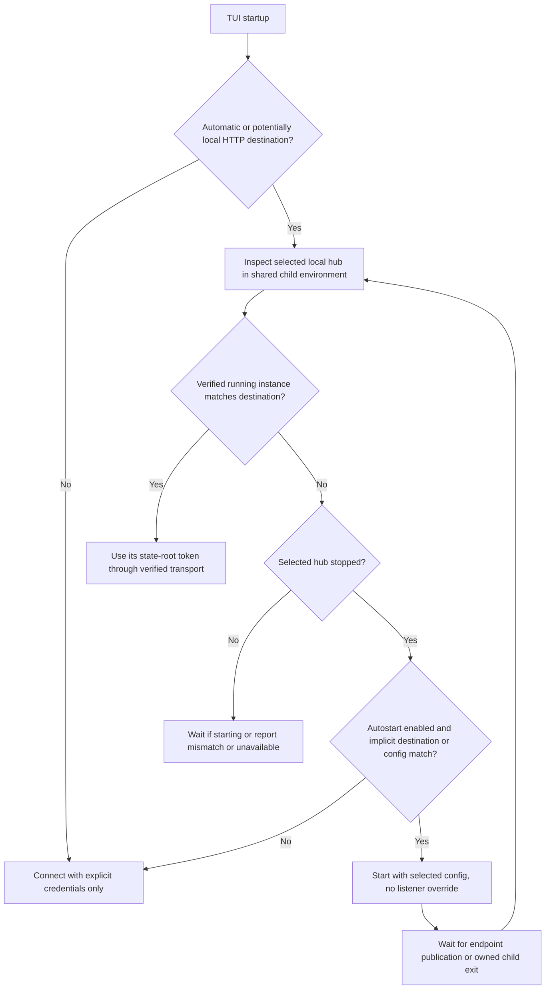

# Hub endpoint cleanup design

## Status and decision gates

Jesse approved this design and subagent-driven implementation. It does not authorize changing a running production hub, editing Jesse's configuration, or deploying a production binary.

### Approved scope amendment: TUI retirement

On 2026-10-16, Jesse chose to drop remaining TUI-specific work because the TUI is being removed separately, without a replacement. Preserve shared endpoint, credential, hub, SSH, browser and native work. Prove the remaining startup, discovery, authenticated AppWire, restart and preservation journey through non-TUI clients. Do not add TUI tests or documentation, or introduce a replacement terminal interface. Reconcile previously committed TUI changes with the separate removal during integration rather than deleting that work here.

This amendment supersedes the remaining TUI-specific obligations below. Their original text records the approved starting scope; it does not require new TUI work. Shared credential isolation, listener preservation and endpoint lifecycle obligations still apply to surviving consumers.

1. **Migration decision: keep server names, clean cutover elsewhere.** Jesse chose to retain hub `--addr`/`-addr` and top-level TOML `addr` as the canonical listener settings. Rename the client and advertised-origin settings, reject their old names with a migration diagnostic, and add no compatibility aliases. The new server environment variable is `EVENER_HUB_LISTEN_ADDR`.
2. **URL decision: origins only.** Jesse chose to accept `http://host[:port]` and `https://host[:port]`, optionally with a root slash. Reject URL prefixes instead of silently stripping them. This removes existing TUI and `hubapi` prefix support; browser, native and pairing already assume root-origin routing. End-to-end prefix support is outside this cleanup.
3. **Autostart decision: require a local configuration match.** Jesse chose to retain autostart for an explicit local HTTP URL only when the unchanged local hub configuration would serve that destination. Remote, HTTPS, mismatched-port and unresolved ephemeral-port destinations never trigger startup.
4. **Browser-login output decision: interactive startup and explicit retrieval.** Jesse chose to retain the credential-bearing login link for interactive startup and add an explicit retrieval command for a background hub. Ordinary redirected and background startup logs contain the plain hub URL, never the token-bearing link.

## Goal

A listener address, a client destination and a published URL have different meanings. Each must have one name, format, owner and precedence rule. A user who binds `0.0.0.0:9180` must retain that binding when a TUI connects or starts the hub.

## Source-audited problems

- `cmd/evener-hub/main.go` accepts `-addr`; `config.go` accepts TOML `addr`. The server does not read `EVENER_HUB_ADDR`.
- `cmd/evener-tui/internal/hubstart/hub_start.go` treats `EVENER_HUB_ADDR` as a client destination, converts that destination back into a bind address during autostart, and implicitly reads the default local token even for a remote URL.
- `cmd/evener-hub/frontend/vite.config.ts` interprets the same variable as an unvalidated proxy URL.
- `cmd/evener-hub/internal/sshconn` can probe port 9180 while `hub attach` reads a different port from the remote config.
- `scripts/ops/deploy-hub.sh` guesses the health address from process arguments and otherwise assumes 9180.
- Startup links, mobile pairing and direct clients use separate URL rules. `mobile_base_url` affects pairing but not the startup link.

The audit proved invalid listener values survive configuration loading, and the existing real-listener test proves port-zero startup knows the assigned port. It did not exercise a live remote deployment or production TLS.

## Public configuration contract

| Purpose | CLI | Environment | TOML | Default |
| --- | --- | --- | --- | --- |
| Server listener | `evener hub --addr` | `EVENER_HUB_LISTEN_ADDR` | `addr` | `127.0.0.1:9180` |
| Client destination | `evener tui --hub-url` | `EVENER_HUB_URL` | None | Discover the local hub |
| Advertised origin | None | None | `public_url` | Existing reachable-origin discovery |
| SSH attachment destination | `evener hub attach --hub-url` | None | None | Resolve the selected local hub |

`EVENER_HUB_URL` also selects the Vite development proxy destination. The proxy retains `http://127.0.0.1:9180` when no URL is supplied; it does not start a hub. The browser uses its page origin, and native uses the selected saved hub profile. The low-level AppWire WebSocket URL API remains a WebSocket endpoint API.

### Listener resolution

Precedence is **supplied CLI flag > present environment variable > present TOML key > default**. Presence is distinct from a nonempty value. Resolve the winning input, then validate it. An explicitly empty or malformed winning input fails; it never quietly selects localhost. Known removed names fail even when a new name is also supplied. Other TOML syntax and type errors still fail normal config loading.

A listener is `host:port`, with a numeric port in `0..65535`. An empty host, wildcard IPv4/IPv6, a specific interface, loopback, or a DNS name is allowed. IPv6 literals use brackets; scoped IPv6 is permitted for binding where the OS supports it. A URL, missing port, service-name port, credentials, path, query or fragment is invalid. Trim surrounding whitespace. Binding port zero remains supported; its assigned port comes from the live listener.

Validation precedes lock acquisition, token creation, background services and binding. Configuration retains the configured listener and its source. The actual bound address is a separate runtime value; do not overwrite the configured value after `Listen`.

### Client and public URLs

Use a shared grammar in Go and TypeScript, backed by the same checked-in fixtures:

- Require an explicit HTTP or HTTPS scheme and a nonempty host.
- Allow omitted ports, meaning 80 or 443, and explicit ports in `1..65535`.
- Reject userinfo, backslashes, control characters, wildcard destinations, scoped IPv6 URLs, query, fragment and non-root paths. Reject even empty query/fragment delimiters rather than letting parsers erase them.
- Normalize scheme and DNS case, IDNA hostnames, IPv6 formatting, default ports and the optional trailing root slash. Do not silently repair ambiguous numeric hosts or URL paths that a browser would normalize away.
- Keep credentials in separate fields. A parse error or diagnostic must never echo a supplied credential or token-bearing URL.

The shared parser owns syntax and normalization. The caller owns reachability policy. A TUI may deliberately connect to loopback; an invitation intended for another device must retain its existing non-loopback/reachable-origin checks and its existing pairing wire restrictions. No invitation format or protocol version changes are required by this cleanup.

`public_url` is an advertised origin. It neither changes the listener nor enables TLS. `public_url = "https://evener.example.com"` may advertise a reverse proxy while the hub listens on local HTTP. Startup links and default invitations use it consistently. Explicit invitation destinations continue to win over this default.

### Removed-name handling

Retain server `--addr`/`-addr` and top-level TOML `addr`; do not introduce `--listen-addr` or TOML `listen_addr` aliases. Reject TUI `--hub-addr`, `EVENER_HUB_ADDR`, and TOML `mobile_base_url`. Explain the replacement and its required format without echoing unsafe values. `hub attach --addr` migrates to `--hub-url` because it selects a client destination, unlike the server startup flag. Recognize only these known removed keys; keep the existing preservation of unrelated operator TOML and machine-managed host records.

Update active source, tests, developer fixtures, environment registry, examples and operations scripts together. Keep historical plans and archived documents as history. Do not rewrite installed configuration or service definitions automatically.

## Local discovery, startup and credentials

The server owns effective configuration and the live listener. TUI `--hub-config PATH` selects the server config for local discovery and startup; `--state-dir` retains its existing project/session meaning. Clients must not reproduce TOML selection or infer a listener from a URL. Provide a read-only structured `evener hub endpoint --json` command using the same configuration resolution as startup. It reports effective configuration and a validated running endpoint when one exists; it never starts a hub, creates a token or mutates config.

Preserve the TUI launcher's existing `--state-dir` environment effects: it supplies `EVENER_STATE_DIR` and derives `XDG_STATE_HOME` for its hub child. Capture one child execution environment and use it for endpoint inspection, launch and subsequent inspection alike. That environment affects the default hub state root and indexed project glob, while an explicit TOML `hub_state_root` still wins. Do not change these semantics as part of the endpoint cleanup or expose the environment in diagnostics.

Publish a small private runtime endpoint record under the selected hub state root while holding the existing hub lock. The record names the actual bound listener, a locally usable origin and a per-process instance identity. The record contains no credentials. Discovery verifies the serving instance without sending a token and without using a proxy or following redirects before making the endpoint eligible for automatic local-token use. A PID or successful generic health response alone is insufficient.

Local origin derivation uses the actual numeric listener: wildcard IPv4 becomes `127.0.0.1`, wildcard IPv6 becomes `::1`, and a specific local interface remains that interface. Discovery must not pretend loopback works for a listener bound only to another interface. A scoped IPv6 bind can serve other clients, but cannot produce a portable URL; report that limitation and require an explicit usable client URL rather than changing the bind.

Existing-instance credential eligibility and stopped-instance startup eligibility are separate checks. An explicit local HTTP destination matching a verified running instance may use that instance's token even when its configured port is zero, its startup flag differed from TOML, or TOML changed after startup. Those cases launch no child. Current configuration must not veto a verified running destination.

When the selected hub is stopped, an explicit URL permits autostart only after resolving the selected local configuration and establishing a direct local HTTP match: a fixed nonzero port, a literal locally assigned address or `localhost`, and a listener that would accept that address in the same IP family. Resolve `localhost` against the actual local addresses; do not assume every loopback spelling matches every bind. A wildcard listener can match a same-family loopback URL. Arbitrary DNS names are connect-only until a running local instance establishes their ownership; never treat DNS resolution alone as permission to start a server. A matching URL does not become an `--addr` argument. A healthy but different running instance is not stopped or replaced to satisfy an explicit URL. Without a URL, startup preserves server flags, environment and TOML semantics, including a wildcard listener or port zero. Concurrent starters converge on the lock winner. Cancellation stops waiting and cleans up an unsuccessfully launched owned child; it does not stop an already-running or successfully handed-off hub.

Credential precedence remains explicit token option, explicit token environment, then the verified matching local instance's token file. Local-file eligibility requires validated runtime identity and a matching destination, whether selected implicitly or by an explicit local URL. Merely naming localhost or matching config is insufficient. Read that file from the resolved hub state root, not from a project state directory or an unconditional default root. Explicit remote or unverified destinations never inherit it. Token values never enter endpoint JSON, runtime records, routine logs or error text. Intentional browser-login output follows the separate contract below.

An authenticated transport binds the credential to the normalized selected origin. It must neither re-add a token on a different origin nor send it through an ambient proxy on the automatic-local path. Reject redirects on authenticated hub requests, including downgrade and cross-port redirects; normal hub API/RPC routes need no redirects. Keep credential source names available for diagnostics, without values. For a file-derived token, validate boot identity on the same TCP connection before returning that connection to the authenticated HTTP/WebSocket transport. Every new connection repeats the token-free check. A separate health request followed by an unchecked new connection leaves a port-reuse race and is insufficient.

TUI and SSH attachment both use the shared verified authenticated transport. SSH attachment retains its stricter literal-loopback rule and bridge-origin header. Its own port-reuse and redirect tests must prove the master token never reaches a different listener; TUI-only coverage does not satisfy this obligation.

## Runtime handoff contract

Reuse the existing per-process `HubBootID` as `boot_id`; add it to `/api/health` rather than inventing a second process identity. Preserve the existing `hub_addr`, version and start-time field meanings.

The private record is `<HubStateRoot>/hub-endpoint.json`. It records `schema_version: 1`, `boot_id`, `pid`, `started_at`, `config_path`, `hub_state_root`, `requested_listen_addr`, `listen_source`, `bound_addr`, optional `local_url`, optional `loopback_url`, and optional `public_url`. The start time is the health handler's time, not an independently sampled timestamp. `public_url` is never an automatic probe or SSH destination. `loopback_url` exists only when the actual listener accepts literal-loopback access.

Use a bounded regular same-user file, private mode, and same-directory atomic publication. Never unlink or replace `hub.lock`, since that would split lock ownership between inodes. Readers inspect the existing lock without creating it, and never remove stale endpoint files. The lock owner replaces stale metadata and removes only its own boot's record before releasing the lock. Bind or publication failure closes the listener and leaves no ready record. A record can be published immediately before serving; only successful live verification makes it ready.

`evener hub endpoint --json [--config PATH] [--addr HOST:PORT]` returns one JSON object on stdout. Diagnostics go to stderr. It uses the same presence and precedence rules as startup. The shared report type has:

- `schema_version: 1` and `state`: `stopped`, `starting`, `running`, or `unavailable`.
- `config_path`, `config_exists`, `hub_state_root`, `configured_listen_addr`, `listen_source`, and optional `public_url` for the currently selected configuration.
- Optional `running` containing the validated record's runtime fields plus live `version` and `backend_git_sha`.
- A stable `reason` for a non-running outcome, such as `lock_held_without_record`, `identity_mismatch` or `unreachable`.

A successful inspection of a stopped hub exits zero with `state: stopped`. A held lock with absent/corrupt/unreachable metadata is starting or unavailable, never stopped. A free lock with stale metadata is stopped; readers leave the file for the next owner. Invalid configuration or an unsupported report schema is an error. Bound reads, request deadlines and caller cancellation prevent inspection from hanging. Unsupported platform lock inspection produces an explicit unavailable result, not an invented running state.

A running result requires a held lock, validated record, numeric local target still assigned to this machine, token-free live health matching `boot_id` and actual bound address, and an unchanged record generation across inspection. This is a local-user trust boundary, not protection against another process that can read the same user's credentials. It must prevent accidental wrong-instance selection and token delivery on port reuse. A changed `hub_state_root` selects a different owner; discovering the old owner requires a config selector that still names its original root. There is no global endpoint registry or port scan.

## Remote SSH and operations contract

Remote configuration is resolved on the remote machine. Attachment, health probes, restart and deployment consume one resolved endpoint and its instance identity. Remove the independent default-port resolver. Re-resolve after restart or deployment because a configured port zero can receive a different bound port.

Preserve the SSH bridge's existing literal-loopback and no-proxy token policy. This policy constrains where the bridge sends a host-master token; it does not forbid users from binding a hub to a specific interface. A non-loopback-only hub remains usable by direct clients, and an SSH attachment that cannot reach a permitted local endpoint reports the concrete limitation without rewriting the listener.

A restart retains the configured listener and config selection. The loopback URL used for a health check must never become the replacement server's listener setting. A deployment must verify process ownership before termination; stale records, an unrelated service on the old port, or a missing endpoint capability must never lead to a guessed-port kill.

Readiness to receive a credential and authority to restart a selected service are distinct. For endpoint-capable installations, preserve the existing authorized supervisor/OS-owner-verified recovery path when HTTP health is unresponsive, metadata is damaged, or a recorded restart left the service stopped. Revalidate the selected service's executable, effective user and configuration/state-root association, and any current process identity, independently of HTTP. A missing or mismatched owner is not permission to kill. Reuse the existing pending-restart mechanism; do not make a verified `running` report a prerequisite for completing its recorded operation. Readiness and build/boot verification remain mandatory after replacement and before authentication. Unsupported old installations still follow the manual-migration rule below.

Mixed-version hosts get an explicit capability/migration outcome. This change must not smuggle in compatibility aliases or guess the missing endpoint from a new default. Preserve healthy existing work when the operator must upgrade or migrate a remote host before managed endpoint discovery is available.

Keep `[[hosts]].addr` and the existing host wire `addr` field as a server-listener override for explicitly authorized fresh bootstrap. This preserves both field contents and listener intent; do not rename durable host fields or mutation fingerprints. Remove the requirement that `config_path` and `addr` appear together, since a config selector alone is now sufficient. Rename the internal manager option to `HubListenAddr` to make its role clear. Attachment and probing use the resolved running endpoint, never this bootstrap override. No new host `hub_url` field is needed: `hub attach --hub-url` remains an explicit direct attachment option and must agree with the verified selected instance before reading its token.

For supervisor-managed restarts, preserve the supervisor's definition. For ad-hoc restarts, retain validated server argv and the narrow listener environment override recorded at startup. Re-read current TOML on an intentional restart; do not replace its newly configured listener with the old actual port. A flag/env override retains its existing precedence. A runtime record is not authority to execute an arbitrary command: existing executable, effective-user, argv and process-owner checks remain required.

Expose `hub_endpoint_schema: 1` in the existing `launch-check --json` result. Probe it without `--protocol`, then evaluate the reported AppWire protocol separately; a protocol mismatch must not conceal supported endpoint discovery or prevent an otherwise authorized upgrade. This avoids error-text capability detection and does not enter the attach/bootstrap path. A missing capability does not mean stopped. For this clean cutover, an older installed binary or a still-running old process with no verifiable record requires manual migration before automatic deployment/restart; refuse mutation while leaving that process running. Do not classify a known endpoint-capable generation as legacy solely because its record was damaged or health stopped responding; independently proved ownership still permits recovery as above. Do not add a legacy inspector or stage a binary to infer old process ownership. The error names the selected host/config and the manual upgrade requirement. A genuinely fresh host still follows the existing authorized install/bootstrap path, then must publish and validate its endpoint before attachment. Missing capability must not create an endless deploy/restart retry loop.

The deployment script reads structured endpoint output before and after service replacement, preserving its existing service and process ownership checks. Add `--config PATH` to select endpoint inspection explicitly; retain `--label` and `--timeout`, and reject the old health-destination `--addr` option rather than keeping another endpoint override. Read the selected service definition only to establish its configuration and environment, never to infer the health URL. An explicit selector must agree with that service's config/state root; if the definition cannot be resolved unambiguously, stop before mutation and explain what selection is missing. For a running report, require its PID/boot identity to belong to the selected service. The ownership-based recovery path handles an unresponsive/stopped service without substituting a different instance. After restart, require the new report's PID to match the selected service's new PID as well as its expected boot/build. Service restart remains the service manager's job; endpoint resolution describes what is running.

## Diagnostics

The structured endpoint command and startup reporting distinguish:

- Selected config path and whether it existed.
- Configured listener and source (`flag`, `env`, `config`, `default`).
- Running state, actual bound listener and instance identity, when available.
- Locally usable connection origin and advertised public origin, when available.
- Credential source kind in the client, never a credential value.

Absent fields are absent or null, never plausible defaults presented as live facts. Human output explains binding and connection separately. Validation failures carry typed codes and source fields for tests; human-readable phrases are not test oracles.

### Browser login output

Startup prints the credential-bearing browser login link only when its actual stderr writer is a terminal. Redirected files, pipes, TUI child capture and service-manager capture receive only the credential-free URL and directions for deliberate retrieval. Do not open `/dev/tty` to bypass redirection. This is terminal-output detection, not a promise that a user cannot record their own terminal.

Add `evener hub login-url [--config PATH]`. It uses the same selected environment/config and verified running endpoint as discovery, reads that instance's existing token file and writes one login URL plus newline to stdout. This explicit output is intentional secret disclosure to the invoking user, including when they choose to redirect it. Stderr remains token-free. The command never starts a hub, creates/rotates a token, opens a browser or changes configuration. A stopped/unavailable hub or unreadable token produces a typed error and no login URL.

Startup and the retrieval command share URL construction: use the running record's `public_url` when set, otherwise the existing advertised-host fallback with the actual bound port. Do not advertise un-restarted config edits as the running instance's publication settings. Default invitation policy remains separate when no public origin is configured. Document that a login link grants access and should be treated as a password. Tests use sentinel credentials and verify absence from normal startup logs and every error path, plus deliberate presence in terminal/command output and successful browser authentication.

## Preservation, failure and recovery

- Preserve default local binding, user configuration contents, host records, tokens, saved native profiles, pending user work and existing sessions.
- Bind failure publishes no ready record. An acquired lock without a ready record means starting or unready, not permission for a second hub.
- Graceful shutdown removes only its own endpoint generation before releasing the lock. Crash leftovers are not trusted; a new lock owner can replace its own stale discovery artifact without deleting unrelated state.
- Corrupt discovery metadata must not silently redirect clients or orphan the ability to start a new hub once no owner exists.
- A listener/config mismatch is reported as configured versus running. Discovery uses the running instance; config changes take effect on an intentional restart.
- Invalid legacy settings cause an actionable migration error, not a silently changed exposure boundary.
- Explicit destination or token errors never trigger fallback to a different hub.

## Non-goals

No TLS certificate management, automatic firewall changes, new exposure defaults, reverse-proxy prefix implementation, pairing wire redesign, general service discovery daemon, new auth UI, secret migration, production deployment or production restart. Do not rename unrelated address fields merely because they contain `addr`.

## Acceptance and proof obligations

1. **Precedence:** each layer wins when present; explicit empty/malformed inputs fail; retired names fail; unknown operator TOML survives rewrites.
2. **Binding:** real sockets cover loopback, wildcard, specific interface, IPv4, supported IPv6 and port zero. Validate URL/portless mistakes before startup side effects.
3. **Automatic local journey:** a TUI with no destination uses a configured wildcard/custom/ephemeral listener, starts only when appropriate, authenticates, reconnects, and retains the listener through concurrent startup and restart.
4. **Explicit destination journey:** matching local HTTP URLs permit configuration-preserving autostart, then authenticate only to the verified matching instance. Remote, HTTPS, mismatched and unresolved-port URLs start nothing and never inherit local tokens. Cover omitted/default ports and localhost address-family differences.
5. **Credential isolation:** two real local HTTP servers and a TLS server prove token selection, same-origin attachment and absence at redirected/unrelated destinations, including same-host different-port and downgrade cases. No real credentials are used.
6. **Discovery lifecycle:** cold start, bind failure, concurrent starters, graceful stop, crash leftover, corrupt record, port reuse, changed config and cancellation resolve to the correct process or an actionable non-destructive failure.
7. **Remote agreement:** a real disposable SSH host with a default-path custom-port config proves attach/probe/restart agreement; repeat with an explicit config path, wildcard binding and ephemeral port. An unrelated process on the old/default port survives. Unsupported old-host capability is non-destructive.
8. **Published links:** a public HTTPS origin over local HTTP appears consistently in startup output and default pairing; explicit invitation overrides, IDNA, IPv6, default ports and existing unsafe-origin rejection remain covered.
9. **Shared client contract:** Go and TypeScript independently load the same literal fixture expectations. Native connection, invitation codec, browser same-origin RPC and Vite proxy keep working without path rewrites or hidden defaults.
10. **Delivery:** targeted checks locally, affected frontend/native/package gates, independent spec and implementation review, simplify pass, then current-head CI and RoboRev settlement before merge. Report unavailable live-host/platform checks rather than claiming them.
11. **Existing-instance selection:** explicit URLs for a running ephemeral port, a server flag override and edited-but-not-restarted TOML authenticate to the verified instance and launch nothing. A TUI-only `--state-dir` override uses the same child environment for discovery/start/reconnect, including an explicit `hub_state_root` variant.
12. **Managed recovery:** an endpoint-capable but HTTP-unresponsive selected service and a failed first replacement remain recoverable through independently verified ownership. An endpoint-capable protocol mismatch stays distinguishable from a pre-discovery binary. Two services sharing an executable but using different config/state roots cannot be confused by deployment.
13. **Login-link access:** terminal startup and explicit `login-url` output provide a functioning login link. Redirected startup, TUI child capture, endpoint JSON and diagnostics never contain its sentinel token. Retrieval selects the running instance's state root and publication settings and has no start/write side effects.

## Delivery boundary

The design and implementation plan are separate deliverables. The implementation will update evergreen guides with current verified behavior, not with this proposal's status. Review and commit each bounded implementation task. Ship the naming cutover as one coordinated PR so no released intermediate state sends new client values to old server parsers.
