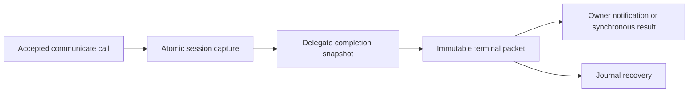

# Preserve delegate report messages

## Problem

A delegate can send detailed findings in `communicate.message` and a shorter machine-readable summary in `output.message`. The session records the detailed message, but its generic return value can be canonical structured JSON. Delegate settlement currently uses that generic return value as the report. The parent therefore receives the summary instead of the findings and may request another report.

This is content loss, not evidence of duplicate transport delivery. Delayed shell completion notifications are a separate investigation.

## Required behavior

1. A successfully reported delegate generation publishes the accepted terminal `communicate.message` as its terminal packet's `message`, using the existing trimming and `output.message` fallback performed by communicate.
2. The same accepted call supplies the structured result, its presence, schema-validation result, and source marker. A distinct structured summary must remain distinct. Preserve data, artifacts, custom-schema objects, and explicit null.
3. A later competing terminal call cannot replace either half of the accepted report. After drain turns, the latest accepted report and its structured value remain paired. A new generation cannot inherit an earlier generation's report.
4. Durable settlement, owner notification, synchronous result delivery, and journal recovery use the same immutable packet. Recovery must preserve both fields without requesting another child report. Existing receipt and delivery identity rules remain unchanged.
5. Root session return values and `CommunicateOutput` retain their current structured-output semantics. Nonterminal delegate updates remain unchanged. Failed, cancelled, exhausted, and unreported runs retain their current classification and diagnostic result text.
6. Existing storage limits and preview bounds remain in force. This change neither adds a truncation limit nor promises to reconstruct reports already stored without their detailed message.

## Design

Select delegate report text at delegate completion, rather than changing the generic communicate return contract. Read the accepted communicate capture under the session lock and use its human message and raw structured value together. Both delegate completion entry points must use this shared capture. Use the generic run result for non-report outcomes. Keep terminal packet storage and delivery schemas unchanged.

The session already retains the human message separately from the generic reply. Delegate completion selects that message while keeping the raw structured result from the same capture. Delivery and recovery continue to consume the stored packet.

## Non-goals

- Notification scheduling, new acknowledgements, or transport deduplication.
- Changing root output APIs or adding a new public wire field.
- Rewriting historical terminal packets or changing client rendering.

## Definition of done

- A regression executes the real communicate handler with a multiline report and a different structured summary, then constructs a real delegate terminal packet. Before the fix, it fails because packet message differs from the supplied report. Afterward, the decoded message equals that report and the decoded structured value equals the supplied output.
- Both completion entry points are covered. Fixtures exercise ordinary text, output-message fallback, default data/artifacts, custom schema including a message key, explicit null, invalid schema output, competing calls, drain restoration, and a fresh generation.
- A report produced through that path is durably settled and read after reopening its journal. Owner delivery and synchronous delivery expose the same message and structured payload. Existing receipt/replay tests stay green.
- Failure, cancellation, exhaustion, and no-report checks stay green; distinct error text is not replaced by an earlier accepted report.
- Existing single-call/root structured-output tests remain unchanged and pass. Tests compare supplied fixture content and machine fields, never product copy.
- Evergreen runtime documentation and the subsystem map describe the message/structured-result separation and recovery authority.
- Targeted Go tests and race checks pass locally. CI runs the full repository gates. Simplification review and branch review have no unresolved actionable findings; the PR is shepherded under repository merge rules.
- The final report links this spec, the plan, test evidence, and the PR, and names any uncompleted checks or findings. Notification delay is explicitly outside the fix.
