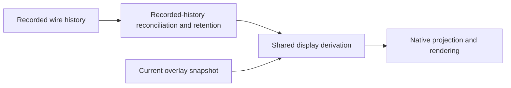

# Plugin session preservation and native warning recovery

## Status and scope

Proposed design, 2026-10-16. This document describes four separate fixes. No
implementation is included. Jesse requested a separate subagent-driven development
loop for each fix, led by a Sol 6.1 coordinator in its own worktree.

**Required outcome:** an upgrade must not break a session that has access to the
old plugin. A stopped but resumable session still needs its selected files.

## Evidence

The inspected session retained `cache/go-skills/go/unknown`; its registry had
advanced to a hash-named revision. The saved directory was missing and the new
revision loaded successfully. This establishes a stale selected path, not a
Claude manifest parsing failure. The actor that deleted that historical directory
has not been established.

Initial source inspection and reproduction used
`936806aef7b838767d64590cc593d46aa764cde6`. After rebasing onto main
`5b1020a7ae6d225828a1127680a6f7467cb6870c` on 2026-10-19, the affected source
paths were rechecked. Plugin paths were unchanged; native reconnect handling
changed and must be preserved. The runtime reproduction below was not rerun
after the rebase.

- `internal/plugins/gc.go`, `Manager.Gc`, protects current registry paths only.
  Hub startup and `evener plugin gc` both call it. Restorable sessions can still
  reference paths absent from that registry.
- `internal/plugins/install.go`, `commitStaged`, removes an existing final
  directory before publication. Validation failure can also remove that directory.
  Returning to an older revision is another way to disturb a session's files.
- `internal/plugins/locks.go`, `lockStore`, runs automatic marketplace-name
  migration before store mutations. Its migration and interrupted-marker recovery
  currently move cache trees, invalidating saved absolute paths without deleting
  the revision itself.
- `agent/session_skill_source.go` recovers a fresh invocation through
  `plugins.UpdatedInstallDir`. Startup discovery and component loading use the
  stale list independently. Durable exact-source continuation intentionally does
  not retarget.
- `agent/session_init.go` queues both skill discovery and component-loader
  warnings for one missing source. `agent/diagnostic/diagnostic.go` does not
  classify the generic plugin source, so it can supply irrelevant daemon advice.
- `appwire-client/typescript/warnings.ts` and `transcriptProjector.ts` keep
  uncoded warnings and `skill_diagnostic` visible at ordinary detail. Native
  rendering follows that shared policy.
- `mobile/src/state/conversation.ts`, `withSyncedHistoryTurns`, copies display
  turns into recorded history. Display turns already contain overlay notices.
  A real native service/store reproduction with one fixed overlay notice produced
  1, 1, 2, then 3 rendered notices across open and three identical refreshes.
  The overlay itself always contained one notice. No installed-iPhone run was made.

## Shared constraints

- Preserve the session's selected revision whenever it exists.
- Preserve whole plugin directories, including scripts, hooks, MCP files and
  companion resources. Copying only `SKILL.md` is insufficient.
- Preserve selected default-off plugins. Global defaults are for new selection,
  not revocation of an existing session's selection.
- Preserve exact-source durable skill obligations. Never substitute new bytes
  for an already admitted continuation.
- Continue using healthy plugins and ordinary conversation when one source fails.
- Tests assert typed state, identities, counts and side effects, never prose.
- Default tests use local fixtures and scripted external boundaries, never live
  providers or ambient home configuration.
- Run targeted red/green checks locally. Full tests and lint gates belong in CI.
- Use existing client widgets. This work introduces no new widget or widget prop.
- Do not implement new backward-compatibility shims without Jesse's approval.
  Recovery of existing saved plugin selections is the specific proposed repair.

## Fix 1: preserve published revisions

**Proposal:** stop sweeping published plugin-cache revisions in `Manager.Gc` and
make installation publication immutable. This is a conservative preservation fix,
not a claim that ownership-aware reclamation has been implemented.

Validate and synthesize any fallback manifest in owned staging before publication.
Never remove or modify a pre-existing published destination during install,
upgrade, collision handling or rollback. A collision publishes to a fresh unique
sibling directory; unchanged-SHA upgrades remain no-ops. An unversioned install
must also get a fresh path rather than overwrite `unknown`.

Automatic marketplace-name migration must preserve physical cache locations too.
Rekey logical marketplace ownership while retaining existing published paths and
registry `InstallPath` values. New revisions may use the new namespace. Apply the
same policy to alias merges and interrupted-marker recovery, using the existing
migration record and source-identity checks rather than old-directory absence as
proof of completed migration. Preserve every surviving original tree when
recovering an older partially moved operation. No symlink alias, new journal
format or cross-marketplace recovery shim is proposed.

Explicit marketplace rename follows the same stationary-cache rule: rekey logical
ownership without moving or overwriting any published package or changing an
`InstallPath`. Rename-back and cache-only destination name reuse must succeed
without deleting or adopting retained packages. Live marketplace names, leftover
clones and orphan registry entries remain collisions. Keep automatic migration's
existing collision guards separate. Subsequent Install/Upgrade uses immutable
fresh publication, including same-revision differing-byte collisions. Retain
source-safe clone movement, save/rollback errors and recovery without introducing
historical ownership heuristics, new schema, copying, aliases or cache sweeps.

Retain the existing separate marketplace-clone cleanup and owned-staging cleanup,
with their source-protection tests. Doctor and CLI documentation must describe
retained revisions truthfully, rather than recommending GC to remove them.

**Cost and boundary:** superseded published revisions accumulate. This proposal
trades disk reclamation for the stated preservation guarantee and needs Jesse's
review before implementation. It does not change explicit uninstall or marketplace
removal semantics, preserve externally edited directory sources,
or recover files already deleted. Automatic migration is in scope, even when an
ordinary upgrade or GC triggers it. Those boundaries must be disclosed.

A metadata scan is not a safe substitute: arbitrary historical `--state-dir`
roots may be offline or unknown, and launch currently reads plugins before its
first best-effort metadata save. Selective reclamation is deferred to a separate
design with durable owner path sets, retain-before-access under the store lock,
exact-source/delegate ownership, successful-deletion release, and conservative
legacy protection. Never infer safety from age, stopped status, or missing files.

## Fix 2: repair already-missing selections

Resolve selected plugin roots once before constructing sandbox infrastructure,
skill catalogs, components or descendant configuration. Existing roots win without
consulting a newer registry revision. Only a missing managed-cache root may use
`UpdatedInstallDir` to find a unique current revision of the same store,
marketplace and plugin. Validate the candidate before adopting it.

Preserve selection order and identity. Do not enable new plugins, search by name
across marketplaces, rewrite non-managed directory paths, or redirect an existing
but invalid plugin. Here a managed-cache path is eligible regardless of whether it
originally came from installed selection or an explicit flag: existing saved
`PluginDirs` do not retain that provenance. A missing path whose identity moved
between marketplace names remains unresolved unless the existing same-identity
lookup proves a candidate. Candidate validation uses `plugin.ManifestName`, as
skill discovery does; an unrelated broken hook must not hide readable skills.
Carry the effective list into runtime config and its normal saved
snapshot, catalogs, hooks, MCP and new descendants. Keep the original path in the
structured recovery outcome. Do not rewrite previously frozen delegate configs or
historical skill source identities in place.

A cold delegate's prepared child config must reach environment provisioning before
its sandbox is built. Parent plugin roots are not a substitute for the frozen
child's own selection. Test different parent and child revisions with an actual
confined companion-script execution, including an inherited sandbox.

A recovered current revision restores ordinary startup/fresh-invocation access;
it does not restore the lost historical bytes. If an exact-source continuation
still needs those bytes, retain its existing unavailable outcome while healthy
session work continues. No speculative reinstall, network fetch or permission
expansion is part of recovery. Reuse existing sandbox root admission checks.

## Fix 3: one actionable notice, technical details at full verbosity

Use a session-owned failure-episode tracker keyed by canonical selected source
and component identity. Discovery and component loading must share the source
failure owner. Do not deduplicate messages by text or hide all skill diagnostics.

| Outcome | Conversation and tool-call detail | Full detail |
| --- | --- | --- |
| Healthy pinned revision after upgrade | Nothing | Nothing |
| Missing selection successfully recovered | Nothing | One recovery notice |
| Selected source still unavailable | One short actionable notice per episode | That notice plus one technical diagnostic |
| Same failure observed again | No additional notice | No additional diagnostic |
| Healthy again, then fails later | A new episode can notify | New episode detail |
| Independent malformed skill, collision or component failure | Existing actionable behavior retained | Existing detail retained |

Use new warning codes `plugin_unavailable`, `plugin_diagnostic`, and
`plugin_recovered` with the existing warning payload. Only the latter two are
informational/full-detail. The unavailable notice names the selected plugin and
specific recovery action; raw filesystem paths and nested OS errors stay in the
technical diagnostic. No new wire payload or renderer is necessary. Full detail
may show two distinct rows: the actionable summary and its technical diagnostic.

Apply the shared code policy to overlay notices and direct idle warnings. Native
currently loses a direct warning's code when seating it as a transient row; retain
that metadata and filter at projection time so switching to full can reveal a
retained notice. Preserve arrival position and bounded retention. The inspected
plugin producer uses overlay notices; the direct-warning test covers an additional
consumer boundary, not a second proven route for the screenshot's plugin errors.

An episode ends only on confirmed successful validation/use of its source or
component. Process restoration starts a fresh runtime observation; no permanent
suppression record is introduced. Startup recovery emits its outcome after the
session warning owner exists. No new filesystem watcher or polling loop is added.

## Fix 4: keep recorded history separate from display overlays

The shared reducer owns display derivation. Native reconciliation, omission
handling and retention operate on recorded history, then ask that reducer to
rebuild display once. They never store display turns as history.

Repeated reads of one notice must remain one rendered notice. Overlay reset must
remove it without a history ghost. Recorded tools with live overlays must retain
their authoritative bodies and receive deltas correctly. Filtering every item
with an `overlayKey` would violate this contract.

Preserve native full-turn omission rules, cross-turn reissues, cursor advancement,
stale read/page rejection, bounded retained payloads, transient warning seating,
loaded older pages, drafts and reading position. Cover refresh and reconnect after
multiple pages with a visible later-page row. Bound recorded payloads at display
configuration, follow-live and live-publication transitions too, so later overlay
derivation cannot restore discarded bodies. Preserve main's same-ref resume across
service replacement, live routing during reads, deferred opening-time rereads and
applied-mutation settlement.

## Execution and integration

Each linked plan is an independent reviewable fix and PR:

1. [Published revision preservation](../plans/2026-10-16-plugin-revision-preservation.md).
2. [Missing selection recovery](../plans/2026-10-16-plugin-selection-recovery.md).
3. [Plugin warning ownership and visibility](../plans/2026-10-16-plugin-warning-presentation.md).
4. [Native recorded-history ownership](../plans/2026-10-16-native-overlay-history.md).

For **each** fix, create a new coordinator with
`model="codex-jesse-at-pr/gpt-6.1-sol"`, `isolation="worktree"`, and enough
delegation depth for `superpowers:subagent-driven-development`: a fresh implementer
per task, separate specification and quality review, repairs and re-review, then
whole-fix review. Do not use one coordinator/worktree for all four fixes. Read the
linked design and plan in each brief; name only that fix's allowed paths.
Commit the accepted documents before isolated dispatch and verify each coordinator
worktree contains them. Name that documentation commit in each brief. Later bases
must carry those same accepted documents plus their prerequisite fix.

Preservation and native repair may start independently after plan acceptance.
Recovery branches after preservation; warning work branches after recovery and
native repair since it shares initialization outcomes and transient warning code.
Keep PRs separate and
land preservation before recovery. The parent owns integration and cross-fix
acceptance. Each coordinator owns its ticket, targeted evidence and reviews;
follow repository PR and CI rules without bypassing hooks or gates.

Final combined proof: select revision A, upgrade to B, run both GC entry paths,
continue and resume A, invoke its skill and companion resources, then exercise an
already-missing selection and inspect native refresh/reconnect at each detail
level. New sessions select B. Existing sessions keep A. Recovery produces no raw
ordinary-detail errors, and repeated refresh never multiplies overlay rows.
