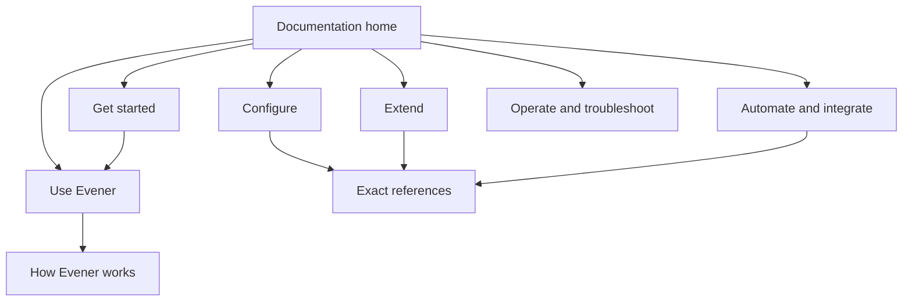

# Evener documentation overhaul design

## Outcome

Give a developer new to Evener a complete, reliable path from installation to useful work, customization, automation, and client integration. Publish the guide automatically to GitHub Pages. Preserve exact technical contracts behind readable explanations.

Jesse requested a comprehensive overhaul informed by the full Claude Code and Codex documentation, clear and concise prose, and merciless editorial reviews across OpenAI and Lunaroute. Jesse excluded the retiring TUI, retained the CLI, chose documentation that tracks main, declined visual mockups, and asked us to work through the design with reviewers and editors.

## Editorial direction

Use task-first navigation, not the repository's package structure. A tutorial teaches one working path; a how-to solves a named problem; an explanation builds the mental model; a reference states the exact contract. Link those forms rather than repeating their contents.

Each how-to states its outcome, prerequisites, where commands run, steps, observable success, and recovery. Distinguish shell commands from prompts sent to the agent. Place risks beside the commands that create them. Use short paragraphs, active voice, concrete nouns, and useful headings. Apply Writing Clearly and Concisely throughout.

Document Evener as it exists. Claude and Codex supply editorial patterns, never Evener flags, paths, capabilities, defaults, or guarantees. In particular, configuration precedence differs by subsystem; do not invent a universal hierarchy. Do not invent maturity labels or promise an SDK distribution mechanism that has not been verified.

## Audience and surfaces

Primary reader: a developer new to Evener who knows basic terminal and Git use. This is our stated default, not an explicit audience selection by Jesse. Provide fast paths for experienced coding-agent users and deeper contracts for extension and client authors.

Cover the browser, noninteractive CLI, and native phone app to the extent supported and verified. Omit TUI instructions and promotion from published pages. Preserve historical and internal implementation records rather than pretending their references never existed. Do not remove TUI runtime code in this documentation change.

## Information architecture

The first path ends with a checked result. Task guides introduce concepts when needed. References and troubleshooting remain reachable from every section.

| Area | Canonical content |
| --- | --- |
| Start | Installation, release versus snapshot, credentials, first task, first result check |
| Use | Browser workflow, steering, queues, stop/resume/fork, review changes, native setup |
| Concepts | Session, turn, delegate, shell job, watch, worktree, transcript, memory and ownership |
| Configure | File locations, scope, trust, precedence and merging by subsystem, reload behavior, providers and credentials, environment variables |
| Extend | Choose skills, commands, agents, plugins, hooks or MCP; author/load/invoke/verify/remove paths |
| Automate and integrate | CLI usage and automation, output and exits, SDK entry path, AppWire authentication/lifecycle/errors/recovery, device pairing |
| Operate | Sandbox boundaries, remote hosts, upgrades, storage/privacy, diagnostics and symptom-based troubleshooting |
| Reference | Generated AppWire catalog, configuration/CLI/environment references, extension contracts |

Existing useful public references stay at stable repository paths. Add missing entry points and substantially revise existing pages instead of shipping a thin portal over stale prose. Keep contributor material and internal product contracts available through repository links; exclude dated plans, research, screenshots, and mockups from site publication and search.

Stable paths do not freeze stale contents: remove TUI instructions from retained public pages, including README, rather than publishing a removal detour. First-run instructions configure a hosted credential or a supported credential-free local provider before starting the first session. A reader with no existing provider setup must have a complete path.

### Content ownership and overlap

- `getting-started.md` owns installation and the first task. README gives a short entry and links there instead of duplicating the full procedure.
- `skills.md` owns skill and command formats and their use. `plugins.md` owns packaging, installation and enablement. `hooks.md` owns hook authoring and event contracts. The extension chooser links to those owners; it does not absorb their references.
- `daily-work.md` owns the human workflow for following delegated and background work. `job-control.md` owns exact job/watch/delegate tool contracts. `concepts.md` supplies short definitions and links to the contract owner.
- `automation.md` owns CLI scripting recipes; `cli.md` owns command reference. `integrations.md` owns the first client path; generated AppWire documentation owns wire methods and notifications.
- Operational guides own upgrades, supported migration commands and state backup/recovery. Do not promise that copying a live state directory produces a consistent backup without verification.
- Native setup must state its verified distribution and update path, or plainly state that only a source-build path has been verified.

## Source ownership

Markdown in `docs/` remains canonical. `README.md` becomes a compact product and getting-started entry point with links to the site and contributor documentation. New user pages use stable names such as `docs/index.md`, `docs/cli.md`, `docs/configuration.md`, `docs/plugins.md`, `docs/mcp.md`, `docs/daily-work.md`, `docs/concepts.md`, `docs/automation.md`, `docs/integrations.md`, and `docs/troubleshooting.md`.

`docs/index.md` is the documentation homepage, both in the repository and on the site. README links to it. The navigation section is consistently named “Automate and integrate”; its task and reference pages remain separate.

Keep generated AppWire reference ownership: edit `internal/appwiredoc/protocol.md.tmpl` and regenerate `docs/appwire-protocol.md`. Never hand-maintain a second method catalog. Verify protocol examples against `appwire/` and existing client tests. Do not fabricate a JSON Schema exporter.

Keep `docs/product/` intent, implementation, and unresolved proposals distinct. Public guides describe shipped behavior on main, not proposed friction fixes. Contributor documents remain contributor documents; expose user-relevant configuration without copying an independent competing reference.

## Site and publishing

Builder choice: use VitePress in an isolated `docs-site/` npm package, with its own lockfile. It fits the existing Node-based tooling and supplies static navigation, local search, code blocks and responsive reading without building a bespoke site. Keep custom styling restrained and typography legible. Do not add application UI dependencies.

Use an explicit publication manifest. Stage only approved canonical Markdown and assets into generated build input; never feed the entire historical `docs/` tree into the site generator. Preserve links among published pages. Resolve source-code and intentionally unpublished reference links to the public repository on main. Reject broken local references rather than silently masking them.

Generate machine-readable Markdown copies and `llms.txt` from that same manifest. Exports contain complete static content, not renderer component code. Test all exported links and paths. Support the repository Pages base path `/evener/`, including search and assets.

GitHub Actions builds and checks documentation on pull requests. On pushes to main, the same checked artifact deploys through GitHub Pages. Use minimal workflow permissions, a deployment environment and concurrency. No deployment from pull requests. Offer manual workflow dispatch. The repository currently reports `has_pages: false`; enabling Pages and observing a successful deployment are separate from merely adding YAML.

Default address: `https://prime-radiant-inc.github.io/evener/`, subject to GitHub Pages availability. No custom domain. Clearly label the site as documentation for main and explain the release/snapshot difference beside installation.

## Verification

- Build the static site with the repository base path and inspect it in a browser.
- Check internal page and fragment links, navigation membership, assets and source links.
- Run structural Markdown lint on the publication manifest. Human reviewers own fluency and terminology checks; arbitrary sentence-length thresholds must not masquerade as comprehension tests.
- Verify excluded internal/history files are absent from output and search.
- Check Markdown exports and `llms.txt` against the publication manifest.
- Test publication helper behavior before implementing it, including nested paths, spaces, fragments, code fences, external URLs and unpublished source links.
- Parse runnable configuration and protocol examples; distinguish complete examples from schematic fragments.
- Run deterministic example checks without hosted credentials or model requests in default tests.
- Verify commands, flags, defaults, configuration precedence and protocol shapes against current source and targeted tests.
- Give the first-run path a snapshot installation matching main. Label release installation as a separate choice whose behavior can lag these guides, rather than requiring release compatibility for all main documentation.
- For a model-driven tutorial, verify the fixture and acceptance command deterministically. State separately whether a live agent walkthrough ran; do not claim a scripted provider validates model quality.
- Run targeted generator/package checks where source-owned references change. Let CI own the full repository gates.

## Editorial review

Use six independent reviewer lenses across OpenAI Codex and Lunaroute:

1. High-school English teacher: grammar, sentence structure, unexplained vocabulary and comprehension.
2. Journalist: factual support, first-paragraph usefulness, concrete claims and missing context.
3. Novice user: installation-to-result continuity, navigation and unstated prerequisites.
4. Boris Cherny-inspired product-engineering lens: coding-agent workflows, extension ergonomics, practical completeness and operational truth.
5. Tim O'Reilly-inspired technical-publishing lens: conceptual structure, examples, reference quality and the reader's progression.
6. Professional editor: consistency, voice, redundancy, flow and publication readiness.

The named-person lenses are simulated editorial perspectives, not claims of their participation or endorsement. Each reviewer must cite exact files/sections, give evidence and severity, and propose concrete repairs. They should inspect actual rendered documentation as well as source when useful. Review representative early chapters before scaling the draft, then the complete published corpus. Resolve substantive findings and repeat the affected checks. Do not equate a reviewer's praise with verification.

Every reviewer returns a per-section checklist and a finding disposition. These conditions fail review:

| Lens | Concrete failure conditions |
| --- | --- |
| English teacher | Undefined essential terminology in Start/Use, ambiguous pronoun references, or sentences that obscure who acts and what happens |
| Journalist | Unsupported factual claim, a lead that hides the outcome, or a consequential caveat separated from the action it qualifies |
| Novice | Missing prerequisite, uncertain input location, unexplained error with no recovery link, or success stated without an observable check |
| Product engineer | A workflow cannot reach its stated result, an extension cannot be verified after loading, or lifetime/trust/recovery claims differ from source |
| Technical publisher | Missing conceptual bridge, unexplained reference vocabulary, incomplete runnable example, or a task that cannot find its owning reference |
| Professional editor | Contradictory terminology, unnecessary duplicated procedures, weak progression, or inconsistent voice that impedes use |

Close every substantive finding with a concrete change and verification, or an evidence-backed rejection. No outstanding blocker or high-severity correctness finding may be waived by an overall positive verdict.

## Boundaries

No product behavior changes, TUI removal, new SDK promises, broad deletion of history, custom search backend or release-version switcher. No copying competitor prose. Avoid new manual duplicate inventories when existing schemas can supply the reference. Preserve unrelated work in the main checkout. Research coverage limitations remain explicit in the research record.
