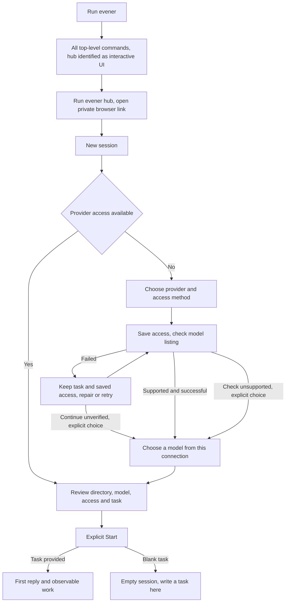

# First-run onboarding design

Status: Jesse approved implementation after three reviewed prototype iterations. Product implementation is pending. Jesse must review the implemented-flow screencast before merge.

## Intent

Help a developer new to Evener run the binary, connect an appropriate provider, and start a useful session without learning Evener's internal architecture. Keep the experience direct and adult. Setup should happen in the place where work begins, using the same controls returning users use.

Research: [six source walkthroughs and browser baseline](../../design/onboarding/research.md). Interactive, nonfunctional workflow model: [prototype](../../design/onboarding/prototype.html).

## Proposed journey

The terminal gives one clear next action. New session puts the missing prerequisite before the task form. Connecting a provider returns to the same task, and only Start begins work.

## Startup

Jesse's decision: bare `evener` lists every top-level command, with a clear hint that `evener hub` starts the interactive UI. It does not start a server or open a browser by itself. Keep the list consistent with actual command dispatch rather than introducing a second partial list. Preserve existing exit semantics unless a separate tested routing requirement warrants changing them; Jesse's decision concerns discoverability, not script status. Explicit flags, supplied prompts, piped input, resume commands, help and command dispatch retain their existing behavior. Empty or invalid scripted invocations must not silently succeed.

`evener hub` should print a concise browser handoff: the interface address, the private sign-in link, and the need to keep the terminal running. Keep operational details available without making them the primary instructions. Do not print tokens in extra diagnostics, recordings, or screenshots.

Preserve existing first-entry routing: `Welcome.tsx` already replaces focused `/` with `/new` when provider setup is missing and no session pane is open. Keep its query/hash preservation, explicit routes, background-pane protection and restored workspaces. Configured users retain their current welcome surface. This is the builder's scope-preserving choice, not a new product policy. Do not add a separate compulsory welcome tour or an onboarding-completed flag.

## Provider prerequisite

Use the existing readiness owner and connection dialog. When provider setup is required, place its explanation and primary action before the composer. Keep the directory and draft editable. Suppress a redundant missing-model notice while provider access is the earlier unmet prerequisite. Distinguish missing access, loading, failed checks, and ready states; an unavailable response is not an empty successful listing.

Healthy configured users retain their normal launch path. Advanced providers and settings remain reachable. Remote host behavior retains its existing ownership and boundaries; this change must not save a credential to the wrong host or imply local setup repairs a remote host.

Keep healthy connection status compact, with a quiet Connection settings action. Reserve prominent notices for actionable failures or unverified status, so completed setup does not overshadow the task.

Configuration readiness and verification are separate. Keep `useProviderSetup` authoritative: stored/resolved access can make a connection configured even when its model-list check failed or has not run. After save, failed check and dismissal, return to the retained task with explicit model selection available and a truthful connection-check status where known. Do not send the user through new-provider setup again or impose a new mandatory verification gate. Reopening offers repair/retry against that saved connection. Retain implicit-local-server discovery and explicit keyless-endpoint behavior. Do not manufacture persistent verification state that the existing owner does not retain.

## Connection discovery and authentication

Show the authentication method on each provider choice before selection, using actual catalogue capabilities. OpenAI API-key access and OpenAI Codex sign-in remain separate. Explain account eligibility without promising that every chat subscription works. Keep local servers, custom endpoints, cloud configuration and existing host access discoverable through their current routes.

Keep the destination and credential source visible where they protect against sending a secret to the wrong endpoint. Explain host as the computer running Evener when necessary. Do not remove endpoint assertions or broaden credential inheritance.

Save and check remains an explicit action. The check requests the model list only; it sends no task and proves neither generation access nor quota. Success should offer an action named for the next step, such as Choose model, using the existing provider-scoped chooser. Unsupported checking retains an explicit unverified continuation. Do not add a paid generation probe.

A failed check preserves saved access and the task. Retry check and editing access are distinct actions. After a save, closing the dialog must accurately say that access remains saved. Changing provider must not transfer the secret. Existing OAuth flows and their server authority remain intact; any actual OAuth defect requires its own reproduced test before a fix.

Preserve Show all providers, provider search and Manage existing connections. In the model chooser, retain Show all models as an escape from the connected instance's scoped list. Catalogue recovery offers retry and one Connection settings action, rather than two names for the same destination.

The model chooser makes a separate catalogue read after the check. It may still be loading, empty, or failed after a successful check. Preserve the task and directory, scope choices by actual instance name, and offer catalogue retry or connection repair without resaving credentials unnecessarily. Unsupported checking remains explicitly unverified. Keep available catalogue data and existing selection behavior; never invent model identifiers or treat catalogue failure as failed generation. The prototype must show multiple representative fixture choices using the real chooser's available information, without fabricated recommendations or prices.

## First task

Keep directory, model and task visible together. Surface the effective access mode and its consequence near the launch decision, using existing controls and the existing access resolver. Preserve configured access; do not silently change sandbox defaults. A user must be able to find the control that changes access without interpreting an unexplained default label.

Use the existing four modes: Full access, Read-only, Workspace write, and Restricted. Show inherited/custom values without recasting them as one of these modes. The effective summary must honor explicit advanced `sandbox` overrides, which currently win over the access selector. If an override wins, identify its source and point Change to the controlling setting; do not imply that changing the lower-priority selector changes launch access. While resolution is pending or failed, state that access is unresolved and expose the existing recovery path. Do not guess Full access or create an additional launch restriction as a side effect of this display change.

Describe blank launch in ordinary language, such as starting an empty session and writing the task there. Retain the existing capability to launch without a prompt. Avoid calling this a dormant session in first-run copy.

Start remains explicit. Existing Starting, first-reply and empty-session states should stay truthful. Never replace actual provider output with a canned success in production or in the review screencast.

Completing model choice restores keyboard focus to the task or selected-model control; dismissal returns to its invoking control. Replacing a dialog must not send focus to the document body. Blank Start opens an empty session with a composer, not a waiting-for-reply state.

The getting-started guide should lead with one in-context provider route and a short own-project path. Preserve the disposable repair example and its independent checks as an optional tutorial. A suggested read-only task is an instruction, not a security boundary; describe actual access separately.

## Visual and implementation constraints

Preserve the editorial design system, both themes, compact operational controls, readable serif headings, and visible focus. Compose production UI from existing widgets and tokens. No new widget API is approved. Prototype controls are standalone HTML outside the production tree and must not be copied into production as raw controls.

Reuse the existing provider store, readiness hook, model chooser, launch resolver and draft owner. No duplicate onboarding state machine, credential store, hardcoded model recommendation, new tour system or completion tracking. A production model must come from actual provider/catalogue data.

## Non-goals and known gaps

This design does not promise durable drafts across page reload, durable creation reconciliation after an uncertain Start, automatic recovery from an unreadable credential file, or runtime adoption of a replaced credential. The friction guide owns those separate proposals. The design may reveal a case that needs a focused fix, but it must not claim that clearer copy repairs those contracts.

No native-app redesign, installer redesign, provider pricing claims, new authentication method, automatic browser opening, automatic session creation, or global-default mutation is included.

## Acceptance evidence

1. CLI tests distinguish bare interactive startup from scripts, explicit flags, prompts and resume. Tests assert routing, output destination and exit behavior rather than exact copy.
2. Frontend behavior tests cover missing/loading/failed/ready provider states, one actionable prerequisite, provider-specific auth method, provider-scoped model handoff, retained task/directory, save/check distinctions, and explicit Start. Include saved access followed by failed check and dismissal, unsupported check continuation, and independently empty/failed catalogue reads after check success.
3. Provider tests preserve endpoint assertions, no cross-provider credential transfer, model-list-only verification and host scope.
4. Browser checks cover keyboard focus and recovery, blank-session launch, narrow and desktop layouts, both themes, and configured-user bypass. Access cases cover all four real modes, inherited/custom values, resolution failure and advanced override precedence. A fixture UI test is labeled as such.
5. A real local hub and producer exercise the full first-session path with a scripted provider at the LLM boundary. No mocked frontend is presented as end-to-end evidence.
6. Record an implemented-flow screencast with private links and credentials excluded. State whether its provider is scripted or live. Jesse reviews it before merge.
7. Update getting-started, provider connection and affected product ownership docs in the same implementation change. Run targeted tests locally and the repository gates through CI before merge.

## Decisions for review

- Decided by Jesse: bare command lists all top-level commands and identifies `hub` as the interactive UI entry point.
- Proposed: contextual setup in New session, rather than a mandatory wizard.
- Proposed: expose effective access near Start while preserving its current value.
- Builder's choice: retain the existing missing-provider welcome redirect, with configured-user and background-pane behavior unchanged.
- To settle from review: the smallest existing-widget layout that makes access consequences visible.
