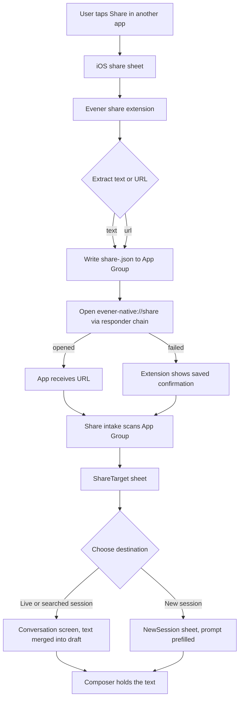

# Share to Evener: iOS share extension and session picker

Date: 2026-10-18
Status: design for approval

## Intent

When you are in another app, you can share text or a link to Evener. Evener then
asks where it should go: a new session, one of your live sessions, or an older
session found with the same search the Board uses. Whatever you pick gets the
shared text in its composer, ready to edit or send. Nothing is sent
automatically.

The user entry point is the iOS share sheet, not an in-app clipboard read.

## What exists today

- `mobile-native` is an Expo SDK 57 app with continuous native generation: `ios/`
  is generated by `npx expo prebuild` and is gitignored.
- The Board already reads live sessions through `createBoardController`
  (`src/board/boardData.ts`) and searches with `createSearchController` over
  `evener/search` (`src/board/boardSearch.ts`).
- The composer's text lives in a durable per-session draft
  (`src/nativeDrafts.ts`, `DraftDocument`), and there is one existing one-shot
  handoff into it: `src/session/pendingQuote.ts`.
- The app scheme is `evener-native` (`app.json`), but the app handles no URLs
  today.
- iOS distribution already has a prebuild + pod-install + Fastlane procedure
  (`docs/design/mobile/ios-build-distribution.md`).

## Goals

- Share selected text or a web link from any app to Evener.
- Choose a destination: new session, live session, or searched older session.
- Land the shared content in the chosen destination's composer draft without
  destroying an existing draft.
- One picker in the app, reusing the Board's live data and search backend. No
  second hub client in the extension.
- Lose nothing if the extension cannot open the app.

## Non-goals

- Reading the clipboard. (Decided by Jesse: use what the app shares.)
- Sharing images, files, or videos. v1 is text and URLs only.
- Sending the shared content automatically.
- Android. The native Android tree is deferred.
- A second, searchable picker inside the extension.

## Decisions already made

1. **The picker lives in the app, not in the extension.** The extension only
   extracts the shared item, saves it, and opens Evener. This keeps the hub
   connection, credentials, search, and drafts in one place.
2. **The extension opens the app through the responder-chain technique**
   (Jesse chose this). Apple documents that share extensions cannot open their
   containing app; the technique reaches the `UIApplication` through the
   responder chain and opens `evener-native://share`. Some apps ship this; it
   carries App Store review risk. Accepted.
3. **What the extension hands over is what the app shared**, not the clipboard.
4. **The extension target is plain Swift**, added with
   `@bacons/apple-targets` rather than `expo-share-extension`. The alternative
   runs an entire React Native bundle inside the extension and needs a second
   Metro entry and native bundle build phase; the extension needs only a small
   view, a file write, and a URL open.
5. **The picker uses the app's active hub**, the same one the Board and every
   session screen read. There is no hub switcher inside the share sheet; the
   app already has exactly one active hub, and adding a second chooser here
   would invent a second connection model. If the active hub is not ready, the
   sheet says so and offers Retry; switching hubs stays in the Hub sheet.
6. **Placement is a durable draft write, not a memory handoff.** The picker
   writes the shared text into the destination's saved draft before it deletes
   the share file, so a crash or a kill anywhere after the pick loses nothing.

## Architecture



The extension writes one JSON file per share into the shared App Group
container. The app scans that container on launch, on every foreground, when
it receives `evener-native://share`, and whenever the connection becomes ready
(which covers "Add a hub" and a hub that was down). Pending files are
processed oldest first; after one is placed or discarded, the next pending one
is offered. A sheet the user dismisses without choosing leaves the item
pending, so the next trigger offers it again; it is never silently dropped.

### App Group

Identifier: `group.com.primeradiant.evener.native` (derived from the app bundle
id, matching `@bacons/apple-targets`' default mirroring).

- `app.json` gains `ios.entitlements["com.apple.security.application-groups"]`.
- The target config mirrors the same array.
- The extension writes to `containerURL(forSecurityApplicationGroupIdentifier:)`.
- The app reads the same directory through expo-file-system's
  `Paths.appleSharedContainers[...]`.

### Shared payload

One file per share, `share-<uuid>.json`:

```json
{ "id": "<uuid>", "text": "<what was shared>", "createdAt": "2026-10-18T20:00:00Z" }
```

- Text and URL are joined into `text` when both are present, text first.
- At most 10 pending files; the extension deletes the oldest beyond that.
- The app deletes files older than 7 days at startup.
- Files are deleted only when their item is placed or explicitly discarded, so
  a crash or a failed open never loses the item.
- The extension never logs the content.

## The extension

New directory `mobile-native/targets/share/` (managed by
`@bacons/apple-targets`; generated entitlements and the Xcode target live under
the ignored `ios/`).

Files:

- `expo-target.config.js` — `type: "share"`, `name: "ShareExtension"`,
  `displayName: "Evener"`, `bundleIdentifier: ".ShareExtension"`,
  `exportJs: false`, deployment target matching the app, entitlements mirroring
  the app's app group.
- `Info.plist` — `com.apple.share-services`, principal class
  `$(PRODUCT_MODULE_NAME).ShareViewController`, activation rule supporting
  `NSExtensionActivationSupportsText` and
  `NSExtensionActivationSupportsWebURLWithMaxCount: 1`.
- `ShareViewController.swift` — a plain `UIViewController` that:
  1. Shows a small "Sending to Evener…" state in Evener's visual language.
  2. Loads `public.plain-text` / `public.text` and `public.url` from
     `extensionContext.inputItems`.
  3. Writes the JSON file to the App Group.
  4. Calls the responder-chain open for `evener-native://share`, then
     `completeRequest`.
  5. If the save or open fails, stays visible with "Couldn't open Evener. The
     text is saved; open Evener to finish." and a Done button. It must not
     dismiss on a failed save.

`app.json` also gains the `@bacons/apple-targets` plugin and the app group
entitlement.

`@bacons/apple-targets` needs `ios.appleTeamId` at prebuild time, and today the
team id exists only as the `APPLE_TEAM_ID` CI secret and local environment
variable. The plan is to convert `app.json` to `app.config.js`, keep every
current value, and set `ios.appleTeamId` from `process.env.APPLE_TEAM_ID`,
failing prebuild with a clear message when it is missing. That keeps the team id
out of the repository and gives local prebuild the same input CI already has.

## The app

### Intake

New `mobile-native/src/share/shareIntake.ts`:

- `scanPendingShares(port)` reads the App Group directory, parses valid files,
  sorts oldest first, and returns items. The port is injected in tests.
- `deletePendingShare(port, id)` removes exactly one file.
- A hook `useShareIntake(navigation)` in `App.tsx`:
  - subscribes to `Linking` (`getInitialURL` plus the `url` event) and checks
    for `evener-native://share`;
  - rescans on `AppState` becoming active (this is also the fallback when the
    extension's open fails);
  - rescans when the connection becomes ready, and when navigation returns from
    the `Hubs` or `Hub` screens, so "Add a hub" and a hub that was down both
    bring the pending share back without waiting for a foreground;
  - navigates to the `ShareTarget` modal with the next item; when the modal
    closes, if another item is pending, opens the next.

Dismissing the sheet without choosing leaves the item pending. The next trigger
offers it again; dropping it requires the explicit Cancel confirmation.

No navigation library linking config is added; the URL is only a trigger, and
the payload comes from the App Group.

### ShareTarget sheet

New route `ShareTarget: { item: SharedShare }` in `App.tsx` and
`screens.tsx`'s `Routes`, presented as a modal sheet with
`useSheetStackOptions`, like New session.

Shape:

- Title "Share to Evener"; Cancel discards this item after a confirmation only
  when the payload is still unplaced. (Discarding is explicit.)
- A preview of the shared text: up to four lines in the inset style, with the
  full text available by expanding the preview.
- A **New session** row.
- A search field, placeholder "Search sessions", the same debounce
  (`SEARCH_DEBOUNCE`) and failure behavior as the Board, through
  `createSearchController`.
- A **LIVE** section: the live rows from a `createBoardController` bound to the
  ready client, classified and ordered with `liveBands` (Needs you, Working,
  Idle). Each row shows its title, its state word, and its project; no swipe
  actions, no menu.
- When searching, results replace the live list and use `sessionResults(...)`
  with scope `all`: live matches first, then past matches, grouped the same way
  the Board groups them. A result is selectable regardless of whether it is
  live.
- States: no ready connection ("Connect to a hub to choose a session", with
  Retry); no hub configured ("Add a hub", which leaves this item pending and
  goes to Hubs); search failed (the Board's retry line); one live session and
  no query still shows the list with just that row.

Selecting a row or New session does not send; it places the text.

### Placing the text

- **Existing session** (live or past): the picker opens the destination's
  `DraftDocument` through `drafts.open({ hubId, ref })` and calls
  `edit(mergeDraftText(currentDraft, text))`. That write is synchronous SQLite
  and durable. `DraftDocument` loads synchronously in its constructor, so the
  picker reads the current draft, writes the merge, and then checks
  `getSnapshot()`: `loaded` false or `error` set means the write did not land,
  and the sheet reports it and keeps the share pending rather than deleting
  it. Raw text is appended; it is not formatted as a quote block. The
  Conversation screen needs no handoff code: it opens on the draft that now
  holds the text.
  A past session takes the text the same way. If it cannot compose now (ended
  or shut down), the text stays in its durable draft and the screen's existing
  shut-down or restart notice explains the state; when the session is resumed,
  the draft is there. The picker adds no second explanation.
- **New session**: `Routes.NewSession` gains
  `share?: { id: string; text: string }`. The sheet runs the existing
  `openForm(store, memory.lastSetup())` first, so the remembered host, project,
  model, and effort still apply, then merges
  `mergeDraftText(currentPrompt, sharedText)` into the prompt and saves it
  through the store. The creation store saves on every prompt change, so the
  write is durable by the time `setPrompt` returns; the sheet checks
  `storageError` and only then calls `completeShare(share.id)`, which deletes
  the file. A save error keeps the share pending and the sheet open. The user
  lands on the normal New session form with Start available.

After the durable write succeeds, the sheet closes and the item's file is
deleted. A failed write keeps both the file and the sheet open with the
error, and the retry writes again.

## Distribution and build

- Extend `mobile-native/scripts/configure-ios-distribution.rb` to sign the
  share target with the same team, plus a profile for
  `com.primeradiant.evener.native.ShareExtension`, and add that bundle id to
  the export options' `provisioningProfiles`.
- New env var for the extension profile name; document it beside the existing
  `IOS_PROVISIONING_PROFILE_NAME` in `docs/design/mobile/ios-build-distribution.md`
  and the Fastlane helper.
- Update `scripts/test-ios-distribution.rb` for the two-target export options.
- Prebuild and pod install procedure is unchanged; the target is produced by
  the plugin.
- The generated `ios/` tree stays ignored.

## Tests

- `shareIntake` unit tests: ordering, malformed files, stale cleanup, delete of
  one item, empty directory, App Group port double.
- Draft placement test: an existing saved draft is preserved and the shared
  text appended, using the real `DraftRepository` over a test database; a
  failed read leaves the share pending.
- ShareTarget component tests with the real controller code behind a fake
  client (the Board's test shape): live list order, search debounce and
  results, past result selection, new-session navigation, no-connection state,
  discard.
- New session seeding test: the remembered setup is applied first, the saved
  prompt is preserved and the shared text appended, and the share is completed
  only after the draft save.
- Swift has no automated test in this repo's gates. Add a manual checklist to
  the distribution doc: share selected text from Safari, share a page URL,
  share with Evener not running, share with no hub configured, and verify the
  payload appears and lands in the composer. The checklist is a required
  verification step, not a substitute for the unit tests above.
- `make test-native` and `make test-native-bundle` must pass. `make lint`
  covers Biome/typecheck via the native gates.

## Docs to update with the code

- `mobile-native/DESIGN.md` — the ShareTarget sheet, its rows, and its states.
- `mobile-native/README.md` — the extension, App Group, and team-id setup.
- `docs/design/mobile/ios-build-distribution.md` — the new target, signing,
  and the manual share checklist.
- `docs/product/subsystems.md` — the native surfaces row, if it names the app's
  surfaces (check the row before editing).

## Open questions for Jesse

1. **Extension provisioning profile.** Does the App Store Connect / Fastlane
   setup already have (or can it create) a profile for
   `com.primeradiant.evener.native.ShareExtension`? If not, the release lane
   needs that added before a TestFlight build with the extension can ship.
   The App Group `group.com.primeradiant.evener.native` also has to be enabled
   on both App IDs in the developer portal.
