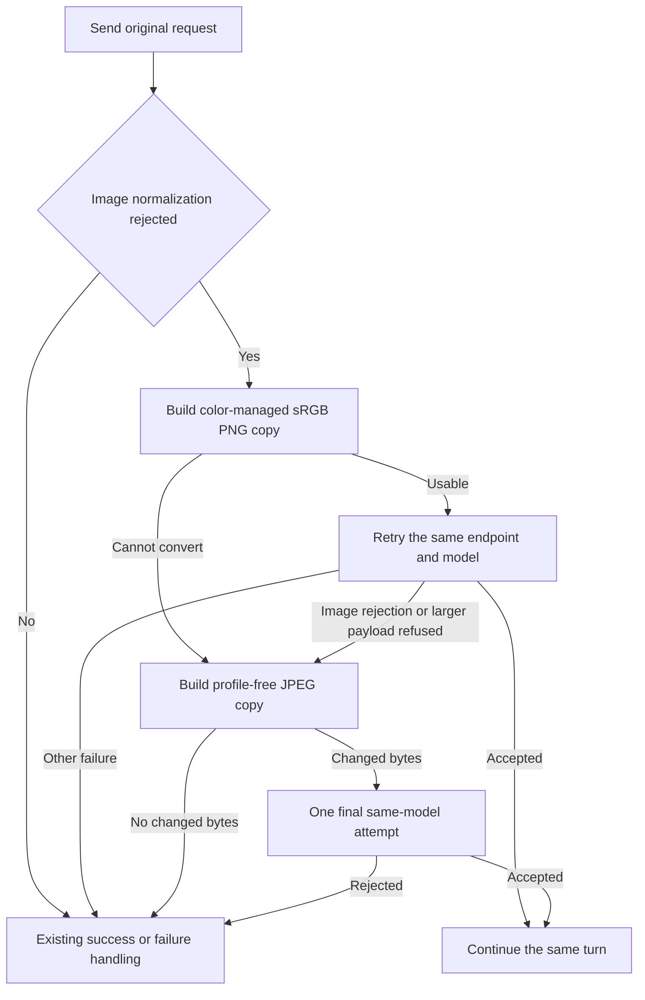

# Recover rejected provider images

Status: Color-managed recovery approved by Jesse on 2026-10-20. Implementation
choices below are the builder's, subject to independent review.

## Intent and evidence

Recover from usable image input instead of ending the user's turn. Keep original
attachments and successful requests unchanged. Use actual color conversion before
best-effort metadata removal; disclose reduced color fidelity when only unmanaged
recovery succeeds.

The reported LunaRoute `glm-5.3-vision` call returns HTTP 400,
`Image normalization failed`, for a valid 942 × 2048 JPEG. The native input path
supplies inline JPEG bytes with the correct media type. Removing EXIF alone or
Photoshop metadata alone still fails. Removing only the ICC APP2 segment succeeds.
The embedded profile is Display P3; this isolates the trigger, not the provider's
internal decoder defect.

A LittleCMS 2.14 diagnostic conversion to sRGB followed by clean PNG encoding also
succeeds. The model reads the screenshot title and `Working` status, with a minor
OCR spelling error in the title. Conversion changes 110092 of 5787648 channel
values, with a maximum 8-bit channel difference of 71. Stripping the profile alone
does not do that conversion. Original evidence remains untouched.

## Recovery contract

The Chat Completions adapter owns recovery for native, browser, CLI and tool images
using that protocol. Clients neither resubmit input nor gain a second retry owner.

1. Send the ordinary request unchanged.
2. On an HTTP 400/422 image-normalization rejection, build a private provider-bound
   copy. For inline JPEGs, convert the embedded ICC color space to sRGB, apply EXIF
   orientation, and encode a clean PNG at the same visual dimensions. Untagged RGB
   JPEGs use the conventional sRGB interpretation. Preserve all images and order.
3. When conversion cannot safely interpret a profile or image, try removing only
   its ICC APP2 segments instead. Preserve compressed image data, EXIF and other
   metadata in this fallback. MPF/multipicture JPEGs stay byte-for-byte unchanged
   in both repair paths, because removing metadata can invalidate image offsets.
   Other unsupported images stay present and unchanged.
4. Retry changed input on the same endpoint and model. If a color-managed attempt
   is rejected again for image normalization, or its larger PNG hits HTTP 413,
   permit one final profile-free JPEG attempt derived from the original request.
   Never resend an identical body. There are at most two repair resends per call.
5. Continue the same turn on success. If recovery is exhausted, return the final
   provider error through existing failure and configured-fallback handling.
   Exception: if an expanded PNG receives 413 and no distinct smaller fallback
   can be sent, return the original image rejection. Keep the 413 in API-attempt
   diagnostics, but do not misclassify disposable repair expansion as a need to
   compact the user's history or bypass their configured fallback.

Only a definite HTTP rejection before any stream is exposed admits this repair.
Cancellation prevents new attempts and interrupts image work. A started stream is
never replayed. Each actual HTTP exchange retains ordinary API-attempt accounting.
The repair budget does not change transport authentication or ordinary transient
retry policy.

The adapter operates after provider message overlays and transport preparation,
so overlays cannot undo repair or lose caller options. Preserve endpoint, model,
text, tools, image order and unrelated options. Only image data/MIME and a fixed
color-fidelity caveat beside an unmanaged image may change. Never derive that
caveat from untrusted profile descriptions or provider bodies.

Use the existing structured response-warning and session diagnostic surfaces to
record unmanaged recovery. The model also receives the caveat beside the affected
image, so it does not assume accurate color. Do not turn successful recovery into
a terminal error or an action the user must take.

## Color handling and limits

Use a portable implementation that works with `CGO_ENABLED=0`; no runtime Python,
ImageMagick or system-library prerequisite. Select an existing suitable library
when available. Validate its conversion, not merely its ICC metadata parsing.
Never choose a transform from a profile's display name.

A bounded, explicitly documented subset of ICC profiles is acceptable when it
covers the actual Display P3 matrix/TRC RGB profile and ordinary sRGB profiles.
Unsupported, contradictory or malformed profiles take the disclosed unmanaged
fallback instead of an invented color transform. Test conversion against outputs
from an independent color-management implementation, including out-of-gamut input.
Gamut clipping/approximation is inherent in converting to sRGB; do not promise
exact preservation of colors outside that gamut.

Apply all eight EXIF orientation values correctly. Missing orientation means 1;
malformed orientation metadata must not silently turn a photo the wrong way.
Keep multipart ICC ordering, JPEG bounds checks and allocation limits explicit.
Leave MPF/multipicture images unchanged in both paths. Bound pixel work before
allocation; exceeding a repair resource budget still permits metadata-only repair
for single-picture JPEGs and never creates a new rejection of the original request.

## Preservation and scope

- Original files, transcript, input history, caller request and registry options
  remain unchanged. Recovery copies are disposable, with no persistent cache.
- Shared image repair is separate from Chat Completions wire traversal. Both
  `Complete` and `Stream` follow the same bounded behavior.
- Recognize the evidenced image-normalization failure case-insensitively. Do not
  retry arbitrary invalid requests, timeouts or uncertain delivery as image repair.
- No new model/provider fallback, network image fetch, filesystem read, credential,
  dropped attachment, resizing, animation flattening or input resubmission.
- Other protocols and remote image URLs keep their existing behavior. This change
  repairs JPEGs; it does not claim universal repair of every image format.
- Remove unsupported registry-field advice from unclassified 400/422 errors when
  no rejected field is established. Actual field rejections retain their guidance.
- Native rejected-draft restoration in friction case C06 is separate.

## Acceptance and evidence

Default tests use synthetic/reference images and a scripted HTTP provider boundary
with real Evener code underneath. Credentials and network are unnecessary. Provider
error text is fixture input, never a copy-string oracle.

1. Color tests compare converted samples to independent LittleCMS references for
   Display P3 and sRGB, including neutral and saturated colors. Assert geometry,
   orientation, alpha handling where applicable and unchanged source bytes. Test
   unknown profiles, malformed/oversized data, multipart ICC and cancellation.
2. Fallback tests verify that only ICC segments are removed and every other byte
   survives. Include unrelated APP2, progressive JPEG, truncated marker lengths,
   and inconsistent ICC chunks. Multipicture input must remain byte-for-byte
   unchanged in both paths, preserving all indexed frames. Fuzz parsing for bounds
   safety.
3. Real HTTP transport tests reject the original, inspect the repaired image, and
   accept it through both completion methods. Cover multiple images, image history,
   tool results, provider overlays and transport constants. Assert original objects
   unchanged, all images retained, same endpoint/model and no option loss.
4. Test managed success, unmanaged success, managed rejection then fallback,
   expanded-PNG 413 then fallback, final failure, no-change input, unrelated 400,
   cancellation and an error after streaming starts. Assert attempt bounds and
   ordinary API-attempt logging, including every rejected exchange.
5. A real session journey submits text and an image, recovers from the scripted
   provider rejection, executes a tool exactly once and finishes. Assert one input,
   no terminal failure, original attachment/hash and transcript reload preservation,
   plus a subsequent model call with the original image still in history. The
   unmanaged journey must carry the structured warning into session diagnostics.
   An untagged JPEG rejected with 400, then PNG rejected with 413, must retain the
   original error when stripping cannot change the original. Assert no forced
   compaction and ordinary configured-fallback handling.
6. Run the copied private failing attachment through the implemented recovery path
   against LunaRoute as explicit live verification. Check visible comprehension
   and actual converted request bytes. Never commit private image data.
7. Update `docs/llm-providers.md` and the provider ownership row of
   `docs/product/subsystems.md` with verified behavior and limits.

Delivery order: implementation and tests, simplify-code, explicit RoboRev branch
review, then PR shepherding through authorized merge. Deployment remains separate.
