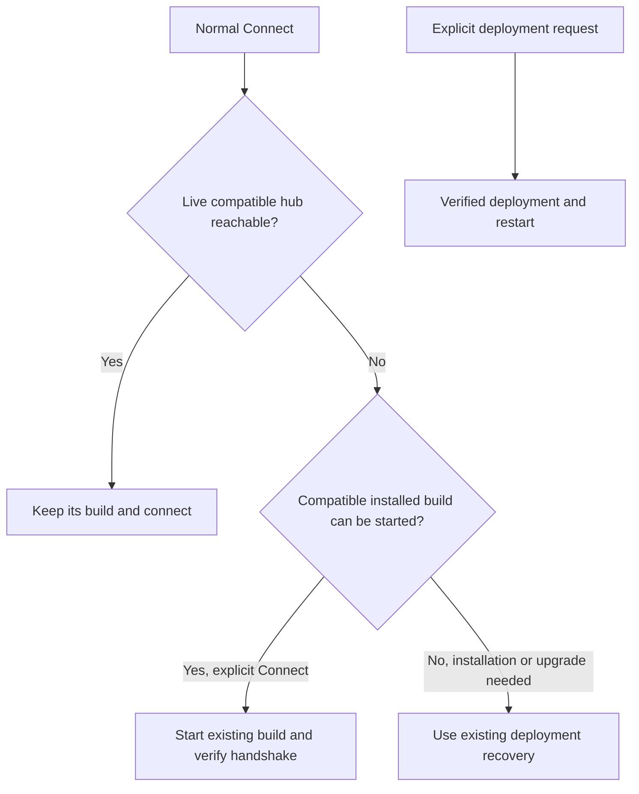

# Connect to compatible existing hosts

## Intent

Normal Connect should make an existing Evener installation usable without
replacing it merely to match the controller's build. Jesse specified that an
installed Evener with the right protocol should connect. This applies even when
the controller has a matching artifact available, not just when synchronization
fails.

The reported failure was a Linux/amd64 development controller trying to deploy
its own executable to a Darwin/arm64 host. The deployment refusal correctly
rejected an unusable artifact. The connection policy incorrectly required that
deployment before allowing a compatible host to be used.

## Scope

- Normal Connect and the SSH manager's reconnect path.
- The distinction between a usable remote build and a requested deployment.
- Truthful remote build/protocol reporting through the existing host facts API.
- Browser and native clients that share the host attach/probe APIs.
- Evergreen host lifecycle and deployment documentation.

This supersedes the weaker fallback-only policy in the product friction guide's
"Connection versus build synchronization" case.

## Behavior

| Situation | Required result |
| --- | --- |
| A usable compatible installation has a different clean build | Connect without deploying or restarting solely for the build difference |
| Either build is development, dirty, or unstamped | Apply the same compatibility rule, without requiring proof of identical source |
| Controller and host have different OS/architecture | Connect normally when the existing remote installation is compatible |
| A matching deploy artifact or build source is configured | Its availability does not itself request a deployment |
| A compatible installation is stopped | Explicit Connect may start that installation using the existing bootstrap path, without replacing it |
| A running hub differs from the executable on disk | Judge the connection using the live handshake, keep a compatible running hub, and report its actual build |
| Evener is missing or the connection is genuinely incompatible | Preserve installation/upgrade recovery through the configured deploy source, or return the accurate missing/incompatible/unavailable-source failure |
| The user explicitly requests deployment | Preserve the existing plan, confirmation, identity verification, operation journal, and restart guarantees |
| Deployment is disabled | Never write an artifact through either the push or installer path |

Compatibility remains the existing AppWire protocol contract and capabilities
actually required for the requested operation. The final live handshake must
validate the protocol. A build label, equal commit, or healthy HTTP response
alone cannot establish compatibility. Optional missing features retain their
existing feature gating instead of blocking all host use.

The on-disk launch contract remains relevant when starting a hub or launching
runtime processes. Keep its facts separate from facts about the running hub.
Do not replace a healthy compatible process merely because the on-disk version
or controller version differs. A bridge that cannot run, authenticate, or speak
to the configured destination remains a real connection failure.

This diagram describes the policy, not an instruction to treat every failed
handshake as an upgrade request. Authentication and transport failures retain
their own classifications and must not authorize replacing the installation.

Positive live protocol evidence is a successful initialize response naming a
different protocol, or a structured protocol refusal such as `ErrorUpgradeRequired`.
A generic `InvalidRequest`, its message text, malformed response, EOF, or timeout
does not establish protocol incompatibility. Without separate live protocol
evidence, leave the installation unchanged and return the unresolved connection
failure. On-disk protocol facts cannot resolve an ambiguous live refusal.
An established mismatch enters existing incompatibility recovery; it does not
bypass deployment-source validation, deployment-disabled settings, or explicit
deployment guarantees.

**Amendment (2026-10-22).** A pre-v7 server refuses a newer client with an
`InvalidRequest` whose message names the client's protocol and the older protocol
it wants. That exact sentence, matched with `CodeInvalidRequest` and both versions
well formed, is positive live protocol evidence for that older server; it is the
only shape those binaries can send. Every other generic `InvalidRequest` still
does not establish incompatibility. A live protocol that is newer than the
controller's is refused rather than downgraded: the controller must be updated.

## Preservation and recovery

- A successful compatible Connect leaves the remote executable, running hub,
  configuration, sessions, and user files unchanged.
- Losing the SSH channel and reconnecting must not trigger build synchronization
  or restart a compatible remote hub.
- Repeated Connect is idempotent. Disconnect continues to stop reconnection.
- A failed probe or handshake does not count as successful attachment. Keep
  existing authentication, cancellation, transient-failure and retry semantics.
- Keep explicit deployment's pending restart and uncertain-write reconciliation.
  Connecting successfully to an old process cannot complete an unfinished
  deployment or satisfy its requested identity.
- Do not implement recovery by catching every deployment error and proceeding.
  A failed or interrupted write still needs its existing reconciliation owner.
- Do not turn ordinary reconnect into permission to start a deliberately stopped
  host. Preserve the explicit-Connect-only bootstrap rule.

### Host-entry authorization across recovery

Unfinished deployment, start and restart effects retain the host-entry validation
that authorized them, alongside their requested build, target and process proof.
An automatic reconnect or retry cannot replace that validation with the settings
observed by its new attempt. A changed or unreadable selected entry refuses new
remote mutations while preserving the unfinished work. Unrelated entry changes
do not block recovery. Restoring the entry permits a later recovery attempt.

Jesse chose a fresh explicit Restart as another way to authorize recovery after
an entry change. After the existing admission, registration, generation, gate and
current-entry checks succeed, that new request may renew the pending effect's
entry validation. It keeps the original requested build, commit pin, installation
target, write acknowledgement and predecessor/start proof. A deduplicated replay
returns its existing record without renewing authorization. An automatic attempt
record is not a fresh Restart request.

A newly confirmed Deploy retains its existing ability to supersede pending
deployment intent at its first authorized installation write. Source refusal
before that write preserves the previous intent. Neither renewal path grants
permission to carry unfinished work into a different host registration or to
retarget it by silently reloading configuration.

The retained validation must survive installation acknowledgement, promotion to
restart, command recording, channel loss and worker completion. Check it before
each mutating recovery boundary, including installation writes, startup, restart
and recorded command replay. A bare-process restart checks both stopping the
predecessor and launching its replacement. These checks do not atomically exclude
external edits after a check. Independent proof that the requested effect already
completed may settle it without issuing another command, despite later entry
drift. Existing registration teardown fences and manager shutdown release the
retained validation with its pending state.

Keep validation in its current owner: the hub reads the selected configuration,
and the SSH manager retains an in-memory operation binding. Do not add persistent
state, protocol fields, a configuration parser in the SSH layer, or a new retry
policy. Ordinary automatic operations without an explicit entry binding retain
their existing policy.

The recovery contract assumes stable remote installation paths. Changes to
executable symlinks or their parent directories between attempts are outside
this change's target-preservation guarantee. A redirected configured symlink can
send a retried installation write to its new destination even with an unchanged
host entry. Jesse accepted this limitation and deferred destination-drift handling
to [#4802](https://github.com/prime-radiant-inc/evener/issues/4802).

## Version reporting and clients

The controller's version and the connected host's version are distinct facts.
Host attach/probe results must report the remote build actually observed, never
substitute the controller's build. Bind facts to the attached channel generation
so reconnect cannot combine an old client's handshake with a new host's facts.
Do not invent a version when it cannot be observed. Missing trustworthy build
metadata leaves the version unknown without blocking a compatible connection.
The handshake's current package-level server version is not a build identity,
and the on-disk launch-check version cannot stand in for a different live build.

Reuse the existing browser and native Connect controls and host details. Both
clients must receive successful attachment for a compatible different build and
retain the remote identity across refresh/reconnect. No new controls, settings,
protocol version, compatibility shims, or widgets are proposed.

## Implementation boundaries

The SSH manager owns connection policy. Keep build-source selection, artifact
validation and explicit deployment identity checks in their existing owners.
Remove version-only auto-deploy/restart decisions and any state used solely to
force development-build synchronization. Preserve state that reconciles real
deployment or startup effects.

Update `docs/evener-hub.md`, `docs/evener-hub-remote-operations.md`, and the remote
host lifecycle row in `docs/product/subsystems.md`. Remove the resolved friction
case only after its acceptance behavior is implemented and verified.

## Verification

1. Add failing-first manager tests for compatible clean, development and dirty
   build differences, including Linux/amd64 to Darwin/arm64 and an available
   deployment source. Assert successful real manager attachment and no build,
   push, installer, or restart side effects.
2. Cover live/disk version disagreement, incompatible live protocol, required
   startup capabilities, missing installations, stopped compatible installations,
   explicit deployment, and deployment-disabled behavior. Exercise real server-side
   initialize rejection, including structured upgrade refusal and generic
   `InvalidRequest`, as well as a successful response naming a mismatched protocol.
   Verify that ambiguous rejections, authentication failures, malformed responses,
   EOF, and timeouts cannot authorize deployment.
3. Prove reconnect and repeated Connect preserve a compatible running process and
   installation. Keep pending-deployment recovery and generation-consistency
   assertions at least as strict as before.
4. Exercise host add/attach, host facts, and a forwarded remote read through the
   real hub handlers and SSH manager. Verify actual remote build reporting in
   shared responses and affected browser/native consumers.
5. Run a private real-process SSH journey with differently stamped compatible
   controller and remote builds. Add the host, connect with default deployment
   settings, read remote data, disconnect/reconnect, and verify the remote binary
   hash and hub process identity remain unchanged. Use test-owned configuration,
   state and ports, never Jesse's live host installation. The real journey uses
   no mocked Evener or SSH components. Its filesystem, process and service-manager
   authority must be isolated from all non-test installations and services,
   including system services. Alternate paths and ports under Jesse's normal
   account over localhost SSH are insufficient: restart discovery consults host-wide
   supervisors. Prove the fixture's isolation before running the journey, including
   the pre-fix failure. If isolation cannot be established, report this journey as
   unverified rather than running it against the shared host.
6. Keep cross-platform decision coverage deterministic at the external transport
   boundary. A Linux-only real-process run does not establish actual Darwin
   execution. Report separately if no safe Darwin fixture is available.
7. Run focused Go and affected client checks locally. Leave full repository gates
   to CI under the repository policy. Tests assert outcomes, structured fields,
   and side effects rather than copy.
8. Exercise an entry change during repair followed by channel loss: automatic
   reconnect must preserve the live predecessor and unfinished requested build.
   Then prove a fresh Restart accepts the changed entry after validation and
   completes that original build without an unnecessary write. Cover dedup replay,
   refusal before renewal, a later entry edit after renewal, acknowledged and
   uncertain writes, saved startup/restart commands, bare kill/relaunch, read-only
   settlement, and registration/shutdown cleanup. Keep the existing restored-entry
   recovery case. Test public operation admission and real manager recovery, not
   just the validation callback in isolation.

## Non-goals

No deployment to or restart of Jesse's running hub or m5max. No new release
artifacts, automatic source-checkout discovery, cross-protocol compatibility,
host retry policy redesign, teardown remediation, or general host settings
redesign. Deployment of the merged change requires separate authorization.
