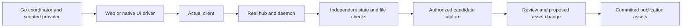

# Documentation quality repairs

**Status:** Approved for subagent-driven implementation on 2026-10-20. Jesse deferred native build setup; native execution and capture remain pending that setup.

**Request:** Repair every defect and learning gap in the completed documentation audit. Jesse selected “Include everything,” including native walkthroughs and reviewable screenshot refresh. Read and apply *Writing Clearly and Concisely* before editing.

## Goal

Readers can safely follow Evener's user, operator, and contributor instructions. Tutorial evidence comes from the interface described, verifies the resulting work independently, and reaches publication through review.

## Boundaries

- Preserve current product behavior and compatibility policy. This work repairs guides and their verification machinery; it does not introduce legacy-state migration, per-device credential revocation, a native web port, or new settings capabilities.
- Keep canonical documentation in its current files. Prefer short procedures, explicit prerequisites, named success checks, and links to owning references over duplicate reference material.
- Native coverage means the real iPhone app in a simulator. Native controls and scope may differ from CLI and web. Physical-device, camera, distribution, iPad, and Android qualification remain outside this work.
- Use a scripted provider only at the LLM HTTP boundary. Exercise the real hub, daemon, tool execution, transcript, and client below it. Do not infer success from screenshots or driver acknowledgments.
- Use disposable roots, synthetic credentials, and owned simulator instances. Preserve original state and existing devices. Do not rotate Jesse's real hub token, expose credentials, issue live-provider requests, or publish screenshots without review.
- Default tests remain deterministic and credential-free. Browser tours and simulator tours have explicit execution commands. Missing requested prerequisites fail visibly rather than counting as successful execution.
- Follow `docs/developing-evener/testing.md`. Assertions test behavior and structured state, not human-readable wording. UI labels may locate controls.
- Run focused local checks. CI remains responsible for expensive whole-repository qualification. Do not run heavy local gates concurrently.

## Required repairs

| Area | Required result | Acceptance evidence |
| --- | --- | --- |
| Daily work setup | Stop at a failed workspace creation or directory change; preserve existing paths and the caller's directory. | Execute the actual documented block for a new path, existing directory, file, symlink, dangling symlink, and unwritable parent. Only the new writable path reaches Git and agent invocation. |
| Upgrade compatibility | Warn before shutdown that roots with legacy delegate or watch state cannot resume. Preserve history and explain fresh-root continuation. Do not claim migration fixes the rejected format. | Compatible and rejected-state fixtures, unchanged original hashes, readable copied history where supported, and a successful new-root task. |
| Lost phone or leaked hub token | Explain that invitations and shared credentials have different lifetimes. Stop the correct service, prevent automatic restart, replace the private credential, restart, reject old access, and reauthorize trusted clients. State that every client sharing the token is affected. | An isolated real hub rejects old bearer and cookie access after restart, accepts the replacement, and permits a trusted client to reconnect. Changing the file alone must not be presented as sufficient. |
| Reconstruction | Name the external AgentsView database, surviving root metadata, and new staging directory. Work on copies and inspect `recovered_through`. Explain omitted jobs, delegates, tasks, queues, live state, media, and provider replay. | Real SQLite-backed reconstruction leaves input copies unchanged, produces a readable staged transcript and a report with its recovery boundary. |
| Backup restore | Provide a provider-free rehearsal from a consistent backup into a fresh disposable root. Separate history readability from resumability. | Copied source hashes remain unchanged; the reader can list and read the expected history without launching an agent. |
| Contributor prerequisites | Show Node 22, npm installation, and Chromium installation before `make docs-check`. Correct the generated make-target prerequisite description at its source. | Follow the revised sequence with a fresh browser-cache directory, then complete the docs gate. |
| Provider test recipes | Remove obsolete package paths, selectors, opt-ins, and present-tense coverage claims. Document maintained replacements only when source and offline enumeration establish them. | Every retained runnable recipe resolves to existing tests; source confirms explicit live opt-in. No live qualification is implied. |
| Developer commands | Replace retired `evener dev` instructions with the owning make target or supported developer binary invocation. | Dispatcher resolution for each changed command; preserve the multi-module warning. |
| First contribution | Give one short first-build, edit, focused-check, generation-if-needed, and submission path. | Perform the walkthrough in a disposable checkout and identify the remaining CI gates. |
| HTML anchors | Decode character references when collecting explicit HTML IDs. | `` resolves from `#a%26b` in source and rendered checks; an absent target still fails. |
| Job control navigation | Add a compact linked tool index without broad page restructuring. | Keyboard and pointer reach `job_stop`, `job_status`, and `job_watch` at desktop, 320px, and 390px widths; headings clear sticky navigation. |
| Pairing terminology | Describe the encrypted credential-bootstrap envelope separately from subsequent RPC transport. | Wording agrees with the actual pairing payload and continues to require appropriate transport protection. |
| Web learning | Follow the visible configuration menu rather than jumping straight to its route. Add first-provider setup evidence from an unconfigured starting state. | The real UI persists the setting/provider, independently observed state agrees, and a subsequent task uses it. |
| Native learning | Add receipt, daily work, configuration, and extensions walkthroughs with entry, action, and verified checkpoints. | Twelve genuine native captures with independent runtime/file/transcript evidence. Keep the existing CLI/web twenty-four checkpoints. |
| Native outbound sharing | Explain opening a document, sharing it out, choosing a destination, cancellation, and retry after failure. Distinguish inbound text/URL sharing. | Execute the actual app's share path in a simulator and verify the exported document bytes. State any untested destination-specific limits. |
| Screenshot refresh | Retain validated candidate captures and provenance. Give reviewers a comparison and an explicit path to a proposed asset change. | Relevant source changes produce reviewable candidates; unrelated documentation changes do not force new published captures. Publication still uses reviewed committed assets. |

## Tutorial design

Reuse the existing Go coordinator, scripted provider, and independent RPC, file, and transcript checks. Keep native UI actions in a small XCTest runner connected through the existing private driver protocol. The driver performs actions and captures; it never decides whether the task succeeded.

The coordinator authorizes each capture only after its outcome checks pass. CI retains sanitized candidates separately from private process logs. Review compares captures and provenance before any asset change is committed.

### Native differences

- **Receipt:** prepare the disposable example on the host, start the repair from the phone, and verify the checker, diff, and unchanged checker source independently.
- **Daily work:** queue input, use the queued row's steering action, stop active work, and continue once. Verify distinct turn identities, cancellation, and exactly-once file effects.
- **Configuration:** edit the hub's **global** Launch defaults through the numeric Max rounds editor. Test bounds 1 and 4, with an existing launch unchanged. Do not claim project-layer editing or use More options presets for values they do not offer.
- **Extensions:** install the example files on the host, then invoke and inspect the command, skill, hook, and MCP interactions from the phone. Host preparation is not a phone terminal.

The native lane must first prove receipt end to end. There is no verified native browser lane or existing XCTest tour runner in this checkout. If current-source simulator execution needs a product redesign or cannot run on the available toolchain, report that specific blocker rather than substituting browser images or claiming verification.

## Candidate and publication contract

The completed matrix has four scenarios, three surfaces, and three checkpoints per scenario/surface. Add an explicit native-simulator representation and record device, runtime, app-build identity, actual image dimensions, and source provenance. Use a new manifest version and migrate committed assets and validation together; do not relabel old captures as new executions.

A requested subset is valid evidence for that subset, not a complete publication set. A missing native run must remain visible. Include native application, shared mobile, and native-driver sources in the relevant-source digest. Keep image hashes, path confinement, failed-evidence rejection, and private-data checks at least as strict as today.

CLI/web candidates can run in the existing Linux documentation workflow. Native execution needs a separate explicit macOS workflow with the supported Xcode/runtime and team configuration. Native CI must not require distribution upload, provider credentials, or production hub access. An unavailable native prerequisite is a blocked lane, not a passing tour.

## Known prerequisite requiring Jesse's input

The current shell has Xcode 27.1 and available iOS 27 simulators. This worktree has no generated native project or native dependencies. `APPLE_TEAM_ID` is unset, while the integrated app's share-extension prebuild requires it. Jesse must identify the intended team or an approved setup that supplies it. Do not copy another environment's value or disable simulator signing.

## Completion

All listed procedures have fresh acceptance evidence. Every tutorial image is reviewed against its claimed outcome and provenance. Documentation and tooling checks pass, focused runtime checks pass, and a fresh reviewer checks the whole branch. Report exact commands, what they established, untested limits, and any remaining blockers. This design does not authorize a push, deployment, or merge.
