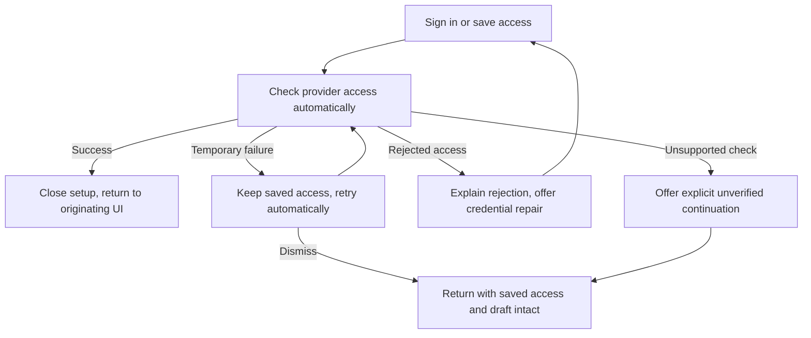

# Automatic completion of provider onboarding

Status: approved by Jesse for implementation after independent review.

## Intent and decisions

After onboarding obtains credentials, Evener checks provider access automatically
and returns the user to the regular UI. The user should not have to coordinate
sign-in, credential refresh, verification, a completion button and a model picker.

Jesse requested this flow after successful OpenAI Codex sign-in left a
configuration-change warning and several manual steps. Jesse chose provider-access
verification only: no generation probe, no user-task submission and no claim that
the check proves generation permission, billing status or remaining quota.

This specification replaces the manual success continuation and required model
handoff in the earlier [first-run design](2026-10-18-onboarding-design.md). It keeps
that design's credential destination protection, explicit Start, saved-access
preservation and non-generating verification contracts.

## Scope

- Browser onboarding, including desktop and mobile web, entered from New session.
- The existing guided provider connection flow: OAuth device authorization,
  redirect completion, API keys and credential JSON, plus its supported existing
  host-access and keyless paths.
- Automatic success dismissal in the shared guided dialog, returning to whichever
  surface opened it. New-session completion must not force its model picker open.
- Shared OAuth dialog/store changes only where needed to preserve the same
  mutation's successful handoff. Existing Settings credential editors keep their
  diagnostic controls and host scope.
- Necessary provider-default resolution and regression tests for shared code.

Native-app onboarding redesign and new remote-host onboarding are out of scope.
Do not imply that connecting the controller repairs a selected remote host. Keep
the current remote setup ownership and the separate agreed work in the
[friction guide](../../product/friction.md#c08-remote-provider-setup-at-launch).

## User journey

### One credential action

OAuth starts with Sign in; submitting a key or JSON remains an explicit save and
check action. Do not submit partial input automatically. Successful credential
acquisition immediately enters a single progress state. Do not show competing
Sign in and Check connection buttons while verification is running.

Keep the destination and account information accessible, using existing widgets.
Use the existing dialog and status components, with no new widget API. Detailed
configuration stays under Advanced settings.

### Automatic success

When the current attempt's provider-access check succeeds, finish that attempt
exactly once and dismiss the guided dialog. There is no success-confirmation
button, Choose model button, or automatically opened model picker.

Return to the original surface. For New session, preserve the task, attachments,
directory, host, harness, access settings and existing model choice. Restore focus
to the composer only while that setup flow still owns the user's focus. Use a
quiet confirmation; do not leave a success page that demands another action.

Do not create or start a session, send the user's task, or change global provider
or model defaults. Start remains the explicit launch action.

### Model readiness in the regular UI

Preserve every explicit model choice, including a choice made while checking.
Do not silently replace an explicit choice that is unavailable.

For an untouched first-run model, resolve the newly connected instance's default
from authoritative provider configuration and validate it against that instance's
current usable catalog. This is a draft-local choice. A catalog's first row is
not evidence of its configured default, and model identifiers must not be
hardcoded in onboarding.

The current catalog response does not expose an instance-default marker. The
implementation must reuse the existing provider/launch resolver or expose its
authoritative result through the existing discovery contract, rather than add an
independent default-selection policy.

Credential verification and model readiness remain distinct. An empty, failed or
unsupported catalog, an absent default, or an unavailable explicit model must not
trap the user in setup or cause an invented readiness claim. Return to the
preserved regular UI; its model control and inline recovery own the unresolved
choice. Retain useful catalog data while refreshing. Ordinary configured-user
launch behavior remains unchanged outside this completion path.

## Recovery and lifetime

1. **Expected credential changes:** reconcile the successful acquisition and its
   listing refresh as the same operation. A new OAuth credential is expected,
   not a reason to demand review again.
2. **Temporary failures:** retain saved credentials, show that access is saved
   while the check remains unresolved, and retry with paced backoff while the
   flow remains open and the selected destination is unchanged. Dismissal is
   always available. No repeated sign-in or credential save is needed merely
   because a read failed. Avoid overlapping checks and hot retry loops.
3. **Rejected access or configuration:** stop automatic attempts that require a
   user correction and offer the specific existing repair action. Do not turn
   every network failure into a credential rejection.
4. **Connection replacement:** reconcile against the same logical host and
   destination when transport recovers. Do not accept a result from an obsolete
   attempt or silently switch hosts.
5. **Changed destination:** retain endpoint fingerprint assertions and require
   review before sending credentials to a genuinely changed destination. Do not
   remove these guards to suppress the reported warning. Unrelated provider
   refreshes must not invalidate evidence for an unchanged target.
6. **Unsupported check:** retain explicit unverified continuation and truthful
   status. A configured connection is not proof that it was verified.
7. **Dismissal or changed intent:** cancel the flow's reads/retry ownership and
   ignore late completion effects. A result must not reopen setup, close a newer
   dialog, overwrite a later model choice, act on a replacement draft or steal
   focus. Bind completion to the originating draft, host and attempt, reusing
   existing ownership and generation mechanisms.

Cancel retires the dialog's ownership, not an already-running server-side OAuth
operation. That operation may save credentials after cancellation if the
destination is unchanged. Keep its late UI effects retired and preserve saved
access; adding server-side cancellation is outside this change.

Keep credentials scoped to their selected host and provider instance. Do not
transfer secrets between providers or discard saved access on check failure.

## Implementation boundaries

Use the current ProviderConnection, OAuth dialogs, credentials store,
useProviderSetup, Spawn draft owner, catalog and launch resolver. Do not add a
second onboarding state machine, credential store or persistent completed flag.

Before fixing the warning, reproduce a failing scenario through the production
state owners and record why the operation was invalidated. Existing source
inspection establishes that signedIn already calls refreshAndCheck and that
listing/connection changes can reset the verdict; it does not establish which
event produced Jesse's screenshot.

Keep product documentation evergreen in the implementation change:
`docs/connecting-a-provider.md`, affected getting-started/model-launch guidance,
and the launch/provider rows in `docs/product/subsystems.md`. Do not remove a
friction case unless its complete agreed outcome is implemented and verified.

## Whole-journey proof

Tests assert state, ownership, requests, focus and side effects, not exact copy.
Default tests use scripted external boundaries and no personal credentials.

- **OAuth completion:** device and redirect success each cause access verification
  and exactly one completion without additional user clicks. Exercise delayed
  OAuth persistence, expected refreshes and unrelated-provider notifications.
- **Key/JSON completion:** one explicit save leads to verification and automatic
  dismissal. Saved access is retained on a failed check.
- **Warning regression:** reproduce the confirmed invalidation mechanism with a
  failing test, then show the same scenario completing after the fix. Keep real
  endpoint-change refusals covered.
- **Recovery:** a transient provider/read failure recovers automatically without
  resaving credentials or signing in again; auth rejection and unsupported
  checks retain their distinct paths. Reconnect resumes useful operation for
  the same target. Closing the flow retires retries.
- **Ownership:** change host, provider, draft and model while a check or catalog
  resolution is pending. Dismiss/reopen setup. Old results must not mutate the
  new intent or focus. Completion happens at most once.
- **Models:** preserve explicit selections; adopt a real connected-instance
  default only for an untouched draft. Cover empty/failed catalog, absent or
  unavailable default, another provider's configured default and failed default
  resolution without forcing a setup picker or claiming launch readiness.
- **Real stack:** extend `cmd/evener-hub/onboarding_browser_test.go` and its
  `frontend/scripts/onboardingguard` driver. Drive production browser UI through
  real AppWire, credential persistence and hub behavior, with the external
  provider scripted. Prove task/directory/attachments preservation, automatic
  return, no forced picker, zero generation requests and zero sessions before
  Start, then an explicit Start and visible reply. Include failure-to-recovery.
  OAuth orchestration needs equivalent producer-to-browser coverage at its
  external authorization boundary, not only a component success stub.
- **Presentation:** check desktop/mobile web, both themes, keyboard focus and
  dismissal in the production flow. Label scripted-provider recordings honestly
  and exclude personal links, account secrets and credentials.

Run focused red/green tests locally, plus affected TypeScript typecheck and Biome.
Use the repository's CI gates for the full suites. PAR the immutable change and
evidence, simplify, then shepherd the exact PR head through CI and review before
admin squash merge. Verify merged content and clean owned disposable artifacts.
Deployment is not part of this change.
