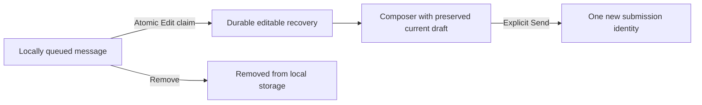

# Queued-message editing and removal

Status: Approved by Jesse on 2026-10-20, including the existing-native-message fallback.

## Intent and agreed scope

Jesse wants queued messages to be editable and removable like steering messages. His screenshot shows two identical messages canceled by Stop, each offering only Retry. He confirmed that this change covers both the browser and native app.

The browser's `QueueStrip.tsx` already offers Edit and Remove for daemon-owned queue entries. Its canceled outbox rows offer only Retry. Native's `session/ghosts.ts` offers Send now and Cancel for locally held messages, but no Edit. These missing controls are confirmed in source. The cause of the duplicate messages in the screenshot is not established.

## Proposed behavior

1. Locally queued messages offer Edit and Remove in both clients, including messages waiting offline or behind other work and messages held after Stop. Eligibility requires durable proof that delivery is not in flight: canceled state, or an unattempted waiting record. Preserve existing explicit Retry or Send now actions for Stop-held messages. Pressing Stop first is not required to edit an offline message.
2. Edit moves that message into the composer and ends its old queued submission. It never sends automatically. The user can correct it and explicitly submit once.
3. Editing preserves the complete locally stored composition: full text, images, their order and text references, skill and command selections, and mention locations. Capture original composer metadata when enqueueing new native submissions. Existing composer work survives: append the recovered composition after the current draft, preserve its images, and remap recovered image markers and mention positions without changing the current draft's associations. Existing native records have the limited fallback described below.
4. Remove deletes only the selected local message. Other messages, including ones with identical text, remain. A reload, reconnect, sibling tab or background/foreground transition cannot resurrect the removed submission.
5. A local message remains editable and removable while offline when its local storage is available and it meets the eligibility rule above. Those actions do not need a live daemon. A storage failure retains the original and reports the failed action.
6. Concurrent Edit, Remove and Retry resolve against the durable record, not a rendered snapshot. Only one action can take ownership. If dispatch or another action won, the losing action refreshes the row and explains the outcome without copying or sending the message again.
7. Retry retains the original submission identity and obeys existing Stop epochs, session identity checks and reconciliation. Repeated clicks cannot create a second submission. Verify this behavior in both clients and fix a reproduced violation at its owner. Preserve each client's current queue ordering; changing Retry's position is outside this design unless a reproduced defect requires a separately agreed change.
8. Ordinary daemon-owned queue entries keep their existing Edit and Remove behavior and identity-guarded cancellation. Preserve their current text-only restoration boundary and attachment warning. This change does not claim to recover image bytes the daemon queue projection does not supply.
9. Unconfirmed or already-attempted delivery keeps its existing reconciliation path. It must not become an editable unsent message by assumption. Existing uncertain-delivery controls remain available under their current guarantees.
10. Failed control operations such as Stop are not editable messages. A promotion or a drain with no new composer input is also a queue control: removing its local request leaves the daemon's queue intact, and its display preview must never be copied into a new submission. Editing a drain that carries new composer input restores only that input. Note-save recovery remains owned by the note editor.

## Existing native messages

Native records created before this change retain wire text and image bytes, but not the original editable image-marker locations. The encoder is lossy: literal image-reference prose and translated composer markers can produce identical stored text. Exact restoration of those original associations is impossible.

Approved fallback: restore the stored text verbatim and image tiles in stored order. Do not guess which prose came from an editable marker or silently bind literal text to new images. Explain that image references in this older message may need adjustment before sending. Preserve the original record until this recovered composition is durable. New records retain the metadata needed for full-fidelity editing. Test reopening a pre-change record with gapped marker numbers beside an existing image-bearing draft.

## Ownership and recovery

Client storage owns a locally queued submission. The daemon owns an accepted queue entry. Editing a local message must commit a durable, non-dispatchable recovery/draft owner before retiring its old outbox owner. A crash or storage failure between those steps must leave the composition recoverable. Reuse existing durable recovery and draft machinery where its guarantees fit; do not introduce a second outbox or copy messages by matching text.

An edit must survive reload before resubmission. An explicit resend consumes the edit's recovery ownership exactly once. A newer Stop still holds submissions through the existing stop-epoch rules. UI busy state prevents accidental repeated gestures, but storage arbitration provides correctness across tabs and restarts.

The builder may choose helper boundaries and storage methods within the existing architecture. New widgets, wire protocols, data stores or consequential changes to the guarantees above require discussion.

## Non-goals

- Rewriting automatic delivery reconciliation or implementing the entire native outbox-convergence punchlist.
- Changing daemon queue attachment transport or making accepted/in-flight input retractable.
- Deduplicating different messages by equal text.
- Automatically retrying Stop-held messages.
- Claiming that the screenshot's duplicate cause is fixed without a reproducing test.
- Deploying or restarting the hub.

## Verification

Use real outbox adapters and application logic, with scripted external transport/provider boundaries. Follow `docs/developing-evener/testing.md`; assert persisted state, identities and sends rather than copy.

- **Browser journey:** enqueue two identical messages, Stop before dispatch, reload, edit one into a nonempty composer, preserve its images and selections, submit the revision, and remove the other. Reopen the storage and verify one revised submission, no original resurrection, and no loss of existing composer work.
- **Native journey:** drive the equivalent held-row actions through the native renderer and mutation runtime using the SQLite adapter. Background/recreate the client before resubmission and after removal. Verify retained composition and final requests.
- **Offline journey:** queue messages without pressing Stop, edit one and remove another while disconnected, then reconnect. Only the explicitly resubmitted revision may dispatch; untouched messages keep their normal delivery behavior.
- **Existing native records:** seed baseline-format text and images without composer metadata, reopen storage, edit beside an image-bearing draft, and verify stored prose and image order survive without fabricated marker associations.
- **Concurrency:** race Edit/Remove with Retry, dispatcher admission, another tab's action and a newer Stop. Assert one durable owner and no duplicate wire submission.
- **Failure and recovery:** fail the durable edit/removal write, retain the source and current draft, restore storage, then complete the action successfully. Interrupt edit transfer and recover on reopen.
- **Regression:** ordinary accepted queue controls, image-only local held messages, selection-only messages, pending attachment encoding, uncertain delivery, stale session identity and non-message operations retain their correct behavior. Cover canceled promotions, empty drains and drains carrying new composer input without copying the daemon queue's preview.
- Run focused red/green suites, TypeScript checks and touched-file formatting locally. CI owns the full web/native/shared-client suites and browser gates.

## Documentation and delivery

Add a current message-recovery guide under `docs/product/`, update the S11 subsystem reference and affected browser/native documentation, and leave historical design records unchanged. Review the specification and implementation independently, simplify the implementation, then shepherd the PR through matching-head checks and review. No runtime deployment is included.
