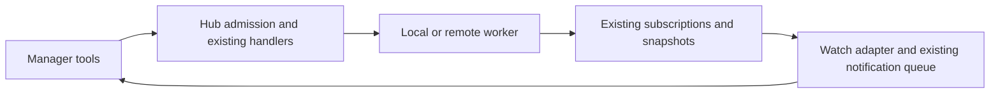

# Manager sessions: tools over the hub

**Status: Jesse approved this design. Product implementation remains paused pending review of the replacement implementation plan.**

## Intent

Let one Evener session manage work in other sessions as Jesse would: start workers, read their progress, answer questions, approve requests and use the existing session controls. Build on the hub and notification paths Evener already has.

This replaces the proposed management framework with a small client surface. Previous implementation and documents remain preserved. The implementation plan must separately say which parts to reuse or replace.

## Decisions Jesse has made

- A designated manager has full delegated human authority for session management.
- It can manage everything reachable through its hub, including connected remote hosts and other managers. There are no project grants or exclusive controllers.
- A remotely running Manager acts for the hub where Jesse enables Manager. That hub owns its setting and defines its reach. Another hub cannot silently take over, including after disconnection or restart.
- Each target uses the shared human capability boundary. Delegates remain discoverable and readable, with existing delegate-stop support. Adding direct delegate input or configuration controls is out of scope.
- Include qualification and enablement of the shared remote input capabilities needed for the question-and-answer loop. Human clients and managers use the same support; the remote loop remains required.
- Manager mode stays on until Jesse turns it off. Resume, restart and Clear preserve it. New sessions and forks start with it off.
- Reuse existing controls and notifications. Avoid a separate management subsystem.
- Extend `delegate_send` for manager-to-session messages. Do not add a separate send tool or put messaging under `session_control`.
- Extend `delegate` with a top-level creation parameter visible only to Manager sessions. Extend `job_stop` for manager use of the existing human stop controls. Preserve ordinary calls to both tools.

## Manager mode

A human-controlled **Manager** setting enables the tools for a session. The hub persists the setting against the stable session/workspace identity that survives Clear, rather than the replaceable runtime instance. The human clients expose the setting and current state through their existing session controls. New sessions can be designated explicitly by the human; neither ordinary creation nor fork copies the setting.

The enabling hub remains the Manager's authority when the session runs elsewhere. Its reachable sessions define the scope of discovery and actions. The hosting hub relays that route rather than substituting its own authority. Multiple connected hubs must see the same selected authority; connection order does not choose it. This selects a Manager's hub, not an exclusive manager for its worker targets.

Only Manager tool schemas expose the added hub-target parameters and modes, including top-level creation and human stop actions, and the new `session_control` tool. Ordinary schemas and default calls retain their existing contracts. The builder chooses exact field names and schema layout.

The session runtime invokes a narrow, authenticated hub entry point. The hub derives the caller's identity and checks its current Manager setting on every operation, including calls made with forged arguments or a stale schema. Turning Manager off blocks subsequent manager operations and ends its manager subscriptions; already-accepted worker actions retain their normal semantics. Runtime tool availability follows the current setting. Ordinary owned-work operations remain available under their existing rules.

The entry point exposes session operations, not an arbitrary RPC-method proxy. It does not give the model the human hub credential, provider credentials, hub upgrades, host administration or the ability to enable Manager mode. Use existing authenticated transport where suitable, adding only the session identity and admission checks it lacks. A remotely hosted manager must use the same authenticated boundary rather than gaining authority from a bare caller-supplied session ID.

This is a tool/API authority boundary. It does not claim to isolate an unrestricted process from other files or credentials owned by the same operating-system user.

### Conditional system-prompt guidance

Add a short Manager section through the existing system-prompt composition:

> Manager mode is enabled. You have delegated human authority for session management throughout this hub, including connected remote sessions and other managers. Use that authority to carry out the user's assigned work.
>
> Use `job_list` to discover sessions and activity, and `job_status` and `read_transcript` to inspect state, supported actions and full questions. Use `model_list` for the selected host's models. Use `delegate`'s explicit top-level mode to create an independent interactive worker, and `job_watch` to receive its questions, approval requests and results. Read existing state as well as new events.
>
> Answer through `delegate_send` using normal input. A notification does not answer a pending question. Resolve approvals and use the remaining human controls through `session_control`, within the target's supported capabilities.
>
> Top-level workers have independent lifetimes and report through history and watches. Ordinary `delegate` calls still create owned sub-agents with parent-directed reporting. Select the human stop action explicitly in `job_stop`; human delegate-stop ends one run and leaves its children running. Ordinary owned-delegate stop remains recursive.

Compose the guidance from the same current Manager state used for tool availability. Refresh both before the next model request after a mode change, including after resume, restart or Clear. Ordinary sessions and new forks receive no Manager section unless explicitly enabled. Qualify existing delegation guidance where it assumes every `delegate` call creates an owned child. Keep exact arguments in tool descriptions. This section conveys a capability, not a new autonomous goal or permission to enable Manager mode; hub admission remains authoritative even for an in-flight call made with stale instructions.

## Tool surface

**One new tool: `session_control`.** Extend eight existing tools with manager-only parameters or target forms. These are proposed hub adapters, not claims that the existing tools already operate hub-wide. The [command-surface audit](2026-10-20-session-manager-tool-audit.md) records the source evidence and all 36 tools considered.

| Surface | Job |
| --- | --- |
| Existing `job_list` | Discover sessions with an explicit hub scope. Separately read a target's delegates, shell jobs and watches with explicit session/subtree scope. Reuse existing filters and paging. |
| Existing `job_status` | Read a hub target's current state, supported actions, pending-question summary and pending approvals. Provide bounded full task detail on demand and the existing full metadata for addressed shell jobs. |
| Existing `read_transcript` | Read bounded hub history, including full questions, and addressed shell-job output. Preserve each source's actual format, cursor and retention contract. |
| Existing `delegate_send` | Accept a hub session reference in `to`. Send replies, queued input or steering through existing human input handlers, including supported typed skill or command input. |
| Existing `job_watch` | Accept a hub session reference and deliver selected events through the existing watch/notification machinery. |
| Existing `model_list` | Read the selected host's model catalog and availability. Ordinary calls keep their frozen startup snapshot. |
| Existing `delegate` | Select top-level creation explicitly. Use existing hub creation with host, project/directory, model and input, returning a session reference and actual creation/watch/input outcomes. |
| Existing `job_stop` | Select an existing human stop action explicitly for a hub target: interruption, single-delegate stop, shutdown or force-stop, where supported. |
| New `session_control` | Invoke the remaining typed human session controls: approvals, resume/fork/Clear, settings, compaction, queue management and other existing session-specific actions. |

Sources and targets use the hub's canonical references, including source identity. Results identify resource kind and actual ownership, preserve target capabilities, and supply structured arguments for follow-up calls. Equal bare session IDs on different hosts are different targets. Addressing a session neither adopts it as a delegate nor changes its parent. Reading a delegate must not silently turn a later write into input to its parent.

### Creation and stopping keep explicit modes

Without the top-level parameter, `delegate` keeps its existing owned-sub-agent behavior, including its constraints, identity and parent-directed reporting. Its manager-only top-level mode calls the existing hub creation handler to create an ordinary interactive session. That session can ask questions and request approvals; ordinary delegates retain their existing limits. The new session is independent of the manager's owned delegate tree and starts with Manager off. Return its canonical session reference, not a fabricated delegate ID or delegate return packet. Reject arguments that do not apply to the chosen creation mode rather than silently ignoring them.

Ordinary `job_stop` calls keep current shell-job and owned-delegate behavior, including recursive stop for an owned delegate. A manager call addressed to a hub session must select its human stop action explicitly. Existing human delegate-stop ends only the selected run, leaving its children running. Interruption, shutdown and force-stop retain their separate meanings and supported target types. Resolve each through its existing owner; do not reinterpret a hub delegate reference as permission for recursive subtree stop. These actions belong only in `job_stop`, not also in `session_control`.

Existing `delegate_send` calls addressed to an owned `dlg_...` keep their current routing, steering, resume and result behavior. Manager-only hub targets use the authenticated hub route, supported human-input modes and existing receipts. Independent session reports arrive through history and watches, not the owned-delegate `earlier_results` mechanism. Turning Manager off removes hub-target access while leaving ordinary owned-delegate messaging intact.

### Reads keep their source contracts

Hub discovery stays shallow. Include reachable source references even when a host has no sessions, so the manager can select its models and create its first worker there. Reuse the existing host-list owner without exposing host administration. Target activity is a separate read with explicit session/subtree scope. Preserve session states, source availability, authoritative versus retained evidence, unknown or partial results, and paging/generation boundaries. Reading another owner's state must not acknowledge its pending delegate report or grant control over its watches.

`job_status` provides current state; `read_transcript` provides history. A pending-question preview is not the full question. Pending approvals come from the existing human-client metadata, not from the worker's transcript, and remain manager-only. Full task detail uses the existing task read owner; an aggregate alone is insufficient. This adds no remote task mutation.

Hub history is projected history with its own cursor and snapshot identity. Do not label it exact local `transcript_v2_jsonl` or accept unsupported local range/expansion options. Hub shell-job references retain both the owning session reference and job ID. Their output uses the existing backward `beforeBytes` paging, byte ranges, encoding and retention floor. Return supported modes with each reference and reject incompatible options. Existing local session, job-output and artifact reads stay unchanged.

### The one new tool covers remaining human controls

`session_control` uses a fixed typed action set with action-specific arguments and existing capability checks. Besides the table's actions, account for rename, human goal and whiteboard changes, URL removal, session archive/unarchive, deletion, pin assignment/unpin and seen/unread controls wherever supported. The audit identifies the current owners; planning must map each supported action without silently omitting it. Creation, messaging and the stop actions above already have tool homes and must not be duplicated here.

Keep human controls distinct from the agent's self-tools. `update_goal` reports completion or blockage; human goal controls set the objective. `notes_agent_set` writes the agent's whiteboard; human notes have their own owner. Human compaction uses its existing entry point rather than another agent's `compact_context` state. No arbitrary RPC names, generic remote-tool executor or project/host administration is exposed.

## Existing behavior remains authoritative

Questions already end a turn and take the next user input as the answer. Read the full question from the transcript and submit a normal answer. There is no new question-response ledger or manager-only answer lock. A human and manager can race under the same rules as two human clients.

Notifications and replies retain different meanings. Existing notification delivery queues a notice and wakes its receiver, subject to the pending-question gate. It does not answer an `ask_user` question. Reuse that delivery path for notices. The extended `delegate_send` routes manager replies, queued input and steering to the existing hub input handlers; it adds no separate messaging subsystem.

Approvals use the existing resolver and pending-request identity. Stale or already-resolved requests retain their existing rejection. Full delegated authority includes approving existing sandbox exceptions for other sessions; the worker still obeys the existing exception's limits.

Keep the distinct `job_stop` meanings above; introduce no manager-only Stop protocol. **This simplification supersedes the earlier special manager Stop contract.**

Reuse existing mutation IDs, instance checks, receipts and unknown-outcome reporting. Retrying the same input preserves its identity. Top-level creation has a different contract: an uncertain launch is not automatically repeated or represented as a proven failure. Keep known partial progress, including a created session's reference, visible to the manager.

Manager input has human-equivalent behavior with honest attribution. Stamp the authenticated manager identity through dispatch, remote forwarding and existing persistence. Record it in target history or the operation's existing receipt/notice as appropriate. Display text is not proof of identity. Human input remains attributed to the human.

### Remote input is a shared prerequisite

The pre-manager remote source has input forwarding, but its controller-side capability mask advertises only shutdown among thread mutations. `Send`, `Queue`, `Steer` and typed-input capabilities remain masked. Forwarders alone do not establish supported remote interaction; this source evidence does not prove that every plain-text remote call fails. The audit records the exact owners and limits.

This work must qualify and enable the shared remote input capabilities needed to submit work and answer questions. Make the advertised support agree with the real remote path in the existing `appsource` and human-input owners. Use the same supported actions for human clients and managers, with no manager-only bypass. Qualify each input mode before advertising it; this prerequisite does not blanket-enable unrelated remote mutations or unsupported hosts.

Prove the remote question/answer/result loop and the corresponding capability reports together, including input identity, attribution and reconnect behavior. Unsupported actions must remain accurately reported while healthy supported actions remain usable. A capability-conditional skip is not completion of the required remote loop.

## Notifications and the first useful loop

The hub routes operations to their current owners. A small adapter connects the hub's existing local/remote session subscriptions to the manager's existing notification queue and wake path. Share the existing relay's fan-out so managers and human clients can watch the same worker without replacing one another's subscription. A websocket broadcast alone is not agent delivery. A notification must not be submitted as ordinary user input, which could answer a pending question accidentally.

For a manager-created task, use `delegate`'s top-level mode to start an interactive root with no initial input, attach the requested watch and read its current state, then submit the task through the existing input handler. The top-level mode can present this sequence as one convenient call, while reporting each partial outcome honestly. An attached subscriber also enables the existing approval path before work begins. If watch setup fails, report the created session and setup failure without submitting the task. No launch parking, reserved-execution protocol or new operation journal is needed.

Watches are explicit and bounded. They outlive individual manager turns, so a waiting manager can wake. Consume initial/resync state as well as live events and expose subscription failures. Read full details on demand. A turn ending with a question or waiting for other work is not a successful task-completion signal.

Default task-completion delivery is one-shot, removed before waking the receiver, with no automatic re-arm or all-session subscription. Keep question and approval observation until that watched work ends or the watch is cleared. Standing event watches must preserve the existing causal provenance and budget controls; two managers observing one another must not create an automatic completion-notification loop.

Use the recorded recovery outcome in `docs/product/friction.md`, R03: continuing observation either resumes or reliably tells the owning agent that it ended and needs re-registration. Choose the simpler cancellation/handoff path when the manager runtime restarts. Preserve already-pending delivery identities. Reconnecting a still-live runtime re-reads current state. A manager awaiting Jesse's own answer keeps the existing pending-question wake rules. This is not a new unattended monitoring service.

For a live runtime, connection loss suspends its watches and reports the interruption through the existing notice queue. Rebinding to the same enabled Manager setting automatically reattaches and resynchronizes them. Disabling Manager ends those watches and delivers the ended notice, including when the disable is discovered after reconnect. Enabling Manager again does not resurrect watches ended by disable. Permanent observation failure likewise ends the affected watch with a notice, rather than leaving the manager waiting silently.

## Scope and implementation ownership

New responsibilities are the Manager setting and authenticated admission, conditional prompt guidance, typed tool adapters, the subscription-to-agent bridge, and actor propagation. Shared remote input qualification is an explicit prerequisite, not presumed existing support. Keep current owners:

- Hub session lifecycle and AppWire handlers: creation, routing, session controls and their admission rules.
- `appsource`: local/remote operations, shared capability reporting, subscriptions and reference translation.
- Session input/approval owners: accepted input, pending requests, persistence and execution.
- Session prompt composition: conditional Manager guidance aligned with actual tool availability.
- Existing watches and notification queues: bounded delivery, wake, provenance and restart handoff.
- Existing human clients: Manager toggle and actor display, using their current components.

Pre-manager source evidence was checked at `34d4ea239ec6c192838b544d6c4dd4e7f70c04a1`. Important entry points are `cmd/evener-hub/app_rpc.go`, `app_threadlifecycle.go`, `internal/appsource` under that hub directory, `server/appwire_runtime.go`, `agent/session_tools.go` and `agent/internal/tool/definitions.go` for `delegate_send`, `agent/session_queue.go`, `agent/job_watch.go`, and `agent/session_escalation.go`. Prompt composition lives in `agent/session_prompts.go`, `agent/prompt_data.go` and `agent/prompts/system.md.tmpl`. The current branch also contains the paused framework; do not mistake it for a preexisting dependency.

The builder chooses the smallest compatible transport, storage fields, schema factoring and client placement. These choices must preserve the decisions above and reuse existing owners. Update evergreen product/tool documentation alongside eventual code; until then, this document describes proposed behavior rather than shipped behavior.

## Acceptance

Start with one end-to-end path, then extend it without inventing stronger control guarantees:

1. A human enables Manager. Only its schema exposes the added hub parameters, creation/stop modes and `session_control`. Its system prompt includes the conditional guidance. Prove this conditional composition in actual model requests alongside the exposed schemas, rather than only rendering an isolated template. An ordinary session cannot use the extensions or self-enable Manager, including through forged arguments. Disabling an active manager prevents its next admission even with stale instructions or schema, ends its manager subscriptions and removes the guidance from subsequent requests. Ordinary tool calls keep working.
2. The setting, guidance and corresponding tool availability survive resume, process restart and Clear. New and forked sessions remain ordinary unless the human explicitly enables them.
3. The manager creates an interactive worker through `delegate`'s top-level parameter, receives a real question, answers with `delegate_send` through the real input handler, and receives the final result through the watch. Verify both transcripts, independent lifetime and no delegate-result acknowledgement. Ordinary `delegate` calls still create owned sub-agents with their existing constraints and reporting, with Manager on or off.
4. Qualify the required shared remote input capabilities, then repeat the full loop through a connected remote source. Verify that advertised actions match usable human and manager paths, including source-qualified identity, input retry identity, attribution and reconnect. Cover unsupported capability reports without skipping the required supported loop. Exercise a remotely hosted manager and another manager as a target through the same boundary. With two controllers and a hosting hub attached, verify that only the enabling hub supplies this Manager's authority/reach, including after restart and connection replacement.
5. Resolve an approval with no browser attached. Verify existing stale-approval behavior, human/manager input races and input retry identity.
6. Discover/read delegates and use `job_stop`'s human single-delegate mode, proving children remain running. Separately verify ordinary owned-delegate recursive stop and the supported interruption, shutdown and force-stop paths. Unsupported direct descendant input/configuration remains unsupported and never targets the parent instead.
7. Ordinary `delegate_send` still steers running owned delegates and resumes idle ones with Manager on or off. Hub sends use human input receipts, not parent-report consumption. Notifications leave a pending question unanswered; a real reply answers it.
8. Verify shallow discovery, including hosts with no sessions, bounded full question/task/approval reads, selected-host models, and hub history/job-output paging, including retained and partial state, refresh and reconnect after multiple pages. Preserve ordinary read contracts and reject unsupported hub read options.
9. Prove initial-state and automatic rebind/resync delivery, disable/off-on ended notices, the existing runtime-restart handoff promise, and protection against automatic reciprocal notification loops. Preserve pending deliveries and target-generation boundaries. Two managers and a human client must be able to watch the same remote worker without displacing one another.
10. Verify each mapped human operation retains its existing behavior. Cover watch-setup failure after creation, uncertain launches, actor persistence and the human clients' supported capability boundaries.

No runtime acceptance checks have been run for this revised design. The command audit and earlier builder checks supported the tool reuse. A subsequent parallel adversarial review found the remote-capability conflict; Jesse chose to include shared remote input support, now made explicit above. The conditional prompt section separately addresses the omission raised by Jesse's question. The final Astra/Luna review found no significant issues, and the four-angle simplification pass retained this design. Jesse approved it after those reviews; runtime qualification remains implementation work.

## Out of scope

Project-scoped grants, exclusive manager assignments, separate attention storage, new operation journals, manager-specific launch/Stop recovery, new direct delegate controls, and stronger-than-existing retry guarantees. No deletion or rewrite of the preserved implementation is authorized. The replacement implementation plan must be reviewed before product implementation resumes.
