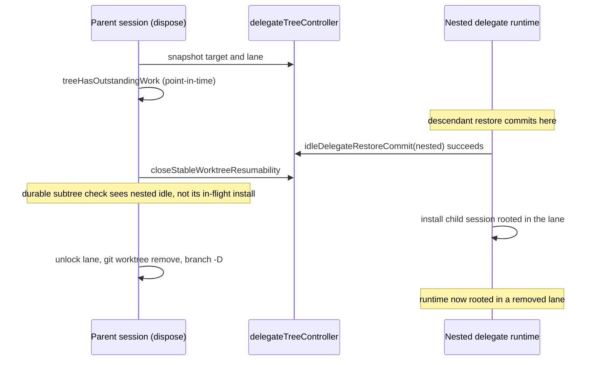

# Issue #2067: fence a worktree-lane handoff over the whole delegate subtree

Status: frozen for PAR, 2026-10-23; PAR findings resolved and re-frozen the
same day. The amendments add the attention-restore hold, the mid-tree close-time
fence, the active-generation refusal, the pre-snapshot acquire anchor, and the
attach/commit gates.
Base: `de2fdab03066fe68e020137bd896ad078f804b3f` (merged into the lane from `dc6c93e081`).

## Goal and scope

A worktree-lane handoff must exclude **every** delegate in the handed-off
delegate's subtree, not only the target. A descendant must not be created,
reserved, cold-restored, or installed into the lane while that lane's
unlock/removal is in progress, and a legitimate descendant admission after an
aborted handoff must still work.

This change adds a controller-level, in-flight **subtree lane-handoff fence**
to `delegateTreeController` and consults it from every admission that can put a
delegate into a lane:

- `ReserveCreate` (a new child under a fenced delegate),
- `ReserveStart` (a send start for a delegate in the fenced subtree),
- `ReserveAttention` and `reserveOwedAttentionStart` (attention starts),
- `idleDelegateRestoreCommit` (the cold attention restore commit),
- `beginIdleRuntimeInstallation`/`attach` and `AttachRuntime` (runtime
  installation), `CommitStart` (defense in depth), and
- the cold-restore window in `restoreColdDelegateAttentionRuntime`.

The live `manage_worktree dispose` operation acquires the fence at the top of
`disposeStableDelegateLane`, before `stableWorktreeSnapshotForOwner` computes
the target's `active` field, and holds it through resumability closure and
physical lane teardown, releasing it on every exit. Placing it after the
snapshot or after the `sub := s.subagents.get(...)` read would leave the
point-in-time reads outside the fence.

Only the delegate controller, the worktree-dispose and close-time lane
handoffs, their tests (including the test-only
`Session.delegateRestoreAfterCommit` seam that pauses a cold restore after its
commit), the evergreen worktree guide, and this spec change.

## The cited code does not exist on main: what this fixes

The issue names two sites. On `de2fdab0`:

- `agent/delegate_tree_start.go:623-643` is `ReserveStart`, which exists. It
  consults `ancestorFenceLocked` (durable resumability) but has no in-flight
  handoff fence. A descendant start is admitted while its parent's lane is
  being handed off, because the parent is still durably resumable until the
  later closure.
- `agent/session_tools_worktree_unlock.go:135-150` does **not** exist.
  `git cat-file -e origin/main:agent/session_tools_worktree_unlock.go` fails,
  matching the issue's own 2026-10-13 comment: the `unlock` operation lives
  only on the parked PR #2013 (`f38d524c43`), whose per-delegate
  `laneHandoffs`/`laneRestores` fence is exactly what the issue says is too
  narrow. Reviving that PR is a worktree feature, not this fix.

The same handoff shape is live on main in `manage_worktree dispose`
(`agent/session_tools_worktree_dispose.go`): it performs a point-in-time
descendant quiescence read, then a point-in-time durable subtree check in
`closeStableWorktreeResumability`, then unlocks the lane, removes the
worktree, and deletes the branch in
`disposeUnchangedLaneMechanics` (`agent/session_worktree_close.go:430`). A
nested delegate that shares its parent's lane (a non-isolated child inherits
the parent's working directory) can be cold-restored into that lane after the
reads and before the unlock/removal.

This change puts the fence in the controller, not in the disposal operation,
so the gates are the ones PR #2013's `unlock` would also consult when it
lands. It does not port the `unlock` operation.

## Exact race window

The confirmed reproduction (an uncommitted scratch test run before this spec)
blocked dispose in `disposeEvaluateLane` at `git -C <lane> status` and called
`idleDelegateRestoreCommit` and `beginIdleRuntimeInstallation` for a nested
delegate seeded under the target. Both were admitted; the test failed with
"nested delegate restore committed while its parent lane handoff was in
progress" and "nested delegate runtime installation admitted while its parent
lane handoff was in progress".

Three properties make the reads insufficient:

1. `treeHasOutstandingWork` is read before lane evaluation and takes no
   controller lock; the restore commit can linearize after it. It also runs
   only when the target has a resident child session (`sub != nil`), so a
   non-resident target skips the subtree read entirely.
2. The cold-restore commit writes no durable delegate event. The durable
   subtree check in `closeStableWorktreeResumability` therefore cannot see a
   restore that has committed but not yet installed, and the installation runs
   outside the controller's durable view. A point-in-time check, even one
   correctly locked, cannot cover work that has not become durable yet.
3. `idleDelegateRestoreCommit` does not consult `ancestorFenceLocked`, so the
   cold path can commit after the target's durable resumability closes. Only
   the in-flight fence and the ancestor check together close both orderings.

## Fence design

Controller state, guarded by `c.mu`:

- `laneHandoffs map[string]struct{}` — delegate IDs whose lane handoff is in
  progress. The key is the subtree root (the disposed delegate).
- `laneRestores map[string]int` — counted cold-restore windows per delegate,
  covering `idleDelegateRestoreCommit` through the end of runtime installation.

Linearization is under `c.mu`:

- `beginSubtreeLaneHandoff(id) laneHandoffAdmission` makes one decision under
  `c.mu`. It returns `busy` when any member of `subtreeMembersLocked(id)` has a
  start reservation (including a create reservation whose descriptor names a
  subtree member as parent), a cold-restore window, an attention-restore hold
  (`attentionRestoreHeldLocked`), an active durable generation
  (`stableWorktreeSubtreeActiveLocked`), or is itself the root of an in-flight
  handoff. It returns `alreadyCovered` when the controller is closing or a
  strict ancestor's handoff already fences the subtree, so a close-time
  disposal may proceed under that coverage without recording anything. It
  returns `acquired` and records `laneHandoffs[id]` otherwise. The
  durable-activity condition covers a send start that has already committed its
  run but has not yet attached its runtime; the reservation condition covers
  the pre-commit half. The hold condition honors the existing invariant that a
  wake pass owns its restored runtime until its reservation decision, and the
  hold outlives the restore window: the pass may read transcripts and take its
  turn before `ReserveAttention`, so the window alone would leave that gap open.
  Because the refusal reason comes from the same locked decision, the close
  path needs no separate `controllerClosing` or covered-by-ancestor query.
- `endSubtreeLaneHandoff(id)` deletes it. Every acquire pairs with a deferred
  release.
- `beginLaneRestore(id) error` refuses when `laneHandoffCoversLocked(id)`, then
  increments `laneRestores[id]`; `endLaneRestore(id)` decrements. The window is
  taken in `restoreColdDelegateAttentionRuntime` before the commit and released
  after installation, on success and on every error.
- `laneHandoffCoversLocked(id)` walks `id` and its `ParentDelegateID` ancestors;
  any `laneHandoffs` entry covers the delegate.

Admission rules (all under `c.mu`):

| Path | Refusal |
| --- | --- |
| `ReserveCreate` | `laneHandoffCoversLocked(parentID)` |
| `ReserveStart` | `laneHandoffCoversLocked(delegateID)` |
| `ReserveAttention` | `laneHandoffCoversLocked(delegateID)` |
| `reserveOwedAttentionStart` | `laneHandoffCoversLocked(delegateID)` |
| `idleDelegateRestoreCommit` | `laneHandoffCoversLocked(delegateID)` or `ancestorFenceLocked(parentID)` |
| `beginIdleRuntimeInstallation` and `attach` | `laneHandoffCoversLocked(delegateID)` |
| `AttachRuntime` (committed send start) | `laneHandoffCoversLocked(lease.delegateID)` |
| `CommitStart` | `laneHandoffCoversLocked(record.delegateID)`, or the create parent's fence (defense in depth) |
| `beginLaneRestore` | `laneHandoffCoversLocked(delegateID)` |

`idleDelegateRestoreCommit` also gains the existing `ancestorFenceLocked` check
that `ReserveAttention`, `reserveOwedAttentionStart`, and `CommitStart` perform.
`ReserveStart` defers that check to `CommitStart`, and the cold path runs no
`CommitStart`, so it needs its own. Without it, a cold restore can commit after
its ancestor's resumability closes, which is a second way into a lane that is
already being retired. This is a gate on an existing path, not a new lifecycle
rule: the wake driver already treats a permanently closed ancestor as an
escalation rather than a wake.

A send start is protected on both sides of its commit: `ReserveStart` refuses
a reservation under a fence, and once `CommitStart` has appended the run, the
subtree's durable activity makes `beginSubtreeLaneHandoff` refuse until the
runtime is attached and the generation settles. That closes the
commit-to-attach gap without adding a second counted window to the send path.

Dispose holds the fence from before `stableWorktreeSnapshotForOwner` through
`disposeStableExecute`'s teardown, including `closeStableWorktreeResumability`
and `disposeUnchangedLaneMechanics`. A refusal returns the existing
"became active while disposing; retry once it is idle" busy path; it does not
partially close resumability or touch the lane.

Close-time lane disposal uses the same admission in
`disposeOneStableDelegateLane`. A root session's close sets `c.closing` in
`closeRuntimeTree` before `disposeDelegateLanesAtClose`, so `begin` returns
`alreadyCovered` and the root close disposes as before. A mid-tree delegate
session closes while the shared controller is still live; its own close
disposes *its* worktree children's lanes, and that path acquires the fence. A
`busy` result retains the lane (kept, not destroyed, with its lock intact) for
a later explicit `dispose` or resume. Retaining the lock is deliberate: the
refusal means an install may be in flight into the lane, and unlocking it would
expose the lane to a later `prune`.

The budget-exempt close tail (`touchUnlockLaneTail`) takes the same admission
before touching or unlocking a lane whose close pass ran out of budget. A
`busy` result keeps the lock and reports the retention in the tail warning;
`alreadyCovered` and `acquired` unlock as before. Without this, an expired close
budget could unlock a lane while a descendant restore was still installing.

A close-time disposal whose lane is already covered by a **strict ancestor's**
in-flight handoff proceeds under that ancestor's fence instead of acquiring a
second, self-refusing one. The ancestor fence already excludes every admission
into the whole subtree, and removing a different lane cannot install into the
ancestor's lane. Without this, every explicit dispose of a resident delegate
whose child session owns its own lanes would tear that child session down inside
the parent's handoff, refuse each nested lane's disposal, and strand those lanes
locked and unreclaimable.

## Lock ordering and deadlock analysis

All fence state is guarded by the controller mutex `c.mu`, and every fence
operation takes `c.mu`, mutates the maps, and releases before any session,
job-manager, subagent, filesystem, or git call. The fence is a **map entry,
not a held mutex**: the handoff is logically held across the teardown without
holding `c.mu`.

Established orders preserved:

- retirement admission (`beginRetirementMutation`) → `c.mu`; every restore and
  start path already takes them in that order, and the fence adds no new
  acquisition before `c.mu`.
- `c.mu` → subagent/session locks is never introduced: no fence operation
  holds `c.mu` while calling another subsystem.
- dispose takes `c.mu` only inside the fence acquire/release and the existing
  `closeStableWorktreeResumability`; its `treeHasOutstandingWork` and git work
  run with no controller lock held. That is the same order dispose already
  used.

No fence path waits while holding `c.mu`: contended admissions refuse
immediately with `errDelegateTargetBusy`, and the handoff never blocks on an
admission. The existing `closeStableWorktreeResumability` may wait on an
accepted attention reservation's done channel after unlocking `c.mu`, but under
a held handoff that blocker set is empty: the handoff refuses to begin while
any subtree reservation exists, and new reservations are refused by the fence.
A refused handoff leaves the lane and resumability untouched, so the caller
can retry.

## Verification and red-first evidence

New tests in `agent/delegate_lane_handoff_fence_test.go`, on the real-git
worktree harness with real dispose:

1. **Red-first race**: seed a stable isolated delegate with a lane, seed an
   idle resumable nested delegate sharing that lane, block dispose in
   `disposeEvaluateLane` at the lane's `git status` (the scripted seam only
   pauses; all git still runs), then attempt
   `idleDelegateRestoreCommit(nested)`, `beginIdleRuntimeInstallation(nested)`,
   and the real `restoreColdDelegateAttentionRuntime(nested)` entry point.
   Before the fix the commit and installation admit; after the fix all three
   refuse with `errDelegateTargetBusy`. Release the seam and assert dispose
   succeeded, the lane is gone, and the parent's resumability is closed.
2. **Control**: a dirty lane makes dispose refuse before destruction and
   releases the fence; `idleDelegateRestoreCommit(nested)` then succeeds and
   the lane remains. This proves the fence is an in-flight barrier, not a
   permanent close.
3. **In-flight restore ordering**: the test-only `delegateRestoreAfterCommit`
   seam holds a real `restoreColdDelegateAttentionRuntime(nested)` after its
   commit and before its owner chain installs. Dispose must refuse, leave the
   lane present, and leave the parent resumable; releasing the restore lets a
   retried dispose complete. This exercises the counted window and the
   release-on-return ordering, not only the commit gate.
4. **Attach and fence unit coverage**: an installation admission taken before
   the handoff cannot `attach` once the handoff starts; a held handoff refuses
   the target's start, a nested owed attention start, and a second handoff;
   `beginSubtreeLaneHandoff` refuses on a descendant reservation and on a
   create reservation parented inside the subtree, and on an
   attention-restore hold; after release, admissions succeed again; a delegate
   outside the fenced subtree is unaffected.
   Additional cases pin every remaining gate: an active generation refuses the
   handoff, a create under a fenced parent, an attention start, a commit, and
   an `AttachRuntime` are refused, and a cold restore under a closed ancestor
   is refused.
5. **Nested lane under a parent handoff**: a resident target whose child session
   owns a worktree-isolated delegate lane is disposed; the nested lane is gone,
   not retained or left locked. This test fails on the fence-first close
   behavior with "nested lane was retained (and left locked)".
6. **Expired close budget**: with a descendant restore window open, an
   already-expired budget drives the close tail; the lane stays locked. After
   the window closes, the same tail unlocks it. This test fails without the
   tail admission with "close budget tail released the lane while a descendant
   restore was in flight".

Commands:

- `go test ./agent -run 'TestDelegateLaneHandoff' -count=1 -v` — the new
  tests, recorded failing before the fix and passing after.
- `go test -race ./agent -run 'TestDelegateLaneHandoff' -count=1` — the same
  tests under the race detector.
- `go test ./agent -run 'TestDispose|TestStableDelegateWorktree|TestWorktree' -count=1`
  — the existing disposal and worktree handoff coverage.
- `make build` — the repository build gate.
- CI owns the full suite; no local full-suite run.

## Non-goals

- No `manage_worktree unlock` operation and no revival of PR #2013. The
  controller fence is the seam that `unlock` would use later.
- No redesign of close-time lane disposal: it gains only the same fence in
  `disposeOneStableDelegateLane` for mid-tree closes. The root close still
  relies on `c.closing`. The foreign-residue sweep also runs on an open pass,
  not only at close, but it collects only already-unlocked lanes: a live
  session's lane carries its own lock, so a live delegate subtree is never in
  its candidate set.
- No change to durable subtree quiescence, retirement, stop, reclamation, or
  delegate lifecycle semantics.
- No new tool surface, user-visible copy, or public API.
- No labels, no unrelated findings folded in (unrelated findings become
  separate issues).

## Evergreen documentation

`docs/developing-evener/worktrees.md` gains one paragraph under Disposal:
`dispose` refuses while any delegate in the target's subtree has a start,
attention start, or cold restore in flight, and holds that fence through lane
removal; a descendant admission refused this way is retryable and leaves the
lane intact.
