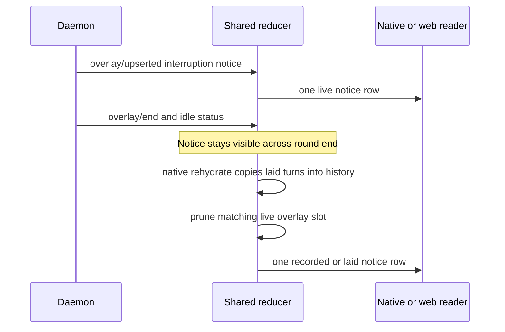

# Issue #3968: one owner for a notice display row

## Scope and acceptance

Fix shared reducer display construction, not React keys. A live notice must appear before a recorded/laid counterpart exists. Once history holds that same notice identity, the recorded/laid item wins and the overlay slot is pruned before constructing display turns. This applies across turns and to interruption and other notice payloads. Keep all unrelated notices and existing stream, preview and tool handoffs unchanged.

Only `appwire-client/typescript/reducer.ts`, its tests, and this specification may change. Native keys need no change. No wire identity, persisted transcript, outbox semantics, visuals, new labels or unrelated cleanup.

## Evidence and diagnosed boundary

The filed Android reproduction is Stop with queued messages, followed by repeated React duplicate-key warnings while sends and mutation reconciliation settle successfully. React's `notice=211` is consistent with its escaped representation of `notice:11`; it is not evidence of a new wire identity format. The filing reports unique wire history ids, so a duplicated display row is not proof of duplicate durable records.

Current source:

- `internal/appoverlay/overlay.go:563–589` ends a round with uncovered stream/tool content by emitting an interruption notice before `overlay/end`.
- `internal/appoverlay/overlay.go:592–622` gives notices opaque keys `notice:N`, an anchor after the last entry and a `systemMessage` payload. Notices remain in the daemon's bounded live ring.
- `agent/session_lifecycle.go:1319–1336` writes a separate interrupted steering marker for Stop. It does not persist the ephemeral overlay id. Other announcements enter the same `addNotice` path.
- `mobile/src/state/conversation.ts:2212–2215` takes the shared reducer's `appliedModel.turns`, which already includes live overlay notices, during same-instance rehydrate. At line 2259 it calls `withSyncedHistoryTurns`, which copies those display turns into `model.history.turns` (lines 647–663) while keeping the overlay. A following overlay notification rebuilds from both copies. This is the client-only promotion seam, and needs no duplicate wire records.
- `reducer.ts:3727–3759` prunes covered streams, previews and tools, but never notices. Consequently any notice already represented in recorded/laid history remains in `model.overlay`.
- `reducer.ts:3855–3874` unconditionally splices each remaining notice into the recorded items. If history already contains its identity, that creates two rows, not merely two choices of React key.
- `reducer.ts:3774–3778` retains wire identity and marks the overlay contribution. `mobile-native/src/readerPosition.ts:70–78` prefers `transcriptKey`, falling back to id. `mobile-native/src/session/transcriptRows.ts:166–168` passes that identity to FlatList unchanged.

The confirmed mechanism is native rehydrate promoting a laid notice into history, followed by the reducer failing to absorb that notice before re-seating its overlay. Current web gap recovery (`cmd/evener-hub/frontend/src/stores/threads.ts:8275–8279`) selects `current.history.turns`, not display turns; mutation `restoreProvenAbsent` manages outbox rows, not transcript identity. Do not change those components. A reducer-level replay of the native synchronization boundary proves the mechanism, but is not a fresh emulator reproduction.

## Sequence and ownership

The recorded/laid item is authoritative because history owns durable/versioned state and already supplies the row. Never delete or rewrite that item to preserve the overlay. Before history covers the identity, keep the live notice unchanged, including its anchor and payload. Unrelated notices at the same anchor or with identical text remain distinct.

## Proposed change

Extend `pruneCoveredOverlay` to collect identities of history items using the reducer's existing `transcriptKey ?? id` identity rule, and recognize an overlay notice as covered when its payload identity already exists in history. Use the same key fallback as item merging, not text, position, event kind, or approximate matching. This works globally even if the notice seats in a different turn from the recorded item. Use the existing `filterOverlay` so an uncovered overlay keeps its reference.

This is source-state absorption: `withDisplay` must return a model with the covered notice absent from `overlay`. Do not deduplicate render rows, suffix keys, compare copy, clear all notices at Stop, or alter recorded history. Persisted steering/memory records with distinct identities must not be mistaken for an ephemeral notice merely because their content is related.

## Verification

TDD in the shared reducer's versioned-history tests:

1. Hydrate a working turn and queued-message state. Receive a realistic interruption overlay, then overlay/end and idle status. Assert one live row and an untouched recorded history.
2. Apply a same-instance authoritative reread and mirror native `withSyncedHistoryTurns` by copying its laid display turns into history without changing overlay. Deliver the next overlay frame. Assert exactly one displayed identity, the recorded/laid item survives and the matching overlay slot is absent. This must fail on the base before implementation.
3. Parameterize a second real notice payload (warning) through the same sequence, plus cover a matching history/updated item and snapshot/read ordering. Today's steering and memory-context producers create distinct historical identities, not ephemeral notice slots (`internal/appoverlay/notices.go:138–172`, `internal/apptranscript/memory_context.go:251–293`). Check they do not falsely cover unrelated live notices.
4. Preserve an unrelated same-anchor notice, an unrecorded notice, cross-turn identity ownership, and distinct durable steering identity. Assert identities/counts/state, not human copy.

Run targeted shared reducer tests under the frontend Vitest config, native reader-position and transcript-row/key tests, web transcript/history consumers, frontend `npm run typecheck`, native `npm run check`, touched-file Biome from the frontend, and `make build`. Do not run full native/web suites locally. Reuse lockfile-identical installs without running npm ci through symlinks.

Freeze and review this spec with two independent competing PAR reviewers before implementation. Review the immutable implementation diff the same way, simplify, commit, run branch RoboRev, open and shepherd the PR. Merge only with all current-head required checks green and all RoboRev findings low or conclusively refuted. Report any missing live Android validation explicitly.
