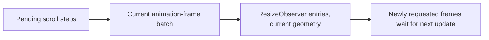

# Issue #4100: browser-order reader geometry delivery

Date: 2026-10-23
Status: frozen for spec PAR, implementation authorized by Jesse after PAR
Base: `06e4aecc99d8dafd842faf932a30d5d0283d8f46`
Lane: `issue-4100-reader-frame-order`, existing isolated worktree

## Goal and invariant

This is a test-ordering defect, not a production defect. A rendering update runs scroll steps, then the animation-frame callback batch, then ResizeObserver delivery. `installTranscriptGeometry().notify()` must never deliver observations ahead of still-held callbacks belonging to that update. It must advance one rendering update, not drain to idle.

Scroll handlers may request frames for this update. Frames requested inside a frame callback or ResizeObserver callback belong to the next update. Cancellation must suppress a callback even when another callback cancels it after the batch was captured. The observer target filter restricts observation delivery, never which earlier frames execute.

## Evidence and chosen model

`transcriptReadingGeometryTestUtils.ts` already owns both scheduling boundaries: `holdReaderFrames()` replaces request/cancelAnimationFrame and retains callbacks, while geometry-generated scroll events use a marked frame callback to run scroll steps before ordinary frames. Its `release()` already runs scroll steps and then snapshots the ordinary-frame batch. However, `notify()` only calls `runScrollSteps()` before delivering observations. Consequently, it bypasses the held ordinary-frame callbacks.

Choose the faithful browser-order model: associate the held requestAnimationFrame function with its rendering-update runner, and have `notify()` invoke the currently installed runner before collecting entries. Use the same runner as `frames.release()`. Keep pending frames requested during callbacks for the next update, and preserve the pre-existing unheld behavior when no reader frame holder is installed. Do not repeatedly release until the queue is empty. Associate by function identity rather than a sticky global holder, so restoring a holder cannot keep routing notifications to an inactive queue.

A refusal-only model would force each of approximately 55 existing delivery sites to hand-order this shared external browser boundary. Both helpers are in one test-only module, so coupling their existing rendering-update operations is smaller and prevents the bad order by construction.

## Scope and call sites

Allowed implementation paths, relative to `cmd/evener-hub/frontend/`:

- `src/panes/session/transcript/transcriptReadingGeometryTestUtils.ts`
- `src/panes/session/transcript/transcriptReadingGeometryTestUtils.test.ts`
- Bounded scheduling/setup corrections in `src/panes/session/transcript/flow/useTranscriptScroll.test.ts`, `src/panes/session/transcript/transcriptAnchors.test.tsx`, and `src/widgets/virtuallist/virtuallist.test.tsx` if advancing the earlier frame exposes an impossible intermediate checkpoint.

Existing `notify()` calls change semantics centrally, including the append in “fresh end-follow respects $input movement before a backward measurement commits”. A subsequent explicit `frames.release()` advances the next frame, including work requested by ResizeObserver, rather than retroactively running an earlier frame. Retain such releases when they test completion of that next update. Fix call sites only by placing mutations/input/checkpoints in browser-producible updates, and explain each necessary correction. Preserve all user-visible offset, anchor, following, focus, and preservation assertions. Do not replace exact assertions with ranges or weaker predicates.

Other consumers include `TranscriptBody.test.tsx`, `Zoom.test.tsx`, `ActivitySidebar.test.tsx`, and `threads.entryProduction.test.ts`. Inspect or run targeted consumer checks to determine blast radius. If the faithful model requires broad expected-output changes beyond the three named files and the fake's own tests, stop after diagnosis and report the scope. Do not mass-edit those consumers.

## Non-goals and preservation

No production source, scroll policy, virtualizer behavior, UI copy, dependencies, labels, or evergreen product contracts change. In this checkout the reader responsibilities are recorded under S02 Browser workspace and S10 History and transcript, not a separate Reader row. No user work or persisted state changes. This fake remains an explicit jsdom boundary, not a full browser event loop, microtask engine, layout engine, or ResizeObserver depth/loop implementation. Unheld native-jsdom frames remain outside this held-frame invariant.

## Verification and delivery

1. Red-first fake test: schedule an earlier frame in a preceding task boundary, then call `notify()` while holding frames. Assert scroll steps, earlier callback, scroll-handler frame callback, and ResizeObserver delivery order. Observe failure against the original fake before modifying implementation.
2. Add focused coverage for one-frame snapshots, requests made during frames/observation, cancellation, filtered notifications, and scheduler restoration. The original held-scroll-order test remains green.
3. From `cmd/evener-hub/frontend`, run:
   - `npx vitest run src/panes/session/transcript/transcriptReadingGeometryTestUtils.test.ts src/panes/session/transcript/flow/useTranscriptScroll.test.ts src/panes/session/transcript/transcriptAnchors.test.tsx src/widgets/virtuallist/virtuallist.test.tsx`
   - Targeted checks for the other direct consumers, only to detect blast radius, not the full suite.
   - `npm run typecheck`
   - Pinned Biome on touched TypeScript paths from this directory.
4. Run repository-root `make build` after reading its recipe. Do not run `make test-web` or the full suite. Reuse a shared install only after byte-identical lockfile comparison, never `npm ci` through a symlink.
5. Run two independent competing PAR reviewers on this frozen spec, resolve legitimate findings, implement, then repeat PAR on the immutable implementation snapshot. Run simplify-code, commit, and run roborev branch review.
6. Merge current `origin/main` locally before final push when needed. Push once per complete round, create a PR against main using GitHub's returned URL, and shepherd exact-head CI/reviews. Admin squash-merge only with all required checks green and every roborev finding low or conclusively refuted. Verify merged state and merge SHA; report blockers honestly.

Task-owned scratch: `$EVENER_SCRATCH_DIR`. Preserve shared installs and caches. Report exact changed paths, command results, review resolutions, PR URL, merge SHA, and anything unverified.
