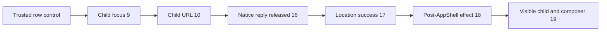

# Guard phone nested-conversation focus on current main

Issue: <https://github.com/prime-radiant-inc/evener/issues/4363>

## Approved guard-only scope

The original request proposed an idempotent placement-seam fix, conditional on a
real-browser reproduction. The natural delayed-location journey passed twice
before any placement change. The follow-up instruction therefore approves a
regression-guard-only delivery: preserve the evidence, pin the desired behavior
on current main, and do not change `sessionPlacement.ts` or other product code.
Do not manufacture a red reproduction or claim a new product fix.

The seven deliverables are this spec and these six test-support files:

- `cmd/evener-hub/doc_file_links_browser_test.go`
- `cmd/evener-hub/nested_focus_browser_test.go`
- `cmd/evener-hub/frontend/src/dev/DocumentFileLinksFixture.tsx`
- `cmd/evener-hub/frontend/src/dev/documentfilelinksharness-entry.tsx`
- `cmd/evener-hub/frontend/src/dev/NestedFocusProbe.tsx`
- `cmd/evener-hub/frontend/scripts/nestedfocusguard/run.mjs`

The lane is `issue-4363-nested-focus`. Before the original spec, it merged
`origin/main` at `33134ee488bda92a8df322ac53a9963e9031e1ae` into its older
`7f8fb3ba706c875861658f75c2d0bdb909eab8ce` base, producing lane HEAD
`2f57e4757703ba914e0ccea551b063863d3d05c9`. A second fetch before this amendment
found `origin/main` unchanged. Repository instructions, `docs/product/README.md`,
the S02 Browser workspace row in `docs/product/subsystems.md`, and
`docs/developing-evener/testing.md` retain authority. No product contract changes.

## Historical interleave and the reproduction blocker

The issue was recorded while removing read-only conversation transcripts on
`conversation-view` (merged by #4373, commit `0ef324a162`). It reports this
page-side focus-transition probe against a real hub, not a jsdom failure:

1. The owner conversation occupies main and is focused on a phone.
2. A row's ordinary `openTranscript(child, parent)` opens the child conversation
   in secondary, focuses it, and records its immediate-parent context.
3. StackHost publishes `/s/<child>`; the child's navigation location then arrives
   and identifies the top-level owner.
4. AppShell calls `openNestedSessionWithOwner(child, owner)`.
5. The helper calls `openTopLevelSession(owner)`, whose matching-primary arm
   publishes owner focus even though the owner is already main.
6. The reported interleave leaves the owner selected despite the following child
   `openPane` dedup. The retained child is mounted but the phone shows the owner.

That is historical evidence, not a reproduced failure on current main. Both
independent spec reviewers found that current `routePlacementIsApplied`
recognizes owner/main plus child/secondary plus child/focused and returns before
the nested helper. This check also exists in #4373. The later stale-path guard
from #4857 is additional protection, not evidence that it fixed #4363.

A synchronous helper call can publish owner then child focus, so a final unit
assertion cannot settle the historical browser claim. Conversely, forcing a
helper replay from test support would bypass the current route check and would
not reproduce the natural journey. No such replay or guard bypass is permitted.

The requested current-head red was not obtained. This blocks the originally
proposed product fix, not the approved regression guard. The PR should describe
#4363 as already satisfied by current placement behavior and close it with the
guard evidence, without attributing the result to a newly identified fix commit
or claiming every possible trigger has been ruled out.

## Existing behavior to pin

Opening a nested conversation from the ordinary row control must leave that
child selected and visible in the phone's StackHost after its resolved route is
reconciled. Deep-link-first remains supported but is not the tested journey.

The desired satisfied-placement rule is: owner session already in main, child
session already in secondary, child already selected means no owner-focus
publication is needed. Preserve the exact pane identities and recorded immediate
Back edge. The guard pins that rule at the user-journey boundary; it does not
change the helper or require a particular implementation of the route check.

## Real-hub browser guard

Reuse the existing document-file-links fixture's actual hub app server,
navigation service, AppwireClient, AppShell, workspace, StackHost, Session and
composer. Its daemon relay is scripted. Factor only the shared Go fixture entry
so the old document runner remains unchanged and the focused nested-focus runner
can use the same fixture.

At a 390 by 844 viewport, start with one settled owner session. Render the real
`OpenTranscriptButton` with literal child and owner refs in the dev harness.
Activate it through trusted browser input, not a page-side placement call.

Install the page-side workspace subscription, route observer and navigation
subscription before activation. Hold only the real child's native location
WebSocket reply. After child selection and child URL publication, forward the
original trusted `MessageEvent` unchanged to the original listener. Do not
fabricate RPC responses, duplicate panes, preload the child location, or use the
existing document fixture's deep-link-first `prepareSource` workaround.

The child DOM can already exist before location delivery. Successful resource
completion plus child DOM is therefore not a reconciliation boundary. Render a
dev-only observer after AppShell as a sibling. Its passive effect acknowledges
the exact successful location resource consumed by that commit, after AppShell's
route-placement effect. Keep transition observation active through this
acknowledgement and the final rendered-child assertions. Use bounded conditions,
not a fixed sleep or an arbitrary number of animation frames.

Assert independently of placement implementation details:

- Child selection precedes StackHost's child URL publication.
- The child URL precedes release and settlement of the real location response.
- No owner focus follows the first child selection, including transient focus.
- Exactly one owner remains in main and one child in secondary, with the original
  owner ID and row-created child ID retained and the child focused.
- The child's recorded immediate Back edge remains the literal owner ref.
- The successful location identifies the literal owner, and the post-AppShell
  acknowledgement matches that resource's identity and loaded revision.
- The phone renders exactly the child Session scaffold and its visible composer
  textbox at completion, with observation still active and no uncaught exception.

## Recorded unchanged-production baselines

Both runs used lane HEAD `2f57e4757703ba914e0ccea551b063863d3d05c9`, before any
product change. The writer ran the first; the calling agent independently ran
the second with a separate artifact directory and a fresh browser profile.

| Page-side event | First run | Independent repeat |
| --- | --- | --- |
| Trusted row-control click | 8 | 8 |
| Child focus | 9 | 9 |
| Child URL | 10 | 10 |
| Original native location reply released | 16 | 16 |
| Successful location resource | 17 | 17 |
| Post-AppShell passive effect | 18 | 18 |
| Rendered child and composer checked | 19 | 19 |
| Owner refocus after child selection | none | none |
| Command exit | 0 | 0 |

Both runs retained owner `pane_session_2` in main and child `pane_session_3` in
secondary and focused. Resource identity 4 and loaded revision 1 matched between
settlement and passive-effect acknowledgement. Both reported
`assertions: "pass"`, `ownerFocusReproduced: false`, and no uncaught exception.



This is a green baseline, not red-to-green evidence. The exact traces are retained
with the task evidence. No failing pre-fix run exists, and none is required or
claimed for this amended guard-only delivery.

## Verification and delivery

From the repository root, run twice as separate invocations:

```sh
DOCUMENT_FILE_LINKS_ARTIFACT_DIR="$EVENER_SCRATCH_DIR/nested-focus-run-1" \
  go test ./cmd/evener-hub -run '^TestNestedSessionFocusBrowser$' \
  -count=1 -v -args -nested-session-focus-browser
DOCUMENT_FILE_LINKS_ARTIFACT_DIR="$EVENER_SCRATCH_DIR/nested-focus-run-2" \
  go test ./cmd/evener-hub -run '^TestNestedSessionFocusBrowser$' \
  -count=1 -v -args -nested-session-focus-browser
```

From `cmd/evener-hub/frontend`:

```sh
EVENER_FRONTEND_VITE_CACHE_DIR="$EVENER_SCRATCH_DIR/vitest-cache" \
  ./node_modules/.bin/vitest run --configLoader runner --maxWorkers 2 src/shell/sessionPlacement.test.ts
EVENER_FRONTEND_VITE_CACHE_DIR="$EVENER_SCRATCH_DIR/vitest-cache" \
  ./node_modules/.bin/vitest run --configLoader runner --maxWorkers 2 src/shell/AppShell.test.tsx \
  -t 'already placed parent location|phone Back from an opened child|responsive retained-parent walk'
npm run typecheck
```

The unchanged-production baselines also passed the 9 placement tests, 5 selected
AppShell cases and TypeScript check. Repeat the focused checks for the final
reviewed support. CI owns the full suite; do not run it locally or run `npm ci`
through a symlinked `node_modules`. This focused guard is explicitly opt-in; this
seven-file change does not register a new default CI browser-gate entry.

Freeze the amended spec and support for two independent competing PAR reviewers.
Run simplify-code, commit exactly the seven files, then run branch RoboRev
review. Stop and report if a reviewer concludes the guard should not land.
Before final push fetch only `origin/main`, merge if it moved, and renew affected
verification and reviews. Push a guard-only PR against main and run shepherd-pr.
Admin squash-merge only when every required current-head check is green and the
review is clean. Record PR URL, merge SHA, trace evidence and remaining limits.

## Non-goals and limits

- No product code, placement-seam hardening, StackHost rewrite, route rewrite,
  focus timer, new UI, persistence change or native-app change.
- No manufactured red, helper replay, guard bypass or deep-link-only workaround.
- No claim to cover a physical phone, actual daemon/provider, deeper parent
  chains, desktop-to-phone restoration, or ownership changes during reconnect.
- No unrelated cleanup, labels or secondary legacy-transcript composer fix.
  File any newly confirmed unrelated problem separately and keep it out of this PR.
