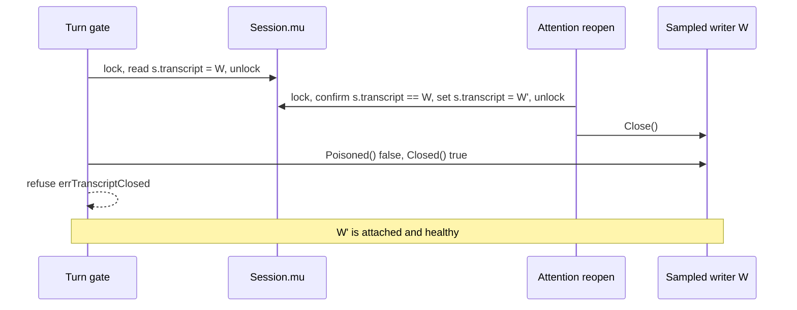

# Issue #4367: the turn gate must not refuse a writer an attention reopen replaced

Status: frozen for PAR, 2026-10-23 (revision 3 after PAR findings).
Base: `d0b40eba630f4fbee4bfaa32e126bd596e04625e` (origin/main at the first freeze), lane merge `692f9cddcd` of the final base `de2fdab03066fe68e020137bd896ad078f804b3f` (that base touches only `agent/internal/atif`).

## Problem

`refuseTurnOnUnhealthyTranscript` samples the attached writer with `attachedTranscript()`, which takes and releases `s.mu`, and then decides health on that sample with `refuseOnUnhealthyTranscript(W)`. That decision reads `W.Poisoned()` and `W.Closed()` without `s.mu`. An attention reopen runs under `attentionMu`: `reopenAttentionTranscriptDurably` opens W', swaps `s.transcript = W'` under `s.mu`, releases `s.mu`, and only then closes W. A gate that sampled W before the swap and reads `W.Closed()` after the close refuses with `errTranscriptClosed()` even though W' is attached and healthy.

The reopen paths (`reopenAttentionTranscriptDurably` and `stabilizeAttentionForStop`) are unchanged by this spec. Both publish the replacement under `s.mu` before closing the writer they replaced; the fix below relies on that ordering but does not redesign it.

## Exact interleaving

1. Turn gate: `attachedTranscript()` locks `s.mu`, reads `s.transcript` = W, unlocks.
2. Attention reopen, holding `attentionMu`: opens W', establishes durability, locks `s.mu`, confirms `s.transcript == W`, sets `s.transcript = W'`, unlocks.
3. Attention reopen: `W.Close()` sets `W.closed` and closes the file.
4. Turn gate: `refuseOnUnhealthyTranscript(W)` reads `W.Poisoned()` false, `W.Closed()` true, and returns `errTranscriptClosed()`.
5. Turn gate: settles processing, emits the end of input as a turn failure, and returns the refusal. W' remains attached and healthy.

The symmetric genuine-close case is different: `closeAttachedTranscript` closes the attached writer in place and leaves it in `s.transcript`. Nothing replaces it, so a gate that samples after the close must refuse.

## Fix rule

The gate decides on the writer named by `s.transcript`, and treats a refusal as final only when that writer is still the attached writer at a fresh `s.mu` read. Its health work is reordered:

1. `failClosedOnTranscriptCreation()` — the creation half of `failClosedOnUnhealthyTranscript`, split out. It is unconditional and writer-independent, as before.
2. Sample `writer := s.attachedTranscript()` under `s.mu`.
3. Decide `refusal := s.refuseOnUnhealthyTranscript(writer)` — the existing failed-closed, poison, closed order, reading only the writer's own lock, with no `s.mu` and no `attentionMu`.
4. Return nil when the decision is healthy.
5. When the decision refuses, re-read `s.attachedTranscript()`. If it is still `writer`, the refusal is final; otherwise the writer was replaced, so sample and decide again on the replacement.
6. At finality, if the refusal is the poison refusal, call `failClosed(errTranscriptRefusesRecords())`. When that returns non-nil (a served session), the gate returns that refusal, so the failed-closed identity a served caller already sees is preserved; when it returns nil (an unserved session), the poison refusal stands. The latch now happens only after the poisoned writer is confirmed still attached.

`failClosedOnUnhealthyTranscript` keeps its behavior for every other caller: it calls `failClosedOnTranscriptCreation()` and then reads the attached writer's poison. Only the turn gate moves the poison latch behind the identity check. The gate never takes `attentionMu`.

### Poison is covered by the same rule

The issue says poison should be read from the sampled writer because "a poisoned writer is never replaced by this path." That premise is false, and it matters twice:

- `resumeWriter` truncates the partial tail and clears the shared tail's poisoned bit (`agent/transcript/transcript.go:1126-1129`), with the comment that only the writer that left the line stays poisoned. That writer keeps `w.poisoned = true` (`agent/transcript/transcript.go:837-838`), and `Writer.Poisoned` reports `w.poisoned || w.tail.poisoned` (`agent/transcript/transcript.go:904-908`). `TrackFailures` transfers only the failure counter (`agent/transcript/transcript.go:447-457`).
- The reopen paths are reachable while that writer is attached: `appendDelegateAttentionMessageDurably` reopens when the attention item already exists (`agent/session_attention.go:545-566`), `resolveAttentionDurablyForGeneration` reopens for an existing resolution (`agent/session_attention.go:1760-1770`), and `stabilizeAttentionForStop` repairs a failed stop append (`agent/session_attention.go:1842`).

The pre-fix gate also latched the failed-closed state *before* it sampled (`agent/session_lifecycle.go:1748` → `agent/session_fail_closed.go:103-105`). That cause is permanent (`failedClosed.cause` is set once, `agent/session_fail_closed.go:62-67`) and `refuseOnUnhealthyTranscript` returns it before any writer-specific fact (`agent/session_lifecycle.go:1809-1811`), so no amount of revalidation could accept a repaired replacement. Moving the latch to finality (step 6) is what makes the identity rule effective for poison.

If the attached writer is genuinely poisoned, the gate still latches and refuses. If a reopen repaired the tail and published a healthy replacement before the gate's final identity read, the stale per-writer poison is discarded and the healthy session continues.

## Why the rule cannot spin or miss a real failure

**It cannot spin on its own.** Only a replacement produces another pass, and every replacement installs a freshly opened writer; no writer is ever re-attached, so each pass decides on a writer generation the previous pass did not. The gate performs no reopen and holds no `attentionMu`, so it cannot cause the replacement that retries it. A replacement requires an external attention delivery, resolution or stop repair, is serialized by `attentionMu`, and performs an open plus a durability barrier. With no replacement, a healthy decision returns at once and the first refusal is final at step 5.

**It still refuses a genuinely closed or poisoned current writer.** A refusal is final only after a fresh `s.mu` read finds the same writer still attached. The refusal was decided on that writer's own `Closed()`/`Poisoned()`, so a current writer that is already closed or poisoned refuses; a poisoned one also latches, as before.

**A close that lands after a healthy decision is the pre-existing stale read.** The gate is a pre-flight sample, not an atomic claim on the writer. The turn may run against a writer that closed just after the decision; the next round's gate re-samples the attached writer, and the synced user-input door is an additional backstop where one follows that turn. A close in the sample-to-decision interval is caught because the decision reads `Closed()` live, as before.

**Residual poison-repair race.** A replacement that lands after the final identity read but before the latch/return can still make a poison refusal stale. This is accepted: removing it would require serializing the gate with `attentionMu` across writer I/O, which the issue rules out. The window is the few instructions between the identity read and the latch, not the reported sample-to-decision window, and it requires a complete reopen (open plus durability barrier) to land there. Its impact is the same as any turn-gate refusal — settle and end input, and a delegate can become `fatalRunGated` — so it is recorded as a narrow residual, not as something a later round recovers. The closed case has no such residual: a writer can be closed while still attached only by a genuine session close, and both reopen paths refuse to swap a closing session (`agent/session_attention.go:1821-1824`, `1899-1903`).

## Non-goals

- No change to attention reopen or stabilization ordering, durability, fold handling, or failure accounting. No close-before-swap and no close under `s.mu`.
- The failed-closed state itself is unchanged: the gate still fails closed on a poisoned current writer, and every other caller of `failClosedOnUnhealthyTranscript` keeps its ordering. Only the turn gate's own latch moves behind its identity check.
- The other sample-then-check sites keep their current shape and are out of scope for this unit: `refuseBeforeClaimingOnUnhealthyTranscript` and the claim/queue-head sites that call `refuseOnUnhealthyTranscript` directly (`agent/session_lifecycle.go:1774-1778`, `agent/session_client_mutation.go:576,624,646`, `agent/session_queue.go:764`, `agent/session_client_mutation_queue.go:431`), `transcriptRefusalForWrite` (`agent/session_lifecycle.go:1890`), `session_compaction.go:208`, `deliverCommunicate`, and `failClosedUnlessRecorded`. These were named in the issue as needing a look; this change narrows the "window removed" claim to the turn gate and leaves them for a separate change.
- No `attentionMu` in the turn gate and no widening of `s.mu` across writer-lock I/O.
- No product contract change: S09 session execution, S10 transcript, and S11 attention ownership and recovery are unchanged, so no evergreen product page is revised.
- No labels, no full local suite, no deployment.

## Test plan

Add one test-only seam to `agent/session_config.go`: `turnGateSampledTranscript func(*transcript.Writer)`, called after each writer sample and before the decision, with no lock held. It is added before the fix at the same position in the current single-sample gate, so the red run uses the production gate plus the seam and tests only. In each test the hook is one-shot: it nils itself on the first call, as existing seams do (`agent/session_poisoned_wake_gate_test.go:447-448`), so the fixed loop's retry pass does not block.

1. Red-first race test `TestTurnGateAcceptsAReplacementAfterAttentionReopenClosesTheSampledWriter`: install the seam, let the gate sample W and block, run the real `reopenAttentionTranscriptDurably` under `attentionMu` through its swap and `W.Close()`, then release. Assert the gate returns nil and the replacement is attached. Against the pre-fix gate this fails with `errTranscriptClosed`; the fix makes it pass.
2. Control `TestTurnGateRefusesAClosedCurrentWriterAfterAttentionReopen`: after a real reopen, close the current replacement in place with `closeAttachedTranscript` (the genuine-close shape) and assert the gate returns `transcript.ErrWriterClosed`. The existing `TestTurnGateRefusesAClosedTranscript` remains the simple closed-writer control.
3. Poison repair `TestTurnGateAcceptsAReplacementAfterAttentionReopenRepairsPoison`: make a daemon-served session (`authoritativeConsumer = true`), poison the attached writer with a direct buffered `Record` through the existing faultable environment filesystem (not `writeTranscript`, which would latch fail-closed itself), hold the gate at the seam, run the real reopen (resume truncates the partial tail), release, and assert the gate returns nil and `failedClosedRefusal()` is nil. This test fails both against the pre-fix gate (pre-sample latch) and against a loop-only fix (the latch survives); revision 3 passes it.
4. Positive poison control `TestTurnGateRefusesAndLatchesAPoisonedCurrentWriter`: the same direct poisoning, no reopen. Assert the gate refuses with a refusal that matches both `ErrTranscriptFailedClosed` and `transcript.ErrWriterPoisoned`, and that `failedClosedRefusal()` is non-nil. Without this, step 6 could be dropped undetected: the existing served-poison test latches earlier through `recordTranscriptLocked`, not through the gate.
5. Unserved poison control `TestTurnGateRefusesAPoisonedWriterWhenUnserved`: the same direct poisoning on a session with no authoritative consumer. `failClosed` is a no-op there, so assert the gate returns a non-nil refusal matching `transcript.ErrWriterPoisoned` (not `ErrTranscriptFailedClosed`) and that `failedClosedRefusal()` stays nil. Without this, updating the refusal unconditionally at finality would let an unserved session accept a turn on a poisoned writer.
6. One reopen path is enough to prove the gate change: both reopens publish under `s.mu` and close the replaced writer after releasing it, and the gate sees only the pointer and the writer's own health. `stabilizeAttentionForStop` has its own coverage of the reopen itself (`agent/session_attention_test.go:941-988`); it has no dedicated gate/stop race test, and the identical gate logic is what this plan pins.
7. Channels and a 30-second tripwire only, no sleeps, per `docs/developing-evener/testing.md`. Every wait on the gate goroutine, not only the sample hand-off, uses the tripwire so a retry loop that never terminates fails the test instead of hanging the package. Assert with `errors.Is` on the writer's sentinel, never on error copy.

## Verification

- `go test ./agent -run 'TestTurnGate' -count=1 -v` (all five new tests are named `TestTurnGate...`, so the selector runs them).
- `go test ./agent -run 'TestClosedTranscriptClaimIsRefusedBeforeItCommits|TestStartClaimGoesBackWhenTheTranscriptClosesAfterTheAnnounce' -count=1`
- `make build`
- CI owns the full suite, race, lint, and fuzz lanes; this change does not run them locally.
- The pre-change failure and post-change pass are recorded in the PR evidence.
