# Issue #4454: preserve profile schemas when renaming the result tool

Status: approved scope from the issue request, frozen for PAR before implementation.

## Goal and exact contract

With `--result-tool-name respond`, the session's result tool must retain the
profile's communicate parameter schema. Renaming changes its callable name,
not the output contract requested by the caller.

- `--output-schema` replaces `parameters.properties.output` wholesale. The
  replacement's properties, types, required fields, and additional-properties
  policy survive registration and provider advertisement. Default output
  fields (`message`, `data`, `artifacts`) are not merged into the replacement.
- `EVENER_ALLOWED_DECISIONS` adds `output.properties.decision` with string type
  and the configured enum. `output.required` includes `decision`, and the tool's
  top-level `required` includes `output`.
- When both overrides apply, output replacement happens first and decision
  injection second. The caller's fields and required entries remain alongside
  the required decision. The existing requirement that the replacement support
  an output properties map is unchanged.
- The same contracts hold for the default name `communicate`. With neither
  override, default output schemas and the absence of a decision field stay
  unchanged for both names.
- The registered definition's name is the configured name, and its executor is
  the real result-tool executor, not the profile's placeholder executor.
  Schema-valid results reach terminal capture with the original structured
  output, including `decision`. Missing required fields and invalid decision
  enum values remain validation failures.
- Existing result-name collision checks and the optional `end_reason` overlay
  keep their current behavior. A registry without a profile communicate
  definition still receives `DefCommunicateNamed(configuredName)`.

## Evidence and chosen seam

The source of truth is the profile's canonical `communicate` definition:

- `provider.WithCommunicateOutputSchema` and `provider.WithAllowedDecisions`
  (`agent/provider/profile_overrides.go`) clone and modify that definition.
- CLI startup (`buildInitialProfile` in `cmd/evener/serve.go`) applies the
  output override before the allowed decisions override.
- `newProfileToolRegistry` (`agent/session_tool_registry.go`) seeds the registry
  under canonical profile names before real executors are registered.
- `registerCommunicateTool` (`agent/session_tools_communicate.go`) already
  owns the configured result-tool name, collision checks, definition adoption,
  and the real executor. Today it tries to adopt `reg.Get(configuredName)`,
  which cannot find the overridden canonical definition after a rename.

Fix definition adoption at registration: look up
`reg.Get(tool.DefaultResultToolName)`, copy its definition when present, and
set that local definition's `Name` to the configured result name. Preserve the
whole definition, not only `output`, so required lists and provider metadata
survive. Keep the existing base definition as the no-profile fallback and apply
the existing end-reason overlay afterward. Changing the copied struct's name
must not rename or mutate the profile definition or its canonical registry key.

This seam is correct because profile overrides are name-independent canonical
configuration, while session registration owns naming. Threading a session name
through both provider override APIs, CLI startup, and delegate setup would add
coupling without fixing another cause. This is not a compatibility shim: it
uses the existing canonical definition at the point that gives it a live name.

```mermaid
flowchart LR
    CLI[Output schema and allowed decisions] --> Profile[Canonical communicate definition]
    Profile --> Registry[Profile registry seeded by canonical name]
    Registry --> Registration[Adopt definition and set configured name]
    Registration --> Request[Advertise respond with preserved schema]
    Request --> Execution[Validate and execute result tool]
    Execution --> Capture[Capture original structured result]
```



The profile remains canonical. Registration binds that contract to the session's
name, so the advertised tool and the validator agree before execution captures
the result.

## Scope, preservation, and recovery

Change only result-tool registration, profile overrides if necessary, their
tests, and this spec. The expected production change is confined to
`agent/session_tools_communicate.go`; the override APIs need no change.
No responsibility, durable store, recovery trigger, or client surface moves,
so the product subsystem map and evergreen guides need no boundary amendment.

This fixes schema construction before a session's first model request. There is
no new retry, migration, persisted-schema repair, or runtime recovery path.
Existing session reconstruction uses the same registration seam when supplied
an overridden profile. Previously produced results are not rewritten. Caller
schemas and base profiles remain unmodified, and existing name reservations
remain intact.

## Non-goals

- No communicator, provider, CLI, prompt, or result-output refactor.
- No alias, extra callable compatibility name, or change to name reservations.
- No changes to allowed-decision parsing, override ordering, supported schema
  shapes, or the behavior of applying an override more than once.
- No live provider qualification, UI changes, or changes to terminal routing.
- No unrelated fixes, labels, full local suite, or deployment. File unrelated
  defects separately rather than including them here.

## Verification

Use real profile overrides, profile registry construction, registration,
validation, and session execution. Script only the external LLM boundary.
Assert structured schema fields and captured output, never human-facing prose.

1. Add regressions for `respond` covering output replacement alone, allowed
   decisions alone, and both stacked. Keep the existing default-name
   `TestWithAllowedDecisions_RegistryPreservesDecisionSchema` passing.
2. Before changing production code, run the new cases and record the failures:
   renamed output retains the default envelope, and renamed decisions lose
   `decision` and its required constraint. Default-name controls must pass.
3. After the fix, verify exact replacement, required `output` and `decision`,
   configured enum, valid execution, and rejection of missing/invalid decision
   values. Check a no-override control, a no-profile fallback, and that the
   canonical profile definition is not renamed or mutated.
4. Exercise a real session with `ResultToolName: "respond"` and a scripted
   provider. Inspect its advertised definition and complete a terminal call,
   asserting the captured structured result, not only successful registration.
5. Run focused checks, not the full suite:

   ```sh
   go test ./agent/provider -count=1
   go test ./agent -run '^(Test.*Communicate|Test.*ResultTool|TestWith(AllowedDecisions|CommunicateOutputSchema))' -count=1
   make build
   ```

Run two independent competing PAR reviewers on the frozen spec and again on
the immutable implementation diff. Then run simplify-code, commit, and run the
branch RoboRev review. Fetch and merge current `origin/main` before the spec
(initial required floor: `48a6703d`) and again before the final push if moved.
Push one round at a time, shepherd the PR, and let required CI qualify the full
suite. Admin squash-merge only with all required checks green on the exact head
and every RoboRev finding low or conclusively refuted. Verify GitHub's merged
state and merge SHA before cleaning owned disposable files.
