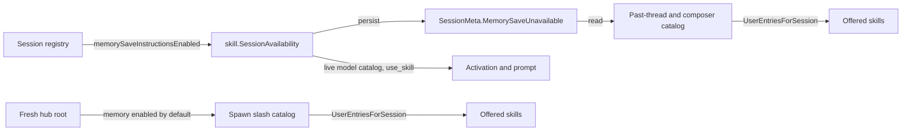

# Issue #4456: hub catalogs honor the session's skill availability

Status: frozen for review, 2026-10-23. The issue's explicit acceptance criteria authorize this bounded behavior correction.

## Defect: two cold scans ignore a verdict activation already enforces

#4458 added `Session.skillAvailableToSession` (`agent/session_memory.go`) and made three surfaces honor it: the model-facing `<skill-catalog>` in `buildPromptData` (`agent/session_prompts.go`), `use_skill` and every activation route in `prepareSkillActivations` (`agent/session_skill_activation.go`), and the live daemon's completion view in `DetailedStatus` (`agent/status.go`). A session that cannot save memory therefore refuses the bundled `gardening-memory` skill with a typed `policy_denied`, and its model catalog no longer names it.

The hub's two catalog builders still run `skill.Discover(...)` and copy `catalog.UserEntries()` verbatim. They apply only the source catalog's own `Unavailable` and `UserInvocable` controls:

- `hubSpawnSlashCatalog` (`cmd/evener-hub/app_spawn_slashcatalog.go:105-122`) answers the launcher's `evener/spawn/slashCatalog`.
- `discoverPastThreadSkills` (`cmd/evener-hub/app_threadread.go:675-716`) answers `thread/read` for live and saved sessions; `attachPastThreadSkillCatalog` overlays it on the past-thread and composer views.

Neither function receives the session's memory capability. A delegate, a `--disable-memory` session, or a root whose registry lacks `memory_write`, `memory_edit` or `memory_delete` is therefore offered `gardening-memory` by the composer and past-thread catalogs, and the offer is refused only after the user selects it. That is the offer-then-refuse defect in #4456.

## Contract

A hub catalog that names a session applies the same session-scoped availability as activation after source discovery, and keeps every other skill exactly as before. For a session that cannot save memory, `gardening-memory` is absent from the advertised list; a session that can save memory still sees it with its existing controls, description, `AllowedTools`, and canonical position among the remaining entries. Source-discovery diagnostics, source precedence, plugin selection, command catalog content, and the wire `Available`/`UserInvocable`/`DisableModelInvocation` values for every retained skill do not change.

The three refusal shapes are covered as follows:

| Session shape | Engine verdict (`memorySaveInstructionsEnabled`) | Saved fact the hub reads | Hub catalog result |
| --- | --- | --- | --- |
| Memory-capable root | true | `MemorySaveUnavailable` absent/false, `IsSubagent` false, `DisableMemory` false | `gardening-memory` offered |
| Delegate | false (save tools filtered) | `IsSubagent` true, and new metas persist `MemorySaveUnavailable` true | absent |
| `--disable-memory` session | false (whole namespace removed) | `Config.DisableMemory` true, and new metas persist `MemorySaveUnavailable` true | absent |
| Root whose profile denies a save tool | false (registry lacks a save tool) | new metas persist `MemorySaveUnavailable` true | absent |

The launcher's spawn catalog describes a fresh root session the hub would start. That session gets the default memory state root and registers every memory save tool, so its availability is `MemorySaveAvailable: true` and `gardening-memory` stays offered. The spawn path uses the same seam so a future launch capability cannot reintroduce a second, independent verdict.

## Plumbing seam

One shared type owns the name-to-capability mapping, and one persisted fact carries the engine's answer to the cold hub:

1. `agent/skill` gains the exported constant `GardeningMemorySkillName`, the value type `SessionAvailability{MemorySaveAvailable bool}`, and `SessionAvailability.SkillAvailable(name string) bool`. Today only `gardening-memory` consults a session capability; every other name is available. `Catalog.UserEntriesForSession(SessionAvailability)` returns `UserEntries()` narrowed by that predicate, preserving canonical order.
2. `agent.Session.skillAvailableToSession` (`agent/session_memory.go`) becomes a thin call to the shared type with `MemorySaveAvailable: s.memorySaveInstructionsEnabled()`. The activation policy, its callers, and the memory-save predicate do not change.
3. `schema.SessionMeta` gains `MemorySaveUnavailable bool` with `json:"memory_save_unavailable,omitempty"`. `Session.metaWithNotes` (`agent/session_state.go`) writes `!s.memorySaveInstructionsEnabled()`; the value is fixed for a session's lifetime and is recomputed on resume. A missing field (every meta written before this change) is false, which keeps the existing advertisement for a memory-capable root. The hub still checks `IsSubagent` and `Config.DisableMemory` for those older metas, so no old delegate or disabled session starts being offered the skill after upgrade.
4. `discoverPastThreadSkills` builds `skill.SessionAvailability` from the saved metadata and calls `UserEntriesForSession`:
   `MemorySaveAvailable = !meta.MemorySaveUnavailable && !meta.IsSubagent && !meta.Config.DisableMemory`.
   `hubSpawnSlashCatalog` calls `UserEntriesForSession` with the fresh-root availability (`MemorySaveAvailable: true`) and documents why.
5. No web client change: both hub responses already merge on `Available && UserInvocable`, and the entry is simply absent now.

The persisted field is the smallest cold-read seam because only the owning session can see its registry. `MemoryStateRoot` and the provider profile are engine-only at launch; a delegate's save tools are removed at runtime; and a root whose profile denies a save tool has no persisted tool list. The hub cannot reconstruct the verdict from `ConfigSnapshot` or `ProfileID`, so the session must persist the answer it already computes.

## Cases and preservation

- A live session whose daemon reports `Evener.Diagnostics` keeps that daemon-owned catalog; the cold past-thread scan remains the fallback only where it already is. No change to the daemon status path.
- A cold read of a delegate or `--disable-memory` session saved before this change still omits `gardening-memory` through `IsSubagent`/`DisableMemory`.
- A cold read of a root whose profile denied a save tool *before* this change has no recorded verdict and continues to offer the skill. That case is unobservable from its saved metadata; the fix applies to every session that saves meta with this build.
- A normal root saved before or after this change still sees `gardening-memory` in both catalogs, with the same description and controls.
- Every other skill, including `doctoring-evener`, project, extra, and plugin skills, is offered exactly as before.
- No activation-policy change, no skill-content change, no web UI change, no catalog source-precedence or diagnostic change, no live-toggle or memory-management surface, no labels. There is no persistent-format migration: the new meta field is optional and ignored by older readers, so rollback needs no data repair.

## Verification

Red first, at the real hub catalog functions (not a hand-filtered catalog and not a stubbed availability seam):

1. `cmd/evener-hub`: seed the existing skill fixture (project, extra, plugin, and embedded skills) and build four past entries from real `schema.SessionMeta` values: a memory-capable root; a delegate (`IsSubagent: true`); a disabled session (`Config.DisableMemory: true`); and a root with `MemorySaveUnavailable: true`. Call `discoverPastThreadSkills` (and one `attachPastThreadSkillCatalog` / `pastThreadForRead` case) and assert `gardening-memory` is present only for the capable root while another fixture skill is present in all four. Before the fix, all four are offered, so the three negative cases fail.
2. `cmd/evener-hub`: call `hubSpawnSlashCatalog` for a normal project and assert `gardening-memory` is offered alongside the project skill; this pins that the fresh-root verdict remains available.
3. `agent`: extend the real-session availability test so `TestMemoryGardeningSkillGatedBySaveCapability` proves `Session.Meta().MemorySaveUnavailable` equals `!s.skillAvailableToSession(GardeningMemorySkillName)` for the enabled, write-revoked, memory-disabled, and delegate shapes, and that `SaveSessionMeta`/`LoadSessionMeta` round-trips the field. This proves the persisted fact comes from the real predicate rather than a hand-built verdict.
4. Retain the exact red output for steps 1-2 before the implementation and the green output after it. Run `go test ./agent -run 'TestMemoryGardeningSkill' -count=1` and `go test ./cmd/evener-hub -run 'SkillCatalog|SpawnSlashCatalog|ThreadRead' -count=1`, then `make build`. Do not run the full suite locally; CI is the source of truth.
5. Freeze and review this spec with two independent competing PAR reviewers. Review the immutable implementation diff with another two-reviewer PAR round, run simplify-code, commit, run branch RoboRev review, then push and open a PR. Fetch current `origin/main` and merge it before the final push if it moved. The parent session owns the CI wait and the merge; do not merge.
