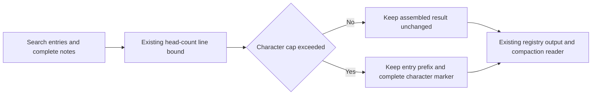

# Issue #4460: atomic trailing search notes at the character cap

**Status:** Approved scope from the issue request, frozen for PAR before implementation.

## Scope and intent

A search result must not expose a fragment of its trailing result note when the
registry applies the `head_count` character cap. This covers grep,
`memory_search`, glob, and callers using that truncation strategy. Tool caps,
note wording, result ordering, and the existing recovery path stay unchanged.

The search-result grammar is owned by `agent/searchresult`: entries contain no
blank lines, and `WithNotes` separates the entries from the entire notes suffix
with the first `\n\n`. Notes can be unbracketed, multiline, or multiple blocks.
No parsing of English sentences, brackets, or note wording is necessary.

## Exact rule

1. Apply the existing head-count line bound first, without changing its line
   accounting or generated summary.
2. If the resulting text is within the positive character cap, or the character
   cap is disabled, leave it byte-for-byte unchanged. Complete source notes and
   complete line-count summaries survive whenever the assembled result fits.
3. If character truncation is needed, keep the existing earliest-prefix policy
   and the existing complete character-removal marker. The prefix may contain
   only entries: its rune length is at most both the available prefix budget
   and the rune length before the first blank-line separator. Drop the entire
   existing notes suffix, including its separator, rather than emitting any of
   it. With no separator, retain the existing plain-text prefix behavior.
4. Calculate the marker's removed-character count against the complete text
   entering the character cutter. Count every omitted rune, including all
   discarded note text and its separator. Recalculate the prefix budget until
   the marker's count and width agree, as the existing cutter does.
5. Keep the existing truncation status, generic registry truncation indicator,
   and full/recoverable output. The character-removal marker is the only
   detailed truncation note after a character cut; it is not accompanied by a
   stale search-limit note or a partial line-count summary.

The normal grep cap remains `{MaxChars: 20000, MaxLines: 200, Strategy:
head_count}`. Existing behavior for a configured cap smaller than the complete
marker is unchanged: the marker itself is not chopped to meet that cap.

## Why the rule cannot leave a note fragment

An over-limit result's retained source prefix ends at or before the first notes
separator. It therefore contains zero characters from the source notes. The
replacement marker is generated as a complete unit after the cut. Under-limit
results retain their complete source suffix unchanged. These cases exhaust the
character cutter's decisions.

Dropping the whole suffix is deliberate. Search notes include useful omission
information, but they describe the pre-character-cut result. Keeping that
suffix would require a new policy for reducing useful entries to reserve notes,
and could leave multiple competing truncation counts. The existing character
marker describes this cut accurately. Complete notes remain available in the
full/recoverable output through the existing artifact/transcript path; no new
recovery action or client state is introduced.

The registry fixes the producer output before the model, transcript, or
compaction sees it. Compaction continues to count entry lines before the first
blank line and consume complete notes afterward.

## Non-goals

- No changes to default/configured tool caps, search traversal, result limits,
  context lines, sort order, note wording, breaker nudges, or recovery hints.
- No new note types, side-channel metadata, sentence recognizer, or generic
  prose truncation rules for other strategies.
- No changes to head/tail or tail truncation, generic line truncation,
  head-count line accounting, or behavior when the head-count line cap is
  disabled.
- No UI changes, full local suite, unrelated cleanup, labels, or product-doc
  changes outside the requested new spec. The existing owners and client
  boundaries are unchanged; the searchresult/registry source comments will
  describe the corrected invariant.

## Verification plan

1. Before changing production code, reproduce #4460 through the registry with
   the real grep default limit and the real filesystem grep note producer.
   Cover the reported sixteen-size window and adjacent below/exact-cap and
   after-window boundaries. Print the pre-fix retained notes in a failing run.
2. Assert structural behavior, not hardcoded prose: unchanged source and notes
   when fitting, no source-note runes after a character cut, earliest entries
   preserved, bounded cutter output, true truncation status, and unchanged
   full/recoverable output. Use test-owned opaque note sentinels for additional
   boundary cases and generated real notes for the issue reproduction.
3. Exercise cuts before, at, and inside the separator/notes; multiple notes,
   unbracketed notes, no-entry results, Unicode entries/notes, line-count
   summaries, disabled caps, and removed-count digit-width transitions.
4. Drive the registry result through the real search compaction consumer and
   prove the removed note cannot enter its summary. Keep existing note and
   breaker-nudge compaction cases unchanged.
5. Run the focused packages, not the full suite:
   `go test ./agent/internal/tool ./agent/searchresult ./agent/internal/contextmgr ./agent/execenv`.
   Run `make build` after inspecting its target and prerequisites. CI owns the
   full required gates.
6. Review the frozen specification and immutable implementation diff with two
   independent competing PAR reviewers, run simplify-code, commit and run
   roborev branch review, then follow shepherd-pr through current-head required
   checks. Refresh main before final push if it moved. Admin squash merge only
   with green required checks and all roborev findings low or conclusively
   refuted, and verify the merged SHA through GitHub.
