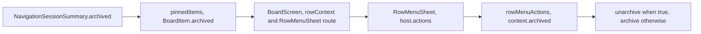

# Issue #4476: pinned archived session actions

## Scope and acceptance

A pinned, archived session that is still running must offer Unarchive, not Archive, in the native iPhone Board row menu. Preserve the hub's archived session fact when constructing pinned Board rows. Missing or false flags retain Archive. No new source of truth or state is introduced.

Authorized scope: `mobile-native/src/board/boardItems.ts`, its tests, row-action tests, and this spec. Existing product contracts and recovery ownership do not change.

## Non-goals and preservation

Do not change #4199's blue-dot suppression, attention classification, Live rows, project tiers, pin membership, ordering, grouping, lifecycle controls, archive mutation/replay or any other client. Pinned rows remain quiet and still. Running archived sessions keep their existing Stop and Shut down controls. Unarchive uses the existing organization journal and its existing refusal/disconnect recovery, preserving session work and pins.

## Flag path

The hub's `NavigationSessionSummary.archived` is authoritative for each pinned page row. `pinnedItems` currently discards it with `archived: false`. Replace that projection with `archived: row.archived === true`, retaining a concrete false for older rows without the optional flag.

BoardScreen already supplies the Board row's archived flag to the row-menu route and action context. RowMenuSheet forwards it to the Board host, which calls `rowMenuActions`. No menu or action implementation change is needed. The shared swipe context also receives the truthful flag and therefore keeps its existing action rule rather than a separate inconsistent state.

## Verification and review

1. Add a parameterized pinned-row regression in `boardItems.test.ts`: true, false and omitted archived flags on an active, live session project to true, false and false. Verify pinned quiet/still presentation is preserved.
2. Add a composed regression in `rowActions.test.ts`: build the active pinned archived row through real `pinnedItems`, pass its item and archived context to real `rowMenuActions`, and assert the structured action list includes `unarchive`, excludes `archive`, and preserves lifecycle controls. This is the production data/action seam, not a copied boolean fixture or UI-copy assertion.
3. Run the new targeted tests before the one-line fix and observe the archived regression fail. Apply the fix and rerun to green.
4. Run from `mobile-native`: `npx vitest run src/board/boardItems.test.ts src/board/rowActions.test.ts src/board/attention.test.ts` and `npm run check`. The existing #4199 attention test proves no blue-dot regression. Run touched-file Biome checks and root `make build`. CI owns the full native suite, so do not run it locally.
5. Freeze this spec for two competing independent PAR reviewers before implementation. PAR the implementation diff, simplify, commit and run branch RoboRev. Push a PR against main and shepherd through green checks and a current-head clean review.
6. Do not merge. Report the ready-to-merge PR URL and head SHA and wait for Jesse's merge signal.

No device/simulator gesture test is claimed by these checks. Existing BoardScreen and RowMenuSheet plumbing is inspected; the changed projection and resulting action selection are tested together.
