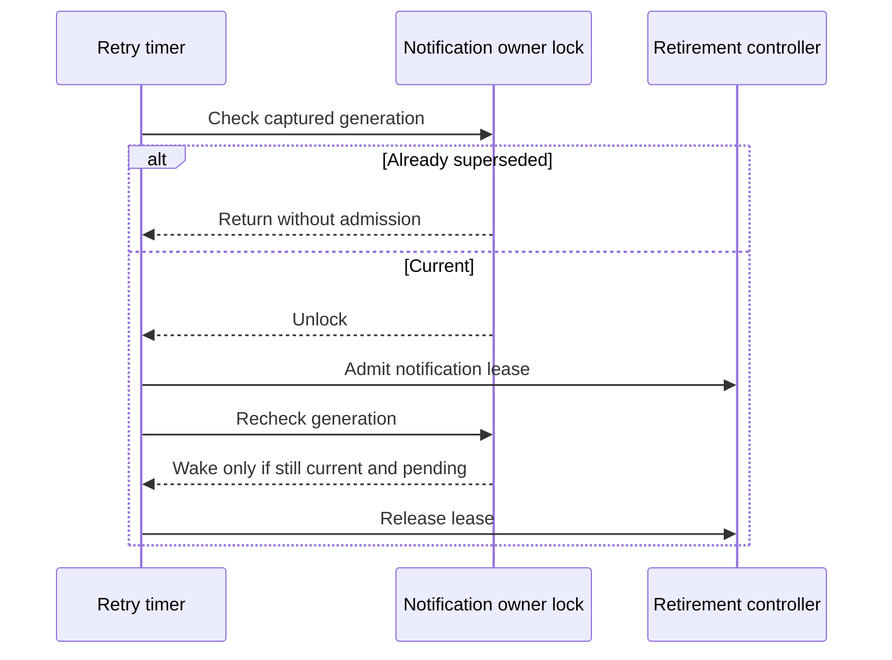

# Issue #4504: superseded job-notification retry admission

Status: frozen after two independent PAR reviews. The issue's explicit acceptance criteria authorize this narrowly scoped fix.

## Scope and behavior

A job-notification retry timer whose captured generation is already superseded when its callback examines the owner state must return without taking a retirement lease, registering a callback, clearing `eligibleSince`, changing retry state, or calling `notify`. A current timer must retain today's admission, callback ownership, notification wake and backoff behavior. All clients use this shared session path; there are no client changes or new recovery controls.

## Exact race window and fix

`scheduleJobNotificationRetryLocked` arms an uncancellable clock one-shot. A drained and acknowledged notification causes `resetJobNotificationRetry` to increment `jobNotifyRetry.generation` and clear `active`, but the old timer remains armed. Today that old callback first calls `beginJobNotifyCallback`, which takes a `notification` lease through `beginRetirementMutation` and `RetirementController.beginMutation`. That mutation immediately clears the automatic-retirement settled instant. The callback can then park on `pendingJobNotifsMu` while a manual retire observes a notification blocker. Its existing generation check finally returns without doing notification work.

Add a read-only generation check under `pendingJobNotifsMu` at callback entry, then release that lock before calling `beginJobNotifyCallback`. If the timer was already invalidated, no admission or mutation is necessary because the old generation has no work left to own. Do not hold an owner lock across retirement admission.

The precheck is only an early rejection, not authorization to work. Reset may run after that check releases the lock and before admission or the later owner-lock acquisition. Keep the existing post-lease generation check authoritative. Such a callback was current at its first check and may still take a lease, but must not act on a superseded generation. Keep the admission-refusal rearm's generation guard unchanged so a still-current one-shot is not lost and an old one is not resurrected.

## Non-goals and preservation

No cancellable timer redesign, retirement policy change, lock-order redesign, notification delivery change, backoff change, or unrelated retry cleanup. Durable terminal receipts, pending notification batches, delivery acknowledgement, refusal recovery, late controller attachment, and real-work retirement blockers keep their current owners and semantics. The subsystem responsibilities and client contracts do not change.

## Verification

Use `agenttest.FakeClock` at a pinned instant and real session/retirement code. Extend the durable-shell notification journey or factor its fixture locally: create and finalize a shell record, drain and requeue its notification to arm a retry, deliver and acknowledge through the scripted provider, verify `active == false` with the stale timer still armed.

The superseded-tick regression first joins the session's background emitters so real work cannot confound admission counts. Establish a nonzero `eligibleSince` and record the lease sequence under the controller lock. Record retry state and wake count, then advance the frozen clock and call `Drain` to join the actual callback. Require no new lease allocation, unchanged settled instant, no wake, no pending work or callback registration, unchanged retry state, and successful manual retirement admission. Check eligibility before the manual claim, since claim/Abort can change it. The lease-allocation assertion catches even a brief stale lease that a snapshot might miss, without owner-lock sampling, callback-entry guesses, or production test seams. Both independent reviewers approved this refinement. The test must fail before the fix and pass after it.

A current-tick control retains a pending source and holds the wake callback using channels. Advance the same frozen clock and wait for the wake. Require a `notification` lease while the wake is held, `eligibleSince` cleared, one wake, retry flag consumed, and backoff advanced. Release and join, deliver through the real notification turn, verify the durable receipt acknowledged, and verify retirement becomes eligible again. Existing retry-refusal and late-attachment tests must remain green.

Run focused `go test ./agent` retirement/job-notification tests and `make build`, not the full local suite. Run PAR on the frozen spec and immutable implementation diff, simplify-code, commit, branch roborev review, and shepherd the PR. CI is the full-suite authority. Start from origin/main `f1ccf449` or newer and fetch/merge moving main before the final push. Merge only after all required checks are green and all roborev findings are low or conclusively refuted.
