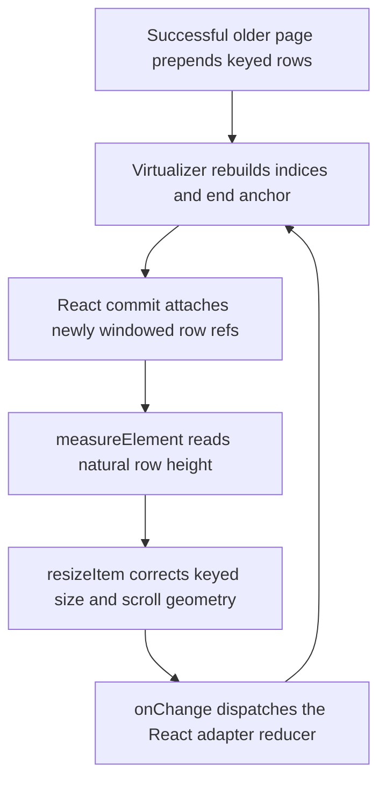

# Issue 457: break transcript prepend measurement feedback

## Goal and scope

A large ended session remains readable when automatic older-history paging succeeds. A dynamic, end-anchored list must do finite measurement work without exhausting React's nested-update limit. Real row heights, row identity and reading position remain authoritative.

This lane starts from `2ad1a36d23a27a326224543e67905ddca5678b0c`, which merges `origin/main` at `f30e7a1982bea540ba61914e517000cb4de2879f`. The issue's historical `panes/transcript/Transcript.tsx` is now a legacy adapter to Session. The active list wiring is `panes/session/transcript/TranscriptBody.tsx`; it already supplies dynamic sizing, stable projected-row keys, end anchoring and the committed-layout reader callback. No wiring change is planned unless the regression proves one necessary.

## Feedback edge

The current row ref calls `virtualizer.measureElement` synchronously during React's commit. A corrected size changes the window, mounting further rows whose refs immediately measure and notify again. A page containing many shorter-than-estimated rows can traverse successive overscan windows in one nested commit chain. End anchoring preserves the same logical visible row while exposing more preceding overscan rows; stable keys alone do not cut this update edge. The issue's browser stack identifies this exact `commitAttachRef -> measureElement -> resizeItem -> notify -> onChange -> dispatchReducerAction` path. The regression must confirm the chain on the current base before production code changes.

## Chosen boundary

Keep row refs stable but make them enqueue current DOM nodes instead of measuring synchronously. Coalesce ref-driven measurements into one owned microtask batch per list. After React's commit returns, snapshot the queue and measure each still-connected node that still belongs to the current list once through the real virtualizer. Run that batch inside ReactDOM `flushSync`, outside the ref/lifecycle stack, so its corrected range and sizer commit before browser rendering updates deliver scroll steps or ResizeObserver. Newly mounted refs form a later microtask batch, never a nested measurement commit chain. Continue using upstream ResizeObserver measurement for later natural content changes.

Detached nodes must not be measured against a newer index/key mapping. Run upstream detached-element cleanup without resurrecting stale ownership. Invalidate the pending batch and release its queued nodes when the list unmounts or dynamic measurement is disabled. A queued microtask checks its batch identity before acting, so it cannot consume a newer mount's work. StrictMode cleanup/setup must retain a usable measurement path and cannot leave callbacks acting on a disposed list.

`data-measured` is stamped only when a current node is actually handed to the virtualizer, not when it is enqueued. That stamp alone does not guard positive-height rows: `contentIsUnmeasured` admits them without it. Microtasks and their synchronous React commits drain before browser scroll/resize observation, but a same-port recorded-opening completion also checks paging synchronously in a parent layout effect. A concrete baseline test proved this needs an explicit handoff: ten 96px rows plus a filtered zero restore a retained anchor to 288px before the baseline opening check, but the queued candidate requests older history at the unmeasured 0px position. Two 96px rows prove the converse, legitimate short-page demand must resume after measurement without an unrelated event.

Keep the existing opening hold and same-ref/same-port resume intent pending until the real list reports committed geometry and the reader has finished its placement. Compose the existing `TranscriptBody` measurement callback after `viewRegistration.restoreAfterLayout` for this ready notification, and expose the registration's pending-placement state to that composition. The scroll owner retries only that pending opening intent through the committed-layout callback, after its own pending initial-end/view-anchor work, and consumes it before invoking the unchanged near-top/short-page predicates. A ref or port change still cancels/reseeds the intent. Fake/legacy handles without committed-layout capability retain their existing immediate checks. Ordinary scroll and short-page policy do not change. The amendment is limited to this measurement/anchoring handoff in `TranscriptBody.tsx` and `flow/useTranscriptScroll.ts`; no transport, paging policy or timeout changes are introduced.

The opening regression uses the real child `TranscriptBody` and parent `useTranscriptScroll`, a pending recorded opening on the same port, a settled filtered zero row, and one store publication that prepends visible rows and clears the opening. Hold only the widget's measurement microtasks. The ten-row case must make no demand before measurement or after restoring the anchor to 288px, with anchor top 0. The two-row equal-estimate control must hold before measurement and resume legitimate demand afterward. Do not inject a scroll/resize event to rescue either result. Existing committed-layout readiness continues comparing measured heights, positions, viewport and sizer; queued work cannot be reported as ready.

This boundary adds no public widget prop, timer deadline, retry policy, observer replacement or independent anchoring controller. Do not change the dependency tree or defer/suppress React errors. Measurements still execute; the change separates DOM attachment from the update it causes.

## Preservation and recovery

- **Variable height:** dynamic rows retain natural content height, with no inline height fed back from cached size. The real `measureElement`/`resizeItem`/ResizeObserver paths continue correcting estimates, including equal-estimate and zero-height filtered rows.
- **Identity:** retain `item.key` as both React identity and virtualizer measurement key. Prepending changes indices, not existing row state or DOM identity when the row remains windowed.
- **Initial latest:** retain the transcript scroll owner's fresh-open landing and measured correction. Queued measurement must settle at the true end, not an estimate-derived intermediate offset.
- **Append:** retain upstream end anchoring and append following at the true end. An away reader must not acquire follow intent.
- **Prepend:** retain upstream keyed anchor capture and per-item compensation, including the existing clamped-write completion after the sizer commits. Assert the same visible row and viewport-relative offset after a successful prepend and settling.
- **Later changes:** a retained mounted row that grows after initial measurement still updates through ResizeObserver. A newer reader movement or explicit scroll continues to supersede pending placement as before.
- **Lifetime:** removing the list or switching off dynamic sizing invalidates outstanding attachment work. A remount measures its own rows normally; no user repair action is added.

## Deterministic regression

Use the real React adapter and virtual-core, with only browser geometry and frame delivery controlled. Do not mock the virtualizer, notification reducer, anchoring or transcript renderer.

1. Mount a keyed dynamic end-anchored list with deliberately nonuniform natural heights that differ from estimates. Establish an initial end landing and then a visible reading point near the page start.
2. Prepend a sufficiently large deterministic page of short/filtered and variable-height rows. Retain an existing visible row's key and DOM node. Count measurement and onChange work with a bounded tripwire, and/or let React's own nested-update guard reject the old behavior. The tripwire observes actual work; it must not cap production work.
3. Show the pre-change failure originates in repeated commit-time measurement updates, not a missing fixture or assertion unrelated to the loop.
4. After the fix, drain microtask batches and drive rendering updates until an observable settled condition holds, with a tripwire ceiling rather than fixed sleeps/flush counts. Assert quiescent measurement work, bounded notifications, nonuniform corrected sizes/positions, stable retained identity and prepend pixel anchoring.
5. Verify initial end, append-at-end following, away-reader append preservation and later ResizeObserver growth. Include queued-node removal, unmount and StrictMode lifetime coverage when needed by the implementation.

Add a real-browser regression using the production Session/TranscriptBody, automatic paging demand and successful fake network responses. Seed a large, asserted-ended session with older history, including a failure-inducing short/filtered page. Cause an automatic near-top older request and hold its response while capturing a viewport-intersecting keyed row and pixel offset. Release the successful response, make no further scroll writes during settling, await its actual model merge and committed measured-geometry quiescence, then verify that the same connected scroll port, transcript/footer, retained row DOM identity and pixel offset survive. An invocation count is not successful paging evidence. Mount the actual DockRegion/DockChunkBoundary in this mode and assert no structural boundary fallback. Capture console errors, caught React/render errors and uncaught browser errors throughout measurement completion, not merely until the model merges. Do not assert human-facing error copy.

## Non-goals

No AppWire concurrency, WebSocket heartbeat, request timeout, history read/retry, transcript projection, workspace boundary recovery, unrelated reader policy or design-system API changes. No dynamic-sizing disablement, warning suppression, fixed row heights or retries around the error boundary. Existing product ownership is unchanged, so the owning evergreen subsystem contract does not need a responsibility change. File unrelated discoveries as separate issues without labels.

## Verification and delivery

- Inspect scripts before running them. Use the matching shared frontend install rather than copying node_modules on the nearly full volume.
- Record the minimal pre-change failing regression command and complete relevant recursion evidence, then its passing result after the fix.
- Run the focused virtual-list and transcript regression/test files, not the full suite. Run `npm run typecheck` in `cmd/evener-hub/frontend` and Biome on touched source files. CI is the full-suite authority.
- Run `make build` after reading its actual targets.
- Extend the existing real-browser transcript reader guard within this scope if it can exercise the large ended-session successful prepend. Run that guard twice. If a browser prerequisite prevents the check, report the exact limit rather than claiming browser acceptance.
- Freeze this spec and run two independent competing PAR reviewers before implementing. Resolve evidenced findings and re-review affected requirements. Run PAR again on the immutable implementation diff, then simplify-code.
- Commit the intended files, run roborev-review-branch (or documented `roborev review --branch --wait` if invocation is denied), fetch main again before final push and merge it if moved. Push once per review round, open a main-targeted PR, and use shepherd-pr.
- Admin squash-merge only after all required current-head checks finish green and every RoboRev finding is low or conclusively refuted. Verify GitHub's merged state and merge SHA. Report issue/PR/SHA, changed paths, commands and actual results, refutations, browser limits and anything left unverified.

The requester has explicitly authorized this non-interactive issue workflow, including the scoped boundary choice, competing spec review and merge gates. No additional product choice is introduced.
