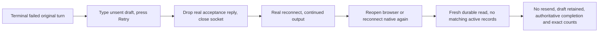

# Issue #4788: durable settlement in lost-reply Retry journeys

Status: frozen for PAR, 2026-10-23. The issue's acceptance criteria authorize this test-only scope.
Base: `7f8fb3ba706c875861658f75c2d0bdb909eab8ce`.

## Goal and scope

Extend the browser and native `lost-reply` cases in `TestRetryContinuationJourney` so successful continued output is not mistaken for durable client settlement. Keep the real shipped Retry, connection, mutation, reconciliation and storage code. Only journey drivers, their fixtures/shared test support and this spec may change. Normal and refused cases retain their assertions.

The daemon's transcript and mutation journal remain authoritative for accepted work. This change inspects the client's separate durable intent, not a daemon-journal deletion: the daemon must retain its receipt for idempotent replay.

## Exact durable state and settlement criterion

Capture the nonempty `clientMutationId` from the Retry's first external `turn/start` or `turn/queue` request. All attempts before recovery must retain that same identity and the text-only `continue` payload.

For that exact identity, settlement means **no record in any of the three active client stores**, including an accepted-but-unreflected optimistic record:

- Browser: the existing `evener-mutation-outbox` IndexedDB database, object stores `outbox`, `optimistic`, `recovery`, keyed by `clientMutationId`. Open a fresh database connection, read all three in a readonly transaction and await its completion. Fail on a missing database/store or a storage error rather than interpreting it as empty. Close the inspection connection.
- Native: the existing `evener-mutations.db` database, tables `mutation_outbox`, `mutation_optimistic`, `mutation_recovery`, keyed by `client_mutation_id`. The existing Expo SQLite platform fixture delegates real SQL to `node:sqlite`. For this journey, back databases with files in the Go fixture's private directory. Open a separate handle to the same mutation file and use the production `MutationOutboxSQLite` getters for all three records. Close the inspection handle after use. The fixture must never substitute mutation/storage methods.

Do not use absence of a UI pending row, successful output, a ready socket, or request deduplication alone as the settlement oracle. Sequence metadata is not unresolved work and need not disappear.

## Journey and reopen sequence

1. Preserve existing real provider failure, Retry action, original-context, successful output, stable mutation identity and composer assertions.
2. Await successful continued output and the initial lost-reply reconnect. Save the Retry identity and transport attempt count outside any browser page lifetime.
3. Browser: reload the production page without clearing its origin storage, reinstalling the external wire observer through its existing new-document hook. Reopen the same session and await its real subscribed `thread/read` response and rendered continued output. Confirm the saved unsent draft is restored.
4. Native: close the live external WebSocket again after recovery. Await a new connection and a fresh real subscribed `thread/read` response for the same session, plus ready state and continued rendered output. Keep the existing runtime and real connection owner; do not call reconciliation manually.
5. Await the fresh durable reader's three getters becoming absent for the captured identity. These bounded condition waits cover asynchronous commits, not fixed sleeps or arbitrary flush counts. A retained row must fail with its store and identity visible in diagnostics.
6. Check the post-reopen/reconnect transport capture: no additional `turn/start` or `turn/queue` for the captured identity, and no other continuation identity. Recheck the unsent draft and continued output after that boundary.
7. The Go fixture still checks the provider retained the original input and received `continue`, never the draft. Its final authoritative read still requires exactly one original user input, exactly one continuation, three turns including the prelude, failed original and completed continuation.

The shared wire fault helper may record real `thread/read` requests/responses and provide a transport-only close/reconnect action. A captured response is an observation barrier, not permission to forge state or call product internals.

## Red-first mutation check

Implement the new assertions, then temporarily suppress terminal durable settlement in each real storage adapter while retaining successful dispatch and transcript delivery. Disable `settleApplied` cleanup; if receipt cleanup can settle the row through an alternate path, force that receipt to retain its normal accepted/pending copy instead of removing it. Do not throw or stop the provider, UI output, connection recovery, or real authoritative reads.

Run each lost-reply journey against that temporary product mutation. It must reach the existing successful-output assertion and then fail the new exact-identity durable assertion with an unresolved outbox/optimistic/recovery record. Record the output milestone and retained state in the verification evidence. Restore every product mutation, rebuild the browser bundle and rerun successfully. No product mutation or runtime test switch is committed.

## Non-goals

No product behavior, protocol, settlement policy, recovery UX, storage schema, duplicate-send fix or assertion weakening. No full local test suite, provider credentials, live model calls, device/simulator claim, labels or deployment. Unrelated findings become separate GitHub issues, not PR changes. Existing product/subsystem ownership is unchanged, so no evergreen product contract is revised.

## Verification and review

- PAR: two independent competing reviewers receive the same frozen spec and source baseline. Resolve legitimate findings before implementation, then run PAR on the immutable implementation diff.
- Browser: `go test -tags browserguard ./cmd/evener-hub -run '^TestRetryContinuationJourney$/browser' -count=1 -v`, twice after restoring the product.
- Native: `go test -tags browserguard ./cmd/evener-hub -run '^TestRetryContinuationJourney$/native' -count=1 -v`, twice after restoring the product.
- Negative controls: the corresponding `/browser/lost-reply$` and `/native/lost-reply$` selectors, with explicit successful-output evidence preceding durable assertion failures.
- Build prerequisite: inspect and run `make build-web`; dependency locks must match shared installs. Never run `npm ci` through symlinked `node_modules`. Native requires a real dependency directory.
- Frontend typecheck: `cd cmd/evener-hub/frontend && npm run typecheck`.
- Documented native typecheck: `cd mobile-native && npm run check`.
- Run simplify-code, then commit and run the required branch RoboRev review. Push/open a main-targeted PR, shepherd required CI and matching-head RoboRev findings, merge a moved base before final push, and admin squash-merge only under the repository's green-check/settled-review policy. CI owns full-suite verification.
