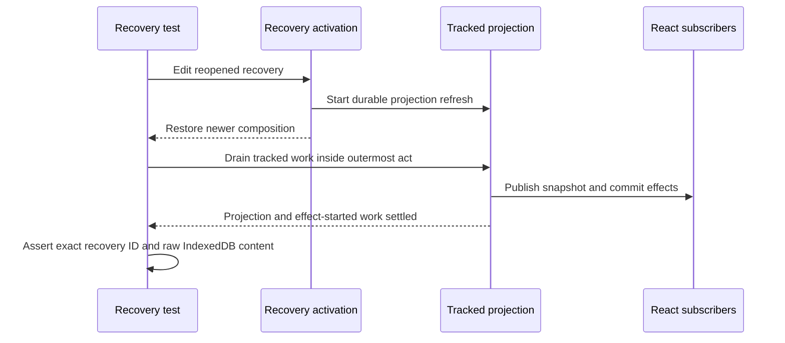

# Issue #4887: await reopened recovery projection inside act

## Intent and scope

Fix the test synchronization in
`cmd/evener-hub/frontend/src/panes/session/composer/Composer.queuedMessages.test.tsx`,
case `late built-in success does not consume newer edited recovery work`.
The strict console guard must report no unexpected output, and every existing
recovery assertion must remain intact. This is not a product behavior change.

The implementation may touch only that test file. A local test helper in the
same composer directory is allowed only if the existing helper cannot express
the required completion boundary. This spec is the only new tracked file.

## Contract and evidence

The S11 input/queue row in `docs/product/subsystems.md` and
`docs/product/message-recovery.md` give client storage ownership of unsent work.
A successful built-in finishes its captured edit, but a late completion must not
consume newer composition. The existing regression exercises the real Composer,
source state, pending-turns store and IndexedDB adapter with a scripted external
compact RPC. It asserts that newer text and its exact recovery ID survive the
late success and a reopened composer, remain durable in IndexedDB, and create no
message mutation.

PR #4817 introduced this regression. Its merged test blob is
`1e89da615404b3888222a3cba259702af9706333`, unchanged at the reviewed baseline.
Issue #4887 records a named-case failure with QueueStrip and Composer act
warnings, plus a controlled scratch-only assertion wrapper that passed without
changing any behavior assertion or the strict console guard. The implementation
must reproduce the unmodified failure locally before any test edit.

## Exact asynchronous boundary

After remounting, the test clicks **Edit message** and waits for
`reopenedSource.getSnapshot().text` to equal its supplied newer-work sentinel.
That is a composition restoration assertion, not a projection completion signal.
`sourceState.ts:activateRecovery` awaits the durable update through
`updateRecoveryPendingTurn`. The latter starts
`refreshPendingTurnsProjection(ref)` without awaiting that refresh before
returning the committed update. The refresh is tracked separately.

The outstanding read can publish through
`pendingTurnsStore.ts:readProjectionIntoStore` → shared
`pendingTurns.ts:store.projectSnapshot` → `setState`, waking QueueStrip and
Composer while the test awaits `reopenedStorage.getRecovery(...)` outside act.
The existing projection flush occurs only after that read, too late to cover it.



## Fix

Move the existing `await flushPendingTurnsProjectionForTests()` from after the
reopened storage/no-message assertions to immediately after the reopened text
wait and before the snapshot and IndexedDB assertions. Add a short comment that
text restoration does not settle the recovery projection.

The existing helper runs each drain round inside its own outermost RTL `act`,
awaits tracked real storage/projection promises, and repeats when committed React
effects start more work. Call it directly, never inside another `act`. Do not
add fixed sleeps, fixed flush counts, timeout increases or warning allowances.
Do not change its implementation. The unrelated existing teardown sequence stays
unchanged.

## Why this does not hide a product race

The paused compact command still completes only after the test types and proves
newer content was persisted. That critical competing operation order is unchanged.
The moved flush affects only the later observation after explicit reopen/Edit.
It does not replace, stub, serialize away or remove the late built-in completion,
the real storage commit, the exact recovery ownership assertion, or the no-message
assertion. It waits for already-started legitimate publication before reading the
same final state. The strict console and act-scope guards stay enabled.

The fixture text is test-supplied user data, not production copy. No new copy
oracle is introduced. Product race freedom beyond this existing recovery
invariant is not claimed.

## Non-goals

- No product, native client, test setup, Vite, lockfile or configuration changes.
- No warning suppression, console mocks, broad act wrapper, weaker assertion,
  extra arbitrary timing or wider timeout.
- No new recovery policy or product documentation change, since ownership and
  behavior do not change.
- No full local suite, new labels, deployment or unrelated issue fixes.

## Verification and delivery

Use the existing shared frontend `node_modules` only after its checkout's
`package-lock.json` matches this lane byte-for-byte. Never run npm ci through a
symlink. Keep Vite cache output in task-owned temporary storage.

From `cmd/evener-hub/frontend`, run this exact named case once before the edit
and twice after it:

```sh
EVENER_FRONTEND_VITE_CACHE_DIR="$TMPDIR/queued-case-vite" ./node_modules/.bin/vitest run src/panes/session/composer/Composer.queuedMessages.test.tsx -t '^late built-in success does not consume newer edited recovery work$' --maxWorkers=2 --configLoader=runner --cache=false --reporter=verbose
```

The pre-change run must fail on unexpected act warnings, not fixture or setup
errors. Both post-change runs must exit zero with the strict console guard and
all behavior assertions enabled. Then run the whole file, expecting 46 passing
cases, and `npm run typecheck` (`tsc --noEmit --incremental false`). Run pinned
Biome on the touched test and inspect the final diff for unchanged assertions
and no product changes. CI owns full-suite qualification.

Freeze this spec for two independent competing PAR reviewers before editing the
test. Review the immutable implementation diff with PAR, then simplify-code.
Commit, run roborev-review-branch or its documented CLI fallback, push one round,
open a PR against main, and shepherd it. Merge a moved base locally before the
final push. Admin squash merge only after required current-head checks are green
and RoboRev findings are resolved or conclusively refuted. Report the PR URL,
merge SHA, exact test-only change, actual red/green results, review dispositions
and anything unverified. Preserve shared dependencies and unrelated work.
