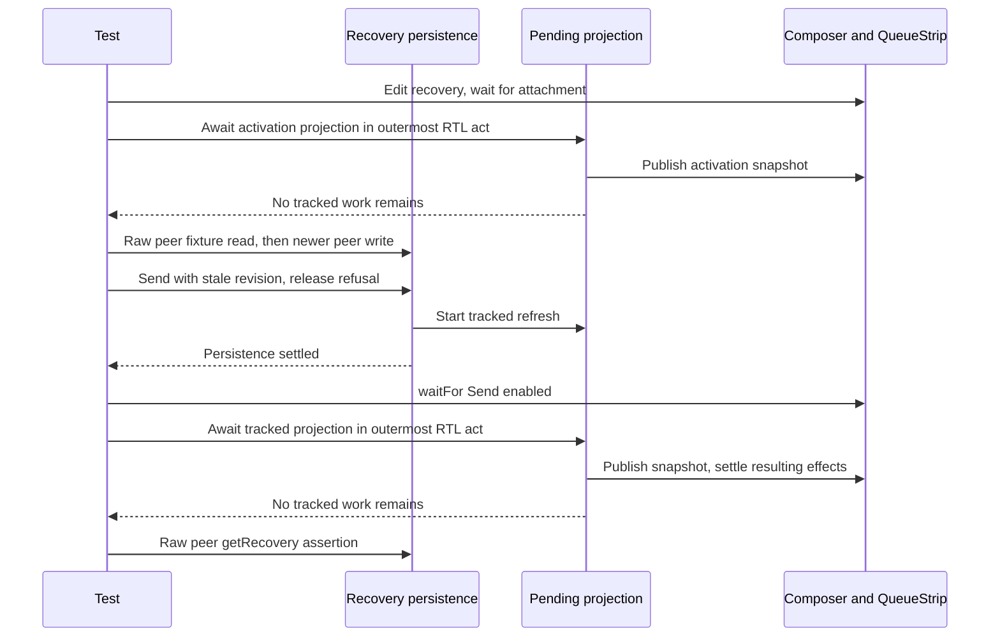

# Issue #4893: settle stale-recovery projection before raw storage reads

## Scope and acceptance

This is a browser component-test synchronization fix, not a product change.
The case `stale recovery persistence refusal preserves the unsent draft and
attachment` in
`cmd/evener-hub/frontend/src/panes/session/composer/Composer.queuedMessages.test.tsx`
must pass repeatedly with zero unexpected console output. Its recovery, draft,
attachment, and no-send assertions must remain intact. The other 45 cases in the
file must still pass.

The user authorized this narrowly specified synchronization fix and its review
workflow. The lane was updated from `origin/main` at
`33134ee488bda92a8df322ac53a9963e9031e1ae` before this specification was written.
That base includes the sibling #4887 fix, merged as #4890 in
`086cb703c6efd4beb23deedab7c6d195302f8c89`.

## Exact asynchronous boundary

The test mounts the real Composer and QueueStrip against the real stores and
IndexedDB adapter, with a fake transport and fake IndexedDB platform. It edits a
recovery containing text and an image. A second storage instance commits a newer
composition before the first composer tries to send using its stale revision.
The refusal is deliberately paused and released, proving the intended peer-write
ordering rather than relying on timing.

`updateRecoveryPendingTurn` in `queue/pendingTurnsStore.ts` tracks the recovery
write but starts `refreshPendingTurnsProjection(ref)` without awaiting its
completion. `readProjectionIntoStore` subsequently publishes that durable read
through `projectSnapshot` in
`appwire-client/typescript/state/mutation/pendingTurns.ts`. That publication can
wake the mounted QueueStrip and Composer after the recovery write itself settles.

The test already flushes the projection after mount, the peer write, and the
refusal. Two later raw `peer.getRecovery` reads yield outside `act`: the initial
fixture read after waiting for the active recovery and visible attachment, and
the final durable assertion after waiting for enabled Send. None of those UI
conditions proves every projection refresh completed.

The issue identified the final read, but a drain only there still failed on run
4 of 10. Temporary phase/stack diagnostics forwarding every console call to the
unchanged guard captured both warnings during the initial peer read on diagnostic
run 26. Both stacks pass through `readProjectionIntoStore` at
`queue/pendingTurnsStore.ts:176`, shared `pendingTurns.ts:226`, and
`frameworkFreeStore.ts:36`. The first 25 diagnostic runs passed, demonstrating
why a few passes alone do not establish correct synchronization. All diagnostic
edits are removed before the real fix. The required fix covers both raw reads.



## Fix

Use the existing `flushPendingTurnsProjectionForTests()` immediately before each
raw peer recovery read: after the activation/attachment waits before capturing
the peer fixture, and after the Send-enabled wait and synchronous local
preservation assertions before the final assertion. Retain the existing
flushes. Add short comments explaining that restored UI and enabled Send do not
prove projection completion.

The helper already awaits actual tracked durable/projection work inside
outermost Testing Library `act` scopes, including work started by resulting
effects. Call it directly, not nested inside another `act`. Do not add arbitrary
sleeps, repeated fixed flush counts, fake timers, warning exemptions, console
mocks, new projection behavior, or a new helper.

## Preservation and why this does not hide a product race

Keep the peer's newer durable composition and retained image assertion unchanged.
Keep the local draft text, editor text, visible attachment, enabled Send, cleared
stale recovery lease, and zero `turn/start` calls unchanged. Do not move or remove
the deferred refusal barriers or the competing peer write.

The initial drain settles recovery activation before the peer captures its
fixture and advances that row. The peer still commits a newer revision before
Send, so the composer still attempts to use a stale lease. The final drain comes
after that deliberately raced operation settles. Neither await changes the
peer-before-Send ordering, stale-revision admission, storage contents, recovery
ownership, or transport. They neither prove global product race-freedom nor mask
a failed recovery invariant. The unchanged assertions still fail if preservation
or peer ownership is wrong, and the strict console guard still rejects every
unexpected console call.

## Non-goals

- No product, setup, Vite, config, dependency, lockfile, or console-guard changes.
- No native behavior, durable attachment follow-up, or recovery redesign.
- No unrelated test cleanup or assertions on product copy.
- No full local suite, browser guard, live-provider, or physical-device claim.
- No labels. File unrelated findings separately rather than broadening this PR.

Only this specification and `Composer.queuedMessages.test.tsx` are intended
deliverables. No local helper change is expected.

## Verification and review

Freeze this specification and give two independent competing PAR reviewers the
same immutable inputs before implementation. Repeat PAR against the frozen
base/head implementation diff, run simplify-code, commit, and run the required
RoboRev branch review. Review findings require evidence-based resolution.

Use the existing shared `node_modules` only after verifying its owning checkout's
`package-lock.json` is byte-identical. Never run `npm ci` through its symlink.
From `cmd/evener-hub/frontend`, repeat this exact command on unchanged source
until the schedule-sensitive strict-console failure is captured, recording every
attempt and its actual result:

```sh
EVENER_FRONTEND_VITE_CACHE_DIR="$TMPDIR/queued-case-vite" ./node_modules/.bin/vitest run src/panes/session/composer/Composer.queuedMessages.test.tsx -t '^stale recovery persistence refusal preserves the unsent draft and attachment$' --maxWorkers=2 --configLoader=runner --cache=false --reporter=verbose
```

After the fix, require at least three runs of that command to pass with no
unexpected console output. Also run:

```sh
EVENER_FRONTEND_VITE_CACHE_DIR="$TMPDIR/queued-case-vite" ./node_modules/.bin/vitest run src/panes/session/composer/Composer.queuedMessages.test.tsx --maxWorkers=2 --configLoader=runner --cache=false --reporter=verbose
npm run typecheck
./node_modules/.bin/biome check --write src/panes/session/composer/Composer.queuedMessages.test.tsx
./node_modules/.bin/biome check src/panes/session/composer/Composer.queuedMessages.test.tsx
```

Read case-level results to confirm all 46 cases actually ran. Run
`git diff --check` and inspect the final diff for unchanged assertions and scope.
No full local suite runs, CI owns that qualification. Before the final push,
fetch `origin/main` again and merge if it moved, then renew affected evidence.
Push, open a PR against main, and shepherd current-head checks and RoboRev.
Admin squash merge only with every required check green and RoboRev clean.
Report the PR URL, merge SHA, exact test change, actual red/green attempts,
review dispositions, and any unverified claims or genuine blocker.
