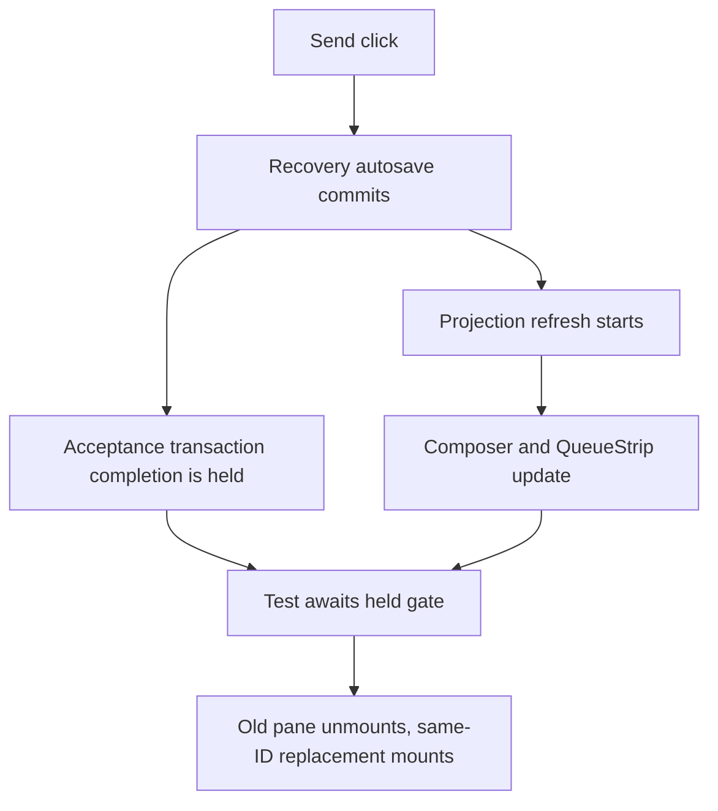

# Issue #4896: close Composer integration async projection boundaries

## Scope and contract

Fix test synchronization in
`cmd/evener-hub/frontend/src/panes/session/composer/Composer.integration.test.tsx`.
The named failure is `pane 'reset' fences held 'acceptance' completion from a
same-ID replacement`. Audit the whole file for the same escaping-await family,
without changing product behavior or assertions.

Issue: <https://github.com/prime-radiant-inc/evener/issues/4896>.
The lane merged `origin/main` at `0f537f9f2914c76677379f4716e0b00cc2889be2`
before this spec. Audit line numbers below refer to the unchanged integration
file at lane commit `355848c15a0c4af44e82c603c137c5deb1b172f1`, blob
`b00c3b5f09765118543c0c2d50443daebee7df44`.

Only the integration test and this new spec may change. A same-directory test
helper is permitted only if truly needed; none is planned. No product, setup,
Vite, configuration, dependency, console-guard, label, or assertion changes.
No full-suite runs. File unrelated findings separately as issues.

Read contracts: root `AGENTS.md`, `docs/product/README.md` and S02 composer /
queued-recovery contract, `docs/developing-evener/testing.md`, the projection
store and package projection, and the #4887/#4893 fixes (PRs #4890/#4895).
This is a process spec, not a new product rule. The recovery/preservation
contract remains unchanged.

## Reproduction and root cause

Before any test edit, 30 independent executions of the named case failed on
runs **1, 5, 6, 8, 9, 11, 12, 13, 14, 16, 17, 18, 19, 22, 24, 25, 27, 28,
29**: 19 failures, 11 passes. Every failing run reported the strict console
failure for both `QueueStrip` and `Composer`: `An update to ... inside a test
was not wrapped in act(...)`. Each execution selected one test and skipped 78.
A separate unedited whole-file run passed 79/79, demonstrating that one clean
file run is not a sufficient reproduction check.

The escaping await is **631**, `await hold.reached`, while the original view
is still mounted. The acceptance path first autosaves the active recovery
(`Composer.tsx:1101–1118`). The completed autosave updates the composition
revision and notifies projection refreshes (`threads.ts:3433–3447`,
`pendingTurnsStore.ts:503–521`), then starts the held acceptance transaction.
Those earlier refreshes can publish while the test waits for that transaction
outside RTL act. Restored editor/source state is not evidence that projection
publication has finished. The replacement does not mount until after this gap.
The raw recovery read at 673 is recovery-edit-only and cannot explain the
acceptance failure.



A forwarding diagnostic trace reproduced both warnings during the held-gate
phase, with `projectSnapshot` on the stack. A source-unchanged transform
experiment adding only a drain before arming the hold still failed 8/10 runs:
the later Send click creates new projection work. A separate transform that
only act-scopes the held gate passed 10/10. These experiments are diagnostic;
they do not replace post-edit verification.

## Boundary rule and minimal changes

`flushPendingTurnsProjectionForTests()` owns its **outermost RTL act** scope.
Call it directly, never inside another act. Before an ordinary raw asynchronous
storage read that can overlap publication, drain immediately before the read
(no intervening operation that creates new projection work). A `waitFor` that
sees restored text, a resumed identity, or an entered gate is not that drain.

**Deliberately held work is different.** Mutation transactions and complete
submission operations are tracked until completion. A full drain while their
completion remains held would wait on the test's own gate and cannot settle.
Keep the held await inside an explicit RTL `act`, preserve release timing, and
retain the outermost drain after release. A pre-hold drain cannot replace this
ownership if the action after it starts more projection work.

Make exactly these three changes unless review finds another evidenced member
of the same family:

1. **631, shared pane close/reset × recovery-edit/acceptance gate:** wrap
   `await hold.reached` in `await act(async () => { ... })`. Do not drain while
   acceptance completion is held. Comment that restored recovery is not a
   settled projection, Send can start autosave refreshes, and the held gate
   needs act ownership. Keep the existing outermost drain at 658.
2. **2029, mid-swap Stop test's first `listOutbox(toRef)`:** add an outermost
   projection drain immediately before the raw read. Seeing `drainHeld` means
   the trailing retarget entered its pause, not that resumed hydration and the
   earlier retarget have finished publishing. This pause is safe to drain:
   the mock waits at 1985 **before** calling the real storage method at 1987,
   so it holds no tracked transaction. Existing 2035 already drains under the
   same pause. Comment on restored identity versus projection completion.
3. **2215, durable plain-send commit observation:** act-scope the
   `storage.committed` marker, retaining the immediately following outermost
   drain at 2216. The marker means the durable enqueue returned in the fixture,
   not that its caller's commit feed, cleanup, or the hook's refresh has
   published. The `renderHook` at 2211 can also have a refresh outstanding.
   Comment on durable/restored state versus publication completion. An
   unresolved fake RPC remains unresolved; this boundary must not wait for it.

Do not blanket-wrap unrelated awaits or refactor helpers/test semantics.

## Complete bounded await audit

The file contains **307 await expressions**. Both a source AST inventory and
an independent source audit account for each once. The 40 unowned/raw tokens
are classified below; line numbers are the baseline, not post-edit locations.

| Baseline lines | Boundary | Disposition and reason |
| --- | --- | --- |
| **631** | Held acceptance/recovery-edit gate | Change: RTL act owns the gate; recovery autosave refreshes can publish before old-view unmount. Full drain under this tracked hold cannot finish. |
| **2029** | First resumed-ref outbox read | Change: drain immediately before read; gate readiness does not settle resumed identity/retarget publication. The held wrapper is pre-storage. |
| **2215** | Durable commit marker | Change: act owns marker await, then existing drain; the hook refresh and commit/submission tail may still publish. Ten unedited runs passed, which does not establish absence of an interleaving. |
| 422, 423 | Held ordinary submission gate and outbox read | Keep: no recovery autosave; mount already drained; held completion prevents commit feed/cleanup. Read does not notify. Release is already act-owned, then drained. |
| 1656 | Held ordinary drain commit gate | Keep: ordinary draft, no preceding recovery write; commit feed/cleanup blocked until release, then drained. |
| 1035, 2160, 2192 | PausedCommitStorage entry markers | Keep: mounts drained, ordinary non-recovery submissions pause before real enqueue. Marker does not publish, commit feed remains behind release. |
| 1480 | Recovery read with all recovery getAll callbacks held | Keep: pre-hold drain1465; every persistence snapshot awaits a held recovery getAll. Synchronous resend commit feed precedes successful editor clear observed by RTL wait1479. Single-key getRecovery neither publishes nor releases the held snapshots. Finally releases, then drains. Full drain here cannot finish. |
| 573, 866 | Recovery reads after unmount | Keep: cleanup567/858 plus drains572/865, no remount/new mutation before read. Child source at859 is not mounted. |
| 673 | Replacement recovery read | Keep: outermost drain658, only synchronous assertions intervene; recovery-edit-only branch. |
| 1532, 1539 | Edited/resubmitted recovery reads | Keep: drains1530/1534 respectively, no new producer between drain and read. |
| 2038, 2042 | Stop/interrupted resumed outbox reads | Keep: drains2035/2040 respectively, no new producer between drain and read. |
| 179, 2013, 2016, 2057, 2091, 2114, 2276 | Thread hydration | Keep: pre-mount, no surviving prior mounted Composer. mountComposer renders only after179 and drains at186. |
| 485, 494, 497, 592, 599, 843, 850, 1448, 1455, 1501, 1508 | Durable fixture preparation | Keep: before mount, so no mounted projection subscriber. Later mount drains. |
| 87, 106, 1117, 1985 | Fixture callback internals | Keep: release gate, enqueue completion, controlled failure, pre-storage retarget gate. Caller scopes own synchronization; never flush inside these methods. |
| 2383 | Promise assertion | Keep: same promise already awaited within act2379, then drained2381; settled assertion creates no work. |

The other **267** tokens already have suitable ownership or are projection
drains. This complete inventory prevents a grep-only audit from missing gates
or mistaking fixture code for test observations:

| Category | Count | Baseline lines |
| --- | ---: | --- |
| Inner awaits in explicit RTL act | 17 | 437,534,546,570,655,656,862,863,1052,1193,1194,1255,1256,1384,2378,2379,2435 |
| Existing outermost projection drains | 57 | 186,316,337,355,370,439,441,529,550,555,568,572,658,772,815,865,884,937,1006,1062,1086,1099,1140,1160,1184,1204,1230,1267,1291,1333,1376,1397,1430,1465,1488,1518,1530,1534,1585,1667,1670,1725,1863,1916,2018,2035,2040,2064,2098,2121,2164,2196,2216,2303,2381,2489,2533 |
| Awaited RTL act calls | 31 | 340,435,533,537,544,569,649,653,713,729,745,767,781,819,861,1051,1061,1136,1189,1202,1208,1252,1269,1329,1381,1395,1481,2291,2377,2434,2500 |
| RTL queries/waitFor | 29 | 341,644,650,714,730,746,768,782,888,948,1018,1064,1132,1137,1322,1479,1612,1736,2019,2026,2237,2246,2287,2297,2364,2427,2438,2459,2518 |
| RTL-owned activity helper | 14 | 351,365,404,511,606,701,710,722,727,738,743,761,807,853 |
| Mount helper calls | 44 | 310,327,350,364,391,510,605,700,721,737,760,806,852,896,986,1027,1075,1093,1120,1153,1168,1214,1278,1353,1425,1456,1509,1565,1592,1626,1680,1741,1785,1830,1869,1895,2142,2172,2206,2224,2330,2409,2445,2468 |
| userEvent/selectSkill helper | 75 | 274,352,366,421,429,430,513,532,542,629,645,784,918,923,927,934,990,994,997,1004,1032,1034,1047,1058,1082,1083,1097,1098,1103,1130,1131,1135,1158,1320,1321,1323,1324,1428,1429,1477,1478,1529,1533,1582,1583,1609,1610,1651,1655,1715,1724,1768,1817,1860,1887,1888,1914,2022,2023,2025,2033,2034,2159,2189,2190,2213,2214,2231,2235,2284,2285,2301,2487,2488,2530 |

Safety is causal, not a claim that storage reads generally synchronize React.
For example, 1480 stays safe only while every recovery snapshot is held and
successful submission cleanup has already been observed. `settleActivityDiscovery`
owns RTL act but is not a projection drain. Existing drain529 cannot cover new
work started by a later Send; the adjacent gate534/read537 already own act.

## Preservation and why this does not hide a product race

Keep every current assertion and all four pane matrix variants. Hold, dispose
or reset the old lifetime, create a different-serial same-ID lifetime, select
`skill-2`, attach `replacement.png`, then release old work in the same order.
The replacement must retain its exact text, selection metadata, image marker,
encoded image, draft/recovery ownership, outgoing RPC count/payload, and empty
toasts. The old lifetime must remain dead. Recovery-edit still verifies durable
replacement input; acceptance still verifies its original accepted payload.

Act owns React publication timing; it does not release a gate early, await the
unsettled network, change a revision fence, drop a callback, suppress output,
or relax the strict guard. The integration test still observes old work
completing after replacement. The Stop test still observes its genuinely held
trailing retarget window. The plain-send test still exposes a durable pending
entry before any network result. No product scheduling/persistence changes.

## Verification and delivery

Use the real Vitest runner with the existing setup/strict console guard, not
the diagnostic transform. Frontend cwd is `cmd/evener-hub/frontend`.
The named red/green repeated command is:

```bash
for run in $(seq 1 30); do
  EVENER_FRONTEND_VITE_CACHE_DIR="$EVENER_SCRATCH_DIR/issue4896-vite" \
    ./node_modules/.bin/vitest run \
    src/panes/session/composer/Composer.integration.test.tsx \
    -t 'pane.*reset.*fences held.*acceptance.*completion from a same-ID replacement' \
    --maxWorkers=2 --reporter=verbose --configLoader runner --cache=false
  # Preserve each exit code and complete output, and fail the batch if any failed.
done
```

The loop is a command template: the executed driver must retain all 30 statuses
and fail on any failure, not merely return the final iteration's status.

Required post-edit checks, with no unexpected console output:

- Named case at least **30** separate successful runs, with exact run statuses.
- Entire `Composer.integration.test.tsx` at least **3** successful runs (79
  parameterized tests in the baseline).
- `Composer.queuedMessages.test.tsx` once.
- `npm run typecheck` (the script runs `tsc --noEmit --incremental false`).
- Touched-file Biome check and `git diff --check`.
- Inspect final diff: only permitted files, no altered assertions/guard/setup,
  all new comments explain durable/restored state versus publication.

Freeze this spec before two independent competing PAR reviews. Resolve any
legitimate findings before implementation. After implementation, PAR-review
immutable base/head input, run the required simplify review, commit, and run
`roborev-review-branch` (documented CLI equivalent only if invocation is denied).
Re-fetch/merge current main before final push if it moved. Open the PR against
main, shepherd all required checks and matching RoboRev review, and use admin
squash merge only when checks are green and RoboRev is clean. Do not run npm ci
through a symlink. CI remains the source of truth for the full suite.
