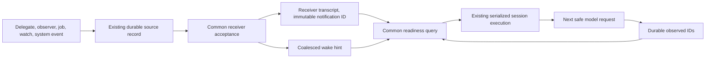
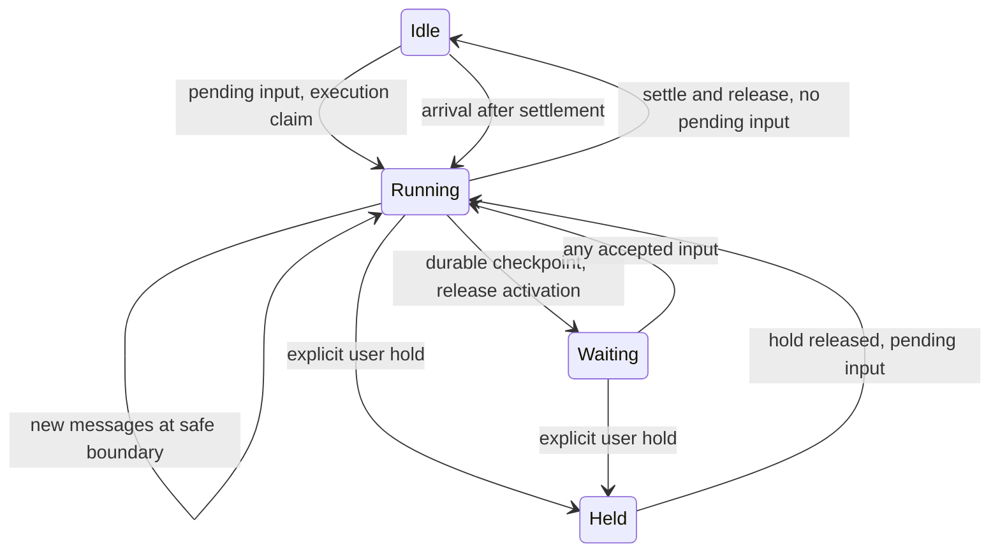

# Unified session notifications design

## Status and authority

Proposed replacement design, written on 2026-10-23. This is a plan for review,
not a description of shipped behavior. No runtime changes are part of this
planning deliverable.

Jesse's requirement is the authority:

> Any notification from a delegate or an observer should just be a
> notification/message into the session it is supposed to notify.

The receiver runs when it has an actionable notification. Report, update and
readiness describe content; they do not select a different wake path.

This design replaces the notification scheduling and polling-wait portions of
[the terminal-report design](2026-10-21-delegate-terminal-reports-design.md).
It keeps that work's report preservation, structured output and task-summary
requirements. The earlier implementation plan remains historical context.

### Corrections to the preceding synthesis

1. **Delivery and completion are different decisions.** Jesse separately ruled
   that a delegate's `done` with a live child must be refused in favor of `waiting_on_work`.
   Keep that sender-side completion rule. An invalid call is not an accepted
   message; every accepted message uses the same delivery path. Do not interpret
   the notification ruling as permission to abolish this rule. Remove the broad
   multi-store inventory gate, not the narrow live-child completion rule.
2. **Waiting releases execution, not ownership.** A wait yields the current
   activation and retains its delegate generation, child ownership, jobs and
   watches. Settling the whole generation and hoping a later notification
   reconstructs those resources is insufficient. Resume the same yielded
   generation; only a previously settled generation needs a successor.
3. **Keep serialization until its replacement proves the same guarantee.**
   Source FIFO, transcript-writer ownership, Stop fences and execution claims
   are necessary. Delete their delivery-specific scheduling branches, not their
   safety properties.
4. **No new queue store is needed for the chosen design.** Extend the existing
   transcript records and source journals. The transcript already supports
   synced asynchronous appends and immutable attention identities. A second
   inbox database or migration framework is outside this design.
5. **The audit is static evidence.** HEAD's 250 ms wait loop can resume on a
   child report. The ordinary drain still filters updates. Tests must establish
   each failure; the plan does not claim every proposed regression fails today.

## Goals and non-goals

Deliver every accepted delegate, observer, shell, watch and actionable system
notification to its addressed session. Preserve it across receiver activity,
Stop, transient storage failure and restart. Make root and delegate receivers
use the same readiness rule and safe model-request boundary.

Keep queued human input in the client-mutation system. That system retains
edit/remove, revision, ordering and recovery ownership; its ready signal shares
the session's execution owner. Passive startup context remains passive.

Do not add a human attention gate, a Needs You row, a task-list completion gate,
a report-only extra model round, a second inbox store, a general actor framework,
or a periodic poll for model work. Do not widen sandbox or watch permissions.
Do not promise exactly-once model cognition or external tool effects.

## Architecture

Source journals own pending transport. The receiver transcript owns accepted
content and observation evidence. A wake is only a hint to re-read durable work.
The host dispatches delivery and execution without waiting for a parent model
turn. A busy receiver accepts immediately and presents the message at its next
safe request boundary.

### Three milestones

| Milestone | Authority | Meaning |
| --- | --- | --- |
| Produced | Existing source journal or durable source transcript event | The sender owes a delivery |
| Accepted | Synced receiver notification record | The receiver owns the content, so the source may acknowledge transport |
| Observed | Synced successful-response coverage record | A settled request actually contained the notification |

Generation settlement is a fourth, independent lifecycle fact in the delegate
journal. Source acknowledgment is not observation. A status read, transcript
read, inline waiter resolution or successful enqueue is not observation either.

Callback-only watches need a durable production record that HEAD lacks. Use the
existing job journal's watch-send pending records for these firings too. Persist
the frame and its per-fire delivery identity before marking a firing spent or
ending a one-shot. A failed source write leaves the firing retryable; a produced
frame replays even after its registration is gone. Existing pre-acceptance
coalescing remains allowed, but each retained payload version has an immutable
delivery ID and an accepted body can never be replaced.

### Receiver contract

Use a small internal `notification` value containing an immutable `ID`, the
model-bound `llm.Message`, and causal provenance. Rendering metadata stays in
the existing typed producer payload. Do not add another notification-kind enum
for the scheduler.

Resident and cold receivers implement the same `enqueueNotification` contract:

1. Resolve the destination through the existing owner/controller identity.
   The producer cannot supply an arbitrary transcript path.
2. Serialize against the destination's writer ownership. Append a synced
   `schema.TurnSteering` with `AttentionID`. A duplicate with identical content
   re-establishes durability if needed and succeeds without another append.
   The same ID with different content is an integrity error.
3. Release writer and fold locks, then request a wake. Retrying acceptance also
   rechecks readiness, repairing a lost wake after a previous successful append.
4. Return success only after receiver custody is durable. On failure, leave the
   source obligation retryable. An unreadable fold is an error, not an empty inbox.

Keep the existing on-disk `AttentionID` name and fold semantics where valid.
Names in storage need not dictate live scheduling architecture. All pending
IDs are returned in transcript acceptance order. Source outboxes retain
per-source FIFO; there is no total ordering by wall clock across producers.

### One execution rule

A receiver with pending notifications is ready unless execution is explicitly
held, or a classified infrastructure failure is awaiting recovery. If an
execution already owns the receiver, it takes the pending records at its next
safe boundary. Otherwise the host claims the existing executor. Report/update,
root/delegate, resident/cold and normal/draining are not readiness inputs.

Legitimate execution controls remain:

- Explicit Stop parks execution without deleting accepted messages.
- An unanswered user question or approval keeps its existing interaction hold.
  Messages accumulate, cannot answer the question, and run after its release.
  Delivery to independent observers continues during this hold.
- A current executor, subtree cancellation fence, provider failure or storage
  failure keeps its existing scoped recovery semantics. Recovery rechecks
  readiness automatically; unrelated healthy receivers continue.
- A permanently closed or deleted destination does not restart. Its source
  gets a durable undeliverable outcome, and the owning session gets one
  diagnostic notification where an owner exists.

Transient failure uses one paced execution-retry owner, separate from transport
retry. Neither is a second queue. Capacity refusal leaves readiness set; capacity
release rechecks waiting receivers. Fair dispatch gives each ready receiver one
activation before reconsidering another round. Existing model/context budgets
bound batches; accepted excess stays pending.

At executor release, check pending work while holding the same scheduling lock
that changes running/idle ownership. If append preceded this cut, the release
schedules continuation. If append followed it, enqueue schedules the idle target.
The scheduling lock never spans a model call, tool call, filesystem operation
or network operation. Transcript-writer locks still serialize durable appends.
Recheck after callback registration, restore, hold release, retry recovery and
capacity release, not only on a new notification edge.

### Observation and safe boundaries

An asynchronous transcript append must not splice an item between an assistant
tool call and its tool results in a provider request. Request construction takes
a snapshot at the existing safe boundary and preserves every call/result pair.
Notifications arriving after that snapshot belong to the next request.

Stage IDs from the actual request contents. Credit only the request that
successfully settled after any retry, fallback or compaction. Preserve the
existing conservative Responses-delta rule unless the adapter supplies exact
ID coverage. When pending IDs cannot be proved present in a delta request,
choose a full-history request before sending it. Do not repeatedly run unknown-
coverage deltas while pending notifications keep the session ready.

Persist observed IDs with the successful assistant response. Existing resolution
records may remain a derived index, but failure to append that index must retry
bookkeeping without another model call. Recovery folds the response receipt as
well as existing resolution records. A crash before any durable successful
response leaves the IDs pending. Uncertain provider responses may be retried;
this is an at-least-once guarantee.

Unobserved bodies survive compaction and bounded history projection. An inline
tool result can present accepted notification IDs. The request builder selects
one presentation of each ID: the completed tool result or the steering record.
Timeout, cancellation or a failed tool-result write leaves the ordinary pending
notification available. A waiter never owns transport or suppresses readiness.

### Publication and lifecycle

A delegate's valid message is durably published independently of receiver
execution. `end_turn=false` updates, readiness and accepted waiting messages use
the same outbox and receiver protocol immediately. Acceptance of a terminal
finish request is distinct from production of its terminal-outcome notification.
Durably capture the accepted call, finish its tool batch, then retain the existing
`RunFinished` boundary that creates the generation-scoped terminal outbox item.
`TerminalPrepared` remains recovery evidence, not an early completion delivery.
Once produced, the terminal notification uses the same receiver protocol.
Capture message, structured output, blocker, waiting target and disposition
atomically from the same winning call.

Keep a delegate's `done` refusal for live child runs at the sender's lifecycle boundary.
Validation must occur before claiming that terminal call was accepted. Serialize
it with child-start admission and settle only after the tool batch completes.
Other accepted messages and inbound notifications continue normally. Do not scan
jobs, watches, goals, tasks and receiver wake caches to decide whether a message
can be sent. Existing owned-shell disposal remains a resource concern.

Inventory is an observational report summary. A failed inventory read says
unknown; it cannot erase the message or impersonate an empty completed list.
Task summaries retain completed count, current task and incomplete tasks.

Readiness is not a terminal outcome. A waiting message is not a terminal outcome.
A blocked report retains its blocker and existing generation-outcome semantics;
its owned resources follow the explicit existing resource policy, never disappear
as a side effect of message publication. A valid completed report is materialized
once even if settlement and delivery retry independently. A later failure is a
failed outcome retaining the accepted report content, not permission to lose it.
Do not publish an early completion message and add a second settlement message
to repair it. That would let a parent observe completion while its child is still
live and then wait for a settlement notification that the simple path never sends.

### Durable waits

Use a synced execution checkpoint in the session transcript, at a completed
safe tool boundary. It records session ID, delegate ID and generation when
applicable, completed execution-turn ID, accepted communicate-call ID, waiting
context and checkpoint state. The transcript is the checkpoint authority; the
delegate journal remains the generation authority.

`waiting_on_work` publishes its message and then yields execution. It releases
model execution capacity, not the live session's resources. There is no new
subscription: jobs, watches and child deliveries already have owners and
notification paths. `waiting_on` is descriptive context, never a wake filter.
Validate target identity and authorization once. If the named producer is already
known terminal at validation, refuse the stale wait before publication/yield and
return its actual state in the tool result; create no checkpoint or synthetic
notification. If it completes after validation, its durable completion obligation
must wake the yielded activation. An already-observed completion cannot be reused
as an unobserved wake. Root waits without a named target keep their current
contract and gain no new requirement to enumerate producers.

Any incoming notification or user input resumes the yielded generation. An
unrelated update wakes it but does not prove that the named target finished.
Present the actual message instead of a fabricated work-settled continuation.

On restore, read a safe waiting checkpoint before classifying an open generation
as `runtime_lost`. Reconstruct existing declarative wakers and replay source
outboxes. Missing or non-restorable wakers produce an addressed interruption
notification with a deterministic recovery ID. A failed evidence read retains
uncertainty and retries; it does not claim the target is gone. An interrupted
model/tool call without a safe checkpoint keeps existing honest recovery rules.

These are execution states, not new public delegate statuses. A yielded
generation remains the same generation. A message after completed settlement
starts a successor through existing generation-start admission.

### Shutdown and one-shot execution

One-shot mode hosts the same delivery and execution path. Its drain waits for
required resources and accepted messages to settle; it does not run a different
notification predicate or swap the session callback.

When the existing one-shot ownership policy closes watches/resources, stop
future production explicitly, join already-entered callbacks, finish their
source records, and deliver everything already accepted. Preserve detached jobs.
A message produced before this fence remains owed even if its watch is cleared
or its producer has finished. No report/watch-kind purge or silent residue drop.

A waiting activation with a live producer is not terminal shutdown. Shutdown
must not cancel that producer merely to make a readiness predicate empty.
Explicit user Stop and forced process death retain their distinct contracts.

Subtree Stop cancels owned work and parks execution, but new Stop events must
retain produced source obligations and accepted messages for resumable targets.
Change the Stop reconciliation, journal fold and shell-repair suppression paths
together. Keep historical Stop-event interpretation: an additive preservation
field distinguishes new events rather than reviving messages that an old event
already discarded. This is also a durable-writer rollout boundary.

## Preservation and rollout constraints

- Keep existing transcript, delegate, shell and watch identifiers. No transcript
  rewrite, historical payload reconstruction, or blanket acknowledgment.
- Keep current old-record readers. Do not introduce a new compatibility mode,
  migration store or legacy notification codec. Any additional backward-
  compatibility work needs Jesse's approval.
- Retain provenance, watch authorization, budgets, pre-acceptance coalescing and
  self-loop protection. Accepted message bodies are immutable.
- Keep the body codec: escape `&`, then `<`; decode only `&lt;` and `&amp;` once.
  Attribute encoding is separate. Do not revive a legacy body decoder.
- Preserve metadata-only job/delegate status reads and generation-matched report
  projections across shared client, browser, native and doctor.
- Do not rewrite or close PR #4841 as part of planning. The implementation plan
  recommends small dependent changes, with runtime decisions reviewed together.
- No production rollout until real restart, Stop/release, callback-in-flight and
  parent-settlement tests pass. Before any new receipt, watch-production,
  checkpoint or Stop-preservation writer ships, prove its downgrade boundary;
  do not claim code-only rollback after new durable semantics.

## Proof obligations

1. Every accepted producer kind reaches root and delegate model requests without
   a second unrelated event, including cold receivers and nested parents.
2. Acceptance survives a busy receiver and source-ack failure; duplicate identity
   never creates duplicate canonical content.
3. Only IDs present in a successful request are observed. Compaction, delta
   requests, retries and inline tool results preserve that distinction.
4. Child completion on either side of parent settlement cannot strand a message
   or start two executors.
5. Waits survive actual object teardown and store reopen, with the same generation
   and retained resource ownership; a genuine lost runtime is not disguised.
6. Stop, unanswered questions and approvals preserve accepted messages and resume
   them after release; they do not block independent observer transport.
7. Cancellation and one-shot cleanup stop future production without erasing an
   accepted or already-produced notification.
8. Storage recovery repairs transport and observation receipts without human
   intervention or duplicate model turns when durable observation exists.
9. Human input retains its client-mutation contract, and no new Needs You entry
   or synthetic unfinished-task gate appears.
10. Client and diagnostic projections agree with durable generation and execution
    state. Status reads never acknowledge delivery.
