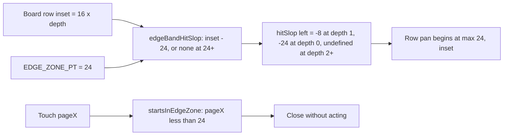

# Issue #2703: Board swipe follow-ups

## Scope and acceptance

Issue #2703 carries three independent follow-ups from the Board swipe work (#2699). GitHub's
triage comment (2026-10-14) and the issue timeline record two as already fixed on `main`:

- **Stop read fault (bullet 2)** — fixed by `fdc1cc5d33` (PR #3473). `BoardStops.#stop` catches
  `host.reconcileRead`, logs `BoardStops: read fence failed`, and resolves `"stopped"`; the
  interrupt is already durable. `boardStops.test.ts` ("keeps a Stop whose read fence fails")
  proves the fault resolves and is logged. This spec requires no change there, only the existing
  test to stay green.
- **Organization journal readers (bullet 3)** — fixed by squash `5d48f05a53` (PR #3477) under
  Jesse's ruling: a reader holds or dims its item when the journal is `pending || uncertain` and
  the recovery operation matches. `organizationCheck.journalOperation` is that one gate;
  `archivingSessionId`, `journalHoldsProject` and `pinnedCategoryMenu.changing` all consume it.
  Their tests in `organizationCheck.test.ts`, `projectMenu.test.ts`, `rowActions.test.ts` and
  `BoardScreen.test.tsx` prove pending and uncertain both hold. This spec requires no reader
  change, only the existing tests to stay green.

The remaining confirmed defect is **the swipe edge band on indented Board rows (bullet 1)**.
Acceptance: an indented Board row no longer loses swipe recognition inside its own frame beyond
the screen's left 24 points, while the screen's left 24 points stay outside every Board row pan.
No other Board swipe, back-gesture, Stop or organization-journal behavior changes.

Authorized scope: `mobile-native/src/board/SwipeRow.tsx`,
`mobile-native/src/board/swipeEdge.ts`, `mobile-native/src/board/BoardRows.tsx`,
`mobile-native/src/board/BoardScreen.tsx` (row inset plumbing only), their tests, and this spec.

## The defect

`SwipeRow` applies `EDGE_BAND_SLOP = { left: -EDGE_ZONE_PT }` (`EDGE_ZONE_PT = 24`) to both its
release-tracker pan and `ReanimatedSwipeable` (`SwipeRow.tsx:80,138,187`). A negative left
`hitSlop` shrinks the pan's hit frame inward from the row's **own** left edge. The Board wraps an
indented session row in `<View style={{ marginLeft: BOARD_ROW_INDENT_PT * item.depth }}>`
(`BoardScreen.tsx:1034`), so a depth-1 row's frame begins at screen x = 16:

| Row depth | Row frame left | Current hitSlop | Pan begins at screen x | Swipe dead strip |
|---|---|---|---|---|
| 0 | 0 | -24 | 24 | none |
| 1 | 16 | -24 | 40 | [24, 40) |
| ≥2 | ≥32 | -24 | inset + 24 | [inset, inset + 24) |

The band is over-trimmed, not under-trimmed: a depth-1 row refuses a swipe that starts at screen
x in [24, 40) even though the touch is on the row and outside iOS's back-gesture band [0, 24).
The row's content still receives taps there; only its pan is trimmed. The
`startsInEdgeZone(pageX)` guard (`swipeEdge.ts:5`) reads window points and closes any swipe that
began below 24 without acting. It remains the second defense for a pan that can begin inside the
band, but with today's over-trim it never fires for a Board row, whose pan starts at 24 or later.

## Chosen fix: shift the band by the row's screen inset

Thread the row's left inset from the Board into `SwipeRow`, and compute the band from the screen,
not the row:

```text
hitSlop.left = inset >= 24 ? undefined : inset - 24
```

- Depth 0 (inset 0): `{ left: -24 }`, unchanged; pan begins at 24.
- Depth 1 (inset 16): `{ left: -8 }`; pan begins at 24, reclaiming [24, 40).
- Depth ≥ 2 (inset ≥ 32): no left slop (`undefined`); the frame already starts outside the band,
  so the pan begins at the frame and the useless trim is gone.

`undefined` is the pinned representation of "no left slop": the tracker's `hitSlop` is never
configured, and the swipeable receives `hitSlop={undefined}`. The pageX guard stays as the second
defense for any future call site whose pan can begin inside the band.

BoardScreen keeps one `BOARD_ROW_INDENT_PT = 16` and passes `BOARD_ROW_INDENT_PT * item.depth` as
`edgeInset` to `BoardListRow`, which forwards it to `SwipeRow`. That is the same product the row's
`marginLeft` uses, so a depth-2 row gets 32 and no left slop, not 16 and `-8`. No layout changes.



This is option B from the issue lane's ruling menu: keep the band, offset it per row. Option A
(drop `hitSlop`, trust the pageX guard) would leave the row's pan recognizing inside the screen's
left 24 points, competing with iOS's interactive-pop recognizer; that needs a simulator check this
worktree cannot run, so it is rejected as unproven. Option C (document the loss) leaves a real
16-point dead swipe strip on every depth-1 row and a 24-point strip on deeper rows.

## Non-goals and preservation

No Board redesign, layout, indentation, navigation, swipe action, Stop, journal, or mutation
change. Unindented rows keep exactly `{ left: -24 }`. Rows at depth ≥ 2 stop receiving a
band-irrelevant 24-point trim from their own frame; their frame is already outside the band, so no
back-gesture behavior moves. The stale header comment at `SwipeRow.tsx:14-21` is updated to
describe the screen-relative band. Swipe-to-archive, trailing Stop/Pin/More, full-swipe thresholds,
edge-band closure and accessibility actions are untouched. `hitSlop` remains a prop of the real
`ReanimatedSwipeable` and release tracker, so gesture arbitration stays native.

Three non-Board call sites have the same over-trim and are deliberately **not** changed here:
`GhostBubble` in the padded transcript (`screens.tsx:3567`, padding 16), `QueueSheet.tsx:67`
(padding 16) and `NotesSheet.tsx:92,453` (paddingHorizontal 20). They are outside #2703's Board
scope, keep exactly today's behavior, and are filed as issue #4943 with the fix
(pass each container's inset, or measure the row's window x inside `SwipeRow`).

## Verification

Red-first, before the fix:

1. `mobile-native/src/board/swipeEdge.test.ts`: `edgeBandHitSlop(0) = { left: -24 }`,
   `(16) = { left: -8 }`, `(23) = { left: -1 }`, and `(24)`/`(48)` are `undefined`. Fails to
   import the missing helper before implementation.
2. `mobile-native/src/board/SwipeRow.test.tsx`: an indented row (`edgeInset={16}`) gives both the
   swipeable and its tracker `{ left: -8 }`; an inset of 32 gives neither a `hitSlop`; the default
   stays `{ left: -24 }`. A rerender from 16 to 32 proves the tracker is rebuilt, not left with
   the first inset. The indented case fails before the fix with `{ left: -24 }` on both.
3. `mobile-native/src/board/BoardScreen.test.tsx`: two separate cases, each with its own red.
   Unfold a flat project whose session row sits at depth 1, then assert that row's wrapper has
   `marginLeft: 16`, that `SwipeRow` receives `edgeInset: 16`, and that its testkit
   `ReanimatedSwipeable` host (and its release tracker) receive `{ left: -8 }` together. Separately
   mount the host-project fixture whose session row sits at depth 2, and assert `marginLeft: 32`,
   `edgeInset: 32`, and `hitSlop` undefined on both. This proves the Board passes the same
   per-depth product it indents by, not a copied literal. On the base commit the depth-1 case
   fails with `{ left: -24 }` and the depth-2 case fails with `{ left: -24 }` instead of
   undefined; the depth-2 case also catches a bare `16` passed as the inset.
4. Keep the existing edge-band behavior test: a full swipe beginning at `pageX = 10` closes
   without acting, and a full swipe beginning clear of the band still archives/stops.

After the fix, run from `mobile-native`:

```sh
npx vitest run src/board/swipeEdge.test.ts src/board/SwipeRow.test.tsx \
  src/board/BoardScreen.test.tsx src/board/boardStops.test.ts \
  src/board/organizationCheck.test.ts src/board/projectMenu.test.ts src/board/rowActions.test.ts
npm run check
```

`npm run check` is this repository's native TypeScript gate (`tsc --noEmit --project
tsconfig.check.json`); there is no `typecheck` script in `mobile-native/package.json`. Also run
`make native-preflight`, `npm run check:scripts`, `npx biome ci` on touched files, and root
`make build` if the change reaches it. CI owns the full native suite; do not run it locally.

Simulator-only limit: vitest proves the hitSlop values and the Board's plumbing, not UIKit's
arbitration between the row pan and the system back gesture. A current-source simulator check
must confirm that a drag from the screen's left 24 points on a depth-1 project row still goes
back and does not move the row. That check is not claimed here.

## Review and delivery

Freeze this spec for two independent competing PAR reviewers. Resolve legitimate findings. Then
implement red-first, PAR the base/head diff, run simplify-code, commit one change, run branch
RoboRev, push a PR against `main`, and hand Jesse the PR URL, exact head and settle command. Do not
merge.
