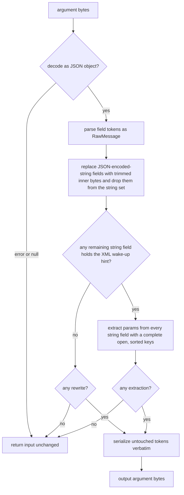

# Issue #2725: chatcompletions XML rescue preserves byte-faithful raw arguments

Status: frozen after three PAR rounds with two independent competing
reviewers. Both requested changes in rounds 1 and 2; both approved the
revised spec in round 3 after every legitimate finding was resolved.
The implementation PAR added one semantic guard (item 3): a syntactically
valid number outside float64 range keeps today's string treatment so the
emitted arguments stay decodable. The delegating brief authorizes resolving
legitimate implementation-review findings; this amendment is recorded here
and in the PR. Issue #2725 is a confirmed, bounded
byte-preservation defect in the Claude-XML rescue used by the Chat
Completions adapter. This spec covers only the rescue helper and its tests.

## Exact rescue path

Two call sites feed tool-call argument content to the helper:

- Non-streaming: `fromChatCompletionResponse` in
  `llm/providers/chatcompletions/response.go` (around line 266) reads
  `tc.Function.Arguments`, calls `rescueClaudeXMLArgs(...)`, and stores the
  result as `json.RawMessage` on `llm.ToolCallData.Arguments`.
- Streaming: `decodeStream` in `llm/providers/chatcompletions/stream.go`
  (around line 91) calls the same helper on the accumulated delta string
  before emitting `StreamEventToolCallEnd` and the final response.

`rescueClaudeXMLArgs` in `llm/providers/chatcompletions/rescue.go` currently
parses the whole argument string with `json.Unmarshal` into
`map[string]any`. It has two rescue shapes:

1. `parsedAnyJSONString`: a top-level string field's value is itself a JSON
   object or array (the trimmed value starts with `{` or `[` and parses as a
   composite). The parsed composite replaces the string field.
2. Claude XML: a string field carries a `"><parameter ...>` tail; the helper
   splits the carrier prefix at the first `">` before the parameter open and
   extracts parameter values as sibling fields.

Both exits re-marshal the parsed map with `json.Marshal`. That round trip is
lossy even for fields the rescue never rewrites:

- `encoding/json` decodes every JSON string into a Go string, replacing
  invalid UTF-8 bytes with U+FFFD.
- `map[string]any` decodes numbers as `float64`, so `1.50` is re-emitted as
  `1.5`; escapes and number spellings are normalized.
- The final `json.Marshal` re-escapes and compacts every field, not only the
  field the rescue changed, and HTML-escapes `<`, `>`, and `&`.

The trigger is narrow: arguments must be rescue-shaped and carry byte
sensitivity (invalid UTF-8, or non-canonical-but-valid JSON such as `1.50`)
in any field, including fields the rescue does not touch.

## Dependency, recorded blocker, and landing authorization

PR #2640 (`provider-rawargs`) makes the adapter capture arguments through
`protocolhttp.RawStringContent`, preserving invalid UTF-8 before the rescue
runs. That PR is **open, not merged** into `main` (verified: its head
`95335cc068` is not an ancestor of `origin/main` `11649076f`), and GitHub
reports it CONFLICTING with `main`.

Issue #2725's two triage comments record it as blocked on #2640 and recommend
fixing it inside #2640 or as its immediate fast-follow. This lane's delegated
brief (2026-10-24) explicitly directs resolving #2725 on `main`: merge
`origin/main` `11649076f`, implement the rescue fix, and open a PR against
`main`. This spec therefore lands the helper half now with the blocker
recorded, not silently overridden:

- The PR links #2640 and states that end-to-end invalid-UTF-8 acceptance is
  proven only when #2640's capture lands. The PR does not claim the durable
  transcript already keeps those bytes on `main`.
- When #2640 lands, the local byte-faithful decoder below should be replaced
  by `protocolhttp.RawStringContent`; this spec and that call site are the
  retirement plan for the duplicate.
- #2640's call-site form is `rescueClaudeXMLArgs(string(content))` (branch
  `response.go:309`, verified), and its stream path writes captured bytes
  into a `bytes.Buffer` and calls `.String()` (branch state, verified). Both
  preserve arbitrary bytes, so the helper change composes with it. That
  call-site form is the basis of the forward-compatibility claim and may
  change on #2640's rebase; the helper itself needs no change.

On `main`, `encoding/json` already coerces invalid UTF-8 when decoding the
`arguments` string, but valid non-canonical JSON survives intact to the
rescue. The rescue-level tests below are the contract evidence for invalid
UTF-8; an end-to-end non-streaming response test uses non-canonical JSON,
which reaches the helper on `main`.

## Byte-preservation contract

When the rescue fires, for both shapes:

1. Every top-level field the rescue does not rewrite is emitted with its
   exact original JSON value token: invalid UTF-8 bytes, escape spellings,
   number spelling (`1.50`), and whitespace inside the value survive.
2. The rewritten XML carrier keeps the decoded byte content of its clean
   prefix (everything before the split point). Only JSON-required syntax is
   escaped around those bytes. Escape spelling may normalize (for example
   `\u0041` becomes `A`), and HTML escaping that today's `json.Marshal`
   applied to `<`, `>`, and `&` is intentionally dropped.
3. An extracted parameter value first has its last case-insensitive closing
   parameter tag removed and then loses leading and trailing Unicode
   whitespace, exactly as today's `strings.TrimSpace` does. The remaining
   value is inserted with its exact bytes when `encoding/json` decodes it
   into an `any` (today's acceptance test); otherwise it is inserted as a
   byte-preserving JSON string. A whitespace-padded non-JSON value therefore
   still becomes the same trimmed string value as today, and a
   syntactically valid but out-of-range number such as `1e999` stays a
   string instead of becoming a number the tool-call path cannot decode.
   The closing tag is located by an ASCII case-insensitive search on the
   original bytes. Today's code searches a `strings.ToLower` copy and slices
   the original by that index, so a value whose case folding changes byte
   length before the tag (non-ASCII uppercase such as U+0130 or the Kelvin
   sign) is truncated and becomes U+FFFD. The ASCII search strips at the
   correct byte offset; that correction is intentional, and it also avoids
   the length mismatch once #2640 feeds invalid UTF-8 to the helper.
4. Parent fields still win a collision with an extracted parameter name.
   When more than one carrier extracts the same name, the carrier whose field
   name sorts later wins; today's map iteration made that choice random, so
   this change makes an undefined case deterministic.
5. When neither rescue shape fires, the helper returns the input bytes
   unchanged, as today. That includes a top-level value that is not a JSON
   object, and `null` (which `json.Unmarshal` accepts into a map as a nil map
   without error): both return the input unchanged rather than an empty
   object.
   A top-level value token that is syntactically valid JSON but not decodable
   into an `any` (an out-of-range number such as `1e999`) no longer makes the
   whole decode fail, so a rescue may now proceed where today's map decode
   returned the input untouched; the token itself is still emitted verbatim.
   The tool-call path rejects such arguments before and after this change, so
   this is not a new failure mode.
6. Ordinary escaped-JSON rescue inputs produce the same decoded JSON values
   as today: the same carrier prefix, the same extracted names and values,
   and the same parent-wins merge. Tests for this requirement compare
   decoded JSON, not raw output bytes, because escape spelling and HTML
   escaping may differ. The item 3 closing-tag correction is the exception:
   where case folding changed the byte length, the new value is the correct
   one rather than today's U+FFFD.
7. For `parsedAnyJSONString`, the replacement is the trimmed decoded inner
   bytes. A field that `parsedAnyJSONString` replaces stops being a string
   and is not inspected for XML afterwards, matching today.
8. The XML wake-up gate is exactly today's: a string value containing
   `<parameter` followed by a space, tab, or newline. A carriage return after
   `parameter` (CRLF output) does not fire the gate, as today. If the gate
   fires but no complete parameter open matches, the helper returns the input
   unchanged, even when `parsedAnyJSONString` rewrote a field; that quirk is
   today's behavior and is preserved.

Not part of the contract (same normalization class as today): top-level key
order; separators between top-level fields; duplicate top-level keys before
the last (the map decode collapses them); top-level key spelling and escaping,
including invalid UTF-8 in keys; the escape spelling of a rewritten carrier
prefix; and the escape spelling of a non-JSON extracted string, which must be
re-escaped to become a JSON string. Valid-JSON extracted values keep their
exact bytes, including escape spelling, and `parsedAnyJSONString` inner bytes
keep their exact internal formatting.

## Chosen seam

The seam is inside `rescueClaudeXMLArgs`; its signature and both call sites
stay unchanged.

- Parse the top-level object into `map[string]json.RawMessage`, which keeps
  each field's original value token. A nil map (`null`) or a decode error
  returns the input unchanged.
- Inspect string fields through a byte-faithful JSON string decoder: named
  escapes and `\uXXXX` surrogate pairs decode normally, unpaired surrogates
  become U+FFFD (stdlib parity, verified), and raw bytes `>= 0x80` pass
  through unchanged. This mirrors `protocolhttp.RawStringContent` locally so
  the fix does not depend on an unmerged PR.
- For `parsedAnyJSONString`, replace the string field's token with the
  trimmed decoded inner bytes after confirming they parse as an object or
  array.
- For the XML shape, find the carrier and parameter offsets on the decoded
  bytes (Go regexp indices are byte offsets), split at the first `">` before
  the first parameter open, strip the last case-insensitive closing tag, trim
  Unicode whitespace, and emit the clean prefix and each extracted value as
  raw tokens or byte-preserving escaped strings.
- Process carrier fields in sorted key order so multi-carrier extraction is
  deterministic; serialize the object sorted by key, writing untouched value
  tokens verbatim instead of re-marshalling them.

Emitter helpers stay internal to `rescue.go`: a byte-faithful string decoder,
a JSON string writer that escapes only JSON-required bytes, an ASCII
case-insensitive last-index search for the optional closing parameter tag,
and the existing case-insensitive open-tag regex. No exported API changes.

## Non-goals

- No changes to `complete.go`, `response.go`, or `stream.go`; the seam is
  the helper.
- No provider adapter redesign and no duplication of PR #2640's raw capture
  beyond the local string decoder needed here.
- No protocolhttp changes; `protocolhttp.RawStringContent` is not available
  on `main`.
- No change to schema validation, error paths, parent-wins merge precedence,
  or streaming delta capture.
- No guarantee for top-level key order, duplicate keys, key spelling, or the
  formatting/escape spelling of a field the rescue rewrites.

## Verification

New `llm/providers/chatcompletions/rescue_test.go` contains red-before tests
and green-before guards. Tests reference only production symbols that exist
before the fix (`rescueClaudeXMLArgs` and `fromChatCompletionResponse`) so the
red run compiles and fails behaviorally.

Red before the fix (each assertion fails against today's lossy helper):

- `TestRescueClaudeXMLArgsPreservesUntouchedRawBytes`: XML trigger plus
  sibling fields carrying a raw invalid UTF-8 byte, `1.50`, an escaped
  surrogate spelling, and HTML characters. The sibling tokens must be
  byte-identical to the input tokens; today they become U+FFFD, `1.5`,
  decoded emoji, and `\u003c`-style escapes.
- `TestRescueClaudeXMLArgsParsedAnyJSONStringPreservesRawBytes`: a
  string-encoded object and a string-encoded array each carry `1.50`, a
  `\u0041` escape, and a raw invalid byte; an untouched sibling carries a
  raw byte. The replacement must be the trimmed inner bytes; today it is
  `1.5` plus U+FFFD and a normalized `A`.
- `TestRescueClaudeXMLArgsCarrierAndExtractedBytes`: the carrier's clean
  prefix contains a raw invalid byte; one XML parameter value is `1.50`, one
  is a valid-JSON string containing a `\u0041` escape, one is a non-JSON
  string with a raw invalid byte, and one is a non-JSON string containing
  `<`, `>`, or `&`. The prefix token and each extracted token must keep
  their bytes; today they are U+FFFD, `1.5`, `A`, or HTML-escaped.
- `TestRescueClaudeXMLArgsClosingTagByteOffsets`: parameter values whose
  UTF-8 case folding changes byte length before the closing tag (U+0130 and
  the Kelvin sign) keep their correct value instead of today's U+FFFD.
- `TestRescueClaudeXMLArgsBothShapes`: one call contains both a
  JSON-encoded-string field and an XML carrier. Both rewrites must appear;
  today's bytes in the untouched fields are lost.
- `TestFromChatCompletionResponseRescuePreservesNonCanonicalJSON`: a
  non-streaming response whose tool-call arguments string carries an XML
  trigger and an untouched `1.50` field. The stored
  `llm.ToolCallData.Arguments` must retain `1.50`; today it is `1.5`.

Green before the fix (regression guards, not defect evidence):

- `TestRescueClaudeXMLArgsNoRescueReturnsInputUnchanged`: byte-identical
  round trip for an argument string with invalid UTF-8, `1.50`, and no
  rescue shape.
- `TestRescueClaudeXMLArgsNonObjectReturnsInputUnchanged`: `null`, an array,
  a number, a string, and `{}` return their input bytes unchanged.
- `TestRescueClaudeXMLArgsXMLGateSemantics`: CRLF after `<parameter`
  (gate does not fire), a hint without a complete `name=` open (input
  unchanged, including after a `parsedAnyJSONString` rewrite), and
  `parsedAnyJSONString` plus a hint with no matching open all return the
  input unchanged, as today. A field replaced by `parsedAnyJSONString` whose
  inner bytes contain a complete parameter open is not inspected for XML.
- `TestRescueClaudeXMLArgsOrdinaryXMLSemantics`: ordinary escaped-JSON XML
  inputs keep today's decoded values for a single-quoted parameter name, a
  parent-wins collision, a missing closing tag, a whitespace-padded non-JSON
  parameter, Unicode (non-breaking-space) trimming, multiple opens without
  closes, and the first `">` split.
- `TestRescueClaudeXMLArgsExtractedOverflowNumberStaysString`: extracted
  `1e999` and `{"a":1e999}` keep today's string treatment instead of
  becoming undecodable number tokens.

Two green-before-intent tests carry exact-token assertions and are therefore
red-before on those assertions: `TestRescueClaudeXMLArgsOrdinaryXMLSemantics`
asserts the extracted `1.50` token, and
`TestRescueClaudeXMLArgsReplacedFieldWithCompleteOpenIsNotInspected` asserts
the replaced field's exact bytes. The no-extraction and ordinary-semantics
properties remain the green-before part; the exact-byte assertions are
additional red-before coverage.

New behavior (neither red-before nor green-before):

- `TestRescueClaudeXMLArgsMultiCarrierPrecedence`: two carriers extract the
  same parameter name; the carrier whose field name sorts later wins. Today's
  map iteration makes the winner random (a probe saw both winners across
  repeated runs), so this test may fail before the fix and is not regression
  or defect evidence. Run it after the fix only.

Commands:

- `go test ./llm/providers/chatcompletions/ -run 'Rescue|XML' -count=1`
  before the fix (record the failures) and after it (pass).
- `go test ./llm/providers/chatcompletions/... -count=1`.
- `go test ./llm/providers/internal/protocolhttp/... -count=1` as the
  package-level check. The named "protocolhttp raw-content tests" do not
  exist on `main` because #2640 is unmerged; this is recorded as unverified
  rather than silently skipped.
- `make build`.

The full suite stays in CI, which is the source of truth.

## Issue disposition

This change fixes the rescue half of #2725: once raw argument bytes reach the
helper, it no longer discards them. The issue's invalid-UTF-8 end-to-end
symptom remains verifiable only after #2640 lands; the PR body says so and
links #2640. The PR does not close the loop on the durable-transcript claim
by itself, and reviewers should not treat the non-canonical JSON proxy as
proof of invalid-UTF-8 preservation through the adapter.

## Risk and rollback

The change is confined to one unexported helper and its tests. Reverting the
commit restores the previous lossy round trip. No durable format, client, or
recovery behavior changes; only the argument bytes recorded for rescued tool
calls become faithful.
